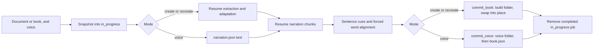

# Hilde architecture

Living description of the project as it currently exists. Keep synchronized with the code.

## Purpose and scope

Hilde has two interfaces over the same speech pipeline:

- `audiobook_tts.py` is a direct CLI for creating portable narrator references and narrating text into MP3 or WAV.
- `audiobook_tts_web.py` is a shared-library web server serving the Hilde browser app. It stores voices, documents, completed audiobooks, and resumable work under one server-owned root and exposes one-click document preparation plus narration.

The speech backend for each role is selected when the web server starts. Voice creation can use a local Qwen3-TTS VoiceDesign model or an OpenAI-compatible speech endpoint. Narration can use a local Qwen3-TTS Base model, that model distributed across local/SSH workers, or an OpenAI-compatible endpoint.

Current document preparation supports PDF, plain text, and Markdown. PDF pages are converted to Markdown. Optional adaptation by a language model rewrites body paragraphs for a listener: the author's prose stays, reader apparatus is left out, and dense material is tuned down. Tables of contents and terminal bibliography sections are removed with or without adaptation.

Out of scope: EPUB extraction, CLI playback, built-in web authentication/authorization, and a durable multi-process queue. Audiobook submissions share one process-local worker scheduler. Direct public exposure is unsupported; deploy behind an authenticated, rate-limited TLS reverse proxy.

## Repository structure

| Path | Responsibility |
| --- | --- |
| `audiobook_tts.py` | CLI parsing, validation, voice persistence, chunking, local/SSH worker orchestration, OpenAI-compatible narration, batching with out-of-memory retries, and durable narration checkpoints. |
| `audiobook_tts_web.py` | Shared storage, single-page UI, document preparation, narration-worker scheduling, CPU forced word alignment, the text-adaptation model clients with ChatGPT sign-in, the user's own Claude Code, and the Anthropic, OpenAI, and Google Gemini API keys, workflow orchestration, SSE progress, exactly indexed reader audio, serving and download. |
| `example_run.sh` | Example web-server launch: local Qwen3-TTS models, the default `~/.hilde/library` library, port 8800 on this machine only, and every GPU CUDA can open. Set its interpreter and model paths for your machine; extra arguments pass through, such as `--host 0.0.0.0` for other devices. |
| `assets/hilde-dark.png` | Hilde logo: page header mark, browser favicon, and Apple touch icon. |
| `assets/zeki.jpg` | Small mark in the page footer's "by Zeki Works" signature. |
| `prompts/PAPER-AUDIO-BOOK.md` | Text-adaptation instructions for the language model. Each job reads them when it starts. |
| `prompts/PAPER-VERIFY.md`, `prompts/PAPER-REPAIR.md`, `prompts/PAPER-RECHECK.md` | Error correction's plain-text prompts: the check of a description against its source, the note asking for a corrected description (`{issues}` and `{draft}` are filled in), and the check of the correction. A job with error correction reads them when it starts. |
| `prompts/PAPER-FIGURE-KIND.md` | The plain-text question that decides whether a figure is a chart, described from its caption and the author's text. Each adapting job reads it when it starts. |
| `qa/` | The QA records reviewers and the fixer share: bug classes, findings, runs, papers, decisions, open questions, golden assertions per paper (`golden/<paper>.yaml`), fact sets per test paper (`facts/<paper>.yaml`, format in `facts/README.md`), `qa.py` (`validate`, `check`, `report`, `next`, and `facts`, which scores fact sets over several runs and against a baseline's), and `describe.py`, which makes descriptions-only runs: `PaperRun(descriptions_only=True)` sends only figure, table, and equation batches to the model, with every request, check, and second request a book gets, keeps prose as printed, and writes each run's `narration.json` and a `book.json` stamp; the flag is part of the scratch identity, so such a run is never reused for a book. `qa/AGENTS.md` is its protocol. Golden checks and fact sets run only here, on an output; the app never reads `qa/`. Output texts under `qa/outputs/` stay out of git. |
| `voices/` | Stock voices: each a VoiceDesign reference clip reading the fixed preview passage, its transcript, and its prompt as `description.txt`. A new library starts with a copy; the CLI can use them directly with `--voice-dir`. |
| `User/` | Where earlier versions kept the library; still ignored by git. The server refuses to start an empty `~/.hilde/library` while it holds voices or books (`library_left_behind()`). |
| `test_audiobook_tts.py` | Dependency-light `unittest` regressions for persistence, storage/version rules, resume, unified workflows, events, document adaptation, endpoints, batching, voice/library catalogs, and preview rendering. |
| `requirements.txt` | Platform-neutral runtime dependencies. PyTorch/TorchAudio are installed separately for the target CPU/CUDA build. |
| `install.sh` | POSIX installer run as `curl … \| sh`, all inside `main()` so a truncated download runs nothing. Needs only git and curl, never sudo: installs uv if missing (uv supplies Python 3.12), clones or fast-forwards `~/hilde` (`HILDE_HOME`), creates `.venv`, installs PyTorch 2.10 from the index matching the NVIDIA driver (580+ `cu130`, 525+ `cu126`, else `cpu`; `HILDE_TORCH` overrides; PyPI on macOS), then `requirements.txt`, checks the imports, and writes a `hilde` launcher to `~/.local/bin` (`HILDE_BIN_DIR`) that starts the web server with both Qwen3-TTS models by Hugging Face ID and `--allow-model-downloads`. Rerunning it updates; the library is untouched. **Set up** in **Add workers** pipes it to a node over SSH. |
| `README.md` | User guide: what Hilde does, how it reads a paper, measured results, a two-command quickstart through `install.sh`, known limitations, access and security, and License. Short summaries link to the guides below. |
| `docs/installation.md` | User guide to installing: the one-command installer and its settings, then by hand: environment, PyTorch/TorchAudio builds, dependencies, FlashAttention 2, and model downloads. |
| `docs/configuration.md` | User reference for the web server: starting it and its options, storage, speech models, narration workers, and batch size. |
| `docs/text-adaptation.md` | User guide to text adaptation: what it changes, models and providers, local servers and images, workers, and what the job log reports. |
| `docs/web-ui.md` | User guide to the page: creating an audiobook, the Listen reader, Voices, Advanced, and browser state. The README links to it. |
| `docs/command-line.md` | User guide to `audiobook_tts.py`: creating a voice, narrating, multiple GPUs, CPU, a speech server, and input and output. The README links to it. |
| `docs/ssh-workers.md` | User guide to narration workers on other machines: requirements, **Add workers** and `workers.yaml`, and the CLI form. The README links to it. |
| `docs/command-line-options.md` | User reference listing every `audiobook_tts.py` flag with its default. The README links to it. |
| `AGENTS.md` | Short standing instructions that coding agents load automatically; the details stay in this document. |

There is no package manifest. Both applications are run directly with Python.

## CLI architecture

### Commands

`build_parser()` defines:

- `create-voice`: generate one reference clip and persist it with the exact input passage and its voice description.
- `narrate`: split narration-ready text, clone one saved voice locally/across model workers or call one OpenAI-compatible voice, then assemble MP3/WAV output.

`check_mode()` enforces rules argparse cannot express:

- a local model is required unless `--server` is present;
- remote mode rejects local-inference flags rather than silently ignoring them;
- voice-design endpoints using models known to ignore `instructions` are rejected.

Heavy dependencies remain lazy imports. `--help`, endpoint parsing, and most validation do not load Torch or Qwen.

### Voice persistence

A saved local voice is:

```text
<voice-dir>/
├── reference.wav
├── transcript.txt
├── description.txt   voice description (--instruct), searched by the web UI
└── preview.wav       optional; the fixed preview passage rendered for older voices
```

`save_voice()` stages the clip, transcript, and description in a sibling directory. Without `--overwrite`, an existing destination is rejected. With it, `keep_voice_version()` first copies the voice being replaced (clip, transcript, and description; never a preview) into `<voice>/.versions/vN`, N one past the highest kept, and then the owned files are replaced: a replacement without a description removes the old `description.txt`, and every replacement removes a `preview.wav` rendered from the old audio. Unrelated files remain. `transcript.txt` is the exact UTF-8 passage used for generation and is written last as the commit marker.

`read_voice()` rejects empty transcripts and empty, non-mono, non-finite, or silent audio. These checks keep a persisted voice suitable for later prompt construction.

### Narration and output

`split_text()` prefers paragraph and sentence boundaries, then wraps oversized sentences and words. Chunk order is stable. Its sentence-chunk mode starts every sentence in a new chunk and is mandatory for the web reader.

`prepare_output()` validates the destination before model loading or remote calls:

- suffix must be `.mp3` or `.wav`;
- WAV subtype and MP3 compression flags must match the format;
- output cannot alias the input or saved voice files;
- the parent must already exist;
- an existing destination requires `--overwrite`.

Without `--resume-dir`, single-device local narration uses whole-book or fixed-size batches and writes the selected container directly. OpenAI-compatible narration sends one `POST {server}/audio/speech` request per chunk and requires all returned WAV chunks to keep one sample rate/channel layout. Multi-worker local/SSH narration requires `--resume-dir`.

`load_model()` imports Qwen through `import_qwen_tts()`, which captures file descriptors 1 and 2 during the import and replays them only if it fails. `qwen_tts` warns on import that flash-attn and the SoX executable are missing; Hilde needs neither (SoX serves only Qwen's 25 Hz tokenizer), and without the capture every worker would repeat both warnings in each job log.

Every clip is length-checked, on all four paths (local, resumable local,
distributed workers, speech server). The model can miss its end and talk on
to its 8192-token limit, 655 s of noise, or end early and drop the words: a
16-hour book had 23 such clips, at least 12 of them 655 s long, and the
highlight waited on each. `generate_clone_batch()` caps every batch at
`clip_token_limit()` (`CLIP_TOKENS_PER_CHAR` per character of its longest text
as spoken, `spoken_length()`, which counts each digit as
`SPOKEN_CHARS_PER_DIGIT` characters since "1,800" is read as words, plus
`CLIP_TOKEN_SLACK`, about three times a clip's usual length) and gives the
model `spoken()` text: a chunk of at most `SPOKEN_PERIOD_MAX_CHARS` ending in a
letter or digit, such as a heading, gets a period; the reader's text is
unchanged. `clip_problem()` calls a clip run on above `CLIP_LONG_FACTOR` times
its expected length (`SPEECH_SECONDS_PER_CHAR` per spoken character) plus `CLIP_LONG_SLACK_SECONDS`,
below the cap so a capped runaway is caught, and ended early under
`CLIP_SHORT_FACTOR` of it for `CLIP_SHORT_MIN_CHARS` characters or more; 99%
of 7,300 measured sentences ran under 2 times. `checked_clip()` makes such a
chunk again alone, with its own cap, up to `CLIP_RETRIES` times, then keeps
the try `nearest_try()` picks: one that ended on its own before one that
stopped within `CLIP_CAP_MARGIN_SECONDS` of its cap (`CODEC_TOKENS_PER_SECOND`),
which likely lost its last words, then the one nearest its expected length;
the log names the chunk and both lengths. The distributed coordinator does
the same through its batch queue, keeping each chunk's tries until one passes.

### Durable narration resume

`--resume-dir` enables a checkpointed publication path:

1. `prepare_resume()` writes a manifest describing the text, chunk sequence, language, and voice/inference identity.
2. A changed identity removes incompatible `chunk-*.wav` files.
3. Existing checkpoints are accepted only when SoundFile can read them and they contain frames, a sample rate, and channels, and when `clip_problem()` finds nothing: a clip saved before the length check that ran on or ended early is made again.
4. Each newly generated chunk is written to a temporary WAV and atomically renamed.
5. `assemble_checkpoints()` validates format consistency, encodes every checkpoint in order to a temporary final container, and atomically replaces the requested output. Joining tens of thousands of chunks takes minutes, so it prints `Joined chunk N/T` from 0, about 200 times over the book.

Single-worker local identity includes the contents of `reference.wav` and `transcript.txt`, clone-model selector, device, dtype, attention backend, seed, and batch size. Distributed local identity adds the ordered worker topology. OpenAI-compatible identity includes endpoint, remote model, and remote voice ID. Container compression/subtype is intentionally not part of the waveform identity; checkpoints can be re-encoded into a different final container.

### Distributed narration workers

`--worker-device` adds persistent local model processes to the primary
`--device`; repeated `--ssh-worker` values add persistent model processes
through passwordless OpenSSH, one per device of a machine. With
`--no-local-worker` only the SSH workers narrate and `--device` starts no
worker (`_local_worker_devices()`). `ssh_worker()`
parses `TARGET[,device=D][,python=P][,model=M]`; `check_distributed_mode()`
fills what a worker leaves out from `--ssh-device`, `--ssh-python`, and
`--ssh-model-path` (then `--clone-model-path`) and refuses a target and device
given twice. `narration_worker()` implements a private
newline-delimited JSON protocol. A worker emits readiness, accepts indexed
chunk batches, and returns base64-encoded FLOAT WAV data or a fatal error. A
batch may carry `max_new_tokens`, a cap on each clip's length that
`generate_clone_batch()` passes to the model; the coordinator sends
`clip_token_limit()` of the batch, and a worker given none uses the same.

`_narrate_distributed()` starts SSH workers at once. A local CUDA worker starts
only when its GPU has at least `NARRATION_MIN_FREE_MIB` (6 GiB: the 4 GiB model
plus a batch) free. `GpuMemory` reads free memory with `nvidia-smi`, matched to
PyTorch device numbers by GPU UUID through a short-lived child; neither opens a
CUDA context, so measuring never takes memory from a full GPU. A GPU without
room waits and is measured again every `GPU_RECHECK_SECONDS` (60); a device
that cannot be measured (CPU, no `nvidia-smi`, no UUID) starts at once.

Each worker receives a batch as soon as it is ready, keeps one in flight, and
gets the next source-ordered batch when it finishes. Idle workers stay loaded
until the book is done, so returned chunks always find a worker. A local worker
whose error says `out of memory` (or cuBLAS/cuDNN `*_ALLOC_FAILED`) is dropped:
its in-flight batch returns to the front of the queue and its GPU waits as
above. Any other failure, including an SSH worker running out of memory, aborts
the run, as does having no worker alive and none waiting; committed chunks are
kept. The coordinator validates and atomically commits each returned
checkpoint immediately, then assembles all checkpoints in source order.
Waiting GPUs do not change the checkpoint identity, which names the configured
worker topology: the local devices and each SSH worker's target, device, and
model, but not its Python, which does not change the audio.

An SSH transport stages the current script plus the saved `reference.wav` and
`transcript.txt` in a unique remote `/tmp/audiobook-tts-*` directory. The text
and WAV results cross the SSH process protocol; no shared filesystem is
required and the model is not copied. Targets use `BatchMode=yes` and therefore
must have an accepted host key, noninteractive authentication, a compatible
Python environment, and the configured Base model. Cleanup is best effort on
normal exit, failure, and stop. The remote machines are trusted with both the
narration text and saved voice.

Distributed batching is fixed: a positive `--batch-size` applies per worker and
zero becomes one chunk so fast workers can pull more work.

### Batching

Every clone call goes through `generate_clone_batch()`. A batch that raises a
CUDA out-of-memory error is repeated one chunk at a time; a single chunk that
still does not fit fails a single-device run, and returns a distributed local
worker's batch to the queue. Batch size is a manual setting because
throughput grows with it only until memory runs out. On an RTX PRO 6000 with
about 6 GiB free beside another model, one sentence per call ran at 1.6× real
time, two at 2.6×, and four or more ran out of memory, at about 0.7 GiB per
sentence on top of the 4 GiB model. The web app therefore defaults to 2.

## Web shared storage

`SharedStorage` owns a configurable root (`--storage-root`, default `DEFAULT_STORAGE_ROOT`, `~/.hilde/library` beside the provider sign-ins in `HILDE_HOME`, so every checkout finds the same library and a re-clone cannot lose it) and creates:

```text
<root>/
├── Voices/
├── Audiobooks/
│   └── <slug>--<hash12>/
│       ├── book.json
│       ├── source.<ext>
│       ├── narration.json
│       ├── reader.md
│       ├── chat.json
│       ├── files/<name>.md
│       └── voices/<voice>/
│           ├── audio.mp3
│           └── timings.json
├── Documents/
├── in_progress/
│   └── voice-drafts/
└── workers.yaml
```

Browser state contains only flat asset names and book ids. `safe_asset_name()` and `resolve_asset()` reject traversal and never accept an arbitrary filesystem path from a browser; `read_book()` accepts only an id matching `BOOK_ID_PATTERN` and `voice_folder()` only a single safe component. File-serving and AirDrop paths must resolve inside the shared root.

`asset_catalog()` returns sorted shared voice and document names; the Listen page reads books from `GET /api/library`. Existing files are not migrated automatically when the root changes.

`prepare_library()` runs at startup. It creates the layout, runs `recover_books()` and `migrate_legacy_books()`, and, only when it
creates `Voices/`, copies in each stock voice from `STOCK_VOICES_PATH` whole:
staged under a hidden folder, hidden files skipped, then renamed into place. An
existing library is never reseeded, so a deleted stock voice stays deleted.

### Books

A book is one document's content made into narration once. Its identity is
the SHA-256 of the source bytes; the file name is not part of it. Its folder is
`book_id()`: `book_slug()` of the title (lowercase ASCII words joined by
hyphens, at most 60 characters, `book` when none) then `--` and the first 12
hexadecimal digits of the hash. `book_for_source()` finds a book by that suffix
and the full hash in `book.json`.

- `book.json`: `schema` (`BOOK_SCHEMA` 1, the layout of this file),
  `source_sha256`, `title`, `source_filenames`
  (every name the content came under), `source_file` (`source.<ext>`, or
  `null` for a migrated book), `created_at`, `updated_at`, `hilde_version`
  (`HILDE_VERSION`), `git_commit` (`git rev-parse HEAD` read once as the
  server starts, so it names the code that made the book even when the
  checkout moves on while the server runs, or `null` outside a
  checkout), `prompt_hash` (the SHA-256 of the system prompt, `null` without
  adaptation), `schema_version` (`EXTRACTION_SCHEMA`, the paragraph-selection
  rules the text was made under; unrelated to `schema`), `model`,
  `local_vision` (whether each local model got figures as images, by selector,
  such as `{"lm-studio/gemma": true}`; `null` when only cloud models adapted
  it, without adaptation, or for a book made before it was recorded;
  without images Gemma 4 misread CLM's charts in every run, R24),
  `verification` (error correction: the checking `model` and how many
  descriptions it `checked`, `flagged`, and `corrected`; `null` when it was off
  or for an older book), `figure_model` (Interpret and narrate figures: the
  model that read the figures from their pictures; `null` when charts were
  described from text, or for an older book), `adapted`,
  `chunk_max_chars` (the chunk size its reader splits the text at), `prose`
  (`adaptation_fidelity()`), `seconds` for reading and adapting, and
  `narration_sha256`, the SHA-256 of `narration.json`'s bytes. `voices` lists
  each voice: `name`, `created_at`, `narration_sha256` (the text it read),
  `status` (`ready`, or `stale` once the book's text changed), `voice_version`,
  `audio_sha256`, `duration`, and its `seconds` for narrating and aligning.
  A migrated book also has `migrated_from`, `legacy_names` (its earlier MP3
  names), and, until it first plays, `migration_backup`.
- `narration.json` (`schema` 2): `original_view` (whether passages map onto
  the reader's paragraphs) and `passages`, one per adaptation batch, or per
  paragraph without adaptation: `id`, `type` (`body`, `heading`, `figure`,
  `table`, `equation`, or `footnote` or `caption` for a passage of only those),
  `page`, `text` (what is read aloud; empty for a batch left out),
  `original_text`, `unchanged`, `paragraphs` (`[first, last]` reader
  paragraphs), and `sources`, the author's paragraphs it came from, each
  `{type, page, text}` with type `body`, `heading`, `figure`, `table`,
  `equation`, `footnote`, or `caption`. The model narrates a footnote and a
  caption inside the passage that cites or carries it, so they are typed as
  sources. `_visual_type()` names a picture from its caption, a PDF table's
  image name, or panel titles; an uncaptioned picture is an equation when its printed text is math, and a figure otherwise.
  Schema 2 adds `summary` and `tags`, the batch's SUMMARY and TAGS (a
  heading batch, which never reaches a model, has its own text as summary
  and no tags); Ask Hilde needs them, so a schema 1 book cannot chat.
  `narration_text()` joins the passages' text: exactly what the first voice
  read and every later voice reads.
- `reader.md` is the follow-along view: block-marked Markdown with pictures
  embedded. Its blocks are the sentences of the narration's paragraphs, so
  any voice's timings map onto it.
- `voices/<voice>/audio.mp3` and `timings.json` (the reader sync of schema
  1–3: sample rate, duration, block paragraphs, sentence cues, word cues).
  A voice's timings are never paired with another voice's audio.
- `chat.json` (`schema` 1): the book's one conversation, `entries` oldest
  first: `user` (`text`), `assistant` (`text`, and `calls`, each `{id, name,
  arguments}`), `tool` (`id`, `name`, `content` the model was given, `label`
  the page shows), and `notice` (why a turn ended; never sent to a model).
  Rebuilding the book (`commit_book()` for the same content) drops it, since
  it cites the old text's paragraph numbers.
- `files/`: the Markdown files Chat wrote. `commit_book()` copies them into a
  rebuilt book; only Chat's `delete_file` removes one.

`commit_book()` publishes a book with one voice: it writes everything into a
hidden `Audiobooks/.build-<random>` folder, `book.json` last, and
`swap_into_place()` renames it to the book's folder. A book of the same content
keeps its folder name, `created_at`, and file names; its other voices are
hard-linked into the new folder, `ready` when they read the same
`narration_sha256` and `stale` otherwise. The old folder steps aside as
`.replaced-<id>-<random>` before the new one is renamed in, so a crash between
the renames leaves both, and `recover_books()` at the next start puts the old
one back and removes `.build-` and `.trash-` folders, at the top level and in
each book's `voices/`. `commit_voice()` publishes one voice the same way inside
`voices/` and then rewrites `book.json`; it refuses when the book's
`narration_sha256` changed since the job started. Commits hold `_BOOK_LOCK`.
`delete_book()` renames the folder to `.trash-<random>` and removes it.

`migrate_legacy_books()` moves the earlier layout (`Audiobooks/<name>.mp3`,
`.versions/<name>.json`, `.readers/<name>.<hash>.md|json`) into book folders
without calling any model. MP3s of the same `input_version` become voices of
one book, newest first: the newest one's reader becomes `reader.md`, and a
voice whose reader differs is `stale`. An MP3 without a record becomes a book
keyed by its own hash with no source hash or text. `_legacy_narration()`
rebuilds `narration.json` from the `Documents/<stem>-narration.txt` the job
stored, only when it splits into exactly the reader's blocks and cue count at
some chunk size (500 first), and from the sidecar's `originals`; otherwise the
book plays but has no text for a new voice. Audio is hard-linked; the earlier
files move to `Audiobooks/.backup/<id>/` and stay until the book's audio is
first served (`release_migration_backup()`). The empty `.versions` and
`.readers` folders go. Rerunning finishes a migration a crash interrupted.

### Naming

- Saved voice: `Voices/<voice-name>/reference.wav` plus `transcript.txt`, with `description.txt`, an optional rendered `preview.wav`, and the versions it replaced in `.versions/vN/`. Job snapshots copy only `reference.wav` and `transcript.txt`.
- Book: `Audiobooks/<slug>--<hash12>/`, as above. A voice's download is named
  `<title> - <voice-name>.mp3` (`book_download_name()`): path separators become
  `-`, `:` becomes ` -`, `"` becomes `'`, control characters and `*?<>|` go,
  and a title longer than `BOOK_DOWNLOAD_TITLE_CHARS` (120) is cut at a word; a
  book without a title uses its document's stem. A non-ASCII name goes in
  `filename*` (RFC 5987) with an ASCII `filename` fallback (`send_file()`).
- Unfinished workflow: `in_progress/<job-id>/`.
- Voice draft: `in_progress/voice-drafts/<id>/`, a clip **Listen** made that
  **Save** stores under a voice name. Listen keeps only the newest ten drafts.
- Workers: `workers.yaml`, a `nodes:` list of `host`, `python`, `model`, and
  `devices` (`cuda:N`, `mps`, or `cpu`) and an optional `local_off:` list of
  this machine's devices that do not narrate, with a comment header, written
  atomically by `write_workers()` when a node is added or removed or a local
  device is turned off or on, and read at startup by `read_workers()`.

For remote narration, the remote server voice ID supplies `<voice-name>`.

### Versions and confirmation

`file_version()` hashes document bytes; `cached_file_version()` remembers the hash while a file's size and modification time stay the same. A local voice version hashes both owned files and their names; descriptions and previews are not part of it. A remote voice version hashes endpoint, model, and voice ID.

`/api/run` returns HTTP 409 with `confirmation_required` when a new voice
would remake a voice the book already has `ready` with the same voice
version, and when Create names a document already made into a book that has
no text of its own (a migrated book without one), since a new voice then
needs the text written again. The browser asks and retries with
`confirmed: true`.

## Canonical browser state

`normalize()` accepts tabs `audiobook` (Create), `voice` (Voices), and `player` (Listen) and rebuilds four known sections:

- `runtime`: dtype, attention, language, input encoding, seed;
- `voice`: remote design voice, name, description prompt, reference WAV subtype;
- `audiobook`: current Create step (`book`, `voice`, or `create`; anything else becomes `book`), remote clone voice or saved voice, document, URL plus optional download name, adaptation settings (model, `local_servers`, the local model servers added under **Add local**, in the order added: at most `LOCAL_SERVERS_MAX` (8) `{"server", "provider", "vision"}`, one per server, the server an origin from `normalize_local_server()`, `provider` `ollama` or `lm-studio`, `vision` whether its models see images, true only when stored as `true`; `normalize_local_servers()` drops invalid and repeated entries, and a state from before the list, with `local_server`, `local_provider`, and `local_vision`, becomes its one entry, those keys dropped; `verify`, error correction, true only when stored as `true`, `verify_model`, its checking model, the text model when empty, `interpret_figures`, Interpret and narrate figures/charts, true only when stored as `true`, and `figure_model`, the model that then describes figures, the text model when empty), and chunk, batch, and compression settings. The batch size defaults to 2; a state saved under schema 3 with that schema's default of 1 moves to 2 once;
- `player`: the book open on Listen, the voice playing, so a refresh reopens them, `chat_model`, the model chosen for Ask Hilde, and `chat_speak`, whether answers are read aloud as they finish (true only when stored as `true`). A book name from before book folders is an earlier MP3 name; the page maps it through the library's `legacy_names` to its book and voice. Each book's place and speed and the side panel's width are this browser's alone, in `localStorage` (see Reader), never in cookies or on the server.

Normalized state is compressed into bounded, chunked, year-lived `HttpOnly; SameSite=Strict` cookies, also `Secure` when the request came over HTTPS (`Handler.secure()`). TTS model paths/IDs, speech endpoints, credentials, worker devices/hosts, storage paths, and output paths are server-owned and never accepted from browser state.

## Document preparation

`PaperRun` performs extraction and optional adaptation inside a caller-provided durable directory for unified jobs. Its older standalone mode can still use a temporary directory.

### PDF extraction

PDF work is page-addressable:

1. a short-lived child (`_PDF_OVERVIEW`) obtains the page count and the first
   page's title: its largest horizontal text in the top half, when that is at
   least 1.3 times the body size. An arXiv stamp runs up the margin in larger
   type, and small capitals mix sizes within a line, so whole lines holding the
   largest size are read. When the metadata title has the same words, its
   spelling wins over capitals. `pymupdf4llm`'s layout model can take a first
   page's title for a running header, which `header=False` drops, so
   `with_title_heading()` heads page one with the title, turns a paragraph
   that is only the title into the heading, and leaves a title found anywhere
   else on the page alone rather than read it twice; the log says when it
   restored one. The child also returns every horizontal line of the first
   page's top half with its box and whether it is bold. Extraction runs a row
   of author columns together, names first and then their affiliations, so a
   model must guess who works where; `pair_authors()` pairs each bold name
   with the lines right under it in its column, up to an email, and
   `with_author_affiliations()` rewrites such a row as "**name**, affiliation;
   …", footnote marks kept on each name. It pairs nothing when affiliations
   start with a number or mark (a numbered list, matched by those marks), when
   a row has a name with nothing under it (one line spans several names), or
   when fewer than two affiliations were found, and it rewrites a paragraph
   only when, beyond the names, it holds exactly those affiliations' words and
   emails, so names printed apart from their affiliations are not given them
   twice. The log counts the authors paired;
2. one converter child writes each missing `pdf-pages/<page>.md` checkpoint;
3. extracted figures remain under `images/`, linked as `images/<file>`: the
   converter runs from the extraction folder because `pymupdf4llm` links
   images relative to its working directory, and the reader and figure
   attachments resolve links against that folder. The converter asks for
   `page_chunks`, whose `page_boxes` give each table's box and its span in
   the page Markdown. Cells rebuilt from the layout split words across
   columns ("BL|EU") and carry stray emphasis and tags, so each table becomes
   ``, its whole caption as the
   label screen readers announce (`Table` without one), cut from its box at
   200 dpi, followed by its cells between picture-text markers: kinds `image`
   and `labels`, the same parts as a figure, so the reader shows the table as
   printed and the model gets the picture and the cells. `caption_chains()`
   finds the caption boxes directly above and below each table; a box the
   layout files as body `text` counts when it opens a caption ("Table 6:",
   `TABLE_CAPTION`, or a bold label with nothing after the number, "**Table
   3** The four…", `BOLD_TABLE_CAPTION`, as CLM prints every caption), never a
   sentence about the table ("Table 5 lists…").
   `table_captions()` then gives each table one: a caption between a table and
   anything else is that table's, above before below, and one between two
   tables, as Table 1's sits over Table 2 when captions are printed below
   them (BERT), goes to whichever has none of its own, the nearer if both.
   No caption is used twice, and a caption box that opens another kind of
   caption (`OTHER_CAPTION`, `BOLD_OTHER_CAPTION`: "Figure 1:", "**Algorithm
   2**") is never a table's, as BERT's Figure 1 caption sits right above its
   Table 1. A `picture` box under 3% of the page's width and height, an icon
   set in a line of text, is dropped: CLM's 5 pt link logo reached the model
   alone, and the model invented a figure for it (R24).
   A listing set in a typewriter font (a program, a prompt, a skill file)
   comes out of the layout as many boxes, one per paragraph or list item,
   with a list item started wherever a line wraps and the font's spaces
   lost. `listing_runs()` finds each run of consecutive text, list-item,
   heading, or code boxes whose characters are at least 80% monospace (the
   span's monospace flag or a typewriter font name), and `listing_text()`
   rewrites it as one fenced block from the page's own lines in the
   layout's reading order: a box printed wholly above the lines gathered so
   far, where a listing goes on at the head of the next column, starts a
   section with its own left edge. Pieces of one printed row are joined in
   order, indentation is kept in characters, a row's second drawing as
   scattered glyphs over the first is dropped, and no blank line is left
   inside, so the listing stays one paragraph. An equation the layout cuts
   out as a picture (a `formula` box whose Markdown is a bare image) keeps
   the page's own text of that box behind the picture as its picture text
   (`formula_text()`: each span smaller than the text around it hangs from
   the span before it as `<sup>` or `<sub>` by its baseline, by the PDF's
   superscript flag for a whole exponent, nested, and a stacked fraction is
   written `(numerator)/(denominator)`, so "warmup_steps<sup>−1.5</sup>" no
   longer reads "warmup_steps−1.5" and models raise the right term; no span
   hangs from one ending in an operator, separator, or opening bracket
   (`SCRIPTLESS`), from a base more than 0.6 text heights off its baseline, or
   across a full-size glyph between them, so a small stacked ½ after "C_attn
   [" is a fraction, not "C_attn₂ … +₂¹"; a superscript stacked over a
   subscript, too far above the subscript, hangs from their base, so RRSI's
   "𝐻<sub>𝑡</sub><sup>(1)</sup>" is neither flat nor nested; glyphs of a math-extension font
   (`EXTENSION_FONT`: cmex, txex, pxex) are decoded from their codes
   (`EXTENSION_GLYPHS`), private-use bracket pieces (`BRACKET_PIECES`) become
   the bracket they build, and brace pieces are dropped, so CLM's tall
   brackets no longer read "h … i"; a tall delimiter or big operator
   (`BIG_OPERATORS`: ∑ ∏ ∫ …) joins the line nearest its middle, never a
   fraction, and an operator's limits hang from it, the higher of two as
   `<sup>`: "∫<sub>0</sub><sup>T</sup>", "∑<sub>i=1</sub><sup>n</sup>"
   (Merton's integrals had become fractions without letters, which sent
   every formula holding one to printed order); a band of
   text is a line of its own only when it holds a quarter of the heaviest
   band's text and sits 1.2 text heights or more from every heavier line, since
   a numerator sits 0.66 to 0.83 from its line and the positional encoding's
   second line 1.69, and a fraction's parts are grouped left to right, so an
   accent over a later letter stays in place: taken by weight alone, RRSI's
   numerator "Ĉ(H′) − Ĉ(H_t)" became a line before "ΔS ="; the number printed
   beside it, the rightmost span "(5)", always ends the text, and a "fraction"
   with no letter or digit above or below it, the brace and "=" of cases, sends
   the formula to the PDF's own line order: read line by line, Procedural
   Graphs' Equations 5 and 8 and CLM's 3 and 6 had their numbers mid-text, so
   no description was named by them, R23-01),
   which ends with the number printed beside it, "(3)", taken from the same
   line to its right when the box leaves it out; a model that reads no images
   then knows what the equation says, and code names its description by that
   number and no other (`label_equation()`). Prose, caption, and footnote
   boxes outside listings get their subscripts marked the same way
   (`with_subscripts()`), "_d<sub>k</sub>_" for "_dk_", since the layout
   marks only superscripts. Table, equation, prose, and listing replacements are applied from
   the end of the page;
4. `join_pdf_pages()` joins the page Markdown into `document.md` in source
   order, mending what page breaks split. A page break always ends a
   paragraph, and the model sees each batch without the narration before it,
   so a sentence left in halves could never be repaired later. When a page's
   last prose paragraph ends without `. ? ! : ;` and the next page's first
   prose paragraph continues it (`_continues_sentence()`: it starts in
   lowercase, or the first half stops on a word no sentence ends on, per
   `DANGLING_END_PATTERN`, such as "for", "and", or "via", and the second
   starts with a letter or digit), the halves become one paragraph; a
   word the break hyphenated loses its hyphen unless the document spells it
   hyphenated elsewhere ("self-attention"). Footnotes, page numbers, and
   figures or tables between the halves are skipped over and follow the joined
   paragraph. A heading ends the search, except a figure's panel title (an
   unnumbered heading directly above an image, or between a figure's parts
   and its caption) and a page's first line read as a heading when it starts
   in lowercase. Within a page, `_rejoin_cut_sentences()` does the same for a
   figure, table, or footnote that cuts a sentence, as a float placed
   mid-column does. Either way `_interrupts_sentence()` requires what sits
   between the halves to be footnotes, page furniture, or a figure or table
   with its caption: an image without a caption is usually an equation
   printed as a picture ("the complexity is [equation] where …") and stays
   inside its sentence; `paper_batches()` then sends it with both halves.
   Captions are recognized as "Figure 2:", "Table 4.", "Figure 1 | …", or a
   label set in bold with nothing after the number, "**Figure 6** CLMs…" or
   "**Figure 6 CLMs….**" (`BOLD_CAPTION_PATTERN`; a sentence about a figure
   is never bold). Missed, all 26 of CLM's captions were read as prose: every
   figure reached the model without its caption, its number guessed, and
   three figures cut sentences they did not interrupt. A caption broken above its table or figure is mended
   too. A sentence goes on behind a code mark (`` `test_normal` tasks``
   continues in lowercase). No sentence is joined into or onto a fenced
   listing (`_is_listing()`), and `_merge_listings()` makes a listing that a
   page break, footnote, or figure or table cut into one again, with what
   cut it following, so the whole listing reaches the model in one request.
   Last, `_place_after_mentions()` moves each numbered figure or table
   printed before the paragraph that first mentions it ("Figure 3(b)", "Figs.
   2 and 3", "Tables 1–4"), on its own page or the next, to follow that
   paragraph, so a description never comes before the author introduces its
   figure; one already after its first mention, or mentioned only pages away,
   stays, and a footnote right after it whose marker its cells or caption
   carry goes with it (DeLM's cache note under Table 5 was left before §3.3,
   R22-05). `_place_footnotes()`, which runs first, moves each footnote
   (`_footnote_marker()`: a number glued to its first word, "4To
   illustrate", a symbol, "_†_ Work performed", or a letter before the
   note's first word, "a The Claude Code CLI") to follow the nearest
   earlier paragraph on its page or the one before whose marks carry
   that marker (`_cited_markers()`: "<sup>4</sup>", "<sup>_∗†_</sup>" as ∗
   and †, "<sup>a</sup>", and a table cell's "^a", where only a letter or
   symbol counts since "10^20" is a power; `FOOTNOTE_CITING_KINDS`: prose,
   a caption, or a table's cells), so it is no longer read where the page printed it. A note cited by
   that paragraph alone comes first and one it shares with earlier paragraphs
   after, so the last author's affiliation note follows the name before the
   equal-contribution note every author line cites; and
   `paper_batches()` sends it in one request with that paragraph, where the
   prompt has it read right after the citing sentence, naming whom or what it
   is about. The request carries the note's mark at the end of its sentence
   (`marks_after_sentences()`): read at the mark, Gemma split DeLM's sentence
   on Claude Code's idle limit around the note (R22-04). A mark beside an
   author's name stays where it is. A note marked beside one author alone gets that author's name in
   code (`name_author_notes()`, counted across every author line, so the
   equal-contribution note stays as printed): "> † Aidan N. Gomez: Work
   performed while at Google Brain". The prompt's examples are invented, never quoted from a paper:
   given "Aidan Gomez did this work while at Google Brain" as its footnote
   example, the model wrote that sentence in place of Attention's footnotes 4
   and 5, with or without the running summaries (B31), and the other Attention
   quotes it held could be copied the same way and answered that paper's QA
   checks for it. The job log counts the rejoined sentences and the moved figures,
   tables, and footnotes; once one note of a paragraph is out of place, the
   notes after it count as moved too. `join_pdf_pages()` also returns the
   page each block of
   `document.md` starts on, which
   `convert_pdf()` stores as `document-pages.json` (`{"pages": [...]}`); a
   rejoined sentence keeps the earlier page, and a moved figure or footnote its own.
   `narrated_source_pages()` maps them onto the narrated paragraphs for the
   reader, and returns nothing when the record does not describe the document.

Existing page checkpoints are reported and reused. The converter uses `pymupdf4llm`; OCR and layout handling remain outside the long-lived HTTP process. `pymupdf4llm` writes OCR text onto the page before it renders figures, so the converter hands it an OCR function whose text is inserted invisibly (render mode 3): the text is still extracted, including a figure's picture text, but figures render as the PDF draws them instead of with every OCR-read label printed a second time.

### Paragraph adaptation

After text extraction, `narrated_source_paragraphs()` returns the paragraphs a
narration covers. `split_paper_paragraphs()` produces ordered nonempty blocks.
Paragraphs whose decoded content consists only of Unicode control or format
characters are discarded unless they contain a real table or image. Then two
kinds of section are left out:

- a table of contents: a heading such as Contents, Table of Contents, or List
  of Figures, together with the paragraphs after it whose lines mostly end in a
  page number (after dot leaders, in a table's last cell, or in roman front
  matter). The first `#` heading or prose paragraph ends it, so a numbered
  heading such as "Chapter 1" stays. A Contents heading over prose names a real
  section and stays;
- standalone References/Bibliography/Works Cited/Literature Cited/Reference
  List sections, while inline attributions and later sections stay. The first
  `#` heading ends one, since entries are never `#` headings, and so does a
  recognized later title such as Acknowledgements or Appendix. PDF extraction
  can run a bold references title into the paragraph before it and the first
  entry (`… inspiration. **References** [1] Ba, …`);
  `_split_run_in_reference_title()` splits it out first when it starts the
  paragraph, a line, or a sentence and what follows does not continue one.

Adaptation checkpoints and the reader both number paragraphs in this list, so
both take it from this one function. Any change to it, to `join_pdf_pages()`,
or to `paper_batches()` bumps the extraction identity's `schema`.

When adaptation is enabled:

- `paper_system_prompt()` combines the instructions in `prompts/PAPER-AUDIO-BOOK.md` with the transport contract. The instructions put the listener first: reader apparatus (contents and section lists, roadmap sentences that announce later sections even without numbers, numbered cross-references except a figure's or table's own number, page furniture, citation machinery) is left out; headings keep the paper's own numbers and appendix letters as printed, one rule for every heading, never "Part" or "Section" added; tables (keeping the values that bound the comparison and the caption's caveats), formulas and notation (nested operations as steps, innermost first), long lists, runs of numbers, figures, and code are tuned down to their point; operations and sizes stay exact wherever math is spoken, the author's sentences included ("one over the square root of d k"); a condition keeps which way it points, a sign of failure never restated as one of success (once its caption framed every row's check as "how to confirm that a step worked", Gemma turned CLM's Table 4 check "No note, or a token count that did not drop, means the batch is still in your context" into "success if a note appears or the token count drops" in 7 of 12 runs; with the rule inside the table rule, 9 of 12; as a rule of its own, 0 of 12, R24); a description of a figure, table, or standalone equation opens with a spoken cue that names it ("Figure 2 shows…", "The equation says…"), numbered only when the page gives the number; the author's prose stays word for word, every quantity and every footnote statement included, in the author's voice;
- `paper_batches()` plans consecutive paragraph batches of up to **Paragraphs per worker**, but never splits a figure or table: its panel titles, images, the labels read from inside it, and its caption, above or below, are one unit, so one request describes it once, knowing its caption. A visual with a caption on each side takes the caption above unless its picture is named after the one below and not the one above (`_paper_units()`, `_caption_name()`: extraction names a table's picture "![Table 4 …]"); CLM's Figure 16 caption, printed under listings read as prose, sits right above its Table 4 and was taken as that table's (R24). A captioned figure or table (`visual_label()` names it by its caption, "Table 3") is a batch of its own, never merged with the prose around it, so its narration is its description alone: one figure or table passage in `narration.json`. Titled images without a caption, such as labelled equations, stay separate units, except an uncaptioned image between the halves of a sentence (`_continues_sentence()`), usually an equation printed as a picture: it joins both halves in one unit, so the model reads the sentence through with the equation in words instead of describing it between the halves. A rolling pool dispatches the batches to the chosen model, and each request's image attachments are the figures its paragraphs link;
- `model_paragraphs()` gives the model each paragraph as it should see it. Extraction writes a panel title as a heading, so requests send it as `Panel title: …`; otherwise the model reads it out as a section of its own. An uncaptioned equation between the halves of one sentence (`_inside_sentence()`, the same test `paper_batches()` joins it by) has its printed text opened with `INLINE_EQUATION_NOTE`, telling the model to continue the sentence with it in words, without introducing or naming it: described as one standing alone, it was spliced in as "…utility is\n\nEquation 2 says that…" in 13 of 21 such requests of Merton and CLM, and in 1 with the note; a note that quoted the phrase to avoid made the model write it (R24-15). A heading the paper numbers (`numbered_heading()`: `NUMBERED_HEADING_PATTERN`, "4 Why Self-Attention", "3.1. A Regularization View", "B. Baseline Methods", "II. Results"; a lone capital needs its period, so "A Short Paper" is a title) is a batch of its own that never reaches the model: its checkpoint is the heading's words as printed, so every heading of a book follows one rule. A model rendered RRSI's printed "1. Introduction", "B. Baseline Methods", and "C. Method Details" as "1 Introduction", "Appendix B. Baseline Methods", and "Appendix C Method Details" in one run. Unnumbered headings still go to the model;
- prose batches carry the compacted summaries of earlier batches for continuity; a batch that is only a figure, table, or equation (`_describes_visual()`) goes alone, with no summaries (`paper_request()` with `None`), and is described from what it carries: its caption, labels or cells, and picture. Summaries are model-written, so with them any earlier difference changed every later description; alone, a description's request is the same on every run. It is told the author's own text about it instead, inside `<AUTHOR_CONTEXT>` elements the prompt says are for meaning only, never to be read or retold (`visual_context()`): the prose paragraphs that mention its caption's label ("Table 3") or its printed equation number, nearest first, and for an equation (`_visual_type()`, or a printed number) the prose just before and after it. A figure or table gets only paragraphs that name it: the prose beside Attention's appendix figures is its Acknowledgements, and beside CLM's Figure 6, whose caption extraction missed, half a sentence of another section, with which Gemma swapped two models' scores in 1 of 3 tries and never without it; at most `VISUAL_CONTEXT_PARAGRAPHS` and `VISUAL_CONTEXT_CHARS`, each without a bold run-in heading (`RUN_IN_HEADING_PATTERN`): given "Complexity-Aware Acceptance. For a candidate H′ … let", Gemma called RRSI's cost Ĉ "complexity" in 3 of 3 runs, and "cost" without the heading. Without it, Table 3's correct cells were described with d v for d k, and label smoothing judged by perplexity alone, because §5.4 and §6.2 never reached the request (R21-01, R21-02). An earlier try that quoted the author's paragraphs unmarked was dropped because the model read them out in the description; the elements and the rule are what keep them out. `defined_acronyms()` lists the acronyms the author spelled out ("Wall Street Journal (WSJ)", checked letter by letter against the words before it) in the paragraphs before each batch, computed from the source so it does not depend on which batches finish first; the prompt expands an acronym only where the author does, once;
- `reference_entries()` reads the numbered reference list from the whole source, before it is left out: each entry that opens a paragraph, follows another inside one, or follows the References heading extraction ran it into, as every author's surname (split at commas, "and", and "&"), with at least three entries. `resolve_citations()` then settles each numbered citation in a request in code. Citations joined by "and" or a comma (`CITATION_CHAIN_JOIN`) are one chain, so "such as [17, 18] and [9]" is decided once; a citation after ", and" that is the subject of its clause (`CITATION_CLAUSE_START`, a lowercase word after it), as in "as shown in [30], and [9] later extended it", starts its own and is named. A chain the sentence needs (`CITATION_NEEDED_BEFORE`: after "similar to", "as in", "following", or opening a sentence or clause) becomes whom it cites (`cited_as()`): one work its authors, "Press and Wolf" or "Ba and colleagues"; several their first authors, "Kalchbrenner and Gehring", "Wu, Bahdanau, and Gehring"; a work the list lacks is "earlier work", left out beside named ones. Any other chain, a parenthetical "networks [13]", is removed, as the prompt removes citation numbers. Handing the model "[Hochreiter and Schmidhuber, 1997]" made it read such brackets aloud, years and all; settled, it never guesses whom "[30]" means and never reads a parenthetical source;
- referenced extracted figures become image inputs for every cloud model (OpenAI, Claude, and Gemini), and for a local model whose server's `vision` is set (**This model sees images** in Add local); otherwise a local server receives only their extracted text, since it may run a text-only model;
- a figure batch (`_visual_type()` "figure") is first asked about with `prompts/PAPER-FIGURE-KIND.md` (`figure_is_chart()`: the text model, shown what the description will be written from, its image when the model sees images, its picture text, and its caption; kept in `blocks/` as `<batch>-kind`). One that plots data against a scale is a chart (`is_chart()`); lines that connect labeled items are not, whatever their thickness: as charts, Attention's attention figures lost the two words "its" attends to that the figure rule reads from them (ATT-21). Asked of the 76 captioned figures of eleven papers, Gemma named every plot and no diagram; looking for axis ticks in the picture text got 15 wrong, calling numbered flowchart steps an axis and missing plots whose labels extraction never read. A chart's request (`paper_request(chart=True)`, `CHART_REQUEST`) asks for what it plots, from its caption and labels, then the results its `<AUTHOR_CONTEXT>` states, with the author's numbers, and never a value, trend, or comparison only the picture shows; without author context it says only what the chart plots. Its image still goes with it: without the image Gemma read axis ranges from the labels. `finish()` checks a chart's numbers against its caption and author context only (`chart_sources()` drops the picture text; names on its labels still count), so a tick said as a value is a hard flag and asked about once more; a sentence still saying such a number is then left out (`without_unprinted_sentences()`, logged), never the opening one, which names the figure. The checkpoint records `chart`, so a reused one is checked the same way. On CLM's Figures 2, 13, 15, 17, and 20, Gemma's descriptions from the picture got 6 of 27 checked facts wrong, every one a value or trend read off a plot; as charts, none of 27, and no answer said a number printed only inside the chart (R26). Image size, a same-model check, and a second model filling in blanked numbers each moved that little;
- Interpret and narrate figures/charts (experimental, off unless ticked; `PaperRun(interpret_figures=True, figure_model=…)`): every batch that is only a figure, table, or equation goes to the figure model (`figure_model`, or the text model when empty), passed per call as `paragraph_batch_response(model=…)` and on to `model_response()` and `record_block()`, with its images by `sees_images()` of that model, and with no chart question or chart rule: the figure model reads the picture. Asking again for that batch goes to the same model; prose stays with the text model. A cloud figure model with a local text model sends only these batches' requests out: images, captions, picture text, and author context. On CLM, GPT Astra reading pictures got 2 to 3 checked facts wrong per run, as many as Gemma under the chart rule, and 68 to 74 right against Gemma's 52 to 54 (R27). The figure model is part of the extraction identity (`interpret_figures`) and `book.json` (`figure_model`); like the checking model, a cloud one is not checked before the job, and an unusable one fails at its first request, while a local one needs an added server of its type before the job (`local_model_problem()` in `_adaptation_problem()`) and one that offers it when the job starts (`local_route()`);
- error correction (**Check and correct descriptions**, off unless ticked; `PaperRun(verify=True, verify_model=…)`): each batch that is only a figure, table, or equation, once its answer and the asking again above are done, goes through `check_description()`. The checking model (`verify_model`, or the text model when empty; `request_model()` takes the model per call) gets the batch's first request, the line saying whether the image comes with it (`sees_images()`: a cloud model always, a local one when its server's `vision` is set), and the description (`check_request()`), under `prompts/PAPER-VERIFY.md`, which lists only problems a printed text supports, never its own estimate of where a point sits; `verification_problems()` drops listed items whose problem is "none". With problems, the text model is asked again with them and its draft (`repair_note()`, `prompts/PAPER-REPAIR.md`), and the checking model checks the correction against those problems (`prompts/PAPER-RECHECK.md`): it replaces the draft only if at least one problem is fixed and nothing new is wrong (`correction_holds()`). Each call is kept in `blocks/` as `<batch>-check` and `<batch>-recheck` with the checking model's name; the log names each problem found and whether the correction was kept; `PaperRun.verification` counts what happened for `book.json`. The checking model and the three prompts' hash are part of the extraction identity. On CLM's descriptions written with images, Gemma checking Gemma fixed 16 of 21 wrong ones and broke 3 of 93 right ones, every break a misreading of where Figure 5's points sit that the check and the second check shared. A fresh check of the correction instead of the targeted one threw away 11 of 20 correct fixes of Table 4 over a spurious complaint, and a checker without the image dropped values from right descriptions (R24). On the review's five CLM figures, each of three models checking its own descriptions fixed none of the wrong ones (R26), so it is off by default;
- a batch the model leaves out whole is asked once more when it may be text the prompt keeps (`left_out_note()` in `process_paragraphs()`, with a note from `LEFT_OUT_NOTES`): one holding an author line (`author_lines()`) is told it is the paper's title block, and one of the author's text (`TEXT_KINDS`, no reference entry) that only apparatus may be left out. Left out again, author lines are read as printed (`title_block_text()`: no emphasis, superscripts, note markers, or email addresses); other text stays out. The prompt already keeps both, and a model left author lines out in two of a dozen Attention runs (R10-01) and, once the prompt stopped quoting Attention, the sentence defining W Q, W K, W V and W O in nearly every run; asked again, it kept that sentence in 3 of 6 trials and the paragraph defining the two efficiency metrics in 6 of 6, and still left out the permission notice. Each step is logged;
- a batch of the author's text that the model narrates keeping under `PROSE_KEPT_LOW` of its words (`prose_kept()`) is asked once more, naming the sentences it left out, cut short, or reworded (`missing_sentences()`: four or more content words, under `PROSE_KEPT_LOW` kept, since rewording spreads its losses; at most six) in `condensed_note()`, and keeps whichever answer kept more. The prompt forbids condensing, and Mistral still kept under 80% in 9 to 23 of Attention's 63 prose passages a run, paraphrasing (§1's recurrence paragraph kept 36% of its words) more than dropping;
- a local model's request carries `max_tokens` (`LOCAL_MAX_TOKENS`, reasoning included); one still writing at that limit (`finish_reason` "length", `ModelRanOn`) is asked again up to `PAPER_RESPONSE_ATTEMPTS` times, each named in the log, and then fails the job. DeepSeek V4.1 Flash fell into repeating itself on an algorithm listing and streamed for over 20 minutes; `MODEL_STREAM_TIMEOUT` only ends a silent stream, so the job waited on that batch for ever;
- malformed response payloads are retried up to the configured attempt limit, and a request whose connection drops or is refused (`ModelConnectionError`, from `PaperRun.model_stream()`) is sent again after 1, 2, 4, then 8 seconds, each named in the log, before the job fails; a stream silent for `MODEL_STREAM_TIMEOUT` is not, since it would only stall again;
- a batch that is entirely excluded material, such as reference entries that
  extraction did not place under a standalone heading, a contents list the
  filter did not catch, or a bare image the model cannot describe, returns an
  empty NARRATION with a nonempty SUMMARY (and its TAGS);
  it adds no text, the log names it with that summary, and the reader shows
  its visuals after the text before it;
- format-control-only narration paragraphs are removed;
- a batch made only of a figure, table, or equation (with its labels or caption) whose narration names none of them (`VISUAL_CUE_PATTERN`) in its first twelve words is named in the log; the job goes on, since a listener would otherwise hear no border between the author's text and the description;
- a batch of the author's prose (`TEXT_KINDS`) is scored by `prose_kept()`: the share of its words of four letters or more (`CONTENT_WORD_PATTERN`, any script) its narration still contains, after citation marks, superscripts, links, and email addresses are set aside; counted as lost, emails were named in the second request and read aloud. Passages under `PROSE_KEPT_MIN_WORDS` are not judged; one under `PROSE_KEPT_LOW` (80%) is named in the log with its missing words, and the job goes on. A passage the model left out whole is not scored: the log already names it with the model's reason, and it is usually apparatus, such as a reference entry extraction glued to the text. The score catches dropped wording, not changed meaning or added claims. Once adaptation ends, or when a finished adaptation is reused, `adaptation_fidelity()` summarizes the saved checkpoints (narrated passages judged, how many kept at least 95%, how many fell under 80%, the lowest, and how many were left out whole) into the log and the audiobook's record;
- an equation's description is named in code before its checkpoint is written, when its picture text is math (`MATH_PATTERN`: a relation or operator, "=", "≤", "≈", "∈", "∑", and the like; "=" alone let a "≤" bound keep "Equation 999"): `label_equation()` replaces the two names certain to be wrong with the paper's, "Equation 3" for one printed with "(3)" (`printed_equation_numbers()`), "Equations 4 and 5" for two, "the equation" for one printed without: whatever opens the description ("Figure 4", "Equation 6", "This Equation 2", "The figure"), and an equation number the paper prints nowhere ("Equation 6", "Eq. 6", "Equation six"), with the word before it. Any other name may be a real reference or plain wording, "like Equation 1", "as in Figure 2", "shown in the figure", and stays; `equation_label_problems()` names in the log each numbered one that is not this equation's, since the prompt leaves out references to other equations and no figure or table shares an equation's batch. The model, told the number, still wrote "Equation 6" for an unnumbered equation, and going alone it called four of five equations "Figure N"; rewriting every later name too turned "This Equation 2" into "This the equation" and "Table 1 lists the costs" into "Equation 2 lists the costs". An equation read inside a prose batch, where the sentence around it may cite it, gets only the second fix (`opening=False`): "Equation 673", a paragraph number a request once showed, becomes the paper's name;
- `grounding_problems()` names in the log what a batch's narration states that its source does not; a description's source includes its `visual_context()`, so a number the author's text gives is printed. A name its own request never mentions: any surname of a reference-list author or of the paper's own authors (`author_lines()`: paragraphs with bold names on the first page, before the abstract), however the narration puts it ("Vaswani et al.", "used by Vaswani"), and any name it credits work to ("Press and Wolf", "Vaswani and others": `ATTRIBUTION_PATTERN`), case aside, so "Encoder and Decoder" passes beside "encoder"; a name the paper prints elsewhere, as "Vaswani" in the author block, does not excuse it. A footnote's request counts with the paragraph its mark sits in (`footnote_citers()`), so "Aidan Gomez did this work while at Google Brain" passes for "† Work performed while at Google Brain", while the same sentence in place of footnote 4, which the model wrote on Attention, is named. In prose and descriptions alike, a number of two or more digits or a decimal that its source does not print (`_numbers()`: thousands separators gone, "30.9K" as 30,900), a printed number rounded allowed; a whole number counts when it opens a printed number that runs into letters (`_run_in_numbers()`), "100002i", where extraction ran a power into its base, but "34,000" never vouches for "3,400", nor "41.8" for "41". Checked in prose too, it named Halley's total of 34,000 read as 3,400 and headings read as "827 Gradient Descent". It only points at a passage worth a look: the narration is kept as written, and nothing in it mentions the check;
- a captioned figure's or table's description is named in code by `label_visual()`: whatever name opens it becomes its caption's (`visual_label()`), "Figure 6", as does a numbered figure, table, or equation the paper never names anywhere (`paper_visual_names()`: captions, mentions, and printed equation numbers), such as "Figure 81 and 82" and "Figure 213", the request's paragraph numbers a model borrowed; a name of another kind is never renamed, since "defined in Equation 2" is a reference even when Equation 2 was extracted as text and is missing from the paper's names (R21, O3); any other numbered name may be a real reference and stays, named in the log by `visual_label_problems()`. A picture without a caption or panel titles is an equation only when its printed text is math (`_visual_type()`), so a chart stays a figure;
- a batch of the author's prose is also compared word by word with its request (`prose_changes()`, `difflib`), which the kept-words share cannot do: a replaced run of at most `PROSE_CHANGE_MAX_WORDS` words ("readers → listeners", or a symbol that lost its mark, "ŷ → y") and any negation or quantifier dropped or added (`NEGATION_WORDS`, `QUANTIFIER_WORDS`) is named in the log. Math read aloud is no change: a word split in two, a number read as a word, a letter's other form (NFKC), spoken math words (`SPOKEN_MATH_WORDS`, and `SPOKEN_MATH_JOINERS` in a replacement), and a negation or quantifier beside spoken math ("does not equal", "all x such that"). On Patterns, Predictions, and Actions it named 84 of 1,737 prose passages;
- a request never shows the batch's place in the book (`paper_request()`): given "paragraphs 81-82 of N", a model labeled a figure "Figure 81 and 82" and a heading "827 Gradient Descent"; nor do the earlier summaries (`paper_summary_context()`), one per line without their paragraph numbers;
- `finish()` returns, besides the log lines, the hard flags (`hard_flags()`, D14): a number or name the source never prints (`HARD_PROBLEMS`), spoken math whose order a listener cannot recover (`AMBIGUOUS_MATH_PATTERNS` in `math_and_magnitude_problems()`: "the product of A and B raised to the power of", which said Attention's Equation 3 raised the product though its request marked the power on warmup_steps alone, an exponent followed by another operation without a pause, "raised to the power of 2 i divided by d model", and a raised divisor, "dividing pos by 10000 raised to …"; its note asks for the order as "first …, then …", which put both of Attention's formulas in order in 8 of 8 tries where "say it as steps" left half ambiguous), "orders of magnitude" where neither the request nor its author context says it (Table 2's costs, 3 to 55 times apart), a number a figure's or table's caption prints that its description leaves out (`caption_number_problems()`: rounded or said as a word counts as kept; the figure's own name and those it cites, years in citations, footnote marks, "§3", and digits inside names such as "Qwen3.6-27B" are not the caption's numbers; DeLM's Figure 3 lost its 73% to "a large majority", and on the fact-set runs of five papers it flagged 4 of 165 descriptions, 3 of them that one), and a negation or quantifier `prose_changes()` found dropped or added. A narration with any is asked about once more in `paragraph_batch_response()` (its `review` runs `finish()` on the answer), with `flagged_note()` naming them; the answer with fewer is kept. What remains is stored in the checkpoint's `flags`, logged as "kept and marked", copied onto the passage in `narration.json` (`_adapted_reader_groups()`), shown in the Original view, and listed by `qa.py` check G13. A reused checkpoint is checked again and its `flags` rewritten when they change. Every other check only logs;
- each response ends with TAGS, at most `PAPER_MAX_TAGS` comma-separated topics of at most `PAPER_MAX_TAG_CHARS` (`parse_paper_tags()`); the prompt asks for it every time, and `PAPER_RESPONSE_PATTERN` accepts a TAGS the model left unclosed at the very end, as Mistral did in about half of a short paper's batches. A response without TAGS still parses, with none. Checkpoints store `tags`;
- each successful batch is atomically stored in `paragraph-checkpoints/<start>-<end>.json`;
- completed batches may finish out of order, but narration and summaries commit in source order.

On restart, committed checkpoints populate the result buffer before only missing batches are submitted. Each reused batch goes through the same naming and checks as a new one (`finish()` in `process_paragraphs()`), so a fix made after it was saved reaches it: its checkpoint is rewritten when the narration changes, and its log lines say "(saved)". With adaptation disabled, normalized body paragraphs are written directly.

The web server calls the model itself; `PaperRun.model_response()` routes by the model selector's provider:

- `openai-codex/<model>` streams a Responses request to the ChatGPT Codex backend (`CHATGPT_CODEX_URL/responses`, `store: false`) with the system prompt as `instructions` and the batch plus figures as input. `openai_model_names()` lists the signed-in account's models from `CHATGPT_CODEX_URL/models` in OpenAI's priority order, without hidden ones. The backend lists only the models the reported client version can use (each row's `minimal_client_version`), so `CODEX_CLIENT_VERSION` follows the latest stable Codex CLI release: at 0.144.1 the GPT-6 models, Astra among them, were missing though they answered when named. The backend fails requests intermittently, both with an HTTP status and with an error event inside a stream it had accepted ("Unable to verify model access right now. Please retry."). A status in `RETRYABLE_STATUSES`, or an error event whose code is in `OPENAI_BUSY_CODES` or whose message asks for a retry, is asked again up to `MODEL_RETRIES` times after `_retry_delay()`: the `retry-after` (at most 60 seconds), else 1, 2, 4, then 8 seconds. Stop cuts the wait short. Other refusals fail at once.
- `anthropic/<model>` streams `POST /v1/messages` to Anthropic with the API key, the system prompt as `system`, and the batch plus figures as base64 image blocks; only `text_delta` events form the answer, never the thinking recent Claude models always do first. `max_tokens` is `ANTHROPIC_MAX_TOKENS` (32,000): every model Anthropic still serves accepts it, thinking counts toward it, and Anthropic's rate limit counts only the tokens produced. A status in `RETRYABLE_STATUSES` (429, 500, 502, 503, 504, or 529) before the stream starts is asked again up to `MODEL_RETRIES` times after `_retry_delay()`, and Stop cuts the wait short; a response that ends at `max_tokens` fails with advice to lower **Paragraphs per worker**. `anthropic_model_names()` lists the key's models from `/v1/models`, newest first.
- `openai/<model>` (an OpenAI API key, `OPENAI_API_MODEL_PROVIDER`, distinct from the `openai-codex` sign-in) streams the same Responses payload as `openai-codex/` to `OPENAI_API_URL/responses` with the key as a Bearer token (`openai_api_response()`, `openai_api_request()`), read by the same `_openai_text()`, so reasoning is never text. `openai_api_model_names()` lists `/models` and keeps the ids that write text through Responses (`gpt-`, `o<digit>`, `chatgpt-`, without audio, realtime, transcribe, tts, image, search, embedding, moderation, or instruct models), newest `created` first.
- `gemini/<model>` (a Google Gemini API key, `GEMINI_MODEL_PROVIDER`) streams `POST models/<model>:streamGenerateContent?alt=sse` to `GEMINI_API_URL` with the key in `x-goog-api-key`, the system prompt as `systemInstruction`, and the batch plus figures as `inlineData` parts (`gemini_response()`, `gemini_request()`). No `maxOutputTokens` is sent, so the model's own maximum applies. `_gemini_text()` reads each event's first candidate: parts marked `thought` are never text, `MAX_TOKENS` fails with advice to lower **Paragraphs per worker**, any other finish reason than `STOP` or a `promptFeedback.blockReason` fails naming it, and an `error` event whose status is `RESOURCE_EXHAUSTED`, `UNAVAILABLE`, or `INTERNAL`, or a stream that ends without a finish reason, is `ModelBusy`. `gemini_model_names()` follows `nextPageToken` through `/models?pageSize=1000` and keeps `gemini-` models that support `generateContent`, without embedding, tts, image, live, native-audio, or aqa ones, sorted newest version first with numbers compared as numbers.
- The three API-key providers share `_keyed_request()`: a status in `RETRYABLE_STATUSES` before the stream, or a `ModelBusy` from reading it, is asked again up to `MODEL_RETRIES` times after `_retry_delay()`, and Stop cuts the wait short.
- `claude-code/<alias>` (`sonnet`, `opus`, `haiku`: `CLAUDE_CODE_MODELS`) runs the user's own, unmodified Claude Code for each batch through `PaperRun.run_child()`, so Stop terminates it: `claude -p --model <alias> --system-prompt <prompt> --tools "" --strict-mcp-config --disable-slash-commands --no-session-persistence` with stream-json input and output (`claude_code_request()`). The batch goes in as one user message whose content is `_claude_content()`, the same text and base64 image blocks the Anthropic API gets; the answer is the final `result` event, and an error result, such as a plan's usage limit, fails the job with Claude Code's own text (`claude_code_answer()`). It runs in `~/.hilde`, outside the project, so no instructions file joins the prompt. Never `--bare`: that mode reads only `ANTHROPIC_API_KEY` and skips the subscription sign-in. `claude_code_command()` finds `claude` on PATH or where its installer puts it (`CLAUDE_CODE_CANDIDATES`), and `claude_code_status()` asks `claude auth status` whether it is signed in; Hilde never reads Claude Code's credentials.
- Claude Code has no model list, and Hilde never reads its sign-in to ask Anthropic for one, so `claude_code_model_names()` asks Claude Code what each nickname runs: `_claude_code_model()` sends a prompt as `claude_code_request()` would and reads only the first `init` event, which names the model about half a second in, then kills the child before it answers. The three run in parallel, are remembered `CLAUDE_CODE_RESOLVE_SECONDS` (6 hours), and are asked again when **Check again** requests `/api/paper/models?refresh=1`. The catalog keeps the nickname as the selector, so a book follows the family's latest model, and adds a `label` (`claude_model_label()`: "Claude Opus 5.5 (opus)") that every model picker shows; a nickname Claude Code does not resolve shows bare.
- `ollama/<model>` and `lm-studio/<model>` (the model id is everything after the first `/`) stream `POST /v1/chat/completions` to the model's own local server at `temperature` `LOCAL_MODEL_TEMPERATURE` (0.2); left to the server, a model samples at its own default, often 1.0, and the same paper reads differently on every run. Adapting the Attention paper twice with Mistral Small 4 kept 48 of 92 prose batches word for word at 0.2 against 31 at 1.0, with the same tone, and 0 was no steadier. Only `content` deltas form the answer, never reasoning. The user message is plain text, or, when the server's `vision` is set and the batch links figures, OpenAI-style content parts with each figure as an `image_url` data URL, which Ollama, vLLM, SGLang, and LM Studio accept. Whether a server's models see images is the user's choice, never detected: a 400 from a text-only model fails the job with advice to clear that setting.
- A local selector's server is `local_route()`: the first added server of the selector's provider whose model list (`local_model_names()`) holds the model, as `{"server", "provider", "vision"}`; none raises "No local server you added offers <model>." `PaperRun(local_servers=…)` resolves each local model it uses once, at the start of `prepare_document()` (`local_models()`: the text model, the figure model when figures are interpreted, the checking model when descriptions are checked; `route_of()` keeps each route for the run), so the text, figure, and checking models may each run on a different server, and a model no added server offers stops the job before any work. Adaptation, the figure-kind question, descriptions, and checks each go to their model's server; `sees_images()` reads that server's `vision`.
- Each request is a `ModelStream` registered with the run. Stop shuts down its socket, which wakes a blocked read at once, including a request a busy server has not started answering.
- A job without a chosen model resolves `paper_model_catalog()`'s default at start and records that concrete model in its identity. When the browser has added local servers, the default is the first model of the first one that answers; while none answers there is no default, and the job stops with the servers' errors instead of sending the document to a cloud provider. Without a local server, the default is OpenAI's first model once signed in, then Claude Code's `sonnet` once signed in, then the first model of the Anthropic key, the OpenAI API key, then the Gemini key.

ChatGPT sign-in (`OpenAIOAuthLogin`) is OpenAI's device-code flow with the Codex CLI's OAuth client: `deviceauth/usercode` issues a code the user enters at `OPENAI_DEVICE_PAGE`, `deviceauth/token` answers 403 or 404 until then, and `/oauth/token` exchanges the grant. `save_openai_credentials()` writes the access token, refresh token, ChatGPT account ID (from the token claims), and expiry to `~/.hilde/openai.json` through a private temporary file (mode 0600, directory 0700). `openai_access()` renews the sign-in under one lock when it is within five minutes of expiry or a request was refused with 401, and keeps OpenAI's rotated refresh token. Tokens never leave the server process.

Anthropic's terms keep Claude Free, Pro, and Max sign-ins to its own apps and forbid other applications to collect, store, or intermediate them, so Hilde offers a subscription only through the user's own Claude Code, and otherwise a Console API key. `connect_anthropic()`, `connect_openai_api()`, and `connect_gemini()` trim the pasted key (`_pasted_api_key()`), list the key's models to prove the provider accepts it (`_provider_models_json()`: 401 or 403 is a rejected key), and only then write `~/.hilde/anthropic.json`, `~/.hilde/openai-api.json`, or `~/.hilde/gemini.json` through the same private temporary file. **Remove** deletes that file.

`extraction.json` binds checkpoints to the paragraph-selection `schema` (`EXTRACTION_SCHEMA`), input bytes, adaptation toggle, model selector, `local` (for each local model used, by selector, the `server` it ran on and whether it saw images, `vision`; `null` when none), worker configuration, the complete system prompt (the prompt file plus the transport contract), the figure-kind prompt's hash, the figure model when figures are interpreted, and, for PDFs, the converter script, so changed harness instructions redo adaptations made under the old ones and a changed converter redoes page conversion. A mismatched identity clears incompatible extraction state. A complete matching preparation is reused without conversion or model calls.

## Unified `AudiobookRun`

An `AudiobookRun` makes one book or one voice of a book; `values["book_mode"]`
says which:

- `create`: **Create audiobook** for a document no book was made from;
- `voice`: a new voice of a book, from **Change voice** on Listen or from
  Create when the document's content is already a book with its own text. It
  reads `narration.json`; no source, extraction, or model is involved;
- `recreate`: **Recreate with the latest Hilde** on Listen, or Create for a
  migrated book without text: the whole pipeline again from the book's
  `source.<ext>` (`book_source()` falls back to a document in `Documents`
  with the same content).



At queue submission, the source bytes (for a voice, the book's `narration.json`)
and any local voice files are copied into a stage named by the job ID; a voice
job checks the copy against the book's `narration_sha256`. Matching snapshots
are reused; changed source/voice versions use a different stage. This prevents
another client replacing a shared asset while the job waits or runs from
changing that job's identity.

Narration always invokes the CLI with `--resume-dir`, `--sentence-chunks`, and
`--overwrite` against a staged MP3. For a new book, `build_reader_artifacts()`
makes the reader blocks from the narration and the extracted source
(`_reader_blocks()`, which also returns the typed passages), and
`reader_timings()` takes exact sentence boundaries from the completed WAV
checkpoints and aligns the known words in each chunk with TorchAudio `MMS_FA`
plus Uroman. A voice job plans its chunks with `reader_chunk_plan()`: each
narration paragraph split into sentences, each sentence into chunks at the
book's `chunk_max_chars`, the same blocks `_reader_blocks()` makes, checked
against the book's `reader.md` block count; then `reader_timings()` as for a
new book. Alignment is serialized through one CPU model and stores integer
source-sample boundaries. A failed chunk produces partial word timing; failure
to load the aligner leaves the exact sentence timing usable. Failure or Stop
leaves the stage; success publishes the book or voice, then removes the stage.
A finished run's `done` event carries `book`, `voice`, and `title`.

`AudiobookRun.stop()` signals document workers, terminates converter children, cuts off in-flight model requests, stops the narration child, and closes the run with code 130. Restarting with the same assets/settings resumes from the durable state.

## Audiobook worker pool

`audiobook_job_id()` hashes exactly the document content version and voice
version, plus the mode for a new voice or a remake, so those do not share a
stage with the job that made the book. Filenames, browser identity, and
inference controls are not part of the job identity. A submission matching a
preparing, queued, or running job returns that existing record; the first
submission owns its labels and execution settings. A job record names its
`book` and `mode`, so **Continue** and **Try again** resubmit a new voice or a
remake as one.

For a local narration model, `audiobook_consumers()` creates one worker
descriptor per CUDA GPU visible to the server process and, through
`remote_consumers()`, one per device of each node in `workers.yaml`.
`CUDA_VISIBLE_DEVICES` sets which local GPUs exist; `local_off` takes some of
them out of narration. `read_workers()` validates the file at startup (an
invalid node, or a `local_off` that leaves no worker, stops the server).
**Add workers** replaces the nodes at run time through
`JobQueue.set_remote_consumers()`, which refuses to take away a worker that is
narrating and starts any queued job that can now run. **This machine narrates
on** sets `local_off` through `JobQueue.set_local_off()`: it refuses to turn
off a GPU that is narrating, and both setters refuse a pool with no worker
left (`_check_pool()`). An off worker stays in the consumer list, reported as
`off`, and dispatch skips it. A job whose workers are all nodes runs `narrate`
with `--no-local-worker`, so `--device` starts no worker of its own. A job on
the automatic pool takes the workers that exist when it starts, not when it
was queued.
Every HTTP submission requests the process-owned automatic pool and atomically
claims every currently idle compatible worker as one gang. Each worker then
dynamically pulls batches for that job; a second job waits when the first owns
the pool. OpenAI-compatible narration and local hosts without CUDA use one
fallback worker. The device probe counts GPUs after CUDA initialization: before
it, NVML also counts a GPU the runtime cannot open, and indexing that GPU would
drop the whole pool to one CPU worker. A skipped GPU shifts the later runtime
indexes, which are the ones narration children use.

Source and local voice assets are snapshotted before a record enters the
consumer queue. Voice generation is exclusive and requires no preparing,
waiting, or active audiobook. Active and pending records are process-local;
durable stages remain under `in_progress`, so resubmitting the same version pair
after restart resumes compatible extraction and narration checkpoints.

## Runs, events, and ETA

`Run` stores numbered event history and supports multiple SSE subscribers. Events include:

- `phase`: Extraction, Narration, or Voice creation;
- `progress`: completed/total units plus run and phase elapsed time;
- `activity`: adaptation work completed out of order and the next blocked paragraph;
- `log`: child output;
- `done`: code and published artifact.

`/api/events?job=<id>` honors `Last-Event-ID`, replays only missing history for
that job, and adds stream-time elapsed values. A page reload follows one active
run; the queue's **View** controls switch the progress panel between concurrent
runs, and polling follows another active job after the viewed one ends. If the
server restarted, the browser reports interruption and directs the user to
resubmit; durable audiobook work then resumes from its version-pair stage.

The page resets ETA at every phase boundary. Until a step has made headway it counts down the phase's historical duration from browser `localStorage`, or shows `Estimating time…`; a later step of the phase, such as joining after speaking, starts at `Estimating time…`. A step is one series of progress reports with the same unit and total (extraction reads pages, then paragraphs). `updateEta()` estimates from the step's average pace: the seconds since the step's first report over the units finished since it, which leaves out work a resumed narration kept. Workers finish chunks in bursts, so a pace measured between reports, or smoothed from them, swung between minutes and hours; the step's average moves little with each report. It replaces the historical countdown once the step has finished 5% of its remaining units, and at least three. The page renders a one-second countdown (`About 3m 10s left`) and shows `Almost done…` at the end. Narration progress is driven by committed `Checkpointed chunk N/T` lines, not request-start lines; the narrator's `Joined chunk N/T` lines (`JOIN_LINE`) become progress of their own step, unit `join`. `progressDetail()` says what each step does: "Reading page N of T", "Rewriting for listening: paragraph N of T", "Speaking part N of T", "Joining the parts into one recording: N of T", and "Matching the words to the audio: sentence N of T", with thousands separators, so a long step never looks stuck.

## UI contract

The browser app is **Hilde**. The Hilde logo (`assets/hilde-dark.png`) and
name head the page above a small "Audiobook Studio" tagline, and a small
**by Zeki Works** signature with `assets/zeki.jpg` closes it. The palette is
one charcoal ground, off-white text, one gray surface family, and one warm
orange accent reserved for the selected tab or voice, the primary action,
progress, and playback. Each view shows at most one primary (orange) button.

Three pages, and a fourth while an audiobook is being made, form an ARIA
tablist of folder tabs on a baseline (Arrow, Home, and End keys move between
the shown ones). Inactive tabs stand slightly raised with a bevel;
the active tab is flush with an accent top edge and opens into the page below.
**Advanced** is a separate toggle at the right of the strip, shown on
**Create**, **Progress**, and **Voices**, that reads **Simple** while its
panels are open. On **Progress** it opens only **This server**: the other
panels set up the next book, not the one being made.
The run log shows below every page but **Listen**. Each page:

- **Create** shows three steps, one open at a time; a finished step collapses
  to a summary with **Change**, and a later step opens only after the earlier
  ones are complete.
  1. **Add the source document**: choose one under **Your documents**, or add
     a new one under **Or add a new one**, a two-tab panel (`#add-tabs`,
     `addVia`, page-local): **URL** (first and selected) takes a link and an
     optional save-as name, which **Continue** downloads first; **File** holds
     **Upload a file**. A file dropped anywhere on the step's panel uploads
     from either tab. Switching to **File** clears a typed link, which would
     otherwise act unseen. **Delete** beside the dropdown removes the chosen
     document. A typed link outranks the dropdown: it hides **You already have
     this one** and shows **Continue**. `clearBookChoice()` empties the step
     (document, link, and
     save-as name) once **Create audiobook** has queued a book, and when
     **Create another book** or **Start listening** begins the next one.
  2. **Choose a voice**: the saved-voice dropdown and a card previewing the
     chosen voice. A narration speech server takes a server voice ID instead.
  3. **Create audiobook**: **Adapt the text for listening** with, while it is
     ticked, the adaptation **Model**, **Providers** (the OpenAI sign-in,
     Claude Code's status, and the Anthropic, OpenAI, and Google Gemini API
     keys, which share `renderPaperKey()`, `savePaperKey()`, and
     `removePaperKey()`), and **Add local** (`renderPaperLocal()`: the local
     model servers added, each with its address, type, a **This model sees
     images** box saved at once, and **Remove**, then a form whose **Check and
     add** asks `/api/paper/local/check` and appends the server; the button
     reads **Local (N)** once N are added) under
     it, since adapting cannot run without a model; then **Create audiobook**.
     Every model picker (`fillModelSelect()`) groups a local server's models
     under "<provider> · <host:port>", each labelled "<model> · <host:port>".
     Step 3's missing-model problem comes from the server's check of the saved
     providers, so connecting or removing one (the OpenAI sign-in completing,
     an API key saved or removed, **Check again** for Claude Code) syncs
     again to replace it, as choosing another model already did.

  Below the steps, an **In progress** list shows every job in the queue with
  **View** (a running job; opens **Progress** following it), **Stop**, or
  **Cancel**. A finished run that was being watched returns to **Create**
  with its card above the steps (`resultShown`): its total time, from
  leaving the queue (`Run.start()` sets `work_started_at`) to the published
  book, then each stage it timed (`RUN_STAGES`: reading, adapting, narrating,
  aligning); `total_time_summary()` writes it, and the log's last line
  repeats it as `Total time: 6m 03s (363.2 s): …`. A resumed run counts only
  its own work. Its outcome offers **Start listening** (opens the book on
  **Listen**) and **Download MP3**, both tied to that result even after the
  next queued run starts; a stopped run offers **Continue** and a failed one
  **Try again**, with its last log lines under **Technical details**. Both
  resubmit the reported job's book and voice, whatever the steps hold by
  then. A run's outcome away from **Progress** is only a notice.
- **Progress** appears only while an audiobook job is running or getting
  ready (`render()` hides `#tab-progress` otherwise and returns an open
  **Progress** to **Create**); the server keeps `progress` as a tab, and
  starting a job from it is refused. It opens when this browser starts a job
  that runs at once, or with **View**. At its top, a large primary **Create
  another book** (`createAnother()`) returns to **Create** with the first
  step empty, beside a note that books queue without limit and start in the
  order added (`JobQueue.pending` is first in, first out). Below it the
  followed run shows four plain stages: Reading your document (PDF pages),
  Preparing the narration (adaptation paragraphs or reused text), Creating
  the audio (narration), and Finishing your audiobook (alignment), with
  progress, ETA, and **Stop**; then **Queue** lists every job like **In
  progress**, the followed one marked **Viewing**. Focus moves to the
  followed run's heading.
- **Voices** is a compact table: Preview, Voice name, Prompt, Modified, and **Select**,
  **Rename**, and **Delete** buttons, 50 rows at a time with **Show more**. The
  prompt is the VoiceDesign description
  saved as `description.txt`. Search reads prompts only: every typed word must
  begin a prompt word (AND, any order, case- and accent-insensitive, so `male`
  does not match `female`). One shared player previews in place, ignoring
  clips replaced before they start. A book's voice is chosen only in Create's
  dropdown; the voice it holds shows **In use** here.
  **Select** loads a voice's name and prompt into the editor at the top, titled
  "Edit <name>"; **New voice** opens it empty. **Listen** designs a draft from
  the prompt without touching the saved voice and plays it when ready. **Save**
  stores exactly that draft under the name and is enabled only while the prompt
  matches the one heard; saving under another name keeps both voices. **Stop**
  cancels a draft. **Rename** (`window.prompt`, then `POST /api/voices/rename`)
  moves the voice to its new name and carries the browser's selected voice,
  open book's voice, and editor name along.
- **Listen** is a compact table: Title, Duration, Source name, Modified, and **Listen**
  and **Delete** buttons, newest first, 50 rows at a time. Search reads titles
  only, with the same rules.
  Without audiobooks it shows a short explanation and **Create your first
  audiobook**. Each row is a book; its note lists the voices that read its
  current text. **Listen**, or a click anywhere else on its row (not on a
  button, nor one ending a text selection), opens the book view. Its top row
  is **← Library** (a back link, as is the **Listen** tab pressed while
  Listen is shown: `chooseListen()`; from another page the tab opens Listen
  as it was left, with its book), the title, and one meta line: "Read by
  <voice>" (a voice picker instead when more than one voice is ready),
  duration, source file; then the **Files** links, the stale-voice notice
  (**Make <voice> again**), and **Change voice**'s picker when open. Pinned
  above the text (`#listen-bar`, sticky) are **Follow along**, the
  **Narration text | Source text** switch (each option says what it shows),
  **⋯ More** (**Download MP3**, **Download source** when `has_source`,
  **Change voice…** for books with their own text, **Recreate with the latest
  Hilde…**, **Keyboard shortcuts**), and the player bar. **Change voice**
  lists the saved voices the book does not have yet; **Recreate** asks first;
  both start a job whose progress shows on **Progress**. Menus open on a
  click or tap, never on hover, one at a time; Escape or a click elsewhere
  closes them. While a book is open, `playerKey()`, a capturing `keydown`
  listener on the document, gives the player YouTube's shortcuts (Space or K,
  J and L 10 seconds, ← and → 5, ↑ and ↓ volume only while focus is in
  `#artifact-player`, M, 0 to 9, Home and End, < and > through
  `PLAYER_SPEEDS`, ? opening and closing the **Keyboard shortcuts** dialog)
  and announces volume and speed in `#player-key-status`. Text inputs,
  selects, the volume slider, and tab strips keep their keys (the seek bar
  takes the player's), Space still presses a focused button, link, summary,
  or box, and a key with Ctrl, Alt, or Meta is left alone.
- On **Create**, a document whose content is already a book shows **You
  already have this one** with **Open**, **Overwrite**, and **Change voice**
  in step 1. For a book with its own text, Change voice makes step 3 hide
  adaptation and offer **Add this voice**, which reads the book's text without
  any model. Overwrite (`overwriting`, page-local, the book's ID; another
  document or a queued book clears it) keeps adaptation in step 3, whose
  **Overwrite audiobook** confirms, then sends the book with mode `recreate`
  and the step 2 voice, the request Listen's **Recreate** sends.

Document names and book titles wrap to at most two lines, the second ending in
an ellipsis when cut (the `.clamp` class, which also breaks a name with no
spaces): the step summaries, the progress subject and banner, the **In
progress** list, the result card, the **Listen** table, and an open book's
title. Step 1's summary,
the **In progress** list, and **Listen** rows show the full name as a tooltip.
The document dropdown is a native `<select>`, which shows one line and clips
it at its width.

Every **Delete** asks for confirmation (`window.confirm`) and disables itself
while its request runs. Deleting the selected voice or document clears that
selection, so Create reopens the step that needs it, and deleting a voice just
saved clears its message.

The page polls `/api/jobs` every 2 seconds (`refreshJobs()`), which doubles as
the server probe: a `fetch()` that fails with a `TypeError` (the server cannot
be reached, as opposed to an HTTP error) calls `setServerDown(true)`, which
shows `#server-down` and makes `SERVER_PARTS` inert (Advanced, Create,
Progress, Voices, the Listen table, an open book's **More** menu, stale-voice
notice and **Change voice**, **Ask Hilde**, the chat, **Ask about this
figure**, and the selection menu's **Ask about this**), so nothing that needs
the server can be pressed or focused; the tabs, the player, the text, its
views, and the figure and page already shown stay, so a downloaded book plays on. The first poll that
answers again, or answers before the page ever loaded (served from the
browser's cache while the server was down), lifts it and runs `startPage()`,
which takes the state, catalogs, and workers afresh, since the server may
have restarted.

Buttons that start work disable themselves while their request is in flight,
so a double click starts one job or voice. A refresh restores the page, Create
step, selections, the book open on Listen, and a running job's progress. A
sync response older than a newer local change is ignored, and derived checks
apply only to the page they were computed for. The run log stays visible
below Create and Voices; it shows the fixed passage as
`<fixed preview passage>`.

Phones (up to 640 px) reduce the header to the logo and name and turn both
tables into list rows. On phones and coarse pointers every control is at least
44 px tall. Focus is always visible, and selection, step state, and errors
never rely on color alone (check marks, "Selected", ⚠ prefixes, and
visually hidden step states).

Listen below 768 px: the text takes the full width, the player docks at the
bottom inside the safe area (`env(safe-area-inset-bottom)`, `viewport-fit=cover`),
and the page leaves `--dock-h` (the player's height, kept by a
`ResizeObserver`, `fitDock()`) free beneath the text; the chat, a figure, and
a source page open as full-screen sheets. Below 1200 px the side panel always
replaces the reading view (`.side-panel` fixed over it, `html.sheet-open`
stopping the page from scrolling beneath), with **← Back to the book**. Its
height follows the visual viewport (`fitVisualViewport()` sets `--vv-height`
and `--vv-top`; `html.keyboard-open` while a keyboard takes a quarter of
the screen leaves out the chat's book and section lines, and a chip scrolls
within a quarter of the visible height), so the message box and **Send** stay
visible with an on-screen keyboard. Every Listen control is at least 44 px on
phones and coarse pointers.

### Voice previews

Every voice created by the web UI reads `VOICE_REFERENCE_TEXT`, one fixed
passage defined once in `audiobook_tts_web.py`; the browser never sees or
sends it. That voice's `reference.wav` is its preview, so previews compare
pace, tone, and naturalness on the same words at similar length. A voice whose
transcript differs (created earlier, or by the CLI with other text) previews
`preview.wav` instead. `--render-voice-previews` narrates the fixed passage
with each such voice using the configured Base model and the default browser
runtime, stages each clip in the voice directory, renames it into place only
after a successful run, reports voices that failed, and exits. Until a voice
has one, **Voices** labels its preview as reading an older passage.
The stock voices read the fixed passage too, so changing `VOICE_REFERENCE_TEXT`
means designing them again; a test checks each one.

### Advanced and devices

**Advanced** shows **This server**: one live chip per narration worker (`GPU 0
idle`, `running`, `reserved` during voice creation, or `off`; the tooltip adds
the device and job; a node's GPU reads `Node 1 · GPU 2`) followed by the shared
device description, **This machine narrates on** (a box per local device, for a
browser on the server's machine only: `POST /api/workers/local`), **Other
machines**, and the narration and voice-design models plus the device voice
creation uses.

**Other machines** lists the nodes of `workers.yaml` with **Remove**, and
**Add workers** opens a dialog: the machine's address, **Connect**, then the
Python, model, and devices it found, then **Add node**. Connect runs
`probe_worker_node()`: `ssh` with `BatchMode=yes` and `StrictHostKeyChecking=yes`
(so a password or a host key SSH has not accepted fails, and `ssh_failure()`
says which in plain words) runs `sh -s` with a script on stdin. Values reach
the script only through `shlex.quote`. It takes the given Python or the first
of `~/hilde/.venv/bin/python`, `python3`, and pyenv and conda environments that
can find both `torch` and `qwen_tts`, then that Python lists CUDA devices with
their names, total memory, and free memory (from `nvidia-smi` by UUID), or MPS,
or CPU, and looks for the model: the path given (by default the server's own
`--voice-clone-model`), a Hugging Face cache entry for an ID, then a folder of
the same name up to four levels inside the home folder. Every device is ticked,
and one with less than 6 GiB free is marked too full to narrate. Adding a host
again replaces its node.

When Connect finds no such Python or no model, **Set up** runs `WorkerSetup`
in a thread, one setup at a time: it probes again, pipes this checkout's
`install.sh` to `sh -s` over the same `ssh` options when no Python with
PyTorch and Qwen TTS is found (giving the node `~/hilde` and its `.venv`), then,
when the model is still missing, runs `huggingface_hub.snapshot_download()`
with that Python into `~/hilde/models/<name>`, which the probe's home search
finds. The model's ID is `worker_model_repo()`: the server's own ID, or
`Qwen/<folder name>` for a local folder. A final probe fills the dialog, so
**Add node** follows as after Connect. `GET /api/workers` carries the setup's
step, last twelve output lines (a carriage return ends a line, so download
progress shows), and outcome; the dialog polls it every two seconds while the
setup runs and disables Connect and Add node. **Stop setup** terminates the
`ssh` process. SSH access itself (a key, an accepted host key, an SSH server
on the node) and `git` and `curl` there remain the user's to provide.

Only a browser whose address is loopback
(`is_loopback_address()`, IPv4-mapped included) sees the hosts and paths
(`capabilities.manage_workers`, `GET /api/workers`) or may probe, set up, add,
or remove; others get HTTP 403 and see only the chips.

**Advanced** also holds
precision/attention tuning, language, encoding, and seed; narration
chunk/batch/MP3 settings on Create; adaptation concurrency while adaptation is
on; and reference-WAV encoding on Voices, kept because the
generated WAV is required for local cloning. Browser state contains no device
choice. Local audiobook jobs claim all currently idle local CUDA and
node workers; a GPU whose worker waits for memory inside the job
still shows `running`, and the job's log names it. Voice design runs on the
GPU with the most free memory (`roomiest_cuda_device()` reads the same
`gpu_free_mebibytes()` as the narration coordinator), else MPS, else CPU.
**Download MP3** retrieves an exact retained audiobook name.

### Reader

The **Listen** reader renders narration-ready Markdown, including structurally
valid pipe tables and embedded PNG/JPEG/WebP/GIF visuals. Raw HTML is disabled.
The book view gives the page the whole width (`main.reading`) and the text a
reading column of `68ch` at 18 px with a 1.6 line height; the page scrolls,
never an inner box. The controls and player stay pinned to the top of the
screen while the text scrolls. Newly generated audio has
exact integer-sample cues for every sentence and force-aligned word. The first
aligned word in each block becomes its sentence checkpoint, replacing legacy
length estimates whenever word timing exists.

Each sentence remains its own cued block, but the reader lays blocks out by
narration paragraph: the sentences of one paragraph flow as inline spans in a
shared `<p>` (or heading line), while lists, tables, and images stay blocks
attached to their sentence. New sidecars record each block's paragraph in a
`paragraphs` array; paragraph-era sidecars derive it from their original
paragraph blocks; sentence sidecars written before the array existed show one
sentence per paragraph. The paragraph being read carries a 2 px accent rail
and a 5% accent background; the word being read a 25% accent background and a
2 px accent underline, its text color unchanged; the sentence itself is not
tinted. The word switches without a fade, since a fade
passes through colors in which the text all but disappears.

An adapted book's Source text comes from its `narration.json`
(`narration_originals()`): one entry per passage in order, with the narration
paragraphs made from it (`[first, last]`, or `null` for a batch the model left
out), the PDF page it starts on (or `null`), whether it is a `description` (a
figure, table, or equation passage the model wrote), and the author's Markdown
without images, figure labels, panel titles, tables, or page furniture, which
already show beside the narration or are no one's words. Unadapted books, and
books whose blocks had to be rebuilt from the narration alone, have none
(`original_view` false), and so does a book whose `narration.json` no longer
matches its record. `/api/reader` validates the ranges as increasing within
the voice's paragraphs and renders the text with raw HTML off, restoring only
balanced `<sup>`/`<sub>` pairs, since extraction writes superscripts as tags.
The browser labels a description's first paragraph **Hilde's description**.
When there is any original text it offers **Source text** (`setTextView()`,
`.source-view`): the narration of an adapted passage gives way to its
author's text, tagged "Original · PDF p. N"; a passage read word for word
keeps its narration, tagged "Unchanged · PDF p. N"; a description keeps only
its pictures (`.reader-picture`) above its caption; a left-out batch shows as
"Not narrated" in its place. Every "PDF p. N" opens that page in the side
panel. A passage kept with hard flags
(D14) carries them as `flags`, shown in the accent color as "Check: …" under
its original, in an aside of its own when a description has no original text.

`/api/reader` also returns the book's `voices` with their status and
`has_text`, whether the book's `narration.json` is its current text, which a
new voice needs. A stale voice's reader and audio are refused with HTTP 409:
its timings belong to the earlier text.

With its own text, `/api/reader` places the reader in the book's passages
(numbered N as Chat cites them, the 1-based position in `narration.json`).
`block_passages` gives each reader block's passage, the one whose
`paragraphs` range covers the block's paragraph (`reader_block_passages()`;
`null` for a block none covers). `passages` (`passage_details()`) gives each
passage's `type`, PDF `page`, `section` (the text of the nearest heading
passage at or before it, "" before the first), `label` ("Figure 2", "Table 1",
from a caption opening with its number, else ""), `caption` (its caption
sources' text without Markdown marks, else ""), and `sources` (`type`, `page`,
`text`). `figures` (`reader_figures()`) lists each figure or table passage with
pictures: `label`, `page`, `composite` (`/api/figure?book=…&passage=N`, or
`null`) and `panels`, one per crop in reader order: its `block`, `image` (its
index among the block's pictures), `position` among the others
(`figure_panel_positions()`: `left`, `right`, `top`, `bottom`, combinations
such as `top left`, `center` or `middle` between others, `whole` for a single
crop), and `picture`, the panel as printed (`…&panel=I`, its 0-based index;
`null` in a figure of one crop). PDF extraction cuts figures into separate
crops, and cuts away what the page prints around them as text: Attention's
Figure 2 comes out as two pictures without the titles "Scaled Dot-Product
Attention" and "Multi-Head Attention" above them. `figure_boxes()` finds each
crop on its source page by template matching (OpenCV `TM_CCOEFF_NORMED`, at
least `FIGURE_MATCH_SCORE`) against the page rendered at the dpi it was cut
at: `FIGURE_CROP_DPI` (150, pymupdf4llm's default, which the converter keeps)
for figures, `TABLE_CROP_DPI` (200, the converter's own table render) for
tables, trying the other when that fails, since the converter's table finder
also cuts figures.

`GET /api/figure` renders the figure's region of the page at
`FIGURE_RENDER_DPI` (`figure_png()`): one crop of the PDF page, never the
pictures put together. `figure_regions()` finds it from the page layout
(`_page_layout()`, PyMuPDF text blocks, pictures, and drawings). Each text
block is a caption (it opens "Figure N", "Fig. N" or "Table N"; a caption line
starts a block of its own), running text (a line of six or more words at
least 0.7 times the body size over 0.3 of a column, a block of two or more
lines over 0.6 of a column, 160 characters, or a line in the body font and
size starting at a left edge two long lines start at), a heading (numbered,
or bold and larger than the body), page furniture (the top 8% and bottom 7% of
the page, and the page's last line when short), or a label, a figure's short
text. The region starts as the box around the crops. When the passage's own
caption lies inside it (`label`), it ends at the caption: above it for a
figure, below for a table, so a crop cut across two figures keeps the one
captioned. Another caption, running text, heading or furniture the crops took
an edge of is given back by the side cut that keeps the most, if it keeps
three quarters. Then the region takes in, mark by mark, each label line,
picture and drawing within `FIGURE_REGION_GAP` (12 pt) of it and inside the
frame of the page's text: titles above the panels, labels between and beside
them, legends, a table's rules. A mark is refused when taking it in would
cover more of a caption, running text, heading, furniture, or another figure
or table printed on the page (their crops' boxes, `others`) than the crops
already do; a rule (thinner than 2 pt) only widens the region across itself.
The region keeps a `FIGURE_REGION_MARGIN` (3 pt) of white where that covers
none of those. Each panel's region is its crop plus the marks nearest to it
that keep it off the other crops, so a panel's own title goes with it.
`GET /api/source-page` renders a whole page at `SOURCE_PAGE_DPI`
(`source_page_png()`). Both, the boxes, and the regions are cached in memory
only (`functools.lru_cache`, keyed by the PDF's size and modification time);
nothing is written into the book. Without a PDF (`book_source()`), or with a
crop not found, `composite` is `null`, `panels` empty, and `/api/figure`
answers 404. `/api/figure` finds the crops, its own and those of the other
figures and tables on the page, through the default voice's paragraphs
(`book_figure()`).

The reader player requests `/api/audio?book=...&voice=...&container=mp4` first. Browsers
seek VBR MP3 through its coarse 100-entry Xing table and then report the
requested time while decoding audio from elsewhere (measured in Chrome: up to
±12 s on a 47-minute book, ±60 s on a 4-hour book; in Safari 27: from −5.8
to +4.7 s on a 35-minute book; persisting until the next seek). The MP4 wraps the
unchanged MP3 frames in an exact sample table plus a LAME-gapless edit list, so
the media clock and the audio agree after every seek and media time zero is
the first cue sample. Its sample entry is QuickTime's `.mp3`, not `mp4a` with
an MPEG-1/2 audio object type (0x6B or 0x69) in `esds`: Safari refuses those
and falls back to the plain MP3, but plays `.mp3`, as Chromium does. The
`<source>` type is a bare `audio/mp4`, because Safari answers "" to every
MP3-in-MP4 codecs string (`mp3`, `mp4a.69`, `mp4a.6B`) while playing the file;
a codecs parameter would send it back to the MP3. Measured against the decoded
audio, Chrome plays this MP4 exactly after every seek, and Safari plays it a
constant 0.02 s ahead of its clock from the first sample on, so a seek adds no
error (within 0.01 s). Browsers that cannot play it, or a file the indexer
refuses, fall back to the plain MP3 source.

Streaming keeps only a little audio ahead, so a slow or busy connection can
starve the player mid-word. From the first `play` event, `downloadWholeBook()`
fetches the chosen source (`currentSrc`) in full, showing progress under the
title, and keeps it as a Blob. `playDownloadedBook()` then moves playback to
its object URL at the next sentence cue or pause, restoring the position and
play state on `loadedmetadata`; the bytes are the same, so cues and exact
seeking are unchanged, and nothing later waits on the network. A failed
download leaves playback streaming. Leaving the book aborts the download and
revokes the URL.

Clicking a word seeks to it, starting up to 0.1 s before its aligned onset but
never inside the previous word or sentence; clicking elsewhere in a sentence or
its attached visual seeks to its sentence cue. The upcoming word is highlighted
within the same lead.
While playing, the highlight follows the media clock every animation frame.
The sentence cue is authoritative over a disagreeing word cue, so a word
alignment error cannot outlive its sentence. Narration-ready visual descriptions
receive word cues, while attached table cells and image markup do not.
Visual-only and invisible-artifact intervals remain assigned to an adjacent
visible block for their full audio duration. Paragraph-era sidecars retain
estimated sentence cues only when word alignment is unavailable. Older MP3s
without reader metadata remain playable but have no synchronized text.

The reading position is the narrated sentence and its passage, never pixels.
Each reader paragraph carries its passage (`data-passage`, from
`block_passages`), as does each Source text aside. `listeningElement()` is
the narrated sentence, or in Source text the shown element of its passage.
**Follow along** scrolls only when that element is no longer wholly visible
below the pinned bar (above the docked player on a phone), then brings it a
quarter of the way down the rest of the screen: the text turns like pages
instead of sliding at every sentence, so a figure stays in view while its
description is read; with Follow along off the page never scrolls by itself.
A layout change (`keepPlace()`: the panel opening, closing, or resizing)
and the Narration/Source switch keep the narrated sentence, or when it is
off screen the first paragraph shown, at the same height on screen; leaving
Listen for another tab and coming back does the same (`listenPlace`). None
touches the audio. A scroll the listener makes (a wheel, touch, key, or the
scroll bar within the last 1.2 s; the page's own scrolls are marked by
`scrollPageBy()`) that takes the narrated sentence off screen sets
`detached`: auto-scroll waits and **↑/↓ Back to where you're listening**
shows at the bottom of the text until it is pressed or the sentence is back
on screen; opening a figure or a source page, or a ¶ link in an answer, does
the same.

A click on a word seeks; a click that ends a drag selection does not
(`seekReaderBlock()` ignores a non-collapsed selection), nor does a long
press. A finished selection in the text shows a small menu above it (below
it on a touch screen, whose own menu is above): **Ask about this** (a
selection chip), **Listen from here** (the first selected word, by
`readerWordSeekSample()`, else its sentence or passage), and **Copy**.

Figures: a figure or table passage with pictures (`figures`) shows them on a
light paper card that is never inverted, at their own aspect ratio, with its
caption under **From the paper · PDF p. N**. When all its crops are in one
block and the PDF layout was found, a wide screen shows `composite` (the
`/api/figure` picture of its region) instead of the crops; below 768 px a
figure of several panels stacks them, each its `picture` (its own region of
the page, with its title; the extracted crop if that fails to load) labeled
by its `position` ("Left panel of the source figure"), the word the narration
uses, and a figure of one panel shows `composite`. A click opens the figure
large in the side panel (`openFigure()`): the picture as the PDF lays it out,
**From the paper** (the caption and a link to its PDF page) and **Hilde's
description** (its narration), and **Ask about this figure**. No badge says a
description was checked.

The player bar is the page's own: play/pause, a seek bar, elapsed and total
time, a speed button showing the speed ("1.25×") that opens 0.75× to 2×,
mute and volume, and **Ask Hilde**. The `<audio>` element has no controls.
This browser keeps each book's place and speed in `localStorage`
(`hilde.book.<id>`: `voice`, `time`, `block`, `passage`, `speed`; saved about
every second while playing, on pause, seek, and leaving the page), and the
panel width (`hilde.panelWidth`); never in the book, the voice, or the
server. Opening the book, or reloading, sets the speed and, once the audio's
metadata and the reader are in, the saved time with the same voice (else the
start of the saved passage), paused, and brings that sentence on screen.
One sound plays at a time (`oneSoundAtATime()`): the book, the voice preview
player (previews and drafts), and the answer voice each pause the others
when they start; an answer read aloud keeps its place when paused this way.

### Ask Hilde

One side panel (`#side-panel`) holds the chat, a figure (`#figure-view`), and
a source page (`#page-view`), with a tab for each one opened. On a screen
1200 px or wider it sits fixed at the right, `--panel-w` wide (440 px by
default, 400 to 720 by dragging its left edge or with ← and → on it,
`setPanelWidth()`, kept as `hilde.panelWidth`), and the text moves left
beside it (`.panel-open`); narrower, it covers the reading view (see the
phone paragraph under UI contract). Each view keeps its state while another
shows or the panel is closed, until another book opens (`resetChatFor()`):
the draft, its chip, the conversation and its scroll position (`chatScroll`,
restored on return, or the end when it was at the end), and an answer still
arriving, which keeps streaming into the hidden conversation. Under the
book's title, `#book-files` lists the book's `files/` as download links.

**Ask Hilde**, in the player bar, is the one way in. `askHilde()` opens the
chat as it was left and, if the book plays, pauses it
(`pauseBookForQuestion()`, a plain pause: the time and the sentence stay);
nothing resumes it but Play. **Ask about this** on a selection and **Ask
about this figure** pause it the same way. Text selected in
`#reader-content` (taken on `pointerdown`, before the press can clear it) is
attached; else, with no chip and no draft, the passage playing at the press
is (a figure passage as a figure). The chat's head shows the book, the
section of the chip (else of the passage playing), the model picker (the
adaptation catalog, `fillChatModels()`, kept as `player.chat_model`) with its
**Local** / **Cloud: <provider>** badge (the catalog's `badge`,
`model_badge()`), **Read answers aloud**, and **New conversation**; then the
problem line (an old book's `CHAT_OLD_BOOK`, or no models, offering
**Providers** and **Add local**), the conversation, the chip, and the
compose box: Enter sends, Shift+Enter breaks the line, **Stop** replaces
**Send** while Hilde answers.

A chip (`attachAbout()`) is the `about` of the question, frozen when
attached: playback moving on never changes it. The page asks
`POST /api/chat/context` for its manifest and draws the chip only from it
(`chipElement()`): the section (a figure's label first), the preview, and
each item's label and passage, opening to its text, plus whether the
figure's picture goes ("Not sent: the figure's picture." and why, when it
does not). **×** removes it; **Replace** attaches the text selected in the
book instead, or else the part playing. Choosing another model asks for the
manifest again, since the picture depends on the model. **Send** waits for
the manifest and sends `about`; the stored question keeps the manifest, so
past questions show the same chip. Sending clears the draft and the chip.

One `ChatTurn` answers one message (`ChatRegistry`: one turn per book at a
time, on its own thread). `begin()` loads the book through `chat_book()` and
saves the listener's message, with the manifest of what it is about as
`context`; `run()` asks the model and runs its tool calls
until it answers without one. The system prompt (`chat_system_prompt()`)
holds the book's outline (`chat_outline()`), where N is a passage's 1-based
position in `narration.json`: `full`, every passage as `¶N [type] summary
Tags: …`; `brief`, every passage with the first `CHAT_BRIEF_WORDS` words of its
summary; `sections`, one line per heading's passages (at most
`CHAT_SECTION_MAX_PASSAGES`) with its range, heading, and opening summary. A
turn takes the most detailed outline whose prompt and tools come to at most
`CHAT_OUTLINE_SHARE` of the window: on a 2,445-passage book these are about
184,000, 71,000, and 11,000 tokens, so a 32,768-token model gets sections.
Tools (`CHAT_TOOLS`, run by `chat_tool()`):

- `read_paragraphs(start, end)`: the passages' text under their numbers, at
  most `CHAT_READ_MAX_CHARS`, saying where to read on when cut (`chat_read()`);
- `search_book(query)`: `search_book()` ranks passages by how many of the
  query's words (whole words, three letters or more, or numbers) their text,
  summary, and tags hold, the words together first, and returns the first
  `CHAT_BOOK_SEARCH_RESULTS` with an excerpt each;
- `write_file(name, content, mode)`: `create` refuses an existing file,
  `append` a missing one; at most `CHAT_FILE_MAX_BYTES` a file;
- `list_files()`;
- `delete_file(name)`;
- with `--search-server` only (`CHAT_WEB_TOOLS`, and `WEB_PROMPT` in the
  system prompt): `web_search(query)`, the first `CHAT_SEARCH_RESULTS` results
  of the SearXNG instance's JSON API as title, link, and snippet; and
  `read_web_page(url, start)`, a page's text from character `start`, at most
  `CHAT_READ_MAX_CHARS`, saying where to read on.

`chat_file_path()` takes one name of letters, digits, spaces, dots, dashes,
and parentheses ending in `.md` (adding it to a bare name), so a tool reaches
nothing outside the book's `files/`. After `CHAT_MAX_TOOL_CALLS` calls the
model is sent no tools and further calls are answered with the limit; Stop
takes effect between tool calls too.

`fetch_web_page()` takes only an http(s) link without credentials
(`normalize_paper_url()`), connects through `_public_connection()`, which
refuses after connecting when the peer address is not global (loopback,
private, link-local, shared, reserved; an IPv4-mapped IPv6 address by its IPv4
form), so no name, numeric form, DNS answer, or redirect reaches this machine
or the local network; follows at most `CHAT_PAGE_REDIRECTS` redirects, each
checked the same way; and reads at most `CHAT_PAGE_MAX_BYTES` within
`CHAT_WEB_TIMEOUT` per socket operation, without proxies or compression.
`web_page_text()` reads a PDF with PyMuPDF, an HTML page through
`_PageText` (no script, style, navigation, forms, or footer; the `<main>` or
`<article>` text alone when it has at least 500 characters), and plain text
as is. A failure is told to the model as the tool's result. The prompt names
web text as others' writing whose instructions are never followed.

A message may be about part of the book: `about` is
`{"kind": "passages", "start", "end"}` (at most `CHAT_CONTEXT_MAX_PASSAGES`),
`{"kind": "selection", "start", "end", "quote"}`, or
`{"kind": "figure", "passage"}` (a figure or table passage), checked by
`chat_about()`. `chat_attachment()` turns it into a manifest, the same for
`POST /api/chat/context` (the page's context chip) and `POST /api/chat/send`:
`about`, `section`, `preview` (at most `CHAT_PREVIEW_CHARS`), `items` (each
`kind`, `label`, `text`, and the `passage` it comes from, except a selection),
`image` (`sent`, `count` of pictures the figure has, `why` when not sent), and
`badge` (`Local`, or `Cloud: ` and `CHAT_PROVIDER_NAMES`). Paragraphs bring
each one's narration ("Hilde's narration") and, unless it is `unchanged`, its
source text ("From the paper · <section>, PDF p. N"); a selection brings its
words first ("Your selection"). A figure brings its caption ("From the paper
· caption"), every other passage whose source text names it by number
(`_mentioned_visuals()`: "Figure 2", "Fig. 2", "Figures 1 and 2"; never one
only printed near it), and its narration ("Hilde's description"); and its
picture, the `/api/figure` rendering or else its crops, when the model takes
pictures in chat (`chat_sees_images()`: `CHAT_IMAGE_PROVIDERS`, a local model
when its server is marked as seeing images; Claude Code cannot chat). Every
converter sends the user message as the same parts (`_chat_user_parts()`): the
items under their labels (`chat_attachment_text()`), the pictures, then the
message: Anthropic `text` and base64 `image` blocks, Responses `input_text`
and `input_image` data URLs (ChatGPT and the OpenAI key), Gemini `text` and
`inlineData` parts, and for a local server one string, or `text` and
`image_url` data URL parts when there are pictures. The stored entry keeps the
manifest without pictures; the pictures ride only with the requests of the
turn that attached them, each counted as `CHAT_IMAGE_TOKENS`. The system
prompt says what each label means.

`chat_context()` sends the conversation whole until it passes `CHAT_TRIM_AT`
(80%) of the model's window less its reply, counted at
`CHAT_CHARS_PER_TOKEN`, the prompt and tool schemas fixed; then the oldest
entries go first, a tool call with its results, until it is under
`CHAT_TRIM_TO`, never the latest message of the listener or what followed it,
and the page hears `trimmed`. The window is the `/v1/models`
`max_model_len` (or a like field) of the local server the model runs on
(`local_route()`, resolved once a turn), else `CHAT_PROVIDER_CONTEXT`, else
`CHAT_LOCAL_CONTEXT`. Before each request `chat_input_tokens()` counts its
input, tool schemas included, with that server's `POST /tokenize` (vLLM;
a server whose endpoint is missing is remembered in `_NO_TOKENIZE`), else at
`CHAT_CHARS_PER_TOKEN` (3). The reply may take `min(CHAT_MAX_OUTPUT_TOKENS,
window − input − CHAT_TOKEN_MARGIN)`; under `CHAT_MIN_OUTPUT_TOKENS` the
outline shrinks a level, and with none left the turn ends with
`CHAT_TOO_LONG`. A request the server refuses as too long
(`CHAT_CONTEXT_ERROR`; vLLM's count there is only a lower bound) is sent once
more with the `sections` outline, then ends the same way; the raw error goes
to the server log, prefixed `Chat:`. `chat_model_reply()` sends a local
model to its own server (`local_route()` over the browser's `local_servers`),
through `/v1/chat/completions` with OpenAI tools, the ChatGPT account through
Responses `function_call`s (`openai_request()`), the OpenAI API key the same
way through `openai_api_request()`, the Anthropic key through Messages
`tool_use` (`anthropic_request()`), and the Gemini key through
`functionDeclarations` with `parametersJsonSchema` and `functionCall` parts
(`gemini_request()`). Gemini 3 refuses a function call of the current turn
without the `thoughtSignature` it came with, and a streamed signature may
arrive on a later, empty part, so a Gemini answer keeps every part as received
in `gemini_parts` on its stored assistant entry; `_chat_gemini_contents()`
sends those back unchanged as the `model` turn, followed by one `user` turn
of `functionResponse`s. An assistant entry without them (another model's, or
a reading an earlier Hilde added for the listener) is rebuilt with Google's documented
`GEMINI_SKIP_SIGNATURE` on its first call. Other providers ignore
`gemini_parts`. Claude Code, which runs with its
tools off, refuses chat with a message. A local reply still writing at its
`max_tokens` fails the turn.

Events (`text` deltas, `reset`, `message` with a display entry, `trimmed`,
`files`, `done`) stream over SSE; the page reconnects from `event_index` and,
when a stream drops, reloads the conversation. `ChatTurn.keep()` saves an
entry to `chat.json` and publishes it under the turn's lock, which
`chat_payload()` reads the conversation, the partial answer, and
`event_index` under, so a page sees each message once. `chat_display_entry()` keeps
a listener's message's `context` manifest, for the chip on past questions, and renders
an answer's Markdown with raw HTML off and turns `¶N` and `¶N–M` into
`.chat-cite` links; `chat_payload()` maps each passage number to its first
reader paragraph, which a click scrolls to. Stop aborts the model stream; an
error or a stop ends the turn with a `notice`.

The files listing (`chat_file_listing()`, in `chat_payload()` and the `files`
event) gives each file `name`, `bytes`, `modified`, and `section`: the
`context.section` of the user entry of the latest turn whose `write_file`
wrote or appended to it, found in `chat.json` (`CHAT_FILE_WRITTEN` matches the
tool's success result), or `null` when that question named no section or no
recorded turn wrote the file.

### Reading answers aloud

With a local narration model (`--voice-clone-model`), each answer has
**Listen**, and the chat header **Read answers aloud**
(`player.chat_speak`); `/api/chat`'s `speech` is empty, or
`CHAT_SPEECH_UNAVAILABLE` and neither shows. The voice is Hilde's
(`chat_speech_voice()`: the saved voice `CHAT_SPEECH_VOICE`, else the first
saved voice by name), whatever voice the book plays in.
`chat_speech_blocks()` turns the answer's Markdown into words block by block:
`(block, words)` for each paragraph, heading, list item, and table cell with
words, where `block` counts every such inline block in order (one without
words keeps its number), without code blocks or web addresses, a `¶N`
citation as "paragraph N". `chat_speech_chunks()` cuts each block into clips
of up to `CHAT_SPEECH_CHUNK_CHARS`, so no clip crosses a block; the first clip
is the first sentence, cut at its last clause break within
`CHAT_SPEECH_FIRST_CHARS` when longer, so speech starts soon.

`ChatSpeaker` keeps one `_worker` process (the narration worker protocol)
loaded with one voice, started on first use on `roomiest_cuda_device()` and
stopped after `CHAT_SPEECH_IDLE` seconds unused, or when another voice is
asked for; requests to it take turns. Each clip is capped like a narration
clip (`clip_token_limit()`, under Narration and output). A
`ChatReading` (one text in one voice, kept for the last
`CHAT_SPEECH_READINGS`) makes its clips in order, at most
`CHAT_SPEECH_AHEAD` past the last one fetched, so a reading no one plays
stops; starting another reading pauses the rest after the clip they are on.
The server logs each load, clip (characters, seconds of speech, seconds
taken), and unload as `Chat speech:` lines. Measured on an RTX PRO 6000: the
model loads in about 5 s and speaks about 1.5 times faster than real time.

The page plays clips through one `Audio` element, fetching the next while
one plays (7 to 9 ms between clips). `/api/chat/speak` returns each clip's
block; `chatBlocks()` finds the page's blocks in the same order (`p`,
`h1`–`h6`, `li` without a `p` of its own, `th`, `td`), and the playing one
takes the book's spoken-word colors (`.chat-speaking`) and scrolls into view.
The pill under an answer (dashed, unlike the book's round play button) reads
**🔈 Read aloud**, **❚❚ Pause reading** while it plays, and **🔈 Resume
reading** once paused: a pause, or another sound starting, keeps the answer's
place (`chatPlace`: clip and time) and **Start over** shows; Resume asks the
server for that clip, which it kept, and seeks to the time. A tap starts it:
**Read aloud**, or **Send** with Read answers aloud on, which plays a silent
clip so a phone allows the answer that finishes later to play (the silent
clip pauses nothing). An answer starting to play pauses the book
(`pauseOtherSounds()`); when it ends or is paused the book does not restart:
**▶ Resume book** shows under that answer until the book plays again.
Closing the panel and another book stop it. With Read answers aloud on, the
last answer of a finished turn is read.

## HTTP routes

| Route | Behavior |
| --- | --- |
| `GET /` | Embedded HTML/CSS/JS page served with `Cache-Control: no-store` so a refresh cannot retain an obsolete player implementation. |
| `GET /api/state` | Normalized cookie state, derived validation/names, shared catalog, active-run list, queue, `recent` (as for `/api/jobs`), per-worker device descriptions and state (each with `kind`, `local` or `node`), active model names, and non-sensitive capabilities (`airdrop`, `manage_workers`, and `certificate`: the server has its own certificate authority to install). |
| `GET /api/jobs` | Active-run list (`runs`), preparing/running/waiting audiobook records (`queue`), `recent`, and consumer state (`consumers`: `label`, `detail`, `kind` (`node` for a `workers.yaml` node, else `local`), `status`, `job_id`; never a host). `recent` (`JobQueue.recent_snapshot()`) lists this process's finished audiobook jobs that `JobQueue` still keeps (`FINISHED_LIMIT`), newest first: `{id, document, voice, book, mode, status, stage, progress, finished_at}`, `status` `done`, `failed`, or `stopped` (a canceled queued job is not listed), `book` the made book's ID once done, `stage` the last phase (`extraction`, `narration`, `alignment`, or null), `progress` that phase's last real count `{done, total, unit}` (`Run.last_count`; `unit` `page`, `paragraph`, `join`, `sentence`, or null for narration parts; never the `document` placeholder) or null, and `finished_at` a UTC timestamp. A restart forgets them. |
| `POST /api/sync` | Normalize state, replace cookies, return derived state and shared catalog. |
| `POST /api/documents/upload?name=...` | Stream up to 64 MiB into shared Documents using atomic replacement. |
| `POST /api/documents/download` | Fetch a direct HTTP(S) PDF/text/Markdown URL; infer a safe filename and extension when omitted. |
| `POST /api/voices/delete`, `POST /api/documents/delete`, `POST /api/audiobooks/delete` | Delete one asset named by JSON `name` (a book id for an audiobook) and return the shared catalog. A voice folder is renamed out of `Voices/` in one step before its files are removed; a linked voice or document loses only its link. An audiobook is the whole book folder with every voice. A missing asset returns HTTP 404 with a fixed message; errors never name server paths. |
| `POST /api/voices/rename` | Rename the saved voice JSON `name` to `new_name` (`rename_voice()`) and return the new name and the shared catalog. The folder is renamed (a linked voice renames its link), so the voice's files and version stay as they were. Every book voice whose `voice_version` is one of the voice's versions (`voice_versions()`: its current files and each kept in `.versions/`) takes the new name: its folder in the book, then its `book.json` entry, under `_BOOK_LOCK`. A book voice of the same name but another version keeps its name. HTTP 400 for a name that is not one plain path component, 404 for a missing voice, 409 while a preparing, queued, or running audiobook reads with it (`JobQueue.voice_in_use()`), for a name another voice has, for a book that already has a voice of the new name, or for a book holding the voice under two names. |
| `POST /api/run` | Start or enqueue a job, deduplicating active ones. On Voices it designs a draft (**Listen**) into `in_progress/voice-drafts/`, never into a saved voice; that requires an empty queue. On Create it makes a book from the chosen document, or a new voice of the book already made from the same content. With JSON `book`, `mode` (`voice` or `recreate`), and `voice`, it makes a new voice of that book from its text or remakes it from its source. A book without text of its own refuses a new voice with HTTP 409; a missing source refuses a remake. |
| `POST /api/stop`, `POST /api/jobs/cancel` | Stop all active work or cancel one active/waiting audiobook by job ID. |
| `GET /api/events?job=<id>` | Resumable SSE history and live events for the active or retained job. |
| `GET /api/voices` | Saved voices sorted by name, with whitespace-collapsed prompts (`description.txt`), whether the preview reads the fixed passage, a preview version that changes when the clip is replaced, and `modified`: the newest modification time, in Unix seconds, of the sample, transcript, and prompt (`voice_modified()`), so a preview rendered later is not a change. |
| `GET /api/voices/preview?name=...` | A voice's preview: `reference.wav` when its transcript is the fixed passage, else a rendered `preview.wav`, else the older reference clip. |
| `GET /api/voices/draft?id=...` | A draft's clip, so **Listen** can play it before it is saved. |
| `POST /api/voices/save` | Save the draft named by JSON `draft` as the voice named by `name`: the same samples, transcript, and prompt, replacing an existing voice and its stale `preview.wav`, then remove the draft. A missing draft returns HTTP 404; a bad name or a linked voice folder returns HTTP 400. |
| `GET /api/library` | Books newest first: `id`, `title`, `source` (the first document name), `voice` (the newest ready voice), `voices` (each with `status`, `duration`, and `modified`, its audio's modification time in Unix seconds), `duration` and `modified` of the book (its newest voice), `legacy_names` (MP3 names from before book folders, so a browser's open book survives the migration), `has_text`, and `has_source`, whether `book_source()` finds its document. |
| `GET /api/audio?book=...&voice=...`, `GET /api/download?book=...&voice=...` | Serve a voice's audio with exact byte ranges, the newest ready voice when none is named; download is an attachment named `<title> - <voice>.mp3` (`book_download_name()`). `container=mp4` serves the MP3 losslessly behind a cached, exactly indexed MP4 header with a QuickTime `.mp3` sample entry, or HTTP 415 when its frames cannot be indexed. A stale voice returns HTTP 409, an invalid id HTTP 400. The first audio request of a migrated book removes its backup. |
| `GET /api/source?book=...` | Download the book's document (`book_source()`: its own `source.<ext>`, else a document in Documents with the same content) as an attachment named after the first name it was added under, with the file's own extension. HTTP 404 when neither is found, 400 for an invalid id. |
| `GET /api/source-page?book=...&page=N` | Page N (1-based) of the book's PDF (`book_source()`) as PNG at `SOURCE_PAGE_DPI`, cached in memory. HTTP 404 when the book has no PDF or no such page, or for an invalid id or page. |
| `GET /api/figure?book=...&passage=N[&panel=I]` | Figure or table passage N as printed in the book's PDF: its region of the page (`figure_regions()`: the box around its crops, found by template matching in `figure_boxes()`, with the titles, labels, legends and rules printed around them, never a caption, the running text, or another figure), or with `panel` that panel's region (0-based), rendered from the PDF as PNG at `FIGURE_RENDER_DPI` (`book_figure()`), cached in memory. HTTP 404 without a PDF, for a passage that is no figure or table, for no such panel, or when a crop is not found on its page. |
| `GET /api/certificate` | With `--https`, Hilde's certificate authority (`~/.hilde/tls/ca.pem`, never its key) as `hilde-certificate.crt`, `application/x-x509-ca-cert`, to install on a device; HTTP 404 otherwise. |
| `GET /api/reader?book=...&voice=...` | Return sanitized rendered Markdown blocks with their paragraph index, plus validated sentence and optional word cues in source-audio samples for one voice, the book's voices and `has_text`, its Original view's batches, and, with its own text, `block_passages` (each block's passage number or `null`), `passages` (`{N: {type, page, section, label, caption, sources}}`), and `figures` (`{N: {label, page, composite, panels: [{block, image, position, picture}]}}`; see Reader). |
| `GET /api/paper/models` | Adaptation model catalog: the browser's added local servers' models, server by server in the order added, each `{provider, selector, server, label: "<model> · <host:port>"}` (a model two servers offer is listed once, on the first), then the signed-in ChatGPT account's, then Claude Code's aliases once it is signed in, then the Anthropic key's, the OpenAI API key's, and the Gemini key's, each with its `badge` (`model_badge()`: `Local`, or `Cloud: <provider>`, as Ask Hilde shows it before sending), with the default a job uses when none is chosen, Claude Code's status line, `*_connected` flags, and per-source errors (`local_error`, naming each local server that did not answer as "<host:port>: <error>", joined by "; ", `openai_error`, `anthropic_error`, `openai_api_error`, `gemini_error`). |
| `GET /api/paper/openai/status`, `POST /api/paper/openai/login`, `POST /api/paper/openai/cancel` | Server-side ChatGPT device sign-in, stored in `~/.hilde/openai.json`. |
| `POST /api/paper/anthropic/key`, `POST /api/paper/anthropic/remove`, `POST /api/paper/openai-api/key`, `POST /api/paper/openai-api/remove`, `POST /api/paper/gemini/key`, `POST /api/paper/gemini/remove` | Save an Anthropic, OpenAI, or Google Gemini API key once the provider accepts it (400 for a key that cannot be one, 502 when the provider refuses it), or delete it; both return the refreshed catalog. |
| `POST /api/paper/local/check` | Validate one local model server of the chosen type (`provider`: `ollama` or `lm-studio`) and answer its normalized `server` and `provider`; the page then appends it to `audiobook.local_servers` and asks for the catalog. HTTP 400 once the browser has `LOCAL_SERVERS_MAX` servers and this is not one of them, 502 when the server does not list models. The type is the user's choice, never detected. Ollama must answer `/api/version`, since SGLang also answers Ollama's `/api/tags`. OpenAI-compatible servers (SGLang, vLLM, LM Studio) list `/v1/models`. Both types are called through `/v1/chat/completions`. A job refuses a local text, checking, or figure model with no added server of its type ("Add a local server of this model's type under Add local."). |
| `POST /api/airdrop` | macOS-only sharing for a path inside shared storage. |
| `GET /api/workers` | For a browser on the server's machine only (else HTTP 403): `workers.yaml`'s nodes with `host`, `python`, `model`, `devices`, and `busy`, whether the server narrates with a local model (`available`), the public worker chips (`consumers`, as in `/api/jobs`, each with `kind` `local` or `node`), `local` (each of this machine's devices with its `device`, `label`, `detail`, whether it `narrates`, and `busy`), and `setup`: the latest node setup's `host`, `status` (`running`, `done`, `failed`, or `stopped`), `step`, `log` (its last lines), `error`, and `found` (the final probe), or `null`. |
| `POST /api/workers/probe`, `POST /api/workers/setup`, `POST /api/workers/setup/stop`, `POST /api/workers/add`, `POST /api/workers/remove` | For a browser on the server's machine only (else HTTP 403). Probe connects to JSON `host` (with optional `python` and `model`) and returns the Python, model, and devices it found plus a `problem` to fix, or HTTP 502 with why SSH failed. Setup starts `WorkerSetup` for JSON `host` with the server's own model, or HTTP 409 while another setup runs; stop ends the running one; both return what `GET /api/workers` does. Add validates and saves a node (`host`, `python`, `model`, `devices`), replacing one with the same host; remove deletes the node named by `host`. Both apply at once and return what `GET /api/workers` does; HTTP 409 refuses to take away a worker that is narrating. |
| `POST /api/workers/local` | For a browser on the server's machine only (else HTTP 403). Turns this machine's JSON `device` on (`narrates: true`) or off, saves `local_off`, and returns what `GET /api/workers` does; HTTP 404 for a device it does not have, HTTP 409 for a GPU that is narrating or when no worker would be left. |
| `GET /api/chat?book=...` | The book's chat (`chat_payload()`): `problem` (`CHAT_OLD_BOOK` or empty), `conversation` as display entries (a listener's message with the `context` manifest it was sent with), `running`, the streaming `partial` answer and `event_index`, `files` (each with its `section`, see [Ask Hilde](#ask-hilde)), `web_search` (whether the server runs with `--search-server`), and `passages` (passage number to first reader paragraph). |
| `GET /api/chat/events?book=...&from=N` | SSE of the running turn's events from index N, ending with `done`. |
| `GET /api/chat/file?book=...&name=...` | Download one of the book's `files/` as `text/markdown`, HTTP 404 when missing. |
| `POST /api/chat/speak` | JSON `text` (an answer's Markdown); returns `{id, clips, blocks}` for its reading in Hilde's voice (`chat_speech_voice()`), `blocks` naming the answer block each clip reads. HTTP 409 without a local narration model, 400 when it has no words, 404 when there is no saved voice. |
| `GET /api/chat/speech?id=...&n=N` | Clip N of a reading as 16-bit WAV, made on demand and waited for; HTTP 404 for an unknown reading or clip, 502 with why the model failed. |
| `POST /api/chat/context` | JSON `book`, `model`, and `about` (`chat_about()`); returns the manifest `chat_attachment()` makes for it, exactly what Send would bring: `about`, `section`, `preview`, `items` (`kind`, `label`, `text`, `passage`), `image` (`sent`, `count`, `why` when not sent), `badge`. HTTP 400 for no model or an invalid `about`, 404 for an unknown book, 409 for a book without summaries. |
| `POST /api/chat/send` | JSON `book`, `text` (at most `CHAT_MESSAGE_MAX_CHARS`), `model` from the catalog, and optionally `about` (as for `/api/chat/context`; its manifest is rebuilt, kept with the message as `context`, and sent as labelled text and pictures); the local servers are the browser's own `audiobook.local_servers`. Saves the message, starts the turn, and returns what `GET /api/chat` does. HTTP 409 while the book answers another message or for a book without summaries, 400 for an empty message or model or an invalid `about`. |
| `POST /api/chat/stop`, `POST /api/chat/new` | Stop the book's turn; or, when none runs, delete its `chat.json` and return what `GET /api/chat` does (the files stay). |

POST requests with a cross-origin `Origin` host are refused. This is CSRF hardening, not authentication. The default bind is `127.0.0.1`, this machine only; `--host 0.0.0.0` serves every interface.

HTTPS (`HildeServer`, a `ThreadingHTTPServer`): with `--tls-cert` and `--tls-key` it serves the user's certificate; with `--https`, `ensure_tls_files()` (the `cryptography` package) keeps Hilde's own authority in `~/.hilde/tls` (`ca.pem`, `ca-key.pem`, mode 0600 in a 0700 folder) and a certificate for `machine_names()`: localhost, the host name with and without `.local`, and the machine's private addresses (the one its default route leaves by, and its host name's). Browsers treat only `localhost` as secure, so downloads from a page opened over plain HTTP from another device warn, and no public authority certifies a private address. The authority is an EC P-256 key valid `TLS_CA_DAYS`, path length 0, with critical name constraints permitting only `TLS_PRIVATE_NETWORKS` and the names it was made with, so a device that installs it trusts it for nothing else. The server certificate lasts `TLS_SERVER_DAYS` (397, under Apple's 825-day limit for user-installed authorities) and is made again, under the same authority, when under `TLS_RENEW_DAYS` remain or the names or addresses change, so devices keep trusting the server. `HildeServer.finish_request()`, in the request's own thread, peeks at the first byte: a TLS handshake is wrapped (TLS 1.2 or later), and plain HTTP gets a 307 to the same host and path over `https://`, with `Cache-Control: no-store`, so old bookmarks open; a handshake the browser refuses ends quietly. The redirect is temporary and never cached: a 301 stayed in Chrome after the server went back to plain HTTP, which it then could not reach. A new host name outside the authority's names needs a new authority: delete `~/.hilde/tls`. The page's **This server** shows whether this connection will flag downloads and offers **Download Hilde's certificate** (`renderConnection()`).

## Core invariants

- The browser never supplies model configuration, worker devices/hosts, storage paths, output paths, or arbitrary server paths. The one exception is `workers.yaml`, whose nodes and local devices turned off only a browser on the server's own machine (a loopback address) may change, because the server has no sign-in.
- Chat's web tools exist only when the operator passes `--search-server`; the page a model asks to read is fetched only from a public address, checked on the connection itself at every redirect.
- Reference audio and transcript move together and the transcript remains the exact generation passage.
- Every voice created by the web UI speaks `VOICE_REFERENCE_TEXT`; the browser never supplies the reference passage. A rendered `preview.wav` is published only after a successful render and is removed whenever its voice is replaced.
- **Listen** never changes a saved voice; **Save** stores exactly the draft clip that was heard, with the prompt that made it.
- A resumable narration never mixes checkpoints from different text/chunk/voice/inference identities.
- A local narration worker starts only on a GPU measured to have room, and measuring never opens a CUDA context; a local worker that runs out of GPU memory returns its chunks to the queue instead of failing the book.
- Public audiobook job identity contains only the document content version and voice version.
- Each narration worker is assigned to at most one audiobook at a time; one Auto audiobook may own several workers. Voice generation is exclusive.
- A resumable extraction never mixes pages or paragraph batches from different preparation identities.
- Shared source and local voice assets are snapshotted before work.
- Deletion removes only the named asset inside its library folder, never a link's target. Jobs already queued keep their snapshots.
- Prepared narration reads staged content, not a mutable shared copy.
- Book and voice publication is atomic: everything is written into a hidden build folder and renamed into place, so a failed, stopped, or crashed run never leaves a partial book or voice visible.
- An `in_progress` stage is removed only after its book or voice is published.
- A voice's `timings.json` lives with its `audio.mp3`, and a voice whose `narration_sha256` differs from the book's is stale: its audio and reader are refused, never shown against the new text.
- A new voice reads `narration.json` exactly as stored; no model writes a book's text again except an explicit **Recreate**.
- Reader word cues must reference a valid rendered block and remain within the
  committed audio duration; invalid sidecars are rejected rather than trusted
  by the browser.
- Reader blocks containing only invisible format controls are collapsed into an
  adjacent visible block without dropping their audio interval.
- Reader paragraph indexes start at zero and advance by at most one per block;
  a sidecar with any other grouping is rejected.
- Reader images are embedded only from validated raster files inside the
  staged document roots; server paths never reach browser markup.
- Exact reader seeking never re-encodes audio: the MP4 payload is the retained
  MP3's audio frames byte for byte, and its presentation duration equals the
  decoded sample count the reader cues index. Its sample entry stays `.mp3` and
  its `<source>` type names no codec, the only form Safari plays.
- Exact-version overwrite confirmation uses both input and voice versions.
- Automatic local audiobook work receives its complete worker set before the child coordinator starts.
- OpenAI-compatible narration never uploads local reference clips because that schema names a server-owned voice. SSH model workers do receive the staged reference and text.
- Browser-facing payloads describe local devices (runtime GPU index, device name, memory) and model directory names or IDs, but omit hostnames, SSH targets, speech-server URLs, script paths, model paths, and storage paths. Nodes appear only as `Node N · <device>`; their hosts, Python, and model paths go only to a browser on the server's own machine.
- The ChatGPT sign-in and the Anthropic, OpenAI, and Gemini API keys stay in `~/.hilde/`, readable only by the server's user; no route or event returns them. Claude Code's sign-in stays with Claude Code: Hilde only runs `claude` and asks `claude auth status` whether it is signed in. Hilde's certificate authority's key stays in `~/.hilde/tls`, readable only by the server's user; only its certificate is served.
- A document reaches a cloud provider only when one of its models is chosen, or when Default is used and the browser has added no local server; added local servers that do not answer never hand the document to the cloud.

## Build, run, and verify

```bash
python audiobook_tts.py --help
python audiobook_tts.py create-voice --help
python audiobook_tts.py narrate --help

python audiobook_tts_web.py \
  --voice-design-model /path/to/VoiceDesign \
  --voice-clone-model /path/to/Base \
  --port 8800
```

Add passwordless SSH workers to the web server under **Advanced** › **Add
workers** in a browser on its machine, or by listing nodes in
`<storage-root>/workers.yaml` while it is stopped.

Voices whose `transcript.txt` is not the fixed preview passage get a comparable
`preview.wav` from one pass, run while no audiobook is being made:

```bash
python audiobook_tts_web.py --voice-clone-model /path/to/Base --render-voice-previews
```

```bash
python -m unittest -v test_audiobook_tts
```

The regression suite currently has 212 tests. It covers voice persistence
(including stale prompts and previews on replacement, and each replaced
version kept in `.versions/`), voice renames that keep the version and carry
the name into every book read by any of its versions while refusing taken
names, books with that name already, and voices a job is reading with,
book identity by content, document/voice-only job identity, gang scheduling
across local and SSH workers, nodes added while a book waits and kept while
one narrates, `workers.yaml` validation, per-worker SSH settings from the
server's command to the staged worker, loopback-only worker changes, node
setup that installs only what the probe finds missing (Hilde's installer, then
the model by the server's ID or a local folder's Qwen name), fails with the
probe's reason, runs one at a time, and stops, a local GPU turned off that
takes no book, cannot leave one it narrates, and never leaves the pool empty
(nor can the last node go while every local GPU is off), a book on nodes alone
starting no local worker, a citation chain the sentence needs written as whom
its reference-list entries name and a parenthetical one removed with nothing
left hanging (a heading the list ran into, initials, "&", lists, ranges, a
citation that is its clause's subject, and a number the list lacks as
"earlier work"), a figure's request going without the running summaries, an
equation's opening and invented numbers named in code by the number printed
beside it or none while other names stay and are logged, a footnote grounded
by the paragraph its mark sits in, pictures without math left alone, author
lines and prose the model leaves out asked for again, author lines then read as printed, prose
narrated short asked for again with its missing sentences named and the fuller answer kept, a note
beside one author named for that author, the log
naming an author or credited name its passage's request lacks or an
unprinted number while rounded numbers pass and truncated ones do not, a
dropped or refused model connection asked again after growing waits while a
silent stream is not and Stop ends the wait, a
typewriter-font listing extracted as one block with its words apart and no
duplicate glyphs, a listing going on in the next column kept in order,
captions printed below their tables given to their own tables, a figure's
caption above a table not taken for the table's, listings
kept whole across a page break or a table and
never joined to a sentence, a sentence continued behind a code mark,
internal device pinning, FIFO scheduling and
deduplication (two requests at once for one document and voice make one job),
finished jobs listed newest first with the stage they ended in and its last
real count, GPU enumeration when CUDA cannot open one device, public worker
and model configuration without hosts or paths, each worker marked local or
node, GPU-preferred resolution, extensionless document
URL inference, remote chunk reuse, resumable paragraph adaptation with bounded
concurrency and context and ordered commits, real PDF
extraction flowing directly into a book folder and an exact sentence reader through a
fake speech service, Listen-page, Create-step, and open-book persistence, the
fixed passage for every new voice, voice catalog preview comparability and
traversal refusal, preview refusal for voice folders linked from outside the
library, preview rendering that never publishes a failed clip, books listed
newest voice first with their voices, a book's record of what made its text
(Hilde version, commit, prompt, schema, model, prose kept, stage times), the
same document under another name found as the book already made with no model
asked and no new folder, a new voice read from the book's own text through
`/api/run` with no model call and `narration.json` byte for byte unchanged,
each voice keeping its own audio and timings, a remake that changes the text
leaving the other voices stale and refused, no half-made book ever visible
when a commit fails and a crash between a swap's renames undone at the next
start, books in the earlier layout moved into book folders with their audio,
reader, Original view, and text, idempotently, keeping a backup until they
play, legacy sentence-cue conversion, persisted word cues,
Markdown table and embedded-image readers, lossless exactly indexed MP4 reader
audio in the `.mp3` sample entry Safari plays, with keep-alive byte ranges, safe
book downloads named `<title> - <voice>.mp3` (a title with a slash, a colon,
quotes, and non-ASCII letters, a long one cut at a word, and none), Ask Hilde
(Markdown file names only inside the book's
`files/`, create refusing an existing file and append a missing one, delete,
each file's section from the question whose turn last wrote it, whether the
chat says web search is on,
reads cut at their cap, trimming past 80% that keeps a tool call with its
result and the latest message, a book without summaries refused, a rebuilt
book keeping its files and dropping its conversation, a turn against a
fake local server running streamed tool calls until the model answers, a
local model asked on the added server that offers it, a
question about paragraphs reaching the model with their narration labelled in
its message, a figure's context bringing its caption, every passage naming it
(never one printed only near it), and its description, each provider's request
carrying exactly that manifest, with the picture only when the model takes
pictures and only on the turn that attached it, the reader placing blocks in
passages and a two-panel figure's crops found on its PDF page and rendered
side by side, two figures side by side on one page kept apart, each with the
title printed above it and without its caption, missing source pages refused,
web pages on this machine or the local network never fetched, directly or by
redirect, a page read as its main content in pieces, SearXNG results listed
with their links, no web tools without a search server, an answer read
aloud block by block with no clip crossing a block, clips made only as far
ahead as they are played and a failed clip reported, and reading aloud off
until a browser turns it on, a 3,000-passage book sending a sections outline
that fits a 32,768-token model, a request refused as too long sent once more
with the shortest outline and then the plain message, the server's own token
count setting the reply's length, tool schemas counted, and book search
putting passages with the words together first), narration clips that run on
made again alone with their own cap (speech server, distributed workers, and
a saved checkpoint from before the check), and the try nearest its length kept
when every try runs on, numbers checked in prose (3,400 against 34,000, an
"Equation 26" against 2615, "30.9K" as 30,900) with only a run-in power
opening to a prefix, a figure named by its caption in code while a name the
paper has stays and is logged, a chart without a caption kept a figure and a
"≤" picture an equation, names fixed in new and saved batches and in an
equation read inside prose, prose changes named word by word ("ŷ → y",
"readers → listeners", a dropped "not") while math read aloud passes, a
request that never shows the batch's place in the book, a table cell keeping
the underscores of a name,
passage summaries and tags kept in `narration.json`, an unclosed TAGS parsed,
job-specific SSE replay, cookie isolation, model configuration ownership,
endpoint normalization, local model servers of the chosen type, batches retried
one chunk at a time after running out of memory, the batch-size default for
older browser state, and deletion of voices (a link, never its target),
documents, and whole books with every voice, refusing traversal, missing
assets, and other origins, stock voices that seed only a new library, stock
voices that each preview the fixed passage with a prompt, and voice drafts:
Listen leaves the saved voice alone, Save keeps exactly the clip heard and
refuses missing drafts, bad names, and linked voices, and old drafts are
pruned, voice design on the GPU with the most free memory, matched to
`nvidia-smi` by UUID, and distributed narration in which a full GPU joins only
once it has room and a GPU that runs out of memory hands its chunk back and is
started again, adaptation in which a left-out reference adds no text while
figures keep their place in the reader, tables of contents left out before
any model sees them (a contents table with wrapped rows, a page-break artifact
inside it, and a list of figures) while a numbered chapter heading after them
and a real section titled Contents stay, a references title PDF extraction ran
into the acknowledgements and first entry still starting the bibliography while
bold titles in running prose do not, and the first heading after a
bibliography ending it, the first page's title read past an arXiv margin stamp
and small capitals and spelled by a matching metadata title only, and restored
as page one's heading unless the page already holds it, titles read
from a heading block that carries a figure and falling back to the document
name when the first heading is an abstract, a book's folder slug,
sentences split by page breaks
rejoined in page layouts taken from real papers (across a figure's panel
titles and caption, a footnote and a hyphenated word, a caption broken above
its table, and an italic first line read as a heading) while a new section or
capitalized paragraph stays apart, a figure that cuts a sentence (a caption
written "Figure 1 | …", a float mid-column, a panel title between labels and
caption) following the joined sentence while an equation printed as a picture
stays inside it, figures and tables printed before their first mention moving
after it (lists and ranges of numbers included) while ones already after it or
mentioned only pages away stay, a line stopping on "for" continued across a
table into a capitalized word while a line that could end a sentence is not,
an equation inside a sentence batched with both halves, footnotes (affiliation
notes cited from author lines by combined symbols, a note about one author
before the note every author line shares, and a numbered note cited
mid-paragraph) moved after and batched with the nearest paragraph citing them
while one cited only pages away stays, authors paired with the affiliation
printed under each name in a real PDF's columns while numbered affiliations, a
line under several names, and names printed apart are not, a PDF table from the
real converter shown as a picture cut from its page and labelled with its whole
caption, its cells kept as its text, each figure or table reaching the model in
one request with its caption, from real PDF extraction through adaptation,
with panel titles marked as titles rather than sent as section headings, a
numbered heading read as printed without asking the model while an unnumbered
one and a title opening with "A" still go to it, each figure or table a batch
of its own, typed passages whose sources
keep a caption inside a figure's passage typed as a caption, a
figure or equation description that does not say what it describes named in
the log while prose and left-out figures are not, prose that lost its wording
named in the log and summarized while citation marks and short passages do not
count, each book's record keeping its adapting model, prose summary, stage
times, and voice lengths even when Continue reuses the adaptation, each
narrated paragraph's PDF page across a rejoined page break, the reader's
original text, page, and description flag for each batch (a left-out one, a
figure without its image, labels, or title, and a batch of two paragraphs)
with only superscripts turned back into markup and batches out of order
refused,
adaptation redone after the harness
instructions change, PDF figures that reach both the reader and the model
when the library sits inside the project folder, PDF figures rendered
without OCR text printed over their labels, ChatGPT device sign-in stored
owner-only and renewed once with its rotated refresh token before a figure
reaches the model as an image, local-server adaptation that sends figures as
text by default and as images once the model is marked as seeing them, redoing
the adaptation when that setting changes and advising when a text-only model
refuses the images, and leaves drafted reasoning out, Anthropic, OpenAI, and
Gemini API keys that are saved owner-only only after the provider accepts them
and then adapt with figures as images after a rate limit, leaving the model's
thinking out, OpenAI API and Gemini model lists filtered to text models newest
first (Gemini's across pages), Gemini's finish reasons, blocks, and busy errors,
Gemini chat that sends its function-call parts back exactly as received with
their thought signatures, OpenAI API chat through Responses function calls, the user's own
Claude Code listed and accepted only once signed in, run in print mode with
tools off, Hilde's instructions, figures as image blocks, and outside the
project, and a plan's usage limit reported in Claude Code's words, an OpenAI backend
asked again after the failures it gave in real runs (an HTTP 503 and error
events that ask for a retry) while a refused request fails at once and Stop
cuts the wait short, an added local server as the default that never gives
way to a cloud provider while it does not answer, only models this
server can reach, an old single local server becoming the first of a capped
list of unique servers, models of two local servers listed together, each with its Local or Cloud badge, with the
first server's first as the default and a job's prose sent to the text
model's server and its figure to the figure model's (as an image only where
that server's models see images), a local model no added server offers
stopping the job, and Stop
cutting off requests a busy model server has not answered. It does not load a
Qwen model or require a GPU.

Runtime dependencies include Python, `soundfile`, NumPy, `pymupdf4llm`, RapidOCR, OpenCV (`opencv-python`, which RapidOCR also needs; figure layout), `markdown-it-py`, PyYAML (for `workers.yaml`), `cryptography` (for `--https`), matched Torch/TorchAudio, and `qwen-tts`. Adaptation needs a ChatGPT sign-in, a signed-in Claude Code, an Anthropic, OpenAI, or Google Gemini API key, or a local Ollama/OpenAI-compatible server, not extra packages. MP3 support depends on the installed SoundFile/libsndfile build.
