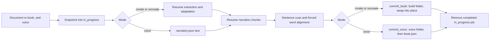

# Hilde architecture

Living description of the project as it currently exists. Keep synchronized with the code.

## Purpose and scope

Hilde has two interfaces over the same speech pipeline:

- `audiobook_tts.py` is a direct CLI for creating portable narrator references and narrating text into MP3 or WAV.
- `audiobook_tts_web.py` is a shared-library web server serving the Hilde Reader browser app. It stores voices, documents, completed audiobooks, and resumable work under one server-owned root and exposes one-click document preparation plus narration.

The speech backend for each role is selected when the web server starts. Voice creation can use a local Qwen3-TTS VoiceDesign model or an OpenAI-compatible speech endpoint. Narration can use a local Qwen3-TTS Base model, that model distributed across local/SSH workers, or an OpenAI-compatible endpoint.

Current document preparation supports PDF, plain text, and Markdown. PDF pages are converted to Markdown. Optional adaptation by a language model rewrites body paragraphs for a listener: the author's prose stays, reader apparatus is left out, and dense material is tuned down. Tables of contents and terminal bibliography sections are removed with or without adaptation.

Out of scope: EPUB extraction, CLI playback, built-in web authentication/authorization, and a durable multi-process queue. Audiobook submissions share one process-local worker scheduler. Direct public exposure is unsupported; deploy behind an authenticated, rate-limited TLS reverse proxy.

## Repository structure

| Path | Responsibility |
| --- | --- |
| `audiobook_tts.py` | CLI parsing, validation, voice persistence, chunking, local/SSH worker orchestration, OpenAI-compatible narration, batching with out-of-memory retries, and durable narration checkpoints. |
| `audiobook_tts_web.py` | Shared storage, single-page UI, document preparation, narration-worker scheduling, CPU forced word alignment, the text-adaptation model clients with ChatGPT sign-in, the user's own Claude Code, and the Anthropic, OpenAI, Google Gemini, and DeepSeek API keys, workflow orchestration, SSE progress, exactly indexed reader audio, serving and download. |
| `example_run.sh` | Example web-server launch: local Qwen3-TTS models, the default `~/.hilde/library` library, port 8800 on this machine only, and every GPU CUDA can open. Set its interpreter and model paths for your machine; extra arguments pass through, such as `--host 0.0.0.0` for other devices. |
| `assets/reader-emblem.svg` | Hilde Reader's emblem, the copper leaf on a navy rounded square (`/reader-emblem.svg`); the favicons, Apple touch icon and manifest icons are the same tile. |
| `assets/reader-leaf.svg` | The bare copper leaf (the emblem's path, no tile, its own gradient id `reader-leaf-copper`, viewBox `22 17.5 56 65` cropped to the leaf): the page header's mark (`/reader-leaf.svg`). |
| `assets/favicon-16.png`, `assets/favicon-32.png`, `assets/apple-touch-icon-180.png`, `assets/icon-192.png`, `assets/icon-512.png` | The copper leaf as icons, each served at its own name (`APP_ICONS`): the browser favicon (16, 32), the Apple touch icon (180), and the web app manifest's icons (192, 512). Used exactly as given; `icon-512.png` is 512 × 513 px as delivered. |
| `assets/hilde-dark.png` | The old Hilde logo, kept byte-identical and no longer shown or served. |
| `assets/zeki.jpg` | Small mark in the page footer's "by Zeki Works" signature. |
| `prompts/PAPER-AUDIO-BOOK.md` | Text-adaptation instructions for the language model. Each job reads them when it starts. |
| `prompts/PAPER-VERIFY.md`, `prompts/PAPER-REPAIR.md`, `prompts/PAPER-RECHECK.md` | Error correction's plain-text prompts: the check of a description against its source, the note asking for a corrected description (`{issues}` and `{draft}` are filled in), and the check of the correction. A job with error correction reads them when it starts. |
| `prompts/PAPER-FIGURE-KIND.md` | The plain-text question that decides whether a figure is a chart, described from its caption and the author's text. Each adapting job reads it when it starts. |
| `qa/` | The QA records reviewers and the fixer share: bug classes, findings, runs, papers, decisions, open questions, golden assertions per paper (`golden/<paper>.yaml`), fact sets per test paper (`facts/<paper>.yaml`, format in `facts/README.md`), `qa.py` (`validate`, `check`, `report`, `next`, and `facts`, which scores fact sets over several runs and against a baseline's), and `describe.py`, which makes descriptions-only runs: `PaperRun(descriptions_only=True)` sends only figure, table, and equation batches to the model, with every request, check, and second request a book gets, keeps prose as printed, and writes each run's `narration.json` and a `book.json` stamp; the flag is part of the scratch identity, so such a run is never reused for a book. `rate_models.py` rates the available models job by job on those fact sets (and the fixed passages of `narration_passages.yaml` for narration) and writes the ratings file the pickers' suggestions read (`qa/README.md`, [Suggested models](#suggested-models)). `qa/AGENTS.md` is its protocol. Golden checks and fact sets run only here, on an output; the app never reads `qa/`. Output texts under `qa/outputs/` stay out of git. |
| `voices/` | Stock voices: each a VoiceDesign reference clip reading the fixed preview passage, its transcript, and its prompt as `description.txt`. A new library starts with a copy; the CLI can use them directly with `--voice-dir`. |
| `User/` | Where earlier versions kept the library; still ignored by git. The server refuses to start an empty `~/.hilde/library` while it holds voices or books (`library_left_behind()`). |
| `test_audiobook_tts.py` | Dependency-light `unittest` regressions for persistence, storage/version rules, resume, unified workflows, events, document adaptation, endpoints, batching, voice/library catalogs, voice tags (validation, the tag file, suggestions and their match spans, what waits for review and the dropped tags saving remembers, composition, routes), suggested models (the ratings file, labels and reasons, matching), `qa/rate_models.py` with stubs, and preview rendering. |
| `requirements.txt` | Platform-neutral runtime dependencies. PyTorch/TorchAudio are installed separately for the target CPU/CUDA build. |
| `install.sh` | POSIX installer run as `curl … \| sh`, all inside `main()` so a truncated download runs nothing. Needs only git and curl, never sudo: installs uv if missing (uv supplies Python 3.12), clones or fast-forwards `~/hilde` (`HILDE_HOME`), creates `.venv`, installs PyTorch 2.10 from the index matching the NVIDIA driver (580+ `cu130`, 525+ `cu126`, else `cpu`; `HILDE_TORCH` overrides; PyPI on macOS), then `requirements.txt`, checks the imports, and writes a `hilde` launcher to `~/.local/bin` (`HILDE_BIN_DIR`) that starts the web server with both Qwen3-TTS models by Hugging Face ID and `--allow-model-downloads`. Rerunning it updates; the library is untouched. **Set up** in **Add narration workers** pipes it to a node over SSH. |
| `README.md` | User guide: what Hilde does, how it reads a paper, measured results, a two-command quickstart through `install.sh`, known limitations, access and security, and License. Short summaries link to the guides below. |
| `docs/installation.md` | User guide to installing: the one-command installer and its settings, then by hand: environment, PyTorch/TorchAudio builds, dependencies, FlashAttention 2, and model downloads. |
| `docs/configuration.md` | User reference for the web server: starting it and its options, default models, suggested models (the ratings file), Ask Hilde settings (`ask.yaml`), storage, speech models, narration workers, and batch size. |
| `docs/text-adaptation.md` | User guide to text adaptation: what it changes, models and providers, local servers and images, workers, and what the job log reports. |
| `docs/web-ui.md` | User guide to the page: header and navigation, creating an audiobook and following its progress, the Library and the Listen reader, Voices and new voices, Settings, confirmation dialogs, and browser state. The README links to it. |
| `docs/help.md` | Hilde Reader's help for listeners, one `##` section per topic (a draft under review). Ask Hilde reads it as the document `help` (`ask_help()`); a feature change updates it in the same commit. |
| `docs/command-line.md` | User guide to `audiobook_tts.py`: creating a voice, narrating, multiple GPUs, CPU, a speech server, and input and output. The README links to it. |
| `docs/ssh-workers.md` | User guide to narration workers on other machines: requirements, **Add narration workers** and `workers.yaml`, and the CLI form. The README links to it. |
| `docs/command-line-options.md` | User reference listing every `audiobook_tts.py` flag with its default. The README links to it. |
| `AGENTS.md` | Short standing instructions that coding agents load automatically; the details stay in this document. |

There is no package manifest. Both applications are run directly with Python.

## CLI architecture

### Commands

`build_parser()` defines:

- `create-voice`: generate one reference clip and persist it with the exact input passage and its voice description.
- `narrate`: split narration-ready text, clone one saved voice locally/across model workers or call one OpenAI-compatible voice, then assemble MP3/WAV output.

`check_mode()` enforces rules argparse cannot express:

- a local model is required unless `--server` is present;
- remote mode rejects local-inference flags rather than silently ignoring them;
- voice-design endpoints using models known to ignore `instructions` are rejected.

Heavy dependencies remain lazy imports. `--help`, endpoint parsing, and most validation do not load Torch or Qwen.

### Voice persistence

A saved local voice is:

```text
<voice-dir>/
├── reference.wav
├── transcript.txt
├── description.txt   voice description (--instruct), searched by the web UI; a voice made
│                     from tags holds exactly the composed request (compose_voice_instruct())
└── preview.wav       optional; the fixed preview passage rendered for older voices
```

The web UI's tags for a voice are not in this folder: they live in the library's `voice-tags.json` (see [Voice tags](#voice-tags)).

`save_voice()` stages the clip, transcript, and description in a sibling directory. Without `--overwrite`, an existing destination is rejected. With it, `keep_voice_version()` first copies the voice being replaced (clip, transcript, and description; never a preview) into `<voice>/.versions/vN`, N one past the highest kept, and then the owned files are replaced: a replacement without a description removes the old `description.txt`, and every replacement removes a `preview.wav` rendered from the old audio. Unrelated files remain. `transcript.txt` is the exact UTF-8 passage used for generation and is written last as the commit marker.

`read_voice()` rejects empty transcripts and empty, non-mono, non-finite, or silent audio. These checks keep a persisted voice suitable for later prompt construction.

### Narration and output

`split_text()` prefers paragraph and sentence boundaries, then wraps oversized sentences and words. Chunk order is stable. Its sentence-chunk mode starts every sentence in a new chunk and is mandatory for the web reader.

`prepare_output()` validates the destination before model loading or remote calls:

- suffix must be `.mp3` or `.wav`;
- WAV subtype and MP3 compression flags must match the format;
- output cannot alias the input or saved voice files;
- the parent must already exist;
- an existing destination requires `--overwrite`.

Without `--resume-dir`, single-device local narration uses whole-book or fixed-size batches and writes the selected container directly. OpenAI-compatible narration sends one `POST {server}/audio/speech` request per chunk and requires all returned WAV chunks to keep one sample rate/channel layout. Multi-worker local/SSH narration requires `--resume-dir`.

`load_model()` imports Qwen through `import_qwen_tts()`, which captures file descriptors 1 and 2 during the import and replays them only if it fails. `qwen_tts` warns on import that flash-attn and the SoX executable are missing; Hilde needs neither (SoX serves only Qwen's 25 Hz tokenizer), and without the capture every worker would repeat both warnings in each job log.

Every clip is length-checked, on all four paths (local, resumable local,
distributed workers, speech server). The model can miss its end and talk on
to its 8192-token limit, 655 s of noise, or end early and drop the words: a
16-hour book had 23 such clips, at least 12 of them 655 s long, and the
highlight waited on each. `generate_clone_batch()` caps every batch at
`clip_token_limit()` (`CLIP_TOKENS_PER_CHAR` per character of its longest text
as spoken, `spoken_length()`, which counts each digit as
`SPOKEN_CHARS_PER_DIGIT` characters since "1,800" is read as words, plus
`CLIP_TOKEN_SLACK`, about three times a clip's usual length) and gives the
model `spoken()` text: a chunk of at most `SPOKEN_PERIOD_MAX_CHARS` ending in a
letter or digit, such as a heading, gets a period; the reader's text is
unchanged. `clip_problem()` calls a clip run on above `CLIP_LONG_FACTOR` times
its expected length (`SPEECH_SECONDS_PER_CHAR` per spoken character) plus `CLIP_LONG_SLACK_SECONDS`,
below the cap so a capped runaway is caught, and ended early under
`CLIP_SHORT_FACTOR` of it for `CLIP_SHORT_MIN_CHARS` characters or more; 99%
of 7,300 measured sentences ran under 2 times. `checked_clip()` makes such a
chunk again alone, with its own cap, up to `CLIP_RETRIES` times, then keeps
the try `nearest_try()` picks: one that ended on its own before one that
stopped within `CLIP_CAP_MARGIN_SECONDS` of its cap (`CODEC_TOKENS_PER_SECOND`),
which likely lost its last words, then the one nearest its expected length;
the log names the chunk and both lengths. The distributed coordinator does
the same through its batch queue, keeping each chunk's tries until one passes.

### Durable narration resume

`--resume-dir` enables a checkpointed publication path:

1. `prepare_resume()` writes a manifest describing the text, chunk sequence, language, and voice/inference identity.
2. A changed identity removes incompatible `chunk-*.wav` files. A manifest of the identity from before 24 Oct 2026 (`_narration_voice_version(legacy=True)`, which also named the device and the workers) keeps its checkpoints when those were the same, and is rewritten with the current identity.
3. Existing checkpoints are accepted only when SoundFile can read them and they contain frames, a sample rate, and channels, and when `clip_problem()` finds nothing: a clip saved before the length check that ran on or ended early is made again.
4. Each newly generated chunk is written to a temporary WAV and atomically renamed.
5. `assemble_checkpoints()` validates format consistency, encodes every checkpoint in order to a temporary final container, and atomically replaces the requested output. Joining tens of thousands of chunks takes minutes, so it prints `Joined chunk N/T` from 0, about 200 times over the book.

Local identity (`_narration_voice_version()`) is what changes the audio: the contents of `reference.wav` and `transcript.txt`, clone-model selector, dtype, attention backend, seed, and batch size. Which workers make the clips is not part of it: a narration resumed with a GPU or a node fewer, or more, keeps every finished part, and parts made on different devices are mixed as a distributed run always mixed them (with dtype `auto` each worker uses the precision its device supports). Changing the voice, the model, or one of those settings still starts the parts again. OpenAI-compatible identity includes endpoint, remote model, and remote voice ID. Container compression/subtype is intentionally not part of the waveform identity; checkpoints can be re-encoded into a different final container.

### Distributed narration workers

`--worker-device` adds persistent local model processes to the primary
`--device`; repeated `--ssh-worker` values add persistent model processes
through passwordless OpenSSH, one per device of a machine. With
`--no-local-worker` only the SSH workers narrate and `--device` starts no
worker (`_local_worker_devices()`). `ssh_worker()`
parses `TARGET[,device=D][,python=P][,model=M]`; `check_distributed_mode()`
fills what a worker leaves out from `--ssh-device`, `--ssh-python`, and
`--ssh-model-path` (then `--clone-model-path`) and refuses a target and device
given twice. `narration_worker()` implements a private
newline-delimited JSON protocol. A worker emits readiness, accepts indexed
chunk batches, and returns base64-encoded FLOAT WAV data or a fatal error. A
batch may carry `max_new_tokens`, a cap on each clip's length that
`generate_clone_batch()` passes to the model; the coordinator sends
`clip_token_limit()` of the batch, and a worker given none uses the same.

`_narrate_distributed()` starts SSH workers at once. A local CUDA worker starts
only when its GPU has at least `NARRATION_MIN_FREE_MIB` (6 GiB: the 4 GiB model
plus a batch) free. `GpuMemory` reads free memory with `nvidia-smi`, matched to
PyTorch device numbers by GPU UUID through a short-lived child; neither opens a
CUDA context, so measuring never takes memory from a full GPU. A GPU without
room waits and is measured again every `GPU_RECHECK_SECONDS` (60); a device
that cannot be measured (CPU, no `nvidia-smi`, no UUID) starts at once.

Each local GPU worker is a fresh `subprocess.Popen` child that sees only its
own GPU, as `cuda:0` (`_local_worker()`): `CUDA_VISIBLE_DEVICES` is the entry of
the coordinator's own list its device names (the `GPU-<UUID>` that `pin_cuda()`
put there, with `CUDA_DEVICE_ORDER=PCI_BUS_ID`), or its index when no list is
set. A GPU that cannot start then fails only its own worker. Its label is
`Local GPU-<UUID>` (`Local cuda:N` without a UUID). No process here imports
torch before starting children, and none forks after CUDA starts.

**Startup readiness.** A worker is starting from its launch until it sends the
protocol's `ready`, which `narration_worker()` sends only after reading the
voice, loading the model on its device (`load_model()` checks the device), and
building the clone prompt: the real narration path, so no extra model copy is
loaded to check it. A starting worker that exits, reports an error, or has not
said `ready` within `--worker-ready-timeout` (`WORKER_READY_SECONDS`, 600) is
left out of this narration (`startup_failed()`): it is stopped, its SSH
staging is cleaned up, and the coordinator prints `Narration worker left out:
<label>: <reason>` (an exit's reason ends with the worker's last line, read
to the end before its exit is handled) and `Narration continues on: <labels>`.
An SSH worker whose staging fails is left out the same way
(`_narration_worker_specifications()` returns it with its reason). The
others narrate. When no worker is alive or waiting and none was ever ready,
narration fails with `no narration worker could start (<label>: <reason>;
…)`, keeping every checkpoint, so the job can be continued. A relaunch after
running out of memory is a startup like any other. Workers still starting
when the last chunk is committed are stopped at once.

Each worker receives a batch only once it is ready, keeps one in flight, and
gets the next source-ordered batch when it finishes; so a worker left out at
startup never held a chunk, and nothing has to be taken back from it. Only
the coordinator writes checkpoints, from results of workers it still counts
alive, so a stopped worker cannot write one. Idle workers stay loaded
until the book is done, so returned chunks always find a worker. A local worker
whose error says `out of memory` (or cuBLAS/cuDNN `*_ALLOC_FAILED`) is dropped:
its in-flight batch returns to the front of the queue and its GPU waits as
above. Any other failure of a ready worker, including an SSH worker running
out of memory, aborts the run, as does having no worker alive and
none waiting; committed chunks are kept. The coordinator validates and
atomically commits each returned checkpoint immediately, then assembles all
checkpoints in source order. Neither waiting GPUs nor workers left out change
the checkpoint identity.

An SSH transport stages the current script plus the saved `reference.wav` and
`transcript.txt` in a unique remote `/tmp/audiobook-tts-*` directory. The text
and WAV results cross the SSH process protocol; no shared filesystem is
required and the model is not copied. Targets use `BatchMode=yes` and therefore
must have an accepted host key, noninteractive authentication, a compatible
Python environment, and the configured Base model. Cleanup is best effort on
normal exit, failure, and stop. The remote machines are trusted with both the
narration text and saved voice.

Distributed batching is fixed: a positive `--batch-size` applies per worker and
zero becomes one chunk so fast workers can pull more work.

### Batching

Every clone call goes through `generate_clone_batch()`. A batch that raises a
CUDA out-of-memory error is repeated one chunk at a time; a single chunk that
still does not fit fails a single-device run, and returns a distributed local
worker's batch to the queue. Batch size is a manual setting because
throughput grows with it only until memory runs out. On an RTX PRO 6000 with
about 6 GiB free beside another model, one sentence per call ran at 1.6× real
time, two at 2.6×, and four or more ran out of memory, at about 0.7 GiB per
sentence on top of the 4 GiB model. The web app therefore defaults to 2.

## Web shared storage

`SharedStorage` owns a configurable root (`--storage-root`, default `DEFAULT_STORAGE_ROOT`, `~/.hilde/library` beside the provider sign-ins in `HILDE_HOME`, so every checkout finds the same library and a re-clone cannot lose it) and creates:

```text
<root>/
├── .cache/
│   ├── thumbnails/<pdf sha256>.png
│   ├── chat-docs/<document id>.json
│   ├── app-index/<commit>.json
│   └── ask-models.json
├── help-chat/chat.json
├── Voices/
├── Audiobooks/
│   └── <slug>--<hash12>/
│       ├── book.json
│       ├── source.<ext>
│       ├── narration.json
│       ├── reader.md
│       ├── history.jsonl
│       ├── chat.json
│       ├── files/<name>.md
│       └── voices/<voice>/
│           ├── audio.mp3
│           └── timings.json
├── Documents/
├── in_progress/
│   ├── <job id>/
│   │   ├── making.json
│   │   ├── chat.json
│   │   └── files/<name>.md
│   ├── voice-drafts/
│   └── create-drafts.json
├── voice-tags.json
└── workers.yaml
```

Browser state contains only flat asset names and book ids. `safe_asset_name()` and `resolve_asset()` reject traversal and never accept an arbitrary filesystem path from a browser; `read_book()` accepts only an id matching `BOOK_ID_PATTERN`, `making_stage()` only `making-<64 hex>` (`MAKING_ID_PATTERN`, a book being made, never a book id), and `voice_folder()` only a single safe component. File-serving and AirDrop paths must resolve inside the shared root.

`asset_catalog()` returns sorted shared voice and document names; the Listen page reads books from `GET /api/library`. Existing files are not migrated automatically when the root changes.

The Library's card thumbnails live in their own cache, `<root>/.cache/thumbnails/`
(`thumbnail_cache()`), never in a book's folder. `book_thumbnail()` renders the
first page of the book's PDF (`book_pdf()`: `book_source()` when it is a PDF)
once with pymupdf, `THUMBNAIL_HEIGHT` (160) pixels tall, twice the card's 72 CSS
px for a HiDPI screen, and keeps it as `<the PDF's SHA-256>.png`
(`thumbnail_path()`, staged as a hidden `.tmp` and renamed, under
`_THUMBNAIL_LOCK`); later requests read the file. The name is the PDF's hash
(`cached_file_version()`), so another PDF is another picture and nothing goes
stale; deleting the cache only costs a render. It is made lazily, on the first
`GET /api/thumbnail` for the book (the card's ``), never
while listing the library.

`prepare_library()` runs at startup. It creates the layout, runs `recover_books()` and `migrate_legacy_books()`, and, only when it
creates `Voices/`, copies in each stock voice from `STOCK_VOICES_PATH` whole:
staged under a hidden folder, hidden files skipped, then renamed into place. An
existing library is never reseeded, so a deleted stock voice stays deleted.

### Voice tags

A voice's tags live in one library-level file, `<root>/voice-tags.json`
(`VOICE_TAGS_FILE`), never in a voice folder, so tagging, confirming, or
editing tags leaves every `description.txt`, reference clip, and transcript
byte-identical:

```json
{"schema": 1,
 "vocabulary": ["late-night radio"],
 "voices": {"Eir": {"tags": ["female", "adult", "warm"], "dropped": ["gentle"], "confirmed": true},
            "Tagtest": {"tags": ["male", "warm"], "details": "Reads like a radio host.", "dropped": [], "confirmed": true}}}
```

`vocabulary` holds the user's own tags (the page's **Yours** group);
Hilde's are `VOICE_TAG_GROUPS` in code (Voice, Pitch, Texture, Pace, Manner,
Suited to: 40 tags), each with the phrases a description may use for it.
`details` is a voice made from tags' **More details**. `dropped` lists the
suggestions the user did not keep, so they are not suggested again.
`write_voice_tags()`
writes a hidden temporary file opened `0600`, fsyncs it, and renames it into
place; `update_voice_tags()` reads (strictly: an unreadable file raises, so it is
never written over), changes, and writes under `_VOICE_TAGS_LOCK`.
`read_voice_tags()` without `strict` treats an unreadable file as empty, so the
list still shows. `rename_voice()` moves a voice's entry (`move_voice_tags()`),
`delete_voice()` removes it (`forget_voice_tags()`), `save_voice_draft()`
replaces it after the voice is saved; a voice without an entry writes nothing.
Removing a tag from `vocabulary` leaves the voices that use it as they are.

What waits for review (`voice_catalog()`'s `suggested`): a voice without an
entry, every tag its description suggests; a voice with an entry, those it
neither has nor dropped (so a tag of the user's own that its description uses
waits even for a reviewed voice); an entry without `dropped` (written before
Part G of 21 Oct) has nothing waiting, as before. At most 12.
`set_voice_tags(storage, name, tags, details=None)` stores the confirmed tags
and makes `dropped` the earlier `dropped` plus every tag the description
suggests, less the tags kept (case aside); with `details` (a new voice,
`save_voice_draft()`) the earlier list is not carried over, so a voice made
from tags has nothing waiting.

- `clean_voice_tag()`: trimmed, inner runs of spaces made one, 1 to 32
  characters (`VOICE_TAG_MAX_LENGTH`), printable (no line break, tab, or control
  character), no comma; one of Hilde's tags in its own spelling.
  `clean_voice_tags()`: a list, repeats (any case) dropped, at most 12
  (`VOICE_TAG_MAX_COUNT`), Hilde's tags in vocabulary order, then the user's own
  as given. Both raise `ValueError` with the reason the page shows.
- `voice_tag_matches(description, custom)`: each tag (Hilde's, then the user's
  own) whose text or one of its phrases occurs in the description as whole
  words in order (`voice_tag_words()`: lower case; a hyphen or apostrophe
  inside a word keeps it one word, so "soft-edged" is not "soft"), ignoring
  words from a negation (`VOICE_TAG_NEGATIONS`: without, not, never, no, nor,
  avoid…, and the pairs rather than, instead of) to the end of its sentence
  (`. ! ? ; :` or a line break), so a sentence starting with "Avoid" suggests
  nothing; for each, the `[start, end)` spans of the matched words (first to
  last word of a phrase, so "middle register" is one span) in the description
  as the page shows it (`" ".join(description.split())`), in code points. No
  model is asked. `suggest_voice_tags()` is its tags, at most 12.
- `compose_voice_instruct(tags, details)`: the request a new voice is designed
  from and its `description.txt`: "A|An <Manner>, <yours>, <Texture>, <Pitch>
  <age> <gender> voice." (An before a vowel letter; left out without such tags),
  "Reads at a <Pace> pace.", "Suited to <a>, <b> and <c>." (`VOICE_TAG_SUITED`:
  narration, storytelling, lectures, news reading, academic texts), then the
  details with whitespace runs made single spaces; each group in vocabulary
  order. The page shows the server's result (`derived.voice_instruct`), never a
  copy of the rule.

### Books

A book is one document's content made into narration once. Its identity is
the SHA-256 of the source bytes; the file name is not part of it. Its folder is
`book_id()`: `book_slug()` of the title (lowercase ASCII words joined by
hyphens, at most 60 characters, `book` when none) then `--` and the first 12
hexadecimal digits of the hash. `book_for_source()` finds a book by that suffix
and the full hash in `book.json`.

- `book.json`: `schema` (`BOOK_SCHEMA` 1, the layout of this file),
  `source_sha256`, `title`, `source_filenames`
  (every name the content came under), `source_file` (`source.<ext>`, or
  `null` for a migrated book), `created_at`, `updated_at`, `hilde_version`
  (`HILDE_VERSION`), `git_commit` (`git rev-parse HEAD` read once as the
  server starts, so it names the code that made the book even when the
  checkout moves on while the server runs, or `null` outside a
  checkout), `prompt_hash` (the SHA-256 of the system prompt, `null` without
  adaptation), `schema_version` (`EXTRACTION_SCHEMA`, the paragraph-selection
  rules the text was made under; unrelated to `schema`), `model`,
  `local_vision` (whether each local model got figures as images, by selector,
  such as `{"lm-studio/gemma": true}`; `null` when only cloud models adapted
  it, without adaptation, or for a book made before it was recorded;
  without images Gemma 4 misread CLM's charts in every run, R24),
  `verification` (error correction: the checking `model` and how many
  descriptions it `checked`, `flagged`, and `corrected`; `null` when it was off
  or for an older book), `figure_model` (Interpret and narrate figures: the
  model that read the figures from their pictures; `null` when charts were
  described from text, or for an older book), `adapted`,
  `chunk_max_chars` (the chunk size its reader splits the text at), `prose`
  (`adaptation_fidelity()`), `seconds` for reading and adapting, and
  `narration_sha256`, the SHA-256 of `narration.json`'s bytes. `voices` lists
  each voice: `name`, `created_at`, `narration_sha256` (the text it read),
  `status` (`ready`, or `stale` once the book's text changed), `voice_version`,
  `audio_sha256`, `duration`, and its `seconds` for narrating and aligning.
  A migrated book also has `migrated_from`, `legacy_names` (its earlier MP3
  names), and, until it first plays, `migration_backup`.
- `narration.json` (`schema` 2): `original_view` (whether passages map onto
  the reader's paragraphs) and `passages`, one per adaptation batch, or per
  paragraph without adaptation: `id`, `type` (`body`, `heading`, `figure`,
  `table`, `equation`, or `footnote` or `caption` for a passage of only those),
  `page`, `text` (what is read aloud; empty for a batch left out),
  `original_text`, `unchanged`, `paragraphs` (`[first, last]` reader
  paragraphs), and `sources`, the author's paragraphs it came from, each
  `{type, page, text}` with type `body`, `heading`, `figure`, `table`,
  `equation`, `footnote`, or `caption`. The model narrates a footnote and a
  caption inside the passage that cites or carries it, so they are typed as
  sources. `_visual_type()` names a picture from its caption, a PDF table's
  image name, or panel titles; an uncaptioned picture is an equation when its printed text is math, and a figure otherwise.
  Schema 2 adds `summary` and `tags`, the batch's SUMMARY and TAGS (a
  heading batch, which never reaches a model, has its own text as summary
  and no tags); Ask Hilde needs them, so a schema 1 book cannot chat.
  `narration_text()` joins the passages' text: exactly what the first voice
  read and every later voice reads.
- `reader.md` is the follow-along view: block-marked Markdown with pictures
  embedded. Its blocks are the sentences of the narration's paragraphs, so
  any voice's timings map onto it.
- `history.jsonl` is the book's model history: the lines of every job that
  made it or a voice of it (see Runs, events, and ETA), 0600; new with this
  version, so older books have none until their next job.
- `voices/<voice>/audio.mp3` and `timings.json` (the reader sync of schema
  1–3: sample rate, duration, block paragraphs, sentence cues, word cues).
  A voice's timings are never paired with another voice's audio.
- `chat.json` (`schema` 1): the book's one conversation, `entries` oldest
  first: `user` (`text`, and `context`, the manifest of what was attached),
  `assistant` (`text`, and `calls`, each `{id, name, arguments}`; `model`, the
  selector of the request that wrote it, on answers saved since 22 Oct, never
  added to older ones; on an answer without calls saved since the Ask context
  change, `ids` and `links`, the paragraph ids and web links its text cites,
  which its shortened form keeps), `tool` (`id`, `name`, `label` the page
  shows, and what the model was given: `items`, each `{kind, text}` with `id`
  for a paragraph or page and `type` for a heading, since the Ask context
  change, and `label` ("From the paper", "Hilde's narration", …) since reads
  have versions (an earlier `paper` item without it held the narration);
  `content`, one text, before), and `notice` (why a turn ended; never
  sent to a model; a model's failure has `failed: true` and its `model`).
  `context` (since the Ask context change; `ask_state()`) is what the next
  request starts from: `expired` (ledger keys replaced by `EXPIRED`),
  `dropped` (how many turns from the first are left out), and `last` (the last
  request's model, time, message fingerprints, and prompt and cached tokens).
  A file without `context`, and entries saved before these fields, load as
  they are; their entries are never changed, and a new question appends.
  Rebuilding the book (`commit_book()` for the same content) drops it, since
  it cites the old text's paragraph numbers, unless the job brings a
  conversation asked while the book was being made (`chat`, see
  [Books being made](#books-being-made)): then the book's conversation stays,
  first, and the job's follows; one never replaces the other.
- `files/`: the Markdown files Chat wrote. `commit_book()` copies them into a
  rebuilt book, and those Chat wrote while the book was being made beside them
  (`copy_new_files()`: a name the book has already goes in as "<name> (2).md");
  only Chat's `delete_file` removes one.

`commit_book()` publishes a book with one voice: it writes everything into a
hidden `Audiobooks/.build-<random>` folder, `book.json` last, and
`swap_into_place()` renames it to the book's folder. A book of the same content
keeps its folder name, `created_at`, and file names; its other voices are
hard-linked into the new folder, `ready` when they read the same
`narration_sha256` and `stale` otherwise. The old folder steps aside as
`.replaced-<id>-<random>` before the new one is renamed in, so a crash between
the renames leaves both, and `recover_books()` at the next start puts the old
one back and removes `.build-` and `.trash-` folders, at the top level and in
each book's `voices/`. `commit_voice()` publishes one voice the same way inside
`voices/` and then rewrites `book.json`; it refuses when the book's
`narration_sha256` changed since the job started. Commits hold `_BOOK_LOCK`.
`delete_book()` renames the folder to `.trash-<random>` and removes it.

`migrate_legacy_books()` moves the earlier layout (`Audiobooks/<name>.mp3`,
`.versions/<name>.json`, `.readers/<name>.<hash>.md|json`) into book folders
without calling any model. MP3s of the same `input_version` become voices of
one book, newest first: the newest one's reader becomes `reader.md`, and a
voice whose reader differs is `stale`. An MP3 without a record becomes a book
keyed by its own hash with no source hash or text. `_legacy_narration()`
rebuilds `narration.json` from the `Documents/<stem>-narration.txt` the job
stored, only when it splits into exactly the reader's blocks and cue count at
some chunk size (500 first), and from the sidecar's `originals`; otherwise the
book plays but has no text for a new voice. Audio is hard-linked; the earlier
files move to `Audiobooks/.backup/<id>/` and stay until the book's audio is
first served (`release_migration_backup()`). The empty `.versions` and
`.readers` folders go. Rerunning finishes a migration a crash interrupted.

### Naming

- Saved voice: `Voices/<voice-name>/reference.wav` plus `transcript.txt`, with `description.txt`, an optional rendered `preview.wav`, and the versions it replaced in `.versions/vN/`. Job snapshots copy only `reference.wav` and `transcript.txt`.
- Book: `Audiobooks/<slug>--<hash12>/`, as above. A voice's download is named
  `<title> - <voice-name>.mp3` (`book_download_name()`): path separators become
  `-`, `:` becomes ` -`, `"` becomes `'`, control characters and `*?<>|` go,
  and a title longer than `BOOK_DOWNLOAD_TITLE_CHARS` (120) is cut at a word; a
  book without a title uses its document's stem. A non-ASCII name goes in
  `filename*` (RFC 5987) with an ASCII `filename` fallback (`send_file()`).
- Unfinished workflow: `in_progress/<job-id>/`; a new book's job adds
  `making.json` once its document is converted, and `chat.json` (0600) and
  `files/` once it is asked about (see [Books being made](#books-being-made)).
- Voice draft: `in_progress/voice-drafts/<id>/`, a clip **Generate preview**
  made that **Save voice** stores under a voice name. Only the newest ten
  drafts are kept.
- Workers: `workers.yaml`, a `nodes:` list of `host`, `python`, `model`, and
  `devices` (`cuda:N`, `mps`, or `cpu`) and an optional `local_off:` list of
  this machine's devices that do not narrate (a GPU by its UUID, `GPU-…` as
  `nvidia-smi -L` shows it; `mps`; `cpu`), with a comment header, written
  atomically by `write_workers()` when a node is added or removed or a local
  device is turned off or on, and read at startup by `read_workers()`.

For remote narration, the remote server voice ID supplies `<voice-name>`.

### Versions and confirmation

`file_version()` hashes document bytes; `cached_file_version()` remembers the hash while a file's size and modification time stay the same. A local voice version hashes both owned files and their names; descriptions and previews are not part of it. A remote voice version hashes endpoint, model, and voice ID.

`/api/run` returns HTTP 409 with `confirmation_required` when a new voice
would remake a voice the book already has `ready` with the same voice
version, and when Create names a document already made into a book that has
no text of its own (a migrated book without one), since a new voice then
needs the text written again. The browser asks and retries with
`confirmed: true`.

## Canonical browser state

`normalize()` accepts tabs `audiobook` (Create), `progress` (the progress view), `voice` (Voices), and `player` (Listen); Settings is page-local, never a saved tab. It and rebuilds four known sections:

- `runtime`: dtype, attention, language, input encoding, seed;
- `voice`: remote design voice, name, New voice's `tags` (`stored_voice_tags()`: the valid ones, once each, at most 12, in vocabulary order) and `details` (More details), reference WAV subtype. `values_of()` composes `instruct` from them (`compose_voice_instruct()`), and `derived()` returns it as `voice_instruct`;
- `audiobook`: current Create step (`book`, `voice`, or `create`; anything else becomes `book`), remote clone voice or saved voice, step 1's chosen source card `source` (`saved`, `url`, or `upload`; anything else becomes `url` when a link is stored, else `saved`) and each card's own value, kept while another card is chosen: `document` (the Saved document dropdown), `upload` (the file uploaded under Upload a file), `source_url` with its optional `download_name`, and `url_document` (the Documents name **Continue** downloaded that link to; the page empties it when the link or name changes), with `url_title`, the paper's title an arXiv link's download answered (emptied with it). `chosen_document()` gives the chosen card's document, the only one `values_of()` uses, and `pending_url()` the chosen link still to download, else empty, so another card's link is never downloaded or checked. Then adaptation settings (model; `verify`, error correction, true only when stored as `true`, `verify_model`, its checking model, the text model when empty, `interpret_figures`, Interpret and narrate figures/charts, true only when stored as `true`, and `figure_model`, the model that then describes figures, the text model when empty), and chunk, batch, and compression settings. Local model servers are not browser state: they are the server's (`local_endpoints()`, see [Local model servers](#local-model-servers)). The earlier per-browser `local_servers` (and the older `local_server`, `local_provider`, `local_vision`) is no longer read or written; a stored one is dropped, not migrated. The batch size defaults to 2; a state saved under schema 3 with that schema's default of 1 moves to 2 once;
- `audiobook` also keeps `draft`, this browser's Create draft (`draft_id()`: a string of 8 to 64 letters, digits, `-`, `_`, else empty; the page makes one with `newDraftId()`, and a new one after each confirmed start), and for the fourth source card `paste` its `paste_document`, the Documents name **Continue** saved a pasted text as (`chosen_document()` uses it; the text itself never enters the cookie).
- `player`: the book open on Listen (or a book being made, `making-<job id>`, which opens without audio; see [Books being made](#books-being-made)), the voice playing, so a refresh reopens them, `in_library`, whether that book plays from the Library (loaded, with the Library shown and of the book's view only the player bar; true only when stored as `true`), `chat_model`, the model chosen for Ask Hilde (this browser's, apart from the book's model), and `chat_speak`, whether answers are read aloud as they finish (true only when stored as `true`). A book name from before book folders is an earlier MP3 name; the page maps it through the library's `legacy_names` to its book and voice. Each book's place and speed, the side panel's width, and the dismissed stopped or failed jobs are this browser's alone, in `localStorage` (see [Browser storage](#browser-storage)), never in cookies or on the server.

Normalized state is compressed into bounded, chunked, year-lived `HttpOnly; SameSite=Strict` cookies, also `Secure` when the request came over HTTPS (`Handler.secure()`). TTS model paths/IDs, speech endpoints, credentials, worker devices/hosts, storage paths, and output paths are server-owned and never accepted from browser state.

## Document preparation

`PaperRun` performs extraction and optional adaptation inside a caller-provided durable directory for unified jobs. Its older standalone mode can still use a temporary directory.

### PDF extraction

PDF work is page-addressable:

1. a short-lived child (`_PDF_OVERVIEW`) obtains the page count and the first
   page's title: its largest horizontal text in the top half, when that is at
   least 1.3 times the body size. An arXiv stamp runs up the margin in larger
   type, and small capitals mix sizes within a line, so whole lines holding the
   largest size are read. When the metadata title has the same words, its
   spelling wins over capitals. `pymupdf4llm`'s layout model can take a first
   page's title for a running header, which `header=False` drops, so
   `with_title_heading()` heads page one with the title, turns a paragraph
   that is only the title into the heading, and leaves a title found anywhere
   else on the page alone rather than read it twice; the log says when it
   restored one. The child also returns every horizontal line of the first
   page's top half with its box and whether it is bold. Extraction runs a row
   of author columns together, names first and then their affiliations, so a
   model must guess who works where; `pair_authors()` pairs each bold name
   with the lines right under it in its column, up to an email, and
   `with_author_affiliations()` rewrites such a row as "**name**, affiliation;
   …", footnote marks kept on each name. It pairs nothing when affiliations
   start with a number or mark (a numbered list, matched by those marks), when
   a row has a name with nothing under it (one line spans several names), or
   when fewer than two affiliations were found, and it rewrites a paragraph
   only when, beyond the names, it holds exactly those affiliations' words and
   emails, so names printed apart from their affiliations are not given them
   twice. The log counts the authors paired;
2. one converter child writes each missing `pdf-pages/<page>.md` checkpoint;
3. extracted figures remain under `images/`, linked as `images/<file>`: the
   converter runs from the extraction folder because `pymupdf4llm` links
   images relative to its working directory, and the reader and figure
   attachments resolve links against that folder. The converter asks for
   `page_chunks`, whose `page_boxes` give each table's box and its span in
   the page Markdown. Cells rebuilt from the layout split words across
   columns ("BL|EU") and carry stray emphasis and tags, so each table becomes
   ``, its whole caption as the
   label screen readers announce (`Table` without one), cut from its box at
   200 dpi, followed by its cells between picture-text markers: kinds `image`
   and `labels`, the same parts as a figure, so the reader shows the table as
   printed and the model gets the picture and the cells. `caption_chains()`
   finds the caption boxes directly above and below each table; a box the
   layout files as body `text` counts when it opens a caption ("Table 6:",
   `TABLE_CAPTION`, or a bold label with nothing after the number, "**Table
   3** The four…", `BOLD_TABLE_CAPTION`, as CLM prints every caption), never a
   sentence about the table ("Table 5 lists…").
   `table_captions()` then gives each table one: a caption between a table and
   anything else is that table's, above before below, and one between two
   tables, as Table 1's sits over Table 2 when captions are printed below
   them (BERT), goes to whichever has none of its own, the nearer if both.
   No caption is used twice, and a caption box that opens another kind of
   caption (`OTHER_CAPTION`, `BOLD_OTHER_CAPTION`: "Figure 1:", "**Algorithm
   2**") is never a table's, as BERT's Figure 1 caption sits right above its
   Table 1. A `picture` box under 3% of the page's width and height, an icon
   set in a line of text, is dropped: CLM's 5 pt link logo reached the model
   alone, and the model invented a figure for it (R24).
   A listing set in a typewriter font (a program, a prompt, a skill file)
   comes out of the layout as many boxes, one per paragraph or list item,
   with a list item started wherever a line wraps and the font's spaces
   lost. `listing_runs()` finds each run of consecutive text, list-item,
   heading, or code boxes whose characters are at least 80% monospace (the
   span's monospace flag or a typewriter font name), and `listing_text()`
   rewrites it as one fenced block from the page's own lines in the
   layout's reading order: a box printed wholly above the lines gathered so
   far, where a listing goes on at the head of the next column, starts a
   section with its own left edge. Pieces of one printed row are joined in
   order, indentation is kept in characters, a row's second drawing as
   scattered glyphs over the first is dropped, and no blank line is left
   inside, so the listing stays one paragraph. An equation the layout cuts
   out as a picture (a `formula` box whose Markdown is a bare image) keeps
   the page's own text of that box behind the picture as its picture text
   (`formula_text()`: each span smaller than the text around it hangs from
   the span before it as `<sup>` or `<sub>` by its baseline, by the PDF's
   superscript flag for a whole exponent, nested, and a stacked fraction is
   written `(numerator)/(denominator)`, so "warmup_steps<sup>−1.5</sup>" no
   longer reads "warmup_steps−1.5" and models raise the right term; no span
   hangs from one ending in an operator, separator, or opening bracket
   (`SCRIPTLESS`), from a base more than 0.6 text heights off its baseline, or
   across a full-size glyph between them, so a small stacked ½ after "C_attn
   [" is a fraction, not "C_attn₂ … +₂¹"; a superscript stacked over a
   subscript, too far above the subscript, hangs from their base, so RRSI's
   "𝐻<sub>𝑡</sub><sup>(1)</sup>" is neither flat nor nested; glyphs of a math-extension font
   (`EXTENSION_FONT`: cmex, txex, pxex) are decoded from their codes
   (`EXTENSION_GLYPHS`), private-use bracket pieces (`BRACKET_PIECES`) become
   the bracket they build, and brace pieces are dropped, so CLM's tall
   brackets no longer read "h … i"; a tall delimiter or big operator
   (`BIG_OPERATORS`: ∑ ∏ ∫ …) joins the line nearest its middle, never a
   fraction, and an operator's limits hang from it, the higher of two as
   `<sup>`: "∫<sub>0</sub><sup>T</sup>", "∑<sub>i=1</sub><sup>n</sup>"
   (Merton's integrals had become fractions without letters, which sent
   every formula holding one to printed order); a band of
   text is a line of its own only when it holds a quarter of the heaviest
   band's text and sits 1.2 text heights or more from every heavier line, since
   a numerator sits 0.66 to 0.83 from its line and the positional encoding's
   second line 1.69, and a fraction's parts are grouped left to right, so an
   accent over a later letter stays in place: taken by weight alone, RRSI's
   numerator "Ĉ(H′) − Ĉ(H_t)" became a line before "ΔS ="; the number printed
   beside it, the rightmost span "(5)", always ends the text, and a "fraction"
   with no letter or digit above or below it, the brace and "=" of cases, sends
   the formula to the PDF's own line order: read line by line, Procedural
   Graphs' Equations 5 and 8 and CLM's 3 and 6 had their numbers mid-text, so
   no description was named by them, R23-01),
   which ends with the number printed beside it, "(3)", taken from the same
   line to its right when the box leaves it out; a model that reads no images
   then knows what the equation says, and code names its description by that
   number and no other (`label_equation()`). Prose, caption, and footnote
   boxes outside listings get their subscripts marked the same way
   (`with_subscripts()`), "_d<sub>k</sub>_" for "_dk_", since the layout
   marks only superscripts. Table, equation, prose, and listing replacements are applied from
   the end of the page;
4. `join_pdf_pages()` joins the page Markdown into `document.md` in source
   order, mending what page breaks split. A page break always ends a
   paragraph, and the model sees each batch without the narration before it,
   so a sentence left in halves could never be repaired later. When a page's
   last prose paragraph ends without `. ? ! : ;` and the next page's first
   prose paragraph continues it (`_continues_sentence()`: it starts in
   lowercase, or the first half stops on a word no sentence ends on, per
   `DANGLING_END_PATTERN`, such as "for", "and", or "via", and the second
   starts with a letter or digit), the halves become one paragraph; a
   word the break hyphenated loses its hyphen unless the document spells it
   hyphenated elsewhere ("self-attention"). Footnotes, page numbers, and
   figures or tables between the halves are skipped over and follow the joined
   paragraph. A heading ends the search, except a figure's panel title (an
   unnumbered heading directly above an image, or between a figure's parts
   and its caption) and a page's first line read as a heading when it starts
   in lowercase. Within a page, `_rejoin_cut_sentences()` does the same for a
   figure, table, or footnote that cuts a sentence, as a float placed
   mid-column does. Either way `_interrupts_sentence()` requires what sits
   between the halves to be footnotes, page furniture, or a figure or table
   with its caption: an image without a caption is usually an equation
   printed as a picture ("the complexity is [equation] where …") and stays
   inside its sentence; `paper_batches()` then sends it with both halves.
   Captions are recognized as "Figure 2:", "Table 4.", "Figure 1 | …", or a
   label set in bold with nothing after the number, "**Figure 6** CLMs…" or
   "**Figure 6 CLMs….**" (`BOLD_CAPTION_PATTERN`; a sentence about a figure
   is never bold). Missed, all 26 of CLM's captions were read as prose: every
   figure reached the model without its caption, its number guessed, and
   three figures cut sentences they did not interrupt. A caption broken above its table or figure is mended
   too. A sentence goes on behind a code mark (`` `test_normal` tasks``
   continues in lowercase). No sentence is joined into or onto a fenced
   listing (`_is_listing()`), and `_merge_listings()` makes a listing that a
   page break, footnote, or figure or table cut into one again, with what
   cut it following, so the whole listing reaches the model in one request.
   Last, `_place_after_mentions()` moves each numbered figure or table
   printed before the paragraph that first mentions it ("Figure 3(b)", "Figs.
   2 and 3", "Tables 1–4"), on its own page or the next, to follow that
   paragraph, so a description never comes before the author introduces its
   figure; one already after its first mention, or mentioned only pages away,
   stays, and a footnote right after it whose marker its cells or caption
   carry goes with it (DeLM's cache note under Table 5 was left before §3.3,
   R22-05). `_place_footnotes()`, which runs first, moves each footnote
   (`_footnote_marker()`: a number glued to its first word, "4To
   illustrate", a symbol, "_†_ Work performed", or a letter before the
   note's first word, "a The Claude Code CLI") to follow the nearest
   earlier paragraph on its page or the one before whose marks carry
   that marker (`_cited_markers()`: "<sup>4</sup>", "<sup>_∗†_</sup>" as ∗
   and †, "<sup>a</sup>", and a table cell's "^a", where only a letter or
   symbol counts since "10^20" is a power; `FOOTNOTE_CITING_KINDS`: prose,
   a caption, or a table's cells), so it is no longer read where the page printed it. A note cited by
   that paragraph alone comes first and one it shares with earlier paragraphs
   after, so the last author's affiliation note follows the name before the
   equal-contribution note every author line cites; and
   `paper_batches()` sends it in one request with that paragraph, where the
   prompt has it read right after the citing sentence, naming whom or what it
   is about. The request carries the note's mark at the end of its sentence
   (`marks_after_sentences()`): read at the mark, Gemma split DeLM's sentence
   on Claude Code's idle limit around the note (R22-04). A mark beside an
   author's name stays where it is. A note marked beside one author alone gets that author's name in
   code (`name_author_notes()`, counted across every author line, so the
   equal-contribution note stays as printed): "> † Aidan N. Gomez: Work
   performed while at Google Brain". The prompt's examples are invented, never quoted from a paper:
   given "Aidan Gomez did this work while at Google Brain" as its footnote
   example, the model wrote that sentence in place of Attention's footnotes 4
   and 5, with or without the running summaries (B31), and the other Attention
   quotes it held could be copied the same way and answered that paper's QA
   checks for it. The job log counts the rejoined sentences and the moved figures,
   tables, and footnotes; once one note of a paragraph is out of place, the
   notes after it count as moved too. `join_pdf_pages()` also returns the
   page each block of
   `document.md` starts on, which
   `convert_pdf()` stores as `document-pages.json` (`{"pages": [...]}`); a
   rejoined sentence keeps the earlier page, and a moved figure or footnote its own.
   `narrated_source_pages()` maps them onto the narrated paragraphs for the
   reader, and returns nothing when the record does not describe the document.

Existing page checkpoints are reported and reused. The converter uses `pymupdf4llm`; OCR and layout handling remain outside the long-lived HTTP process. `pymupdf4llm` writes OCR text onto the page before it renders figures, so the converter hands it an OCR function whose text is inserted invisibly (render mode 3): the text is still extracted, including a figure's picture text, but figures render as the PDF draws them instead of with every OCR-read label printed a second time.

### Paragraph adaptation

After text extraction, `narrated_source_paragraphs()` returns the paragraphs a
narration covers. `split_paper_paragraphs()` produces ordered nonempty blocks.
Paragraphs whose decoded content consists only of Unicode control or format
characters are discarded unless they contain a real table or image. Then two
kinds of section are left out:

- a table of contents: a heading such as Contents, Table of Contents, or List
  of Figures, together with the paragraphs after it whose lines mostly end in a
  page number (after dot leaders, in a table's last cell, or in roman front
  matter). The first `#` heading or prose paragraph ends it, so a numbered
  heading such as "Chapter 1" stays. A Contents heading over prose names a real
  section and stays;
- standalone References/Bibliography/Works Cited/Literature Cited/Reference
  List sections, while inline attributions and later sections stay. The first
  `#` heading ends one, since entries are never `#` headings, and so does a
  recognized later title such as Acknowledgements or Appendix. PDF extraction
  can run a bold references title into the paragraph before it and the first
  entry (`… inspiration. **References** [1] Ba, …`);
  `_split_run_in_reference_title()` splits it out first when it starts the
  paragraph, a line, or a sentence and what follows does not continue one.

Adaptation checkpoints and the reader both number paragraphs in this list, so
both take it from this one function. Any change to it, to `join_pdf_pages()`,
or to `paper_batches()` bumps the extraction identity's `schema`.

When adaptation is enabled:

- `paper_system_prompt()` combines the instructions in `prompts/PAPER-AUDIO-BOOK.md` with the transport contract. The instructions put the listener first: reader apparatus (contents and section lists, roadmap sentences that announce later sections even without numbers, numbered cross-references except a figure's or table's own number, page furniture, citation machinery) is left out; headings keep the paper's own numbers and appendix letters as printed, one rule for every heading, never "Part" or "Section" added; tables (keeping the values that bound the comparison and the caption's caveats), formulas and notation (nested operations as steps, innermost first), long lists, runs of numbers, figures, and code are tuned down to their point; operations and sizes stay exact wherever math is spoken, the author's sentences included ("one over the square root of d k"); a condition keeps which way it points, a sign of failure never restated as one of success (once its caption framed every row's check as "how to confirm that a step worked", Gemma turned CLM's Table 4 check "No note, or a token count that did not drop, means the batch is still in your context" into "success if a note appears or the token count drops" in 7 of 12 runs; with the rule inside the table rule, 9 of 12; as a rule of its own, 0 of 12, R24); a description of a figure, table, or standalone equation opens with a spoken cue that names it ("Figure 2 shows…", "The equation says…"), numbered only when the page gives the number; the author's prose stays word for word, every quantity and every footnote statement included, in the author's voice;
- `paper_batches()` plans consecutive paragraph batches of up to **Paragraphs per request**, but never splits a figure or table: its panel titles, images, the labels read from inside it, and its caption, above or below, are one unit, so one request describes it once, knowing its caption. A visual with a caption on each side takes the caption above unless its picture is named after the one below and not the one above (`_paper_units()`, `_caption_name()`: extraction names a table's picture "![Table 4 …]"); CLM's Figure 16 caption, printed under listings read as prose, sits right above its Table 4 and was taken as that table's (R24). A captioned figure or table (`visual_label()` names it by its caption, "Table 3") is a batch of its own, never merged with the prose around it, so its narration is its description alone: one figure or table passage in `narration.json`. Titled images without a caption, such as labelled equations, stay separate units, except an uncaptioned image between the halves of a sentence (`_continues_sentence()`), usually an equation printed as a picture: it joins both halves in one unit, so the model reads the sentence through with the equation in words instead of describing it between the halves. A rolling pool dispatches the batches to the chosen model, and each request's image attachments are the figures its paragraphs link;
- `model_paragraphs()` gives the model each paragraph as it should see it. Extraction writes a panel title as a heading, so requests send it as `Panel title: …`; otherwise the model reads it out as a section of its own. An uncaptioned equation between the halves of one sentence (`_inside_sentence()`, the same test `paper_batches()` joins it by) has its printed text opened with `INLINE_EQUATION_NOTE`, telling the model to continue the sentence with it in words, without introducing or naming it: described as one standing alone, it was spliced in as "…utility is\n\nEquation 2 says that…" in 13 of 21 such requests of Merton and CLM, and in 1 with the note; a note that quoted the phrase to avoid made the model write it (R24-15). A heading the paper numbers (`numbered_heading()`: `NUMBERED_HEADING_PATTERN`, "4 Why Self-Attention", "3.1. A Regularization View", "B. Baseline Methods", "II. Results"; a lone capital needs its period, so "A Short Paper" is a title) is a batch of its own that never reaches the model: its checkpoint is the heading's words as printed, so every heading of a book follows one rule. A model rendered RRSI's printed "1. Introduction", "B. Baseline Methods", and "C. Method Details" as "1 Introduction", "Appendix B. Baseline Methods", and "Appendix C Method Details" in one run. Unnumbered headings still go to the model;
- prose batches carry the compacted summaries of earlier batches for continuity; a batch that is only a figure, table, or equation (`_describes_visual()`) goes alone, with no summaries (`paper_request()` with `None`), and is described from what it carries: its caption, labels or cells, and picture. Summaries are model-written, so with them any earlier difference changed every later description; alone, a description's request is the same on every run. It is told the author's own text about it instead, inside `<AUTHOR_CONTEXT>` elements the prompt says are for meaning only, never to be read or retold (`visual_context()`): the prose paragraphs that mention its caption's label ("Table 3") or its printed equation number, nearest first, and for an equation (`_visual_type()`, or a printed number) the prose just before and after it. A figure or table gets only paragraphs that name it: the prose beside Attention's appendix figures is its Acknowledgements, and beside CLM's Figure 6, whose caption extraction missed, half a sentence of another section, with which Gemma swapped two models' scores in 1 of 3 tries and never without it; at most `VISUAL_CONTEXT_PARAGRAPHS` and `VISUAL_CONTEXT_CHARS`, each without a bold run-in heading (`RUN_IN_HEADING_PATTERN`): given "Complexity-Aware Acceptance. For a candidate H′ … let", Gemma called RRSI's cost Ĉ "complexity" in 3 of 3 runs, and "cost" without the heading. Without it, Table 3's correct cells were described with d v for d k, and label smoothing judged by perplexity alone, because §5.4 and §6.2 never reached the request (R21-01, R21-02). An earlier try that quoted the author's paragraphs unmarked was dropped because the model read them out in the description; the elements and the rule are what keep them out. `defined_acronyms()` lists the acronyms the author spelled out ("Wall Street Journal (WSJ)", checked letter by letter against the words before it) in the paragraphs before each batch, computed from the source so it does not depend on which batches finish first; the prompt expands an acronym only where the author does, once;
- `reference_entries()` reads the numbered reference list from the whole source, before it is left out: each entry that opens a paragraph, follows another inside one, or follows the References heading extraction ran it into, as every author's surname (split at commas, "and", and "&"), with at least three entries. `resolve_citations()` then settles each numbered citation in a request in code. Citations joined by "and" or a comma (`CITATION_CHAIN_JOIN`) are one chain, so "such as [17, 18] and [9]" is decided once; a citation after ", and" that is the subject of its clause (`CITATION_CLAUSE_START`, a lowercase word after it), as in "as shown in [30], and [9] later extended it", starts its own and is named. A chain the sentence needs (`CITATION_NEEDED_BEFORE`: after "similar to", "as in", "following", or opening a sentence or clause) becomes whom it cites (`cited_as()`): one work its authors, "Press and Wolf" or "Ba and colleagues"; several their first authors, "Kalchbrenner and Gehring", "Wu, Bahdanau, and Gehring"; a work the list lacks is "earlier work", left out beside named ones. Any other chain, a parenthetical "networks [13]", is removed, as the prompt removes citation numbers. Handing the model "[Hochreiter and Schmidhuber, 1997]" made it read such brackets aloud, years and all; settled, it never guesses whom "[30]" means and never reads a parenthetical source;
- referenced extracted figures become image inputs for every cloud model (OpenAI, Claude, and Gemini), for a DeepSeek model whose `/models` entry lists `image` input, and for a local model known to read images (`local_model_images()`: set by hand, else reported by its server, else found by the test picture; see Local model servers); otherwise a local server receives only their extracted text, since it may run a text-only model;
- a figure batch (`_visual_type()` "figure") is first asked about with `prompts/PAPER-FIGURE-KIND.md` (`figure_is_chart()`: the text model, shown what the description will be written from, its image when the model sees images, its picture text, and its caption; kept in `blocks/` as `<batch>-kind`). One that plots data against a scale is a chart (`is_chart()`); lines that connect labeled items are not, whatever their thickness: as charts, Attention's attention figures lost the two words "its" attends to that the figure rule reads from them (ATT-21). Asked of the 76 captioned figures of eleven papers, Gemma named every plot and no diagram; looking for axis ticks in the picture text got 15 wrong, calling numbered flowchart steps an axis and missing plots whose labels extraction never read. A chart's request (`paper_request(chart=True)`, `CHART_REQUEST`) asks for what it plots, from its caption and labels, then the results its `<AUTHOR_CONTEXT>` states, with the author's numbers, and never a value, trend, or comparison only the picture shows; without author context it says only what the chart plots. Its image still goes with it: without the image Gemma read axis ranges from the labels. `finish()` checks a chart's numbers against its caption and author context only (`chart_sources()` drops the picture text; names on its labels still count), so a tick said as a value is a hard flag and asked about once more; a sentence still saying such a number is then left out (`without_unprinted_sentences()`, logged), never the opening one, which names the figure. The checkpoint records `chart`, so a reused one is checked the same way. On CLM's Figures 2, 13, 15, 17, and 20, Gemma's descriptions from the picture got 6 of 27 checked facts wrong, every one a value or trend read off a plot; as charts, none of 27, and no answer said a number printed only inside the chart (R26). Image size, a same-model check, and a second model filling in blanked numbers each moved that little;
- Interpret and narrate figures/charts (experimental, off unless ticked; `PaperRun(interpret_figures=True, figure_model=…)`): every batch that is only a figure, table, or equation goes to the figure model (`figure_model`, or the text model when empty), passed per call as `paragraph_batch_response(model=…)` and on to `model_response()` and `record_block()`, with its images by `sees_images()` of that model, and with no chart question or chart rule: the figure model reads the picture. Asking again for that batch goes to the same model; prose stays with the text model. A cloud figure model with a local text model sends only these batches' requests out: images, captions, picture text, and author context. On CLM, GPT Astra reading pictures got 2 to 3 checked facts wrong per run, as many as Gemma under the chart rule, and 68 to 74 right against Gemma's 52 to 54 (R27). The figure model is part of the extraction identity (`interpret_figures`) and `book.json` (`figure_model`); like the checking model, a cloud one is not checked before the job, and an unusable one fails at its first request, while a local one needs a server of its type under Settings › Providers before the job (`local_model_problem()` in `_adaptation_problem()`) and one that offers it when the job starts (`local_route()`);
- error correction (**Check and correct descriptions**, off unless ticked; `PaperRun(verify=True, verify_model=…)`): each batch that is only a figure, table, or equation, once its answer and the asking again above are done, goes through `check_description()`. The checking model (`verify_model`, or the text model when empty; `request_model()` takes the model per call) gets the batch's first request, the line saying whether the image comes with it (`sees_images()`: a cloud model always, a local one when its server's `vision` is set), and the description (`check_request()`), under `prompts/PAPER-VERIFY.md`, which lists only problems a printed text supports, never its own estimate of where a point sits; `verification_problems()` drops listed items whose problem is "none". With problems, the text model is asked again with them and its draft (`repair_note()`, `prompts/PAPER-REPAIR.md`), and the checking model checks the correction against those problems (`prompts/PAPER-RECHECK.md`): it replaces the draft only if at least one problem is fixed and nothing new is wrong (`correction_holds()`). Each call is kept in `blocks/` as `<batch>-check` and `<batch>-recheck` with the checking model's name; the log names each problem found and whether the correction was kept; `PaperRun.verification` counts what happened for `book.json`. The checking model and the three prompts' hash are part of the extraction identity. On CLM's descriptions written with images, Gemma checking Gemma fixed 16 of 21 wrong ones and broke 3 of 93 right ones, every break a misreading of where Figure 5's points sit that the check and the second check shared. A fresh check of the correction instead of the targeted one threw away 11 of 20 correct fixes of Table 4 over a spurious complaint, and a checker without the image dropped values from right descriptions (R24). On the review's five CLM figures, each of three models checking its own descriptions fixed none of the wrong ones (R26), so it is off by default;
- a batch the model leaves out whole is asked once more when it may be text the prompt keeps (`left_out_note()` in `process_paragraphs()`, with a note from `LEFT_OUT_NOTES`): one holding an author line (`author_lines()`) is told it is the paper's title block, and one of the author's text (`TEXT_KINDS`, no reference entry) that only apparatus may be left out. Left out again, author lines are read as printed (`title_block_text()`: no emphasis, superscripts, note markers, or email addresses); other text stays out. The prompt already keeps both, and a model left author lines out in two of a dozen Attention runs (R10-01) and, once the prompt stopped quoting Attention, the sentence defining W Q, W K, W V and W O in nearly every run; asked again, it kept that sentence in 3 of 6 trials and the paragraph defining the two efficiency metrics in 6 of 6, and still left out the permission notice. Each step is logged;
- a batch of the author's text that the model narrates keeping under `PROSE_KEPT_LOW` of its words (`prose_kept()`) is asked once more, naming the sentences it left out, cut short, or reworded (`missing_sentences()`: four or more content words, under `PROSE_KEPT_LOW` kept, since rewording spreads its losses; at most six) in `condensed_note()`, and keeps whichever answer kept more. The prompt forbids condensing, and Mistral still kept under 80% in 9 to 23 of Attention's 63 prose passages a run, paraphrasing (§1's recurrence paragraph kept 36% of its words) more than dropping;
- a local model's request carries `max_tokens` (`LOCAL_MAX_TOKENS`, reasoning included); one still writing at that limit (`finish_reason` "length", `ModelRanOn`) is asked again up to `PAPER_RESPONSE_ATTEMPTS` times, each named in the log, and then fails the job. DeepSeek V4.1 Flash fell into repeating itself on an algorithm listing and streamed for over 20 minutes; `MODEL_STREAM_TIMEOUT` only ends a silent stream, so the job waited on that batch for ever;
- malformed response payloads are retried up to the configured attempt limit, and a request whose connection drops or is refused (`ModelConnectionError`, from `PaperRun.model_stream()`) is sent again after 1, 2, 4, then 8 seconds, each named in the log, before the job fails; a stream silent for `MODEL_STREAM_TIMEOUT` is not, since it would only stall again;
- a batch that is entirely excluded material, such as reference entries that
  extraction did not place under a standalone heading, a contents list the
  filter did not catch, or a bare image the model cannot describe, returns an
  empty NARRATION with a nonempty SUMMARY (and its TAGS);
  it adds no text, the log names it with that summary, and the reader shows
  its visuals after the text before it;
- format-control-only narration paragraphs are removed;
- a batch made only of a figure, table, or equation (with its labels or caption) whose narration names none of them (`VISUAL_CUE_PATTERN`) in its first twelve words is named in the log; the job goes on, since a listener would otherwise hear no border between the author's text and the description;
- a batch of the author's prose (`TEXT_KINDS`) is scored by `prose_kept()`: the share of its words of four letters or more (`CONTENT_WORD_PATTERN`, any script) its narration still contains, after citation marks, superscripts, links, and email addresses are set aside; counted as lost, emails were named in the second request and read aloud. Passages under `PROSE_KEPT_MIN_WORDS` are not judged; one under `PROSE_KEPT_LOW` (80%) is named in the log with its missing words, and the job goes on. A passage the model left out whole is not scored: the log already names it with the model's reason, and it is usually apparatus, such as a reference entry extraction glued to the text. The score catches dropped wording, not changed meaning or added claims. Once adaptation ends, or when a finished adaptation is reused, `adaptation_fidelity()` summarizes the saved checkpoints (narrated passages judged, how many kept at least 95%, how many fell under 80%, the lowest, and how many were left out whole) into the log and the audiobook's record;
- an equation's description is named in code before its checkpoint is written, when its picture text is math (`MATH_PATTERN`: a relation or operator, "=", "≤", "≈", "∈", "∑", and the like; "=" alone let a "≤" bound keep "Equation 999"): `label_equation()` replaces the two names certain to be wrong with the paper's, "Equation 3" for one printed with "(3)" (`printed_equation_numbers()`), "Equations 4 and 5" for two, "the equation" for one printed without: whatever opens the description ("Figure 4", "Equation 6", "This Equation 2", "The figure"), and an equation number the paper prints nowhere ("Equation 6", "Eq. 6", "Equation six"), with the word before it. Any other name may be a real reference or plain wording, "like Equation 1", "as in Figure 2", "shown in the figure", and stays; `equation_label_problems()` names in the log each numbered one that is not this equation's, since the prompt leaves out references to other equations and no figure or table shares an equation's batch. The model, told the number, still wrote "Equation 6" for an unnumbered equation, and going alone it called four of five equations "Figure N"; rewriting every later name too turned "This Equation 2" into "This the equation" and "Table 1 lists the costs" into "Equation 2 lists the costs". An equation read inside a prose batch, where the sentence around it may cite it, gets only the second fix (`opening=False`): "Equation 673", a paragraph number a request once showed, becomes the paper's name;
- `grounding_problems()` names in the log what a batch's narration states that its source does not; a description's source includes its `visual_context()`, so a number the author's text gives is printed. A name its own request never mentions: any surname of a reference-list author or of the paper's own authors (`author_lines()`: paragraphs with bold names on the first page, before the abstract), however the narration puts it ("Vaswani et al.", "used by Vaswani"), and any name it credits work to ("Press and Wolf", "Vaswani and others": `ATTRIBUTION_PATTERN`), case aside, so "Encoder and Decoder" passes beside "encoder"; a name the paper prints elsewhere, as "Vaswani" in the author block, does not excuse it. A footnote's request counts with the paragraph its mark sits in (`footnote_citers()`), so "Aidan Gomez did this work while at Google Brain" passes for "† Work performed while at Google Brain", while the same sentence in place of footnote 4, which the model wrote on Attention, is named. In prose and descriptions alike, a number of two or more digits or a decimal that its source does not print (`_numbers()`: thousands separators gone, "30.9K" as 30,900), a printed number rounded allowed; a whole number counts when it opens a printed number that runs into letters (`_run_in_numbers()`), "100002i", where extraction ran a power into its base, but "34,000" never vouches for "3,400", nor "41.8" for "41". Checked in prose too, it named Halley's total of 34,000 read as 3,400 and headings read as "827 Gradient Descent". It only points at a passage worth a look: the narration is kept as written, and nothing in it mentions the check;
- a captioned figure's or table's description is named in code by `label_visual()`: whatever name opens it becomes its caption's (`visual_label()`), "Figure 6", as does a numbered figure, table, or equation the paper never names anywhere (`paper_visual_names()`: captions, mentions, and printed equation numbers), such as "Figure 81 and 82" and "Figure 213", the request's paragraph numbers a model borrowed; a name of another kind is never renamed, since "defined in Equation 2" is a reference even when Equation 2 was extracted as text and is missing from the paper's names (R21, O3); any other numbered name may be a real reference and stays, named in the log by `visual_label_problems()`. A picture without a caption or panel titles is an equation only when its printed text is math (`_visual_type()`), so a chart stays a figure;
- a batch of the author's prose is also compared word by word with its request (`prose_changes()`, `difflib`), which the kept-words share cannot do: a replaced run of at most `PROSE_CHANGE_MAX_WORDS` words ("readers → listeners", or a symbol that lost its mark, "ŷ → y") and any negation or quantifier dropped or added (`NEGATION_WORDS`, `QUANTIFIER_WORDS`) is named in the log. Math read aloud is no change: a word split in two, a number read as a word, a letter's other form (NFKC), spoken math words (`SPOKEN_MATH_WORDS`, and `SPOKEN_MATH_JOINERS` in a replacement), and a negation or quantifier beside spoken math ("does not equal", "all x such that"). On Patterns, Predictions, and Actions it named 84 of 1,737 prose passages;
- a request never shows the batch's place in the book (`paper_request()`): given "paragraphs 81-82 of N", a model labeled a figure "Figure 81 and 82" and a heading "827 Gradient Descent"; nor do the earlier summaries (`paper_summary_context()`), one per line without their paragraph numbers;
- `finish()` returns, besides the log lines, the hard flags (`hard_flags()`, D14): a number or name the source never prints (`HARD_PROBLEMS`), spoken math whose order a listener cannot recover (`AMBIGUOUS_MATH_PATTERNS` in `math_and_magnitude_problems()`: "the product of A and B raised to the power of", which said Attention's Equation 3 raised the product though its request marked the power on warmup_steps alone, an exponent followed by another operation without a pause, "raised to the power of 2 i divided by d model", and a raised divisor, "dividing pos by 10000 raised to …"; its note asks for the order as "first …, then …", which put both of Attention's formulas in order in 8 of 8 tries where "say it as steps" left half ambiguous), "orders of magnitude" where neither the request nor its author context says it (Table 2's costs, 3 to 55 times apart), a number a figure's or table's caption prints that its description leaves out (`caption_number_problems()`: rounded or said as a word counts as kept; the figure's own name and those it cites, years in citations, footnote marks, "§3", and digits inside names such as "Qwen3.6-27B" are not the caption's numbers; DeLM's Figure 3 lost its 73% to "a large majority", and on the fact-set runs of five papers it flagged 4 of 165 descriptions, 3 of them that one), and a negation or quantifier `prose_changes()` found dropped or added. A narration with any is asked about once more in `paragraph_batch_response()` (its `review` runs `finish()` on the answer), with `flagged_note()` naming them; the answer with fewer is kept. What remains is stored in the checkpoint's `flags`, logged as "kept and marked", copied onto the passage in `narration.json` (`_adapted_reader_groups()`), shown in the Original view, and listed by `qa.py` check G13. A reused checkpoint is checked again and its `flags` rewritten when they change. Every other check only logs;
- each response ends with TAGS, at most `PAPER_MAX_TAGS` comma-separated topics of at most `PAPER_MAX_TAG_CHARS` (`parse_paper_tags()`); the prompt asks for it every time, and `PAPER_RESPONSE_PATTERN` accepts a TAGS the model left unclosed at the very end, as Mistral did in about half of a short paper's batches. A response without TAGS still parses, with none. Checkpoints store `tags`;
- each successful batch is atomically stored in `paragraph-checkpoints/<start>-<end>.json`;
- completed batches may finish out of order, but narration and summaries commit in source order.

On restart, committed checkpoints populate the result buffer before only missing batches are submitted. Each reused batch goes through the same naming and checks as a new one (`finish()` in `process_paragraphs()`), so a fix made after it was saved reaches it: its checkpoint is rewritten when the narration changes, and its log lines say "(saved)". With adaptation disabled, normalized body paragraphs are written directly.

The web server calls the model itself; `PaperRun.model_response()` routes by the model selector's provider:

- `openai-codex/<model>` streams a Responses request to the ChatGPT Codex backend (`CHATGPT_CODEX_URL/responses`, `store: false`) with the system prompt as `instructions` and the batch plus figures as input. `openai_model_names()` lists the signed-in account's models from `CHATGPT_CODEX_URL/models` in OpenAI's priority order, without hidden ones. The backend lists only the models the reported client version can use (each row's `minimal_client_version`), so `CODEX_CLIENT_VERSION` follows the latest stable Codex CLI release: at 0.144.1 the GPT-6 models, Astra among them, were missing though they answered when named. The backend fails requests intermittently, both with an HTTP status and with an error event inside a stream it had accepted ("Unable to verify model access right now. Please retry."). A status in `RETRYABLE_STATUSES`, or an error event whose code is in `OPENAI_BUSY_CODES` or whose message asks for a retry, is asked again up to `MODEL_RETRIES` times after `_retry_delay()`: the `retry-after` (at most 60 seconds), else 1, 2, 4, then 8 seconds. Stop cuts the wait short. Other refusals fail at once.
- `anthropic/<model>` streams `POST /v1/messages` to Anthropic with the API key, the system prompt as `system`, and the batch plus figures as base64 image blocks; only `text_delta` events form the answer, never the thinking recent Claude models always do first. `max_tokens` is `ANTHROPIC_MAX_TOKENS` (32,000): every model Anthropic still serves accepts it, thinking counts toward it, and Anthropic's rate limit counts only the tokens produced. A status in `RETRYABLE_STATUSES` (429, 500, 502, 503, 504, or 529) before the stream starts is asked again up to `MODEL_RETRIES` times after `_retry_delay()`, and Stop cuts the wait short; a response that ends at `max_tokens` fails with advice to lower **Paragraphs per request**. `anthropic_model_names()` lists the key's models from `/v1/models`, newest first.
- `openai/<model>` (an OpenAI API key, `OPENAI_API_MODEL_PROVIDER`, distinct from the `openai-codex` sign-in) streams the same Responses payload as `openai-codex/` to `OPENAI_API_URL/responses` with the key as a Bearer token (`openai_api_response()`, `openai_api_request()`), read by the same `_openai_text()`, so reasoning is never text. `openai_api_model_names()` lists `/models` and keeps the ids that write text through Responses (`gpt-`, `o<digit>`, `chatgpt-`, without audio, realtime, transcribe, tts, image, search, embedding, moderation, or instruct models), newest `created` first.
- `gemini/<model>` (a Google Gemini API key, `GEMINI_MODEL_PROVIDER`) streams `POST models/<model>:streamGenerateContent?alt=sse` to `GEMINI_API_URL` with the key in `x-goog-api-key`, the system prompt as `systemInstruction`, and the batch plus figures as `inlineData` parts (`gemini_response()`, `gemini_request()`). No `maxOutputTokens` is sent, so the model's own maximum applies. `_gemini_text()` reads each event's first candidate: parts marked `thought` are never text, `MAX_TOKENS` fails with advice to lower **Paragraphs per request**, any other finish reason than `STOP` or a `promptFeedback.blockReason` fails naming it, and an `error` event whose status is `RESOURCE_EXHAUSTED`, `UNAVAILABLE`, or `INTERNAL`, or a stream that ends without a finish reason, is `ModelBusy`. `gemini_model_names()` follows `nextPageToken` through `/models?pageSize=1000` and keeps `gemini-` models that support `generateContent`, without embedding, tts, image, live, native-audio, or aqa ones, sorted newest version first with numbers compared as numbers.
- `deepseek/<model>` (a DeepSeek API key, `DEEPSEEK_MODEL_PROVIDER`) streams `POST /chat/completions` to `DEEPSEEK_API_URL` (`https://api.deepseek.com`, OpenAI-compatible) with the key as a Bearer token (`deepseek_response()`, `deepseek_request()`): the system prompt, then the batch as plain text or, for a model that reads images, OpenAI-style `image_url` parts (`_chat_completion_content()`, shared with local servers). No `max_tokens` or temperature is sent: DeepSeek thinks by default, its reasoning counts toward the limit, and temperature does nothing then. `_chat_completion_stream()`, shared with local servers and chat, reads the answer from `content` deltas only, never `reasoning_content`; a `length` finish fails with advice to lower **Paragraphs per request**. `deepseek_models()` lists `/models` and keeps each text model with `images` (its `input_modalities` holds `image`) and `context` (`context_window`, else `DEEPSEEK_DEFAULT_CONTEXT`), remembered in `_DEEPSEEK_MODELS` for `deepseek_model_info()`, which `PaperRun.sees_images()`, `chat_sees_images()`, and `chat_context_window()` ask, never the model's name.
- `xai/<model>` (the xAI sign-in, `XAI_MODEL_PROVIDER`) and `xai-api/<model>` (an xAI API key, `XAI_API_MODEL_PROVIDER`) stream `POST /chat/completions` to `XAI_API_URL` (`https://api.x.ai/v1`, OpenAI-compatible: chat completions with OpenAI-style `image_url` parts, function `tools`, and SSE, per docs.x.ai) through `xai_response()` / `xai_request()`, the same message shapes and `_chat_completion_stream()` as DeepSeek and local servers (reasoning never text). The key goes through `_keyed_request()`; the sign-in's token through the same loop with one renewal when xAI answers 401 and `XaiRefused` ("xAI refused this account (403). Use an API key instead: …") when it answers 403. The two ways in are separate selectors, so a book or question never moves from one to the other by itself. `xai_models()` lists `/models` (context from `context_length`) and, since that list has no modalities, takes each model's `input_modalities` from `/language-models` (by id or alias), which also leaves out the image and video generators; `xai_model_info()` serves image marks and context windows from that listing, per way in.
- The API-key providers share `_keyed_request()`: a status in `RETRYABLE_STATUSES` before the stream, or a `ModelBusy` from reading it, is asked again up to `MODEL_RETRIES` times after `_retry_delay()`, and Stop cuts the wait short.
- `claude-code/<alias>` (`sonnet`, `opus`, `haiku`: `CLAUDE_CODE_MODELS`) runs the user's own, unmodified Claude Code for each batch through `PaperRun.run_child()`, so Stop terminates it: `claude -p --model <alias> --system-prompt <prompt> --tools "" --strict-mcp-config --disable-slash-commands --no-session-persistence` with stream-json input and output (`claude_code_request()`). The batch goes in as one user message whose content is `_claude_content()`, the same text and base64 image blocks the Anthropic API gets; the answer is the final `result` event, and an error result, such as a plan's usage limit, fails the job with Claude Code's own text (`claude_code_answer()`). It runs in `~/.hilde`, outside the project, so no instructions file joins the prompt. Never `--bare`: that mode reads only `ANTHROPIC_API_KEY` and skips the subscription sign-in. `claude_code_command()` finds `claude` on PATH or where its installer puts it (`CLAUDE_CODE_CANDIDATES`), and `claude_code_status()` asks `claude auth status` whether it is signed in; Hilde never reads Claude Code's credentials.
- Claude Code has no model list, and Hilde never reads its sign-in to ask Anthropic for one, so `claude_code_model_names()` asks Claude Code what each nickname runs: `_claude_code_model()` sends a prompt as `claude_code_request()` would and reads only the first `init` event, which names the model about half a second in, then kills the child before it answers. The three run in parallel, are remembered `CLAUDE_CODE_RESOLVE_SECONDS` (6 hours), and are asked again when **Check again** requests `/api/paper/models?refresh=1`. The catalog keeps the nickname as the selector, so a book follows the family's latest model, and adds a `label` (`claude_model_label()`: "Claude Opus 5.5 (opus)") that every model picker shows; a nickname Claude Code does not resolve shows bare.
- `ollama/<model>` and `lm-studio/<model>` (the model id is everything after the first `/`) stream `POST /v1/chat/completions` to the model's own local server at `temperature` `LOCAL_MODEL_TEMPERATURE` (0.2); left to the server, a model samples at its own default, often 1.0, and the same paper reads differently on every run. Adapting the Attention paper twice with Mistral Small 4 kept 48 of 92 prose batches word for word at 0.2 against 31 at 1.0, with the same tone, and 0 was no steadier. Only `content` deltas form the answer, never reasoning. The user message is plain text, or, when the server's `vision` is set and the batch links figures, OpenAI-style content parts with each figure as an `image_url` data URL, which Ollama, vLLM, SGLang, and LM Studio accept. Whether a server's models see images is the user's choice, never detected: a 400 from a text-only model fails the job with advice to clear that setting.
- A local selector's server is `local_route()`: the first server under Settings › Providers of the selector's provider whose model list (`local_model_names()`) holds the model, as `{"name", "server", "provider", "vision"}` (`vision`: whether this model is known to read images, `local_model_images()`; not known yet counts as text only); none raises "No local server under Settings › Providers offers <model>." `PaperRun(local_servers=…)`, given `local_endpoints()` as the job starts, resolves each local model it uses once, at the start of `prepare_document()` (`local_models()`: the text model, the figure model when figures are interpreted, the checking model when descriptions are checked; `route_of()` keeps each route for the run), so the text, figure, and checking models may each run on a different server, and a model no server offers stops the job before any work. Adaptation, the figure-kind question, descriptions, and checks each go to their model's server; `sees_images()` reads the route's `vision`.
- Each request is a `ModelStream` registered with the run. Stop shuts down its socket, which wakes a blocked read at once, including a request a busy server has not started answering.
- A job without a chosen model resolves `paper_model_catalog()`'s default at start and records that concrete model in its identity. When Settings › Providers has local servers, the default is the first model of the first one that answers; while none answers there is no default, and the job stops with the servers' errors instead of sending the document to a cloud provider. Without a local server, the default is OpenAI's first model once signed in, then Claude Code's `sonnet` once signed in, then the first model of the Anthropic key, the OpenAI API key, then the Gemini key.

ChatGPT sign-in (`OpenAIOAuthLogin`) is OpenAI's device-code flow with the Codex CLI's OAuth client: `deviceauth/usercode` issues a code the user enters at `OPENAI_DEVICE_PAGE`, `deviceauth/token` answers 403 or 404 until then, and `/oauth/token` exchanges the grant. `save_openai_credentials()` writes the access token, refresh token, ChatGPT account ID (from the token claims), id token (a renewal without one keeps the earlier), and expiry to `~/.hilde/openai.json` through a private temporary file (mode 0600, directory 0700). `openai_access()` renews the sign-in under one lock when it is within five minutes of expiry or a request was refused with 401, and keeps OpenAI's rotated refresh token. Tokens never leave the server process; `openai_account_email()` reads the account's e-mail from the id token's claims (`email`, or the `https://api.openai.com/profile` claim's) for the catalog's `openai_account`.

xAI sign-in (`XaiOAuthLogin`, a subclass of `OpenAIOAuthLogin` sharing its state and snapshot) is RFC 8628 device authorization with PKCE against `XAI_AUTH_URL` (`https://auth.x.ai`, whose OIDC discovery lists `/oauth2/device/code` and `/oauth2/token`), with the public client id of xAI's Grok CLI (`XAI_CLIENT_ID`) and the scopes `openid profile email offline_access grok-cli:access api:access`. That client takes only loopback redirects, and a Hilde server is often not the browser's machine, so the device flow is the one that works everywhere: the page shows `verification_uri_complete` on `accounts.x.ai` and the user code; the server polls the token endpoint with the device code and the PKCE verifier (`authorization_pending`, `slow_down`, `access_denied`, `expired_token`; 403 settles as `refused`). `save_xai_credentials()` keeps the access and refresh tokens, expiry, and the account's e-mail (id token claim) in `~/.hilde/xai.json` sealed with AES-256-GCM (`_seal()`, `_unseal()`, associated data `XAI_SEALED_AS`) under `~/.hilde/credentials.key`, 32 random bytes made once (`_credentials_key()`, linked into place so two threads never write different keys), both mode 0600; a file that cannot be opened (another key, altered bytes) reads as no sign-in. `xai_access()` renews under `_XAI_SIGN_IN_LOCK` within `XAI_RENEW_MARGIN` (15 minutes) of expiry or after a 401, keeping xAI's rotated refresh token; 400/401 from the token endpoint marks the sign-in `failed` (kept, encrypted) so every use says "Sign in to xAI again" until a new sign-in; 403 raises `XaiRefused`; a renewal xAI could not answer leaves a still valid token in use. `keep_xai_sign_in_fresh()` runs in the background from `main()`, every `XAI_RENEW_CHECK_SECONDS`. The catalog reports `xai_connected`, `xai_error`, `xai_refused`, `xai_account` (e-mail only), `xai_api_connected`, and `xai_api_error`; no route returns a token. The ChatGPT store (`openai.json`) is not encrypted yet.

Anthropic's terms keep Claude Free, Pro, and Max sign-ins to its own apps and forbid other applications to collect, store, or intermediate them, so Hilde offers a subscription only through the user's own Claude Code, and otherwise a Console API key. `connect_anthropic()`, `connect_openai_api()`, `connect_gemini()`, `connect_deepseek()`, and `connect_xai_api()` trim the pasted key (`_pasted_api_key()`), list the key's models to prove the provider accepts it (`_provider_models_json()` or `_xai_get()`: 401 or 403 is a rejected key), and only then write `~/.hilde/anthropic.json`, `~/.hilde/openai-api.json`, `~/.hilde/gemini.json`, `~/.hilde/deepseek.json`, or `~/.hilde/xai-api.json` through the same private temporary file. **Remove** deletes that file.

`extraction.json` binds checkpoints to the paragraph-selection `schema` (`EXTRACTION_SCHEMA`), input bytes, adaptation toggle, model selector, `local` (for each local model used, by selector, the `server` it ran on and whether it saw images, `vision`; `null` when none), worker configuration, the complete system prompt (the prompt file plus the transport contract), the figure-kind prompt's hash, the figure model when figures are interpreted, and, for PDFs, the converter script, so changed harness instructions redo adaptations made under the old ones and a changed converter redoes page conversion. A mismatched identity clears incompatible extraction state, except a change of models alone (`same_but_models()`: the text, figure, or checking model, with a local model both runs use still on the same server with the same vision): then the batches written so far stay and only the rest go to the model chosen now. Each batch checkpoint records the model that wrote it (`"model"`, `null` for a numbered heading; a checkpoint from before took the model of the manifest it was kept under, `earlier_models`), why (`"why"`: `text`, `figure` for a batch the figure model wrote, or `continued` for a role in `PaperRun.changed_roles`, the text or figure model changed since the kept batches were begun, with `"after"`, the pause message or "the model was changed"), and when (`"at"`, UTC), and `batch_models()` joins neighbouring batches of one model and one why into `part_models` (`[{first, last, model, why, after, first_at, last_at}]`; an older checkpoint gives no why or times) for `book.json`, the `done` event, `/api/jobs` `recent`, the reader payload, and the job's log ("Written by: …", `part_models_text()`). `part_models_summary()` says them in one line by model with counts and reasons ("Text written by A (98 parts) and B (42 parts: figures, tables and equations)"), sent as the reader payload's and the done event's `part_models_summary`; the page (`renderPartModels()`) shows it with every range under a closed **Which parts** `<details>` (write times as the title), and counts by model itself when the line is missing. A model still unreachable after `MODEL_RETRIES` (or whose server does not offer it at the start) raises `ModelUnreachable`; the batch loop keeps the batches that came back with it and raises it at the earliest unfinished batch, and `AudiobookRun` ends the job with `paused` (`{model, name, part, message, picker, part_models}`, also in `recent`): the page's card says "⚠ <model> became unreachable at part N" with **Retry** and **Continue with another model…** (`resumePaused()`). Nothing switches models by itself. A complete matching preparation is reused without conversion or model calls.

## Unified `AudiobookRun`

An `AudiobookRun` makes one book or one voice of a book; `values["book_mode"]`
says which:

- `create`: **Create audiobook** for a document no book was made from;
- `voice`: a new voice of a book, from **Change voice** on Listen or from
  Create when the document's content is already a book with its own text. It
  reads `narration.json`; no source, extraction, or model is involved;
- `recreate`: **Recreate with the latest Hilde** on Listen, or Create for a
  migrated book without text: the whole pipeline again from the book's
  `source.<ext>` (`book_source()` falls back to a document in `Documents`
  with the same content).



At queue submission, the source bytes (for a voice, the book's `narration.json`)
and any local voice files are copied into a stage named by the job ID; a voice
job checks the copy against the book's `narration_sha256`. Matching snapshots
are reused; changed source/voice versions use a different stage. This prevents
another client replacing a shared asset while the job waits or runs from
changing that job's identity.

Narration always invokes the CLI with `--resume-dir`, `--sentence-chunks`, and
`--overwrite` against a staged MP3. For a new book, `build_reader_artifacts()`
makes the reader blocks from the narration and the extracted source
(`_reader_blocks()`, which also returns the typed passages), and
`reader_timings()` takes exact sentence boundaries from the completed WAV
checkpoints and aligns the known words in each chunk with TorchAudio `MMS_FA`
plus Uroman. A voice job plans its chunks with `reader_chunk_plan()`: each
narration paragraph split into sentences, each sentence into chunks at the
book's `chunk_max_chars`, the same blocks `_reader_blocks()` makes, checked
against the book's `reader.md` block count; then `reader_timings()` as for a
new book. Alignment is serialized through one CPU model and stores integer
source-sample boundaries. A failed chunk produces partial word timing; failure
to load the aligner leaves the exact sentence timing usable. Failure or Stop
leaves the stage; success publishes the book or voice, then removes the stage.
A finished run's `done` event carries `book`, `voice`, and `title`.

`AudiobookRun.stop()` signals document workers, terminates converter children, cuts off in-flight model requests, stops the narration child, and closes the run with code 130. Restarting with the same assets/settings resumes from the durable state.

### Books being made

A new book (`book_mode` `create`, adapted) can be read and asked about from the
moment its document is converted, the job's first step, while preparation and
narration go on; it plays only once published. Conversion is quick: about
0.8–1 s a page, CPU only (pymupdf4llm and RapidOCR on onnxruntime's CPU
provider, one child per page), so a 15-page paper is readable about 15 s after
the job starts.

**States.** A job's stage is *readable* once `PaperRun.prepare_document()`
has its paragraphs (after `convert_pdf()` for a PDF, at once for text, and on
every resume, a completed extraction included): it calls `on_readable`, which
for a new book is `AudiobookRun.mark_readable()`, writing `making.json`
(`MAKING_FILE`: `job`, `title` (`heading_title()` of the first paragraphs,
else the document's stem), `document`, `voice`, `source` (the converted text,
relative to the stage: `extraction/document.md` or `source/document.<ext>`),
`encoding`, `paragraphs_per_worker`, and `at`, when it first became readable,
kept on resume). From then until it is published it is a *book being made*
with the id `making-<job id>` (`making_id()`, `MAKING_ID_PATTERN`; never a
`BOOK_ID_PATTERN` id). A remake (`recreate`) or a new voice writes no marker:
its book is in the Library as it was. A stage whose converted text is gone
(another identity cleared it) is not listed until converted again.

**Its document.** `_making_document()` reads the converted text as the job
does (`narrated_source_paragraphs()`, the recorded pages, `_layout_kinds()`)
and plans its batches with `paper_batches()` and the job's
`paragraphs_per_worker`: one passage per batch, made by the same
`_narration_passage()` as `narration.json`, so ¶N and `<id>:N` are the
numbers the published book gives the same parts. Each part's reading-view
block is the paper's own paragraphs (`_making_block()`: pictures and tables
kept, furniture and figure labels left out, images embedded from the stage).
It is cached by the files' size and time. `making_passages()` reads each
batch's checkpoint (`paragraph-checkpoints/<start>-<end>.json`) on every
call: a written one gives the part its narration (`text`), `summary`, and
`tags`; one not written yet is `pending`, with none.

**Library and reading view.** `GET /api/library` adds `making_catalog()`'s
entries to the books, sorted together by `modified` (for a book being made,
`at`): `voices` empty, `has_text` false, `thumbnail` from the stage's PDF,
and `making` (`making_progress()`: `status` `running`, `queued`, or `stopped`
(stopped, failed, canceled, or unknown to this process), `phase`, and
`percent`, the current phase's `Run.last_count`, the progress view's count,
else the share of batches written). A published one, or one whose job is
`done`, is not listed. The card (`bookStatus()` kind `making`) reads
**Being made · N%** or **Stopped · N%** in the New chip's gray, has no play
button (Space opens it), and **⋯** holds **Delete…** alone. `openAudiobook()`
hands a making id to `openMaking()`: no audio, `readerMaking` set,
`#book-view.making` hiding `.listen-bar`, `.player-dock`, and Back to reading
position, `#reader-making` saying what can be done now, and
`making_reader_payload()` as `/api/reader`: the blocks, one per part, in
`render_reader_original()`, `block_passages` 1…N, `passages`
(`passage_details()`), and `figures` (`reader_figures()`, so figure cards,
the figure view, and `/api/figure`, `/api/source-page`, and `/api/thumbnail`
(`book_or_making_pdf()`) work from the stage's PDF); no cues, voices, or
originals; plus `making`. The figure view says the description is not ready;
the card's Listen from here is left out.

**Ask Hilde.** Book mode on a book being made is the same engine:
`chat_book()` gives the stage, `{title, making: true}`, and
`making_passages()`; `chat_folder()` is the stage, so `chat.json` (written
0600 by `write_private_json()`, never making a missing stage again) and
`files/` live there. `AskDocument(making=True)` adds `ASK_MAKING_NOTE` after
the open document's line of the instructions; a `pending` part's narration
or description is `ASK_NOT_READY` (labelled "Hilde's narration" or "Hilde's
description", never the paper), its weak-match line `ASK_NOT_READY_SUMMARY`,
and its paper text reads as any book's, so `read_paragraphs` version
`narration` before its batch is written says not ready, and a search finds a
summary's words only after it. Cards, selections, figures, and ¶ links use
the same passages.

**Stop, Continue, delete.** Stop and failure keep the stage, with the
conversation; Continue (or Create again with the same document and voice)
resumes the same stage and keeps it. A server restart forgets the job but
not the stage: its card stays, **Stopped**, from the share prepared.
Deleting the card (`POST /api/audiobooks/delete` with the making id,
`delete_making()`) holds the conversation (`ChatRegistry.hold(…, 0)`: an
answer is stopped and set aside), cancels the job, waits up to
`MAKING_STOP_WAIT` (30 s) for it to stop (else HTTP 409), forgets its record
(`JobQueue.forget()`, so nothing offers to continue it), and renames the
stage to `.trash-<random>` before removing it; no book or other conversation
is touched.

**Publish.** `_make_book()` publishes a book being made inside
`ChatRegistry.hold(making id, MAKING_CHAT_WAIT)`: no new question starts
(`CHAT_HELD`, HTTP 409), and an answer being written gets up to 120 s to end
before it is stopped (kept, marked stopped). `commit_book(…, chat=(making id,
stage))` then writes into the build folder, with the rest of the book,
`making_chat_for_book()`: the job's entries with every `document_id(making
id):` paragraph id and the making id turned into the book's, after the
entries of the book's own `chat.json` when the book already has one (a book
of the same content published meanwhile), whose context's expired keys
(`<entry>.<n>`) move by the entries before them; it is written 0600. The
job's `files/` go in beside the book's (`copy_new_files()`). Then
`note_making_published()` maps the making id to the book (`making_published()`:
`chat_key()` sends a later question to the book, `/api/reader` answers
`{moved: <book>}`, and the catalog leaves it out). The publishing order, the
history lines, and the stage's removal after publishing are unchanged. The
page's job poll (`followMaking()`) sees the job `done` in `recent` and
`switchToMadeBook()`: the passage at the top of the view and its offset
(`readingAnchor()`) are kept, `chatData.book` becomes the book (so
`resetChatFor()` keeps the panel), `openAudiobook(book, …, {keep})` opens it
with its player and puts that passage back in place, and the conversation is
loaded again from the book. A page opened after the book was published (its
state still names `making-<job id>`) opens the book its job became
(`refreshLibrary(true)` looks the job up in `recent`: `done`, `book`), not the
Library. While Listen shows a book being made, each poll refreshes the cards
(`refreshMakingBooks()`, drawn afresh only when the books change).

## Audiobook worker pool

`audiobook_job_id()` hashes exactly the document content version and voice
version, plus the mode for a new voice or a remake, so those do not share a
stage with the job that made the book. Filenames, browser identity, and
inference controls are not part of the job identity. A submission matching a
preparing, queued, or running job returns that existing record; the first
submission owns its labels and execution settings. A job record names its
`book` and `mode`, so **Continue from the last completed part** resubmits a
new voice or a remake as one.

For a local narration model, `audiobook_consumers()` creates one worker
descriptor per CUDA GPU visible to the server process and, through
`remote_consumers()`, one per device of each node in `workers.yaml`.
`CUDA_VISIBLE_DEVICES` sets which local GPUs exist; `local_off` takes some of
them out of narration. `read_workers()` validates the file at startup (an
invalid node, or a `local_off` that leaves no worker, stops the server).
**Add narration workers** replaces the nodes at run time through
`JobQueue.set_remote_consumers()`, which refuses to take away a worker that is
narrating and starts any queued job that can now run. Each **Narration
worker** box of **This server** sets `local_off` through `JobQueue.set_local_off()`: it refuses to turn
off a GPU that is narrating, and both setters refuse a pool with no worker
left (`_check_pool()`). An off worker stays in the consumer list, reported as
`off`, and dispatch skips it. A job whose workers are all nodes runs `narrate`
with `--no-local-worker`, so `--device` starts no worker of its own. A job on
the automatic pool takes the workers that exist when it starts, not when it
was queued.
Every HTTP submission requests the process-owned automatic pool and atomically
claims every currently idle compatible worker as one gang. Each worker then
dynamically pulls batches for that job; a second job waits when the first owns
the pool. OpenAI-compatible narration and local hosts without CUDA use one
fallback worker. The device probe counts GPUs after CUDA initialization: before
it, NVML also counts a GPU the runtime cannot open, and indexing that GPU would
drop the whole pool to one CPU worker. A skipped GPU shifts the later runtime
indexes, so a local GPU's worker ID, and its name in `local_off`, is its UUID
(`local_device_id()`); `cuda:N` is only the server's current index. Entries for
a GPU not present stay in `local_off`, so a GPU that comes back stays off. A
`cuda:N` entry from before (`LEGACY_GPU_PATTERN`) is replaced at startup by the
UUID of the GPU the probe numbers N (`migrate_local_off()`), and the file is
rewritten; a number with no such GPU stops the server. The
server sets `CUDA_DEVICE_ORDER=PCI_BUS_ID`, and `pin_cuda()` starts every model
child (narration, voice runs, previews, answer speech) with
`CUDA_VISIBLE_DEVICES` set to the UUIDs of just the GPUs its `--device` and
`--worker-device` name, renumbered from `cuda:0`: a GPU that fails after the
server started cannot shift them, and an off GPU is never listed, since CUDA
hides every GPU after one it cannot open.

**Devices checked at every narration start.** The device list the server
probed at startup (`available_devices()`) is a display list for Settings and
the pool; no narration trusts it, nor a number stored with a job. When a job
(new, or continued from its last completed part, which resubmits it and so
gets its workers from the pool again) reaches narration,
`AudiobookRun.check_workers()` probes the devices again in a fresh child
(`refresh_devices()`, `probe_devices()`; up to `DEVICE_PROBE_SECONDS`, 60) on
the machine that runs the workers. `narration_workers_now()` finds each local
worker the queue gave the job by its lasting name (a GPU's UUID, carried in
the worker's `id`), gives it the number CUDA gives it now, and leaves out one
the check did not find, or every local one when the check failed, with its
reason. Nodes are kept; each checks its own device as it starts (above). The
narration command is then pinned by UUID from that same fresh list
(`pin_cuda(command, devices)`). The fresh list also becomes the display list
(Settings shows the devices found now), and `JobQueue.refresh_local_devices()`
renumbers this machine's workers by UUID and reports those not found as
`missing`. With no worker left, narration does not start: the job fails with
`No narration worker can start: …`, its resume data kept. A browser's choices
play no part: the cookie state holds no device (`normalize()`), every
submission asks for the automatic pool, and the server-wide `workers.yaml`
(`local_off`, nodes) decides which workers exist.

**Workers left out.** `AudiobookRun.leave_out()` records each worker left out,
by the fresh check or by the narration command's `Narration worker left out:`
line (`LEFT_OUT_LINE`, matched to the job's worker by its label in
`_worker_labelled()`): a warning naming it (`worker_name()`: `GPU n
(GPU-xxxxxxxx)`, or a node's `Machine N · device`, never a host), why, and the
workers that narrate on, in the job's log, in the server's log
(`history_log()`, with the worker's pool ID), in the active run's snapshot
(`warnings`, shown on its Progress card) and in `recent_snapshot()` (shown
on the unfinished job's card). While the job runs, the pool reports that
worker as `left_out`, not narrating. A narration that stops with an error
reports the command's own reason (`NARRATION_ERROR_LINE`) in the job's
failure. Startup is the only failure a job narrates on through: a worker
failing after it said `ready`, a missing or unreadable input, a failed
checkpoint write, or a failed assembly fails the job with its error and keeps
its resume data.

Source and local voice assets are snapshotted before a record enters the
consumer queue. Voice generation is exclusive and requires no preparing,
waiting, or active audiobook. Active and pending records are process-local;
durable stages remain under `in_progress`, so resubmitting the same version pair
after restart resumes compatible extraction and narration checkpoints.

Each job's model history (`HISTORY_FILE`, `history.jsonl`) is kept in its
stage by `AudiobookRun.note()`: JSON lines `{at (UTC), job, event, …}`,
appended with `append_history_lines()` (0600), so it outlives a restart and is
read again by the job that resumes it. `note_start()` writes `start` (the
models by role, `how` each was chosen from the request's `choice`, the page's
`pickerChoice()` hows by picker, mapped by `HOW_CHOSEN`, or "server default"
when `_make_book()` resolved the first-use model, and `browser`, the
submitting address: `queue_audiobook()` sets `values["submitted"]` from
`client_address` and `/api/run`'s `choice`, outside the job's identity); a
`paused` line not yet followed by `retried`, `continued`, or `done` makes the
start a Retry (same model) or a continue (another model; its role's `how` is
"continued", and the pause message becomes `PaperRun.continued_after`).
`prepare_document()` adds, through `AudiobookRun.note_paper()`,
`models_changed` when `same_but_models()` keeps an earlier attempt's batches
(at least one checkpoint exists) and the manifest's text model differs (with `browser` and a server-log line;
not after a Retry or continue, which said it already), or `restarted` when it
discards them (`reason`, and `fields`: the identity keys that differ; no log
line). `PaperRun.note` (the run's `note`) adds `batch` (with
`attempts`, model requests counted per worker thread in `batch_state`, and
`seconds`) and `request_failed` (each failed request asked again); `pump()`
adds `paused` (with `total`, `PaperRun.total_parts`, and `error`,
`ModelUnreachable.error`), `stopped`, `failed`, and, after publishing,
`done`. `commit_book()` copies the existing book's `history.jsonl` into the
new folder and appends the job's lines; `commit_voice()` appends them;
`done` is appended after (`append_book_history()`). `history_log()` prints
one line per pause, Retry, continue, and change of model:
`<UTC> job <first 8 of the id>… paused: <model> unreachable at part N
(<error>)`, `… retried with <model> for parts N–T (browser <address>)`,
`… continued with <model> for parts N–T (browser <address>)`, `… model changed
from A to B (browser <address>)` (only when the earlier parts are kept).

## Runs, events, and ETA

`Run` stores numbered event history and supports multiple SSE subscribers. Events include:

- `phase`: Extraction, Narration, or Voice creation;
- `progress`: completed/total units plus run and phase elapsed time;
- `activity`: adaptation work completed out of order and the next blocked paragraph;
- `log`: child output;
- `done`: code and published artifact.

`/api/events?job=<id>` honors `Last-Event-ID`, replays only missing history for
that job, and adds stream-time elapsed values. A page reload follows one active
run; **View** in the progress view switches the followed run between
concurrent ones, and polling follows another active job after the viewed one
ends. The progress view's stopped or failed card replays a finished job's
events the same way (`loadJobHistory()`) while the server keeps the job. If
the server restarted, the browser reports interruption and directs the user to
resubmit; durable audiobook work then resumes from its version-pair stage.

The page resets ETA at every step: one series of progress reports with the same unit and total (extraction reads pages, then paragraphs; narration speaks parts, then joins them). There is no estimate before the step has made headway, and none from an earlier run. `updateEta()` estimates from the step's average pace: the seconds since the step's first report over the units finished since it, which leaves out work a resumed narration kept. Workers finish chunks in bursts, so a pace measured between reports, or smoothed from them, swung between minutes and hours; the step's average moves little with each report. It shows once the step has finished 5% of its remaining units, and at least three, as `About N min left at the current pace` (`renderEta()`, every five seconds), and disappears when the step completes. Narration progress is driven by committed `Checkpointed chunk N/T` lines, not request-start lines; the narrator's `Joined chunk N/T` lines (`JOIN_LINE`) become progress of their own step, unit `join`. `progressDetail()` says what each step does: "Reading page N of T", "Preparing the text for listening: N of T paragraphs done", "Generating audio: part N of T", "Joining the parts into one recording: N of T", and "Aligning text and audio: sentence N of T", with thousands separators, so a long step never looks stuck.

Preparing the text counts one number everywhere, the paragraphs finished: batches run side by side (`in_flight`) and finish out of order, so `activity` (`completed`, after every finished batch) runs ahead of `progress` (unit `paragraph`, only when batches commit in source order). `recordEvent()` keeps the larger of the two for unit `paragraph`, so the meter and its label, the step line, the stage note, and a stopped job's "What was finished" all show `completed` and never go back when a later in-order `progress` event arrives. The ETA samples that same count at each `progress` event, with that event's `phase_elapsed` (`activity` carries no elapsed time).

## UI contract

The browser app is **Hilde Reader**: the tab title, the header, and the web
app manifest (`GET /manifest.webmanifest`, `APP_MANIFEST`: name "Hilde
Reader", short name "Hilde", the 192 and 512 icons, `--bg` as its theme and
background colour, opening in the browser as before). The header holds the
mark (`assets/reader-leaf.svg`, the bare leaf, 36 px tall, 32 px on a phone, centred on the name and tagline; the tile stays the app icon's), the name ("Hilde" semibold in
`--text`, then " Reader" regular in #c9ccd2, one line, 24 px on every width),
and the tagline "Listen to your documents. Follow the text. Ask to
understand." (shown on phones too, smaller). Ask Hilde and the voice Hilde
keep their names.
A small **by Zeki Works** signature with `assets/zeki.jpg` closes the page. No model names or
GPU details appear on Create; they are in the progress view and Settings. The
palette is one charcoal ground, off-white text, one gray surface family, and
six colours, each in one role, used only through tokens: blue `--accent`
(#2a5fe0) fills primary buttons, the player bar's Play/Pause, the active step
marker, and a pressed preview, with white ink (`--accent-ink`, 5.5:1); `--accent-light`
(#5aa2ff, 6.6:1 on the #1b1b1b ground) draws selected states (tab and switch
underlines, the focus outline, links, indicators, a card's border, the LED
dots, the reading highlight) and never fills a button; `--accent-soft` mixes
16% of it; teal `--ask`
(#2bb3a3; its light-mode value #127a6e is recorded beside it for Phase 3) only
Ask Hilde: the player's **Ask Hilde** button (a 12% tint over `--surface`, a
1 px border of 65% `--ask`, teal text and sparkle), the chat panel's header
while the chat is shown (the sparkle and **Ask Hilde** in teal), the chat's
Stop / Pause / Resume button (`#chat-action`: a solid `--ask` fill with dark
ink #0e1a18), **Ask Hilde** for a touch selection above the player bar
(`#dock-ask`: the same solid fill and dark ink, with the sparkle), and every Ask Hilde card
(`.chip`: a selection, a passage, a figure, Preparing, Couldn't attach, a
selection too long to attach, and the collapsed cards of past questions: a
1 px border of 65% `--ask` on a 12% tint; the
card sets `--accent-light` to `--ask`, so its attached outline,
scope-switch underline, details mark, and focus outlines are teal, and so is
its title; `#chat-about`'s attach glow is 16% `--ask`), and the chat's "Hilde is
still answering" box (`.chat-hint.busy`: the card's border on its tint); green `--local`
(#3fb950) only the Local badge and Runs on Local, purple `--cloud` (#c678dd)
only the Cloud badge and Runs on Cloud, gray `--off` (#8b8f98) disabled and "not
running" items and the played part of the seek bar, red `--bad` (#e5534b) errors and destructive actions, always
with an icon and text. Like Create's steps, the Voices list sets its own colours on `#page-voice` (Part C):
`--play` (#3fb950) for its play circles and the selected voice, `--tag` (#d66bc6) for description tags, and
`--gray-line` (#707070, 3.5:1) for the search box and Select outlines (see **Voices** below). Contrast of `--ask`, dark: the Ask Hilde button's teal
text and sparkle 4.9:1 on its tint (4.6:1 on the 16% hover tint), its border
3.3:1 on the bar; the header's teal 6.0:1 on `--surface`; a card's border
3.3:1 and title 4.9:1 on its tint; the dark ink of Stop / Pause / Resume 6.9:1
on `--ask`; its gray status (`--dim`) 6.1:1 on `--surface`; light (#127a6e on
white): border, icon, and title 5.2:1, icon 4.2:1 on its 15% tint, dark text
14:1 on that tint. Selected text (`::selection`) is a neutral gray fill
(#5c5c5c). No orange is left; no glow stays lit (the LED dots
are flat); an answer being read aloud stays plain text (no fill); danger buttons are dark ink (`var(--bg)`) on
`--bad`.

Buttons are raised: a 1 px top highlight (inset white 10%) and a 2 px shadow
below (`--lift`); pressed (`:active`), a button moves down 1 px onto a 1 px
shadow and brightens, fading back in 100 ms; with `prefers-reduced-motion`
only the 1 px move remains. Links, tabs (Settings too), switch segments
(`role=radio`), and menu items stay flat. A steady 6 px `--accent-light` LED dot
marks what is on: the selected folder tab and Settings while open (`::before`), every `label.check`
whose box is ticked (`::after`: Follow along, Create step 3's options,
Settings' boxes), and the chosen highlight style. The
player's time is monospace with tabular figures.

Each screen shows at most one filled (primary, `button.primary`, `--accent`)
button, for its main job: Create's step **Continue**, **Change voice** (the
notice of a book you already have), or **Create audiobook**; **Continue from
the last completed part** / **Retry** on the progress view's job card (on
Create the same card's buttons are `button.secondary`, the step's button being
Create's job, `fillFailureCard()`); **Generate preview**, then **Save voice**
in the voice editor (`renderVoiceForm()` moves the class); **Save and next**
in Review tags; **Create your first audiobook** on an empty Library; **Ask about
this** for a selection in the reading view; a dialog's confirm button (or its
red danger button); none on Voices, in Settings, or in the Ask Hilde panel.
Role colours are not primary buttons and stay: Play/Pause in the player bar and
a playing card's play button, a playing voice preview (`--accent`, pressed),
Ask Hilde's teal (`--ask`) buttons, and the tag pink of **Review tags**.
A secondary action beside a screen's main job is `button.secondary`, the quiet
blue of Create's **Change** (an outline, no fill): **New voice** on Voices.
Other buttons are neutral; destructive or rare actions are text buttons or
sit in a row's **⋯** menu, always behind a confirmation dialog.

Three pages, **Create**, **Voices**, and **Listen**, and **Progress** while it
shows, form an ARIA tablist of folder tabs on a baseline (Arrow, Home, and End
keys move between them, Progress included while it shows).
Inactive tabs stand slightly raised with a bevel; the active tab is flush with
an `--accent-light` top edge and opens into the page below. After the tablist,
outside it, at the row's right end (`margin-left: auto`), sits **Settings**
(`#settings-button`): a button (`aria-pressed`, `aria-label="Settings"`), not
one of the tablist's tabs, styled by the tabs' own rules (`.tab-list [role=tab],
.tabs .settings-button`): the same raised surface, `--dim` text, border,
padding (10 / 7 px, sides `clamp(14px,3vw,22px)`), 9 px top corners, square
bottom, `margin-bottom: -1px` onto the row's line, at least 44 px wide; a gear
(inline SVG, `stroke: currentColor`, 1.125em; 1.5em, the tabs' line height, when alone) and the word **Settings**
(`.settings-label`). Its right edge is as far in from the row's end as Create's
left edge is from its start (the row's own padding, 8 px, 2 px on a phone).
Closed it is an unselected tab; open (`aria-pressed="true"`) it is the selected
tab: pressed flush (top padding 7 px), `--text` at weight 650 on `--bg`, the
3 px `--accent-light` bar along its top and the LED dot. The word needs a row of
368 px (a 400 px window) with three tabs and of 476 px (a 508 px window) with
Progress; in a narrower row (`@container`) the gear shows alone. Before 23 Oct
it was filled `--accent`, its gear and its open-state bar in white. A tab
never wraps its label.
`.tabs` is an inline-size container: below 310 px Settings' side padding drops
to 8 px (44 px wide) and the tab list's right margin to −2 px, the tabs as they
are; below 300 and 290 px the tabs' and Settings' side padding shrinks (11,
then 8 px) so the row never scrolls. With
Progress shown (`.tab-list:has(> #tab-progress:not(.hidden))`, and
`.tabs:has(#tab-progress:not(.hidden)) .settings-button` for Settings), four
tabs and Settings share the row: below 410, 350, 310, and 290 px the side
padding (8, 7, 4, 3 px) and then the type (13, 12 px) tighten, each tab and
Settings at least 44 px wide; measured from 296 to 760 px every 2 px with and
without Progress, with Create selected or Settings open, the row stays one line
on one baseline and never scrolls, Settings at the right end. One
more view is not in the tablist:

- The **progress view** (`#page-progress`, tab `progress` in state, the
  `tabpanel` of `#tab-progress`) opens from the **Progress** tab, from
  **View progress** on Create (`viewJob()`, `openProgress()`), and by itself
  when this browser starts a job, running or queued (`showStartedJob()`; the job's page, `#job/<id>`). The
  tab, labelled "Progress" with no counts, shows while `progressAvailable()`:
  a job of this server is preparing, queued, or running (`/api/jobs`'s
  `queue`), this browser follows an audiobook run, or the latest problem
  (below) is not dismissed. `render()` hides it otherwise, and a page on it
  returns to Create (the keyboard focus to the Create tab);
  `renderProgressTab()` calls `render()` when a followed job's poll changes
  that.
- **Settings** (`#page-settings`, `settingsOpen`, page-local) opens from the
  Settings button (`toggleSettings()`) in place of the current page, never
  above it, and closes with the button again, **Close settings**, or any tab
  (`setTab()`, `chooseListen()` call `setSettings(false)`). While it is open
  the button has `aria-pressed="true"` and the selected tab's look, and no tab is
  `aria-selected` (the tabs' pages are hidden). See [Settings and
  devices](#settings-and-devices).

Each page:

- **Create** shows three steps as rows on one page, one open at a time; a
  finished step collapses to one row, a later step opens only after the
  earlier ones are complete, and going back resets nothing. A step's colour
  is its state, the same for all three (`.step` sets `--step` yellow
  `--step-open` #ddd040, `--step-done` green `--local`, `--step-ink` #111111),
  on the rows' own ground `--step-bg` #17181b: the yellow 11.1:1 with the dark
  number on it 11.8:1, the green 7.0:1. The yellow (hue 55°, not amber, so the
  page still has no orange) marks the open step only; no warning uses it.
  Open (`.is-active`): a 2 px border and a solid circle in
  `--step`, a white bold title. Finished (`.is-done`, `renderCreate()`):
  `STEP_CHECK_ICON` in a `--step-done` ring with a 12% fill, the title in
  `--step-done`, then `.step-summary`
  (`setSummary()`: the value cut with "…", a gray "· type"), then its
  `.change` label (a `<span>`, not a button) about 12 px after it (under it on a phone). The finished
  step's whole `.step-head[data-step]` is one button (`renderCreate()` sets `role="button"`,
  `tabindex="0"` and takes the title's `tabindex`; one Tab stop, named by its content, Change
  included): it takes the row's padding (`.step.is-done` has none), a click anywhere, Enter (key down)
  or Space (key up) calls `setStep()`; under the pointer and with `:focus-visible` it looks the same
  (the row's border `--accent-light`, the title underlined, Change as hovered). Steps 2 and 3 have
  `button.back` (**← Back**, `#voice-back`, `#create-back`) at the actions row's left, never filled,
  **Continue** / **Create audiobook** at the right (`.create-actions` orders the run reason before
  the button): `backStep()` opens the previous numbered step. Not reached
  (`.is-upcoming`): a `--step-off` outline circle, `--off` title; so is step 3
  when step 1 or 2 is reopened from it (it holds no value of its own).
  The visually hidden `.step-state` reads "(current step)", "(completed)" or
  "(not reached yet)". Every Change on Create (`button.change`, the pickers'
  `button.picker-change`) is the quiet blue: `PENCIL_ICON` and the word in
  `--accent-light` (6.6:1 on the ground), a thin blue border (65%
  `--accent-light`, 3.5:1), no fill; Listen's **Library** shares its colours,
  border and fill (see below). Step 3 is never finished: a
  queued book starts the next one.
  1. **Add the source document**: four `.source-card`s, two by two
     (stacked up to 640 px), always shown, in
     one radio group (`.sources`, `role="radiogroup"` "Source document"; a
     native radio `.source-radio` in each header, named by the card's title,
     so arrow keys move the choice). The chosen card (`audiobook.source`,
     `selectSource()`, `renderSources()`) is `.is-on`: filled dot, `--accent`
     border, controls enabled. The others are `.is-off`: empty circle, text
     in `--off` gray (at least 3:1; never opacity alone), controls disabled
     with their values kept, and their contents take no pointer, so a click
     anywhere on the card reaches it, chooses it, and focuses its first field
     (`SOURCE_FIRST`); a keyboard click (`detail` 0) leaves focus on the
     radio. A new browser starts on Upload (`normalize()`), then keeps the
     last card used. **Saved document** is a field (`#document`, a button)
     opening `#document-list` (`openDocumentList()`, `renderDocumentList()`):
     the saved documents newest first by `assets.document_times`, each row a
     `.doc-pick` (name, `documentDate()`) and its own `.doc-trash` (gray,
     red on hover); `#document-delete` after the field deletes the chosen
     one. By keyboard (`documentField`'s keydown): Enter or Space (the
     button's click) or ArrowDown/ArrowUp opens the list on the chosen row,
     else the first; ArrowDown/ArrowUp (wrapping), Home, and End move
     between rows; Enter chooses (`pickDocument()`, focus back on the field);
     Escape or a press outside closes it back on the field, as every popup
     ([Menus, lists and popovers](#menus-lists-and-popovers)). The open list is one Tab stop
     (`markDocumentRow()`, `focusDocumentRow()`: only the current row's pick
     and trash have `tabIndex` 0), so Tab goes from a row to its trash, then
     out of the field, which closes the list (the focus leaving it). Delete and Backspace
     do nothing there. Both trash buttons call `deleteDocument()`, which asks
     'Delete "<name>"?' with the trash icon (`askConfirm({ icon, more })`, a
     deep red `button.danger.with-icon`; Tab and Shift+Tab go round the
     confirmation's controls, Escape is Cancel) and removes only that file
     (`POST /api/documents/delete`); cancelled, focus returns to the button
     that asked (a row's trash passes the field). **From a URL** is a link and
     an optional save-as name, which **Continue** downloads first
     (`materializeUrl()`, only while `pendingUrl()`; a request that gets no
     answer at all says the server couldn't be reached). An arXiv link
     (`arxiv_id()`: host `arxiv.org` or `www.arxiv.org` only, path
     `/abs/<id>` or `/pdf/<id>[.pdf]`, `ARXIV_ID` new-style `2401.12345` or
     old-style `cs/0112017`, `math.GT/0309136`, either with `vN`) is fetched
     as its `/pdf/<id>` (`arxiv_pdf_url()`); its failures answer in plain
     words (`arxiv_problem()`: 404 "arXiv has no paper at that link", no
     answer "arXiv could not be reached (<network_reason()>)", HTML or a body
     not starting `%PDF-` "arXiv did not send a PDF", another status "arXiv
     answered <code>"), and its download answers a `title`: the abstract
     page's `citation_title` meta (`arxiv_title()`,
     `arxiv_title_from_html()`), else the PDF's metadata title
     (`pdf_title()`), else the saved name (`<id>.pdf`, from the final URL as
     for any link). The page keeps it as `audiobook.url_title` with
     `url_document` (cleared with it: a changed link or Save as, a delete,
     `clearBookChoice()`), and `chosenTitle()` shows it for that document: the
     finished step's summary (tooltip "<title> (saved as <name>)"), the hint
     beside **Continue**, and step 3's summary. **Upload a file** ("A file
     from your computer") is a dashed drop area, "Drop a file here or
     **browse**" over the type line; on a touch screen (`@media (hover:
     none)`, `.pointer-only` / `.touch-only`) the card says "A file from your
     device", the drop words go, and `#document-upload` is a bordered **Choose
     a file** button (44 px) over the type line. It uploads at once and names
     the file in `#upload-name`; a file dropped anywhere on the step chooses
     Upload and uploads. The types come from one constant, `DOCUMENT_TYPES`
     (Python, beside `PAPER_SUFFIXES`, which is its suffixes): `text` "PDF,
     TXT or Markdown", `suffixes` (`.pdf`, `.txt`, `.text`, `.md`,
     `.markdown`, each with its type label), `media`, and `problem`, the one
     wrong-type message. `PAGE` gets it as JSON (`__DOCUMENT_TYPES__`); the
     page builds `#document-file`'s `accept` from the suffixes and media
     types, fills every `.doc-types` (the type lines, the empty Library's
     sentence), types names with `documentType()`, and refuses a file of
     another type (the picker's All files, a drop) with `problem` before
     sending it (`uploadDocument()`); the upload route and a job's check
     answer the same `problem`, so both sides read alike. **Continue** uses only
     `chosenDocument()`; pressed with it empty it stays and `#book-chosen`,
     the hint beside it, says "Choose a document first" (`bookEmptyContinue`).
     Otherwise `#book-chosen` shows the chosen card alone:
     "Chosen (URL): <link>" (once an arXiv link is downloaded, "<title> ·
     PDF"), or "Chosen (Saved document|Upload): <name> ·
     PDF|Markdown|Text", else "No document chosen yet"; **Continue** refuses
     other types. Reopened from step 3 (`reachedCreate`), **Continue** returns
     to step 3 with every choice kept; Overwrite and Change voice go through step 2.
     Step 2 shows done only once step 3 was open for this book (`voiceReady()
     && reachedCreate` in `renderCreate()`): `clearBookChoice()` resets
     `reachedCreate`, so a new book starts with steps 2 and 3 upcoming and the
     last voice still chosen inside step 2 (one **Continue** confirms it).
     `reachedCreate` lives in the page only: a reload on step 3 sets it again
     from the saved step; a reload elsewhere leaves step 2 upcoming until it is
     passed again.
     Server errors for links and uploads become short plain sentences in `#book-problem`. An
     upload or link whose predicted file name (`predictedDownloadNames()`) is
     already in Documents asks first (`replaceDocumentOk()`). A link still to
     download hides **You already have this one** and shows **Continue**.
     `clearBookChoice()` empties every card (the chosen card stays) once
     **Create audiobook** has queued a book, and when **Create another
     book** or **Start listening** begins the next one.
     **Paste text** (`data-source="paste"`): `#paste-text` (16 px type) and
     `#paste-title`; the text stays in the page (`sessionStorage`
     `hilde.paste`, so a reload of the tab keeps it), never in the cookie.
     **Continue** saves it first (`materializePaste()`, while `pendingPaste()`):
     a `File` named by `pastedName()` (the title, else the first line, a
     heading without `#`, ≤ 80 characters) with `.md` when
     `looksLikeMarkdown()` (a heading, fence or table, or two of links, bold,
     quotes, lists, inline code) else `.txt`, sent to
     `POST /api/documents/upload?…&paste=1` (`sendDocument()`), so the upload's
     type check and limit (`DOCUMENT_TYPES.limit`, `BOOK_UPLOAD_LIMIT`)
     apply; the answer's name becomes `audiobook.paste_document` (emptied when
     the text or title changes). A saved paste that `facts.existing_book`
     names stops on step 1 with **You already have this one**, as an upload.
     `pasteOnStep()` (the document's `paste` event) acts on step 1 only when no
     text field (`TEXT_FIELD`) has the focus and no dialog is open: a file in
     `clipboardData` goes to `uploadDocument()` as a drop; one `http(s)` link
     fills **From a URL**; other non-blank text fills **Paste text** (over the
     limit: the upload's size message, the box untouched); `#paste-note` says
     "Pasted <file>", "Pasted a link" or "Pasted N characters". A blank paste
     does nothing.

     **History** (`setStep()`, `backStep()`, `showEntry()`,
     `startCreateHistory()`): an entry is `{hilde: "create", step, draft,
     prev}` at `#create/document|voice|text`, or `{hilde: "job", job, draft}`
     at `#job/<id>`. `setStep()` (Continue, a finished row, Create another
     book) pushes one when the shown step, draft or tab no longer matches the
     current entry (naming an unnamed entry first); `popstate` shows the
     entry with `setStep(…, {record: false})` and at most replaces it, never
     pushes. `backStep()` calls `history.back()` when `prev` is the previous
     step of this draft, else replaces the entry: no loops. Startup gives the
     cookie's draft (`audiobook.draft`, a new `newDraftId()` when missing or
     submitted), then the entry's (or the hash's) step only if its draft is
     the saved one and `bookReady()`/`voiceReady()` allow it, else step 1, and
     names a Create page's first entry. Once `/api/run` answers with a job,
     `startAudiobook()` records the draft (`noteSubmitted()`, localStorage
     `hilde.submittedDrafts`), starts a new draft (`clearBookChoice()`),
     replaces the step-3 entry with the job's, and shows it
     (`showStartedJob()`: Progress while preparing, queued or running; a
     draft repeat whose job ended: `showJob()`, its book in Listen or the
     progress view). Any entry of a submitted draft becomes its job's entry
     (`openJobEntry()`), so no entry reopens a form that could send it again.
     Every Create start sends `draft` in the body; the server's `DraftGuard`
     (below) starts at most one job per draft.
  2. **Choose a voice**: the saved-voice dropdown (`audiobook.voice`, the
     state Voices' **Select** sets) and a card previewing the chosen voice. A
     narration speech server takes a server voice ID instead.
  3. **How Hilde prepares the text**: first `#book-model`, **Model for this
     book** (the `book` picker, `state.audiobook.model`), which all three
     options use; **Use different models per option** (`togglePerOption()`)
     shows the `figure` and `verify` pickers in their cards, starting at
     "Same as the text model (<short>)" (`""`); turning it off clears both.
     Then three `.option` cards, **Adapt the text for listening**,
     **Interpret and narrate figures/charts (Experimental)**, and **Check
     and correct descriptions**: checkbox and bold title, a muted line on
     what it does, a smaller "Can change:" line, a closed **More**
     `<details>`; the step uses three text sizes (17, 15, 13 px). Every model
     choice uses one component (`PICKERS`, `mountPicker()`,
     `renderPicker()`, `renderPickerList()`): the book, figure, and checking
     pickers, Ask Hilde's (`state.player.chat_model`), and Settings' two
     server-wide defaults. It is two dropdown boxes with their labels outside, **Runs on**
     (`#<name>-kind`: Local or Cloud, `pickerKind()`) and **Model**
     (`#<name>-picker`: short name and badge), and a small **Change**; one
     list popover (`#<name>-picker-pop`, `position:fixed`, placed inside the
     screen by `placePicker()`) shows either the two kinds or the models of
     the current kind. Choosing a kind opens that kind's model list
     (`pickerKinds`); closing it unchosen takes the switch back. Cloud with no
     cloud model in the catalog (`needsProvider()`, `noCloudModel()`) opens no
     list: the switch stays and the Model box reads **Connect a provider**
     and opens the provider dialog on Cloud (`aria-haspopup="dialog"`);
     Settings' pickers (`assign`) only assign, so they open
     the list there and have no `#<name>-picker-none`. A model list
     has the default first (tag Default; not in Settings), this browser's recent models
     (`localStorage` `hilde.recentModels`, `noteRecentModel()`; not in Settings), then the
     rest, each with "reads images" and, for an Ollama model not loaded,
     "loads on first use", the selector as its tooltip; Local rows read
     "<model> · <server name>" with the address under them, and Local adds
     the catalog's offline rows, disabled (`aria-disabled`, greyed, badge
     and tags dimmed) and never chosen: a model of a server that does not
     answer as "<model> · <server name>", its key the selector, with
     "<address> · server unreachable" under it; a default model no server
     lists by its name, "not listed by any reachable server", badge Local;
     a server never listed, "<server name> — server unreachable"; then
     **Add local**
     (`openProviderDialog({kind: "local"})`). Every picker (book, figure,
     checking, Ask Hilde, Settings' defaults) draws this one list from the one
     catalog; a refreshed catalog (`refreshPaperModels()`, such as at page
     load and when Ask Hilde opens) makes a returning server's models
     selectable again. `textModel()` names an unlisted selector as the
     catalog's `defaults` do, else from its offline row, so the red "⚠ <name>
     is unreachable" uses the same name. Cloud adds the catalog's
     provider rows with **Connect** (`openProviderDialog({kind: "cloud",
     provider})`; Anthropic's covers Claude Code); in a browser without
     `manage_providers` both open `openProvidersPanel()` instead; a search box above `PICKER_SEARCH_FROM` (10)
     models. Arrow keys, Home, End, and Enter work in the list; Escape, a
     press outside, or a choice closes it back on its opener
     (`togglePicker(name, mode, open, opener)`: the box, else **Change**,
     **More models…**, or, for the model list a **Runs on** choice opens, the
     **Runs on** box; the box when the opener has gone), as every popup
     ([Menus, lists and popovers](#menus-lists-and-popovers)); the player's shortcuts skip `[role=listbox]`. With
     ratings for the picker's job (`PICKERS[name].stage`) on the open tab,
     the list starts with its **Suggested for <job>** section (see
     [Suggested models](#suggested-models)); the rest of the list is
     unchanged. A
     choice is stored in the option's cookie field, the browser's last used;
     `""` means first use: the catalog's `first_use` (`first_use_models()`:
     the server's default text narration model (`how: "default"`, said as
     "Default on this server"), else the only model there is (`"only"`), else
     nothing (`"none"`); figures: the default image narration model, else the
     text model, `"same"`; with an image default set the per-option pickers
     show). `pickerChoice()` applies the rules a–d per field and never falls
     back: a last used or default model the catalog does not list selects
     nothing, `#<name>-model-reason` says in red "⚠ <name> is unreachable",
     and `#<name>-alternatives` (`pickerAlternatives()`,
     `renderAlternatives()`) offers one-click alternatives, the other
     reachable models, local ones first (name, badge, size); for figures and
     image narration only models known to read images (`images === true`); `setPickerModel()` applies
     a click. Settings' defaults (`PICKERS[name].server`, `pickerValue()`
     reads the catalog's `defaults`) follow `defaultChoice()`: the stored
     model by name and badge, red "⚠ <name> is unreachable" with
     alternatives while the catalog does not list it, else "Not set" (either
     row; an unset image default still sends figures to the text model in
     Create, `first_use.figure.how: "same"`); image narration's list holds
     only models that read images, and neither list has an entry that unsets
     a default (only the route's `""` does). A choice there goes to the server
     (`saveDefaultModel()`, `POST /api/models/defaults`), never to the
     cookie. Without `caps.manage_providers` both rows are a read-only
     `#<name>-static` box (`.picker-box.static`, the speech models' look),
     with the red line and no alternatives, under `#defaults-read-only`.
     With nothing chosen and nothing to start with, the book's list opens
     once (`pickerAutoOpened`). With one
     model for all, `#figure-shared-reason` says on the figure option when
     it can't read images. Until every turned-on option has a usable model,
     **Create audiobook** is disabled with the option and why beside it
     (`#run-blocked`: `#run-reason` from `createBlock()`, "<Text|Figures|
     Checking>: <pickerBlock()>": "no cloud provider connected", "no model chosen",
     "<model> is unreachable", "the text model can't read images";
     or "No model available: …", with **Add local** and **Connect a
     provider** under the picker) and one-click fixes (`fixCreateBlock()`):
     `#run-fix-text`, "Use the text model (Local|Cloud)" when the text model
     is usable for that option (for figures, reads images), "Use the default
     model (…)" for the text option, which clear the option's choice and Runs
     on switch; and `#run-fix-off`, **Turn off this option**, which clears
     its checkbox (`PICKERS[name].flag`). `renderSummary()` says "Not ready:
     …" for such an option;
     `startAudiobook()` sends the shown model, so a book never resolves its
     model later. **Settings › Providers** (`#settings-providers`,
     `renderProviders()`) lists one `providerRow()` per local server of the
     catalog's `endpoints` (name, Local, address, "set at
     startup" for `from_flag`, reachable or unreachable) and per cloud
     connection (`cloudConnections()`: "<Provider> · Subscription" or "·
     API key" with "Signed in as <e-mail>", "Key saved", Claude Code's status,
     errors in red with ⚠). With `caps.manage_providers` each row has
     **Edit** and **Delete** (none for a set-at-startup server) and **Add**
     ends the list; elsewhere `#providers-read-only` says "Read-only from
     this device. Manage providers from a browser on the Hilde server, or
     start Hilde with --manage-from-network."
     `deleteLocalProvider()` asks "Remove '<name>'?" and posts
     `/api/providers/local/remove`; `deleteCloudProvider()` asks "Sign out of
     <Provider> (Subscription)?" or "Remove the <Provider> API key?" and posts
     the connection's remove route. `openProviderDialog()` opens
     `#provider-dialog`: radio **Local | Cloud** (fixed when editing). Local
     has Name and Address (the address fixed for a set-at-startup server)
     and **Check and add** / **Save** (`saveLocalProvider()`,
     `/api/providers/local/save`); for Edit, `#provider-local-models`
     (`renderLocalModels()`) lists the server's models from the catalog
     (live, or its offline rows): name, `imageCheckText()` ("reads images
     (tested)", "reads images (reported by the server)", "text only
     (tested)", "not checked yet", "checking…"), and a select **Reads images:
     auto / yes / no** (`setLocalModelImages()`, `POST
     /api/providers/local/images`); **Check again** (`checkLocalImages()`)
     drops what was found out. While a model is being checked the open
     dialog asks for the catalog again every 3 seconds. An image picker
     (`PICKERS[name].images`: `figure`, `default-image`) lists
     (`renderPickerList()`) only models with `images === true` and only
     offline rows with `images === true`; text-only and not-known models are
     left out, not greyed. Its `#<name>-images-note` (`IMAGES_ONLY_NOTE`,
     "Only models that can read images are listed.", muted, under the boxes;
     hidden with them in a read-only Settings row) says so; "Same as the text
     model" is in the figure list only while the text model reads images;
     when no model of the kind reads images a muted heading in the list says
     so. Cloud has the
     provider (`CONNECT_PROVIDERS`: OpenAI, Anthropic, Google, DeepSeek,
     xAI), its `.connect-provider` section with the API key, and
     **Subscription** only for OpenAI (the ChatGPT device sign-in), Anthropic
     (`useClaudeCode()`, `/api/paper/claude-code/use`, then Claude Code's
     status), and xAI (its device sign-in), opened by `showSubscription()`;
     Google adds the AI Studio key link. No dialog says a provider forbids
     its membership in other apps. The two
     sign-ins share `SIGN_INS` and `renderSignIn()` / `pollSignIn()` /
     `startSignIn()` / `cancelSignIn()` / `copySignInCode()` by name
     (`/api/paper/<name>/status|login|cancel`); xAI's also shows
     `#paper-xai-problem` in red (the catalog's `xai_error`: "Sign in to xAI
     again", or "xAI refused this account (403)" with **Use an API key
     instead**, `useXaiKeyInstead()`, which only focuses the key field, also
     focused when the dialog opens for a refused sign-in). In the pickers the refused xAI row (`refused` in the
     catalog's rows) shows its note red (`.picker-sub.problem`) with "Use an
     API key instead" in place of Connect. The OpenAI, Anthropic, Gemini,
     DeepSeek, and xAI keys share `paperKeyProviders`, `renderPaperKey()`
     ("Key saved" / "No key yet"), and `savePaperKey()`; a
     key field is `type=password` and emptied whenever it shows and
     after saving. Badges (`badgeElement()`): **Local · <server name>** green with a
     chip icon, **Cloud: <Provider> · Subscription** or **· API key** purple
     with a cloud icon (`.badge.cloud`), tinted. Step 3's missing-model problem comes from the
     server's check of the saved providers, so connecting or removing one (the
     OpenAI sign-in completing, an API key saved or removed, **Check again**
     for Claude Code) syncs again to replace it, as choosing another model
     already did. `renderSummary()` fills the **Summary** above **Create
     audiobook**: document and type, voice, and text, figures, and checking
     with their models and badges; a narration speech server shows as
     "Speech server: <model>" with no Local/Cloud claim. Until the text-model
     catalog has loaded (`paperCatalog.loaded`), the default model reads
     "Checking the models…" with the badge "Checking…", and with adapting on
     **Create audiobook** and the failure card's **Continue** stay disabled,
     since where the text goes is not yet known. With details closed
     the step fits a 1600 × 900 window.

  Below the steps, **In progress** (`createJobRow()`) shows every job in the
  queue with its title, voice, and stage only (`jobStage()`), and **View
  progress**. A finished run that was being watched returns to **Create**
  with **Your audiobook is ready** above the steps (`resultShown`): its total
  time, from leaving the queue (`Run.start()` sets `work_started_at`) to the
  published book, then each stage it timed (`RUN_STAGES`: reading, adapting,
  narrating, aligning); `total_time_summary()` writes it, and the log's last
  line repeats it as `Total time: 6m 03s (363.2 s): …`. A resumed run counts
  only its own work. Its outcome offers **Start listening** (opens the book on
  **Listen**) and **Download MP3**, both tied to that result even after the
  next queued run starts.
- The **progress view** has **Create another book** (`createAnother()`) at its
  top, beside a note that it lists every job on this server, which start in
  the order added (`JobQueue.pending` is first in, first out). Under
  **Running**, the followed run's card (`renderProgress()`) shows its title,
  "<document> · read by <voice>", and five stages (`STAGES`, from
  `stageStates()` over the run's own events): Reading the document
  (`extraction`, unit `page`), Preparing the text for listening (`extraction`,
  unit `paragraph` or `document`), Generating audio (`narration`), Aligning
  text and audio (`alignment`, which also publishes the book), and Ready
  (`done`, code 0). A done stage shows ✓ and its last real count; a stage the
  job never reached before a later one shows "Skipped" (a text document
  without adaptation, a new voice of an existing book). Reading the document
  counts as reached only from a `page` count, not the extraction `phase`
  event alone, so a text or Markdown file shows it Skipped. The meter shows
  "N of T <unit> · P%" only from a real count, the detail line, the ETA
  above, the workers narrating it, and **Stop**, which asks "Stop making
  '<title>'?" first. Other running jobs (`progressJobRow()`) show their stage
  and workers with **View** and **Stop**; **Queued** lists the waiting ones
  with their place and **Cancel**. Focus moves to the heading.

  Stopped and failed jobs: `/api/jobs`'s `recent` lists this server process's
  finished jobs, newest first. `latestProblem()` takes the newest entry per job
  that is `failed` or `stopped`, not running again, and not dismissed in this
  browser; `fillFailureCard()` shows it on Create (`#create-failure`) and in
  the progress view (`#progress-failure`), so it survives a reload: "Stopped:"
  or "Couldn't finish: <title>", the stage it ended in, what was finished
  (`finishedText()`, e.g. "Reading the document: done · Preparing the text: 212
  of 840 paragraphs"), **Continue from the last completed part** with "Changing
  the settings or the voice since then starts the changed steps again." and
  its send-out badges (`continueJob()` resubmits the same document or book,
  voice, and mode, so the same job and its checkpoints), **Technical
  details** (the job's log, replayed from `/api/events?job=`; "The server no
  longer has this job's log." once it is gone), and **Dismiss**, which adds
  `<id>@<finished_at>` to `hilde.dismissedJobs`. A server restart empties
  `recent`; the followed run's "The server restarted…" notice stays.
- **Voices** is a table (`voiceRow()`, each row `tr[data-voice]`): a preview
  button (a #3fb950 outline circle; filled, with "Playing preview" in place of
  the text line, while its clip plays), Voice (`td.name`, two lines), Modified
  (local YYYY-MM-DD in monospace, the exact time in its tooltip; hidden on
  phones), and **Select**, 50 rows at a time with **Show more**. Order: the
  selected voice (`audiobook.voice`, unless a clone server narrates) first on a
  10% green row, then the rest A–Z by `compareVoiceNames()` (an `Intl.Collator`
  of the browser's locale, sensitivity `base`); `takeVoices()` sorts once
  (from `GET /api/voices` or a tag route's answer, the same shape) and
  `renderVoiceTable()` moves the selected match to the top. Line 1
  (`.voice-head`, one line): the name (whole up to 9em, then "…"), the voice's
  confirmed tags only (`voice.tags`) as `button.voice-tag` chips in #d66bc6 on
  an opaque 14% tint (text 5.1:1, 4.6:1 hovered; border 80% of the colour,
  ≥ 3:1 on the green row), at most `VOICE_TAGS_WIDE` (4) on a wide screen and
  `VOICE_TAGS_NARROW` (1) up to 640 px (the stylesheet hides the rest of a
  closed row's chips), then `span.voice-tag-more` "+N" (one per width, the
  hidden tags in its tooltip); chips that still run past the cell fade out
  (`is-cut`, `fitVoiceRow()`, also through a `ResizeObserver` on
  `#voice-table`). While suggestions wait (`voice.suggested`, row class
  `has-waiting`), one dashed `button.voice-review` follows: "N suggested ·
  Review", up to 640 px "N to review" in place of the chips; it opens Review
  tags at that voice. Nothing else is in the list: no suggested chips, no
  confirm button, no explanation. Line 2: `button.voice-text`, plain gray, one
  line ending in "…" (`text-overflow`): More details for a voice made from
  tags, else the description (`description.txt`, whitespace collapsed); no
  text reads "No description". The text (`aria-expanded`, `aria-controls` its
  row's name cell `#voice-about-N`; Enter and Space as a button), or on a phone a tap
  on the row (not on a button), toggles `is-open` (`toggleVoiceRow()`): every
  chip, wrapping, and the whole stored description; open rows are kept across
  re-renders in `expandedVoices`. Up to 640 px (`VOICE_PHONE`, the list's
  phone breakpoint) the line ends in a chevron (`button.voice-text::after`,
  45°, turned to 225° while open, no transition with reduced motion), one
  row is open at a time (opening one folds the others, `window.scrollBy`
  keeping the one opened where it was), and an open row's name cell spans the
  row's three columns (`grid-template-columns: subgrid`): the name line stays
  in the middle one (44 px tall, beside play and Select, which sit above the
  cell), the text and everything after it run the full width under them. A
  wide screen is unchanged: no chevron, any number open. The cell has `width: 100%` and its two
  lines `contain: inline-size`, so nothing widens the table. Up to 400 px the
  columns and buttons are a little tighter, so a name and its pill fit. Search
  (placeholder "Search voices by tag or description"): every typed word must
  begin a word of the description or of the voice's confirmed tags
  (`voice.words`, AND, any order, case- and accent-insensitive, so `male` does
  not match `female`), so tags only add to what the description alone finds,
  and a suggestion counts once kept. A chip is filled (`aria-pressed`,
  `tagFilled()`) when each of its tag's words begins with a search word, so
  `mid-pitched` fills `mid-pitched` but not `low-pitched`; filled chips come
  first in their row (so a match is never behind "+N"). A click on a chip
  (`toggleVoiceTag()`) appends its tag as typed, or, on a filled chip, removes
  the typed words that fill it; **×** (`#voice-search-clear`, shown while the
  box has text) and **Clear search** empty it. Each keystroke rebuilds only
  `#voice-rows`, never the box, so its text and cursor stay; `#voice-count`
  under the list reads "N voices" or "N of M voices"; no match reads "No voice
  matches all of: <terms>." with **Clear search**. One shared player
  (`previewAudio`) previews in place, so filtering never stops it, ignoring
  clips replaced before they start; a second preview stops the first, and a
  preview never changes the selection. **Select** (`chooseVoice()`) sets
  `audiobook.voice`, the state Create's step 2 uses (its `#selected-voice`
  card, `renderSelectedVoice()`, shows the same confirmed tags as
  `span.voice-tag`, on one line, and one `.voice-text` line); that voice moves
  to the top and shows "✓ Selected" (solid green, dark text) instead, and a
  banner offers **Back to Create**; a search that hides it leaves it selected.
  Each row's **⋯** (`rowMoreButton()`, one shared `#row-menu`) holds **Edit
  tags** (`editVoiceTags()`), **Rename…**, and **Delete…**. Rename (a confirm
  dialog with a name field, then `POST /api/voices/rename`) moves the voice to
  its new name and carries the browser's selected voice, open book's voice,
  editor names, and open row along.
- `#tag-banner` (`renderTagBanner()`), between the search box and the list,
  shows while any voice has suggestions waiting: "Hilde suggested tags for
  **N voices**. Nothing changes until you confirm." (the second sentence,
  `.tag-banner-more`, hidden up to 640 px), **Later** (`laterTagReview()`:
  sessionStorage `hilde.tagReviewLater`, see Browser storage), and **Review
  tags** (`openTagReview()`), filled #d66bc6 with #160d15 text (6.2:1).
- Review tags (`dialog#tag-review`, modal; up to 640 px a sheet filling the
  screen, its head and buttons fixed and the rest scrolling): `tagReview`
  holds the queue, the voice at hand and its chips. `openTagReview(start,
  opener)` queues `voicesWaiting()` (list order, the selected voice first)
  from `start` round to the one before it (the banner: from the first);
  `editVoiceTags()` queues one voice in edit mode. The head: the green preview
  button (`previewButton()`), the name (`h2`), "Voice X of N" (not in edit
  mode), and × (`closeTagReview()`). Then the description read only, the
  words matched for the dialog's tags marked (`renderReviewDescription()`:
  the server's `matches` spans merged into `mark`s, by code point); edit mode
  only: the confirmed tags as kept chips ("Tags: click to keep (filled) or
  drop (dashed)"); "Suggested by Hilde: click to keep (filled) or drop
  (dashed)" with `voice.suggested` as `button.review-chip`, kept (filled, ✓,
  `aria-pressed=true`) until clicked (`is-dropped`, dashed), a click again
  keeps it; "Add your own": the added tags as the same chips, **+ Add a tag**
  (`toggleTagPick()`) and up to three dashed `button.review-idea`s with "from
  the tag list" (`tagIdeas()`: for Suited to, then Manner, the group's tags
  after the last one kept, round the group, from its start when none is kept,
  never one in the dialog; taken in turn). The picker
  (`#tag-review-picker`): `input` `role=combobox` over `#tag-review-options`
  (`role=listbox`), the vocabulary's groups and Yours each in a
  `role=group` under a small `.tag-pick-group` heading (headings appear only
  here), filtered by the typed text (substring, case aside), tags already on
  left out, then, unless the text is a known tag, `Add “<text>” as a new tag`
  (`POST /api/voices/vocabulary` `add`; the server's refusal shows in
  `#tag-review-problem`). ArrowUp/Down move (`aria-activedescendant`), Enter
  picks (`pickReviewTag()`: a tag in the dialog is kept again, else added),
  Escape closes the picker only. The foot: **Skip this voice**
  (`skipTagReview()`; leaves it waiting), the note "Tags only help you find
  and describe voices. They never change how a voice sounds.", and **Save and
  next** (`saveTagReview()`, `POST /api/voices/tags` with `reviewTags()`: the
  confirmed tags in review mode, the kept chips and the added ones, in
  vocabulary order); the next waiting voice follows, and after the last the
  dialog closes. In edit mode they read **Cancel** and **Save tags**, and
  **Make a new voice from these tags** (`newVoiceFromReview()`) closes it and
  opens New voice with them on. Tab and Shift+Tab go round the dialog's
  controls; Escape closes the open **+ Add a tag** picker first (a popup, back on its button), then the dialog; on close focus returns to the
  opener or, once the list was redrawn, that voice's pill or ⋯
  (`#tag-banner-review` or the search box otherwise), and a preview of that
  voice stops.
- The tag picker (`renderTagPicker()`, New voice): one
  `fieldset.tag-group` per vocabulary group (`legend`, `button.tag-option`
  toggles with `aria-pressed` and `data-tag`), then **Yours**: the user's own
  tags, each with `button.tag-remove` ("Remove <tag> from your tags", `POST
  /api/voices/vocabulary` `remove`), any chosen tag of no group, and **Add your
  own tag** (`input.tag-add-input`, **Add** or Enter: `add`; the server's
  refusal shows under it in `.tag-add-problem`; one of Hilde's tags is just
  turned on). Changes come back in vocabulary order (`canonicalTags()`). It is
  rebuilt only when the vocabulary changes, so focus and a half-typed tag stay.
- **New voice** (`button.secondary`, the outline: choosing a voice is the page's main job; `openVoiceForm(tags)`) opens the editor
  (`#voice-form`): the tag picker (`#voice-new-picker`, `voice.tags`), **More
  details** (`#voice-details`, `voice.details`), **Name**, and **Sent to the
  voice model:** (`#voice-instruct`), the server's `derived.voice_instruct`
  for the synced state. With neither tags nor details the problem is "Choose
  at least one tag or write some details." and Generate preview is disabled.
  **Generate preview** designs a draft from the composed request without
  touching any saved voice and plays it when ready; **Stop** cancels it; it is
  refused while any audiobook is queued. **Save voice** stores exactly that
  draft under the name, sending its tags and details (`voiceRequestKey()`
  must equal the draft's); it is enabled only once the draft was played to
  its end or for 3 seconds (`noteDraftPlayed()`) and while the tags and
  details still equal the previewed ones, and `#voice-save-note` says which
  condition is missing. A name that exists shows "A voice named '<name>'
  exists. Saving replaces it; its current version is kept in its history."
  and Save asks "Replace voice '<name>'?" first. Saving under another name
  keeps both voices.
- **Listen** opens the **Library** (`#library-view`; its "Library" heading is
  for screen readers only): under the search box (placeholder "Search titles",
  titles only, the same rules; it filters both groups, and "N of M audiobooks"
  shows only while searching) the books as framed cards (`bookCard()`,
  `updateCard()`) in two groups, `#continue-cards` under **Continue
  listening** (books in progress, the latest `played` first; the group hidden
  when empty) and `#book-cards` under **All books** (every other book, newest
  first, 50 at a time); the headings are small gray capitals (13 px,
  `text-transform`). A card (`li.book-card`, `--card` #1e1e20, a 1 px
  `--card-line`, 12 px radius, 10 px apart, at least 100 px tall) holds the
  thumbnail (`.book-thumb`, 56 × 72 px; the paper's first page from `GET
  /api/thumbnail?book=<id>&v=<the PDF's SHA-256>`, a lazy `` shown once
  loaded over the plain page icon `PAGE_ICON`, which stays for a book without
  a PDF or a failed picture), the title (`.book-open`, a button: bold 17 px,
  one line cut with …, accessible name "Listen to <title>", described by the
  line and the chip), "voice · length · PDF" (`.book-line`, `--dim`; the
  voice of the saved place, else the book's; the document type
  `documentType()`, left out on a phone), and for a book in progress the bar
  (`.book-bar`, 4 px, `--accent-light` on #33363c, at most 420 px); then the
  status chip (`.book-chip`, one 150 px column), the round play button
  (`.book-play`, 46 px, 44 px on a phone; `--accent-light` ring and triangle;
  "Play <title>" / "Pause <title>"; not a Tab stop) and **⋯** (`rowMoreButton()`,
  **Start over** for a book in progress, then **Delete…**). The state
  (`bookStatus()`, from `hilde.book.<id>`, only read here): **New** (gray
  outline) without a saved time or with a voice no longer ready; **N%
  listened** (blue chip, 1–99% of that voice's length) in progress;
  **✓ Finished** (green, no bar) once `finished`; and for the book playing in
  the player (`bookPlaying()`) **Playing · N%** from the player's own time,
  a 2 px `--accent` border (its 1 px border and a 1 px inset shadow) and the
  button solid `--accent` with a white pause. A mouse over a card turns its
  border light blue (65% `--accent-light`); the title's focus ring is drawn
  round the card (`:has(.book-open:focus-visible)`). Cards are kept per book
  (`bookCards`) and only moved (`placeCards()`), with focus given back. The
  groups and their order (`libraryGroups`) are set when the Library is drawn
  afresh (`renderLibrary()`: shown, searched, more shown, a book closed); its
  repaints while it shows (`refreshCards()`, `renderLibrary(false)`: every
  save of the place, every play, pause, or end) update the cards where they
  are, so a card never moves under the pointer: a book started from All books
  moves to Continue listening the next time the Library is drawn. A click on a card
  (not on a button, nor one ending a text selection; judged by the click's
  `composedPath()`, since a button's own click repaints its icon) or Enter on its title
  opens the book (`openFromLibrary()`); Space on the title, or the play button,
  plays or pauses it without opening it (`playFromLibrary()`): the book loads
  with `state.player.in_library` (`openAudiobook(…, {inLibrary, play})`),
  the Library stays, and of `#book-view` only the player bar shows
  (`.dock-only`, `main.library-docked`, without Ask Hilde); the player's keys
  then work only inside the bar. Another card's play button loads its book
  instead (the first one's place saved by `clearReader()`); **Start over**
  plays from 0 (`fromStart`). The press itself starts the new audio muted
  (`pendingPlay`), so Safari, which plays sound only from a press, plays it;
  once placed it is unmuted and plays, unless paused meanwhile. A card of the
  book playing here opens it where it is, playing on, scrolled to the
  sentence. Without audiobooks it shows "No audiobooks yet", a sentence, and
  **Create your first audiobook**. The book view's header holds the
  title and one meta line, and at its top right (on desktop and phone alike)
  **Library**, the quiet blue of Create's Change (`button.library-button`:
  `--accent-light` text and books icon, a thin blue border, no fill; its own
  15 px text, 6 × 11 px padding) that returns to the
  list in one press (`closeBook()`: the place saved, the book unloaded, the
  Library drawn afresh), as does the **Listen** tab pressed while a book is
  open (`chooseListen()`; a book playing from the Library plays on; from
  another page the tab opens Listen as
  it was left, with its book). The meta line reads "Read by <voice>" (a
  voice picker instead when more than one voice is ready), duration, source
  file; under it the in-browser copy's progress (`#reader-download`); then
  **Notes Hilde wrote** (below), the stale-voice notice (**Make
  <voice> again**). Pinned above the text on a wide screen (`#listen-bar`,
  sticky) are **Follow along**, the **Narration text | Source text** switch
  (each option says what it shows), and **⋯ More** (**Download MP3**,
  **Download source** when `has_source`, **Change voice…** for books with
  their own text, **Recreate with the latest Hilde…**, **Keyboard
  shortcuts**); nothing at the top asks Hilde. Once the header has scrolled
  away, the slim paper bar pinned at the top keeps its title, voice and
  length, and **Library** (see Reader). The player bar is docked at
  the bottom (see Reader).
  **Change voice** opens `#change-voice-dialog`: the saved voices the book
  does not have ready, the title "Read '<title>' with <voice>?", and
  `changeVoiceText()`: "The text stays the same; <voice> is added beside the
  voices it has. Nothing is replaced." (or "this replaces <voice>'s
  recording." when the book has that voice), with its badges. **Recreate**
  asks (`recreateBook()`): "Make '<title>' again from its document? Hilde
  prepares the text again with your current settings (<model> · <badge>) and
  records it with <voice>. The current text and <voice>'s recording are
  replaced.", plus "Its other voices are kept but must be made again before
  they play." when it has others, and "Notes stay; the conversation is
  cleared." Both start a job whose progress shows in the progress view.
  Menus open on a click or tap, never on hover, one at a time, and close as
  every popup ([Menus, lists and popovers](#menus-lists-and-popovers)). While a book is open, `playerKey()`, a
  capturing `keydown` listener on the document, gives the player YouTube's
  shortcuts (Space or K, J and L 10 seconds, ← and → 5, ↑ and ↓ volume only
  while focus is in `#artifact-player`, M, 0 to 9, Home and End, < and >
  through `PLAYER_SPEEDS`, ? opening and closing the **Keyboard shortcuts**
  dialog) and announces volume and speed in `#player-key-status`. Text
  inputs, selects, contenteditable, a model picker's list, and tab strips
  keep their keys (the seek bar takes the player's); Space toggles the book
  anywhere else, except that a focused button, link, summary, or box still
  gets its native press (Space on the focused play button plays or pauses;
  on **Ask Hilde** it opens the chat); a key with Ctrl, Alt, or Meta is left
  alone. The player has no mute button or volume slider: M and ↑/↓ act on
  the audio directly.
- On **Create**, a document whose content is already a book shows **You
  already have this one** with **Open**, **Overwrite**, and **Change voice**
  in step 1. For a book with its own text, Change voice makes step 3 hide
  adaptation and offer **Add this voice**, which reads the book's text without
  any model. Overwrite (`overwriting`, page-local, the book's ID; another
  document or a queued book clears it) keeps adaptation in step 3, whose
  **Overwrite audiobook** asks "Overwrite '<title>'?", then sends the book
  with mode `recreate` and the step 2 voice, the request Listen's **Recreate**
  sends.

**Download MP3** (`startDownload()`) is ready as soon as the book exists: it
navigates to `/api/download`, shows the toast "Download started", and reads
"Download started" for four seconds, never claiming the file was saved. The
player's in-browser copy reads "Loading in this browser: N%", then "Loaded in
this browser".

**Notes Hilde wrote** (`#book-files`, `renderChatFiles()`) is a collapsed
`<details>` listing each note's file name, the book's title, "Section: <s>"
from the files listing's `section` (else "No section"), "In this book's files
on the server" with its size, **Copy text**, and **Download .md**. A chat
tool row that wrote a note gains "· Saved" only after the server's confirmed
tool result. The chat's ⋯ menu (`#chat-web`) says "Web search on" when
`chat_payload`'s `web_search` is true.

Document names and book titles wrap to at most two lines, the second ending in
an ellipsis when cut (the `.clamp` class, which also breaks a name with no
spaces): the step summaries, the progress subject, the **In progress** list,
the result card, the Library table, and an open book's title. Step 1's
summary, the **In progress** list, and Library rows show the full name as a
tooltip. The document dropdown is a native `<select>`, which shows one line and
clips it at its width.

### Confirmation dialogs

`askConfirm({title, text, confirm, danger, input, where})` opens the one
in-page `#confirm-dialog` (no `window.confirm` or `window.prompt` remain) and
resolves to true, false, or the entered text. Every title names its target:
"Delete voice '<name>'?", "Delete audiobook '<title>'?", "Delete '<name>'?"
(a document), "Rename voice '<name>'" (with a **New name** field), "Make
'<title>' again?" (Recreate, and the server's 409 replace questions), "Make
<voice> for '<title>' again?", "Overwrite '<title>'?", "Replace voice
'<name>'?", "Replace document '<name>'?", "Stop making '<title>'?", "Stop
narrating on '<host>'?" (removing a node), and "Start a new conversation
about '<title>'?". `where` adds Local/Cloud badges. Destructive confirms use
the danger style; preview, open, and play never ask. Each action's button
disables itself while its request runs. Deleting the selected voice or
document clears that selection, so Create reopens the step that needs it, and
deleting a voice just saved clears its message.

The page polls `/api/jobs` every 2 seconds (`refreshJobs()`), which doubles as
the server probe: a `fetch()` that fails with a `TypeError` (the server cannot
be reached, as opposed to an HTTP error) calls `setServerDown(true)`, which
shows `#server-down` and makes `SERVER_PARTS` inert (Settings, Create, the
progress view, Voices, the Library, an open book's
**More** menu, stale-voice notice, **Ask Hilde**, the chat, **Ask about this
figure**, the floating **Ask about this** on a selection, and the slot's
**Ask Hilde** for a touch selection), so nothing that needs
the server can be pressed or focused; the tabs, the player, the text, its
views, and the figure and page already shown stay, so a book loaded in this
browser plays on. The first poll that answers again, or answers before the
page ever loaded (served from the browser's cache while the server was down),
lifts it and runs `startPage()`, which takes the state, catalogs, and workers
afresh, since the server may have restarted.

Buttons that start work disable themselves while their request is in flight
(`submitting`), so a double click starts one job or voice, and the job ID (a
hash of document, voice, and mode) deduplicates on the server. A refresh
restores the page, Create step, selections, the book open on Listen, and a
running job's progress without sending a request. A sync response older than
a newer local change is ignored, and derived checks apply only to the page
they were computed for. Logs shown under **Technical details** show the fixed
passage as `<fixed preview passage>`.

### Menus, lists and popovers

Every popup opens from a button and goes through one behaviour:
`openPopup(panel, opener, hide, fallback)` after it shows, `closePopup(how)`
to close (`popup` holds the open one; one at a time). The popups: the book's
`#more-menu` and `#speed-menu` (`toggleMenu()`), Ask Hilde's `#chat-menu`
(`toggleChatMenu()`), the shared `#row-menu` of a voice's or a book card's
⋯ (`openRowMenu()`), every model picker's `#<name>-picker-pop` (`book`,
`figure`, `verify`, `chat`, `default-text`, `default-image`; Runs on and
Model, `togglePicker()`/`closePicker()`), the saved-document
`#document-list` (`openDocumentList()`), and Review tags' `#tag-review-picker`
(`openTagPick()`). `"back"` (Escape, a choice, the opener pressed again)
focuses the opener (`focusOpener()`: a redrawn row's button of the same
`aria-label`, else `fallback`, a picker's box); `"outside"` (a press outside
panel, opener and fallback, capturing `pointerdown`) hides it at once and,
when the press is over (`click`, a mouse's `pointerup`, `pointercancel`),
focuses the opener only if nothing took the focus (`settlePopupReturn()`:
the body, or a dialog's own text); `"quiet"` (Tab, `focusin` elsewhere, the
page closing it: another tab, Settings, its box gone) leaves the focus. One
capturing `keydown` takes Escape first unless a dialog the popup is not in is
open, and a dialog's `cancel` is refused while its popup is open. A choice
that opens a dialog calls `closePopup("back")` first, so `showModal()` keeps
the opener as the element to give the focus back to.

### Browser storage

Besides the cookie state above, the page keeps five `localStorage` keys, all
through `stored()`/`store()` (JSON under the `hilde.` prefix), never sent to
the server:

- `hilde.book.<id>`: a book's place and speed, whether it was heard to the end,
  and when it was last heard (see Reader); the Library's states and order.
- `hilde.panelWidth`: the side panel's width (`setPanelWidth()`).
- `hilde.dismissedJobs`: the `<job id>@<finished_at>` keys of stopped or
  failed jobs dismissed here, newest first, at most 50.
- `hilde.highlightStyle`: `"A"` or `"B"`, the reading highlight chosen under
  Settings → Reading (`setHighlightStyle()`, applied at startup as
  `<html data-highlight>`; anything else is A).
- `hilde.submittedDrafts`: `[[draft, job id], …]`, newest first, at most 50:
  Create drafts whose start the server confirmed (`noteSubmitted()`), so their
  history entries open the job.

Two `sessionStorage` keys, so they last for this browser tab
only: `hilde.tagReviewLater` (raw, not JSON) is `"1"` once **Later** hid the Voices banner of
suggested tags (`laterTagReview()`); a reload keeps the banner hidden, a new
tab shows it again. `hilde.paste` is Paste text's `{text, title}` (JSON; left
out when it does not fit), emptied by `clearBookChoice()`.

Phones (up to 640 px) keep the tagline, smaller, and turn the tables, step
heads, and summary into stacked rows; grid and flex children may shrink
(`minmax(0, 1fr)`, `min-width: 0`) and long text wraps, so no screen is wider
than a 390 px viewport. On phones and coarse pointers every control is at
least 44 px tall. Focus is always visible, and selection, step state, and
errors never rely on color alone (check marks, "Selected", ⚠ prefixes, and
visually hidden step states).

Listen below 768 px: the text takes the full width, the view's controls
(`#listen-bar`, `display: contents`) scroll with it, and menus dock above the
player (`narrowLayout()`). Below 900 px (`narrowScreen()`) the side panel (the chat, a figure, a
source page) is a bottom sheet: fixed at the foot of the visual viewport, the
full width up to 720 px (centred beyond), 60% of the visible height
(`--vv-height`), rounded at the top with a grabber (`.sheet-grabber`), the book
dimmed above it by `#panel-backdrop` (50% black; a tap there closes the
panel), and `html.sheet-open` stopping the page from scrolling beneath; **×**
closes it as on a wide screen. `fitVisualViewport()` sets `--vv-height` and
`--vv-top`; `html.keyboard-open` while a keyboard takes a quarter of the
screen makes the sheet the whole visual viewport and leaves out the model's
notes (`#chat-model-notes`), the model box's own line in a narrow header, and
the no-model notice
(`#chat-problem`; a send then says why in `#chat-hint`), and a context card
scrolls within a quarter of the visible height, so the message box and
**Send** stay visible with an on-screen keyboard. Every Listen control is at
least 44 px on phones and coarse pointers.

### Voice previews

Every voice created by the web UI reads `VOICE_REFERENCE_TEXT`, one fixed
passage defined once in `audiobook_tts_web.py`; the browser never sees or
sends it. That voice's `reference.wav` is its preview, so previews compare
pace, tone, and naturalness on the same words at similar length. A voice whose
transcript differs (created earlier, or by the CLI with other text) previews
`preview.wav` instead. `--render-voice-previews` narrates the fixed passage
with each such voice using the configured Base model and the default browser
runtime, stages each clip in the voice directory, renames it into place only
after a successful run, reports voices that failed, and exits. Until a voice
has one, **Voices** labels its preview as reading an older passage.
The stock voices read the fixed passage too, so changing `VOICE_REFERENCE_TEXT`
means designing them again; a test checks each one.

### Settings and devices

**Settings** has seven groups, each ending with one "Applies …" note (`.applies`,
`.group-note`), never one per row. A group's technical options sit just above
that note in a collapsed `<details class="advanced">` named **Advanced**
(`#advanced-speech`, `#advanced-narration`, `#advanced-adaptation`,
`#advanced-voice`; a native disclosure, Enter and Space on its summary), its
everyday options above it; under each advanced option one grey line (`.note`,
its `aria-describedby`) says when to change it. Moving them changed no id,
value, default, or rule: `FIELDS`, `collect()`, and the disabled rules in
`render()` read the same elements, open or closed. **Reading** (temporary, for the highlight
test): **Highlight style** A / B (`#highlight-style`, a radio switch), applies
now, this browser only (`hilde.highlightStyle`). **Speech tuning**: language on
top; precision (`auto (recommended)`), attention (`sdpa (recommended)`), and
seed under Advanced. All four
reach narration and voice design through `shared_arguments()`, so they
apply to the next audiobook and the next voice preview generated in **New
voice** (`create_voice_command()`); saved voices' previews
(`voice_preview_command()`) and answers read aloud (`ChatSpeaker.command()`)
use `normalize({})` defaults, which the note says. With a narration speech
server only voice design uses them (`#speech-server-note`), and they are off
when voice design uses a speech server too. **Narration**: MP3 compression on
top; text encoding (TXT and Markdown input only; extracted PDFs are UTF-8),
batch size (off with a narration speech server), and chunking under Advanced,
for the next audiobook; a book's new voice keeps the book's
chunking. **Text preparation**: under Advanced, **Parallel text requests**
(`in_flight`) and **Paragraphs per request** (`paragraphs_per_worker`).
**Voices**: under Advanced, the reference-WAV encoding (`wav_subtype`), kept
because the generated WAV is required for local cloning.

**Machines and devices** (`renderMachines()`) is built only from what the
server reports. `/api/state` adds `machine`: this server's short host name
(`machine_name()`, the one host every browser sees) and each device
`available_devices()` probed, as `machine_device()` describes it (`kind`
`cuda`, `mps`, or `cpu`, the probe's name and memory, and for a GPU `id`,
`GPU-` and the first 8 hex digits of its UUID). The public consumer snapshot
adds each worker's `device` and, for a node, its `machine` number, so a
browser not on the server's machine groups node workers without hosts
(`Machine 1 · GPU 2`). **This server** lists the probed devices with each
one's narration worker state (`idle`, `narrating`, `held while a voice is
designed`, or `off, excluded in settings`; a device that is no narration
worker says so) and, for a browser on the server's machine, its box (`POST
/api/workers/local`, applies now). **Other machines** lists the nodes by host
there (by number elsewhere), with their `workers.yaml` devices (no model or
ID is known) and **Remove**. Each machine shows **Text preparation**,
**Narration**, and **Voice design** separately as `available`, `not
available` with the reason, or `not tested`: text preparation is available on
this server when the model catalog lists a model (`not tested` until it
loads), never on a node; narration when the machine has a narration worker
that is not off; voice design on this server with a local voice-design model,
never on a node. A browser that may not manage (`caps.manage_workers` false)
sees one note at the top, "Read-only from this device. Manage machines from a
browser on the Hilde server, or start Hilde with --manage-from-network.", and
no controls.

**Models and connection** only assigns models to their jobs (adding is under
**Providers**: no Add local, Connect, or Providers… link here). It shows, read-only, **Default TTS** (the narration
model) and voice design by readable name (`speechModelName()`, the ID in the tooltip) and, for
voice design, the device its last run took: `run()` records it in
`JobQueue.design_device` when a local design starts, and
`public_configuration()` describes it with `machine_device()`; `/api/jobs`
carries `configuration` too, so the page shows it without a reload ("Device
chosen on first use" before). Then the server's two default models, the
shared picker for each (`PICKERS["default-text"]`, `PICKERS["default-image"]`,
`server: "text"|"image"`): **Default text narration** and **Default image
narration** (`defaultChoice()`, see the shared model picker under Create step 3), one "Applies to every browser on
this server" note under both, and **Connection to Hilde**
(`renderConnection()`): "local (this computer)" on localhost, "HTTPS", or,
when `window.isSecureContext` is false, the plain-HTTP warning linking to the
README's HTTPS section, plus **Download Hilde's certificate** when the server
has its own authority.

**Other machines** lists the nodes of `workers.yaml` with **Remove**, and
**Add narration workers** opens a dialog: the machine's address, **Connect**, then the
Python, model, and devices it found, then **Add node**. Connect runs
`probe_worker_node()`: `ssh` with `BatchMode=yes` and `StrictHostKeyChecking=yes`
(so a password or a host key SSH has not accepted fails, and `ssh_failure()`
says which in plain words) runs `sh -s` with a script on stdin. Values reach
the script only through `shlex.quote`. It takes the given Python or the first
of `~/hilde/.venv/bin/python`, `python3`, and pyenv and conda environments that
can find both `torch` and `qwen_tts`, then that Python lists CUDA devices with
their names, total memory, and free memory (from `nvidia-smi` by UUID), or MPS,
or CPU, and looks for the model: the path given (by default the server's own
`--voice-clone-model`), a Hugging Face cache entry for an ID, then a folder of
the same name up to four levels inside the home folder. Every device is ticked,
and one with less than 6 GiB free is marked too full to narrate. Adding a host
again replaces its node.

When Connect finds no such Python or no model, **Set up** runs `WorkerSetup`
in a thread, one setup at a time: it probes again, pipes this checkout's
`install.sh` to `sh -s` over the same `ssh` options when no Python with
PyTorch and Qwen TTS is found (giving the node `~/hilde` and its `.venv`), then,
when the model is still missing, runs `huggingface_hub.snapshot_download()`
with that Python into `~/hilde/models/<name>`, which the probe's home search
finds. The model's ID is `worker_model_repo()`: the server's own ID, or
`Qwen/<folder name>` for a local folder. A final probe fills the dialog, so
**Add node** follows as after Connect. `GET /api/workers` carries the setup's
step, last twelve output lines (a carriage return ends a line, so download
progress shows), and outcome; the dialog polls it every two seconds while the
setup runs and disables Connect and Add node. **Stop setup** terminates the
`ssh` process. SSH access itself (a key, an accepted host key, an SSH server
on the node) and `git` and `curl` there remain the user's to provide.

Only a browser that may manage (`Handler.may_manage()`: a loopback address,
`is_loopback_address()`, IPv4-mapped included, or any address when the server
started with `--manage-from-network`, `HildeServer.manage_from_network`) sees
the hosts and paths (`capabilities.manage_workers`, `GET /api/workers`) or may
probe, set up, add, or remove; others get HTTP 403 and see only the chips.

Browser state contains no device
choice. Local audiobook jobs claim all currently idle local CUDA and
node workers; a GPU whose worker waits for memory inside the job
still shows `running`, and the job's log names it. Voice design runs on the
GPU with the most free memory (`roomiest_cuda_device()` reads the same
`gpu_free_mebibytes()` as the narration coordinator), else MPS, else CPU.
**Download MP3** retrieves an exact retained audiobook name.

### Suggested models

Part H (21 Oct). Every model picker's list can start with "★ Suggested for
<job>": at most three rated models of the open Runs on tab, each with a
label, chosen by the server from one file and never by name in code.

- **The file**: `ratings_path()`, `HILDE_HOME / RATINGS_FILE`
  (`~/.hilde/ratings.json`; tests patch `HILDE_HOME`). `read_ratings()` reads
  it on every catalog request: missing is quiet; unreadable or invalid
  (`parse_ratings()` raises `ValueError` with the reason) is one printed line
  "Suggested models are off: <path> can't be used (<reason>).", printed again
  only when the problem changes (`_RATINGS_PROBLEM`). Either way the catalog's
  `suggestions` is `None` and the pickers are exactly as before.
  `parse_ratings()`: an object with `generated` (`YYYY-MM-DD`, a time after it
  dropped), `machine` (non-empty), `papers` (a whole number), and `stages`,
  whose keys must be in `RATING_STAGES` (`prepare_text`, `figures`, `check`,
  `ask`, `narration`, `voice_design`), each a list of `{model_id, provider
  (no "/"), score (0–100), runs (≥ 1), errors?, speed?, noise?, tiebreak?}`;
  numbers finite (`errors`, `speed`, `noise` ≥ 0), no `(provider, model_id)`
  twice in a stage, other fields ignored. The user reference is
  docs/configuration.md "Suggested models".
- **Matching** (`model_suggestions(models)`, `paper_model_catalog()`'s
  `suggestions`): for each of `PICKER_STAGES` (`prepare_text`, `figures`,
  `check`, `ask`; narration and voice design have no picker, their models set
  at startup and shown read-only in Settings), a rating belongs to the live
  catalog model whose selector is `"<provider>/<model_id>"`; one the catalog
  does not list (offline rows included) is skipped, and for `figures` one
  whose `images` is not `True`. The rest are grouped by the model's `kind`
  and `choose_suggestions()` picks per kind; a stage or kind with none is left
  out. The answer is `{source: {generated, machine, papers}, stages: {stage:
  {local|cloud: [{selector, label: best|fastest|balance, reason}]}}}`, or
  `None` when nothing is left anywhere.
- **Labels** (`choose_suggestions(entries, stage)`, best first, then
  balance, then fastest): `best` the highest score (ties: fewer errors, then
  faster, then provider and model ID, never `tiebreak`); `fastest` the
  fastest other entry with a speed at least `CLEARLY_FASTER` (1.1) times the
  best's and a score at least `FASTEST_SHARE` (0.95) of it (ties in speed:
  higher score, then `tiebreak` when every tied entry has one, `_first()` /
  `_by_tiebreak()`); `balance` only with a fastest: the most accurate other
  entry of those candidates whose score is above the fastest's and not
  `similar_scores()` to it, with the fastest at least `CLEARLY_FASTER` times
  its speed. A best without a speed gets neither. `similar_scores()`: the
  difference is at most the sum of the two entries' `noise` (missing counts
  as 0). Reasons: the best's `BEST_REASONS[stage]`, or "Similar accuracy, top
  score on Hilde's checks" when any other entry is similar to it; the
  fastest's "Almost as accurate" or "Similar accuracy", then ", about N×
  faster here" (`times_faster()`: whole numbers from 2, one decimal below);
  the balance's "More accurate than the fastest, about N× faster than the
  best", or "Similar accuracy, about N× faster here" when similar to the best.
- **The page**: `renderPickerList()` asks `pickerSuggestions(name, kind,
  models)` (the catalog's rows for the picker's stage and kind, at most three,
  each still a model of the list it draws, so an image picker's only models
  that read images), except while the search box has text. It draws the
  heading `#<name>-suggested` (`.suggest-title`, a `★` in `--accent-light`,
  "Suggested for " and `SUGGESTION_STAGES[stage]`), one `pickerOption()` per
  suggestion (`.picker-option.suggested`, ID `<name>-option-suggested-<n>`,
  key `suggested:<selector>`, value the selector: the model's name, its tags,
  the reason as its second line, `.suggest-label` with
  `SUGGESTION_LABELS[label]`, `.best` blue, and a `.picker-tick` shown while
  it is the chosen model), and a `.suggest-rule`, then the list exactly as
  without suggestions (its IDs and keys untouched; the suggested models stay
  in it). `renderSuggestFoot()` adds `#<name>-suggest-foot` to the list
  popover only while there are suggestions: the grey line "Suggestions come
  from Hilde's own checks on N papers, run on <machine> on <date>."
  (`ratingsDate()`: "20 Oct", with the year when not this year's) and **How
  this works** (`#<name>-suggest-how-link`, `aria-expanded`), which shows
  `SUGGESTIONS_HOW` in place. Tab from the list or search box focuses it,
  Shift+Tab goes back, Tab or Escape from it closes the list. A suggestion
  is chosen as any option (`choosePickerOption()` → `setPickerModel()`;
  in Settings that saves the default, as a row there does); nothing is chosen
  or saved by drawing them.
- **The rating run**: `qa/rate_models.py` (see `qa/README.md`) writes the file
  atomically after Hilde's own checks; Hilde never writes it.

### Reader

The **Listen** reader renders narration-ready Markdown, including structurally
valid pipe tables and embedded PNG/JPEG/WebP/GIF visuals. Raw HTML is disabled.
The book view gives the workspace the whole width (`main.reading`) and the text a
reading column of `68ch` at 18 px with a 1.6 line height. The header, the tab
row, `#status` and `#server-down` stay in the centred 960 px column of every
other page (`main.reading > :is(.app-header, .tabs, #status, #server-down)`,
920 px inside main's sides), and every page keeps the scroll bar's room
(`html { scrollbar-gutter:stable }`), so nothing above the workspace moves
when the tab changes, a book opens, or a page starts scrolling. On a desktop
(`(hover:hover) and (pointer:fine)`) the page's scroll bar and every scroll box
in the side panel are thin and grey with the standard properties
(`scrollbar-width: thin; scrollbar-color: #707070 transparent`: 10 px in
Chromium, measured on Linux, wide enough to drag); not `::-webkit-scrollbar`,
which turns Safari's overlay bar into a classic one whose width WebKit leaves
out of the media queries' width (in Playwright's WebKit the layout then flipped
between side panel and sheet from 900 to 911 px with the panel open). A phone
keeps its own; with the panel open the page's bar is at the window's right
edge, beyond the panel. On a screen
900 px or wider the side panel's top is the bottom of the lowest bar pinned at
the top (`--panel-top`, `fitPinned()`): the tab row while it shows, else the
slim paper bar, else the window's top; it never covers the header, the tabs,
Settings or the paper bar, and its x, width and bottom are as before. The page scrolls,
never an inner box. The view's controls stay pinned to the top of a wide
screen while the text scrolls, and the player is docked at the bottom of
every screen (see the player bar below).

The **slim paper bar** (`#paper-bar`) keeps the paper reachable once its card
(`.book-top`) has scrolled away: the title (`#paper-bar-title`, one line, cut
with "…"; a click scrolls to the top, `paperBarToTop()`), the voice and length
in `--dim` (`#paper-bar-meta`, "Mimir · 44 min", from the same voice and
`formatDuration()` as the card's line; hidden under 600 px), and **Library**
(`#paper-bar-library`, the card's `.library-button`, after it in the DOM). It
is a zero-height sticky slot right under the card, sticking at the bar's
bottom edge (`top: calc(env(safe-area-inset-top) + var(--paper-bar-h))`, so on
a phone the bar sits at the top of the layout viewport, below the browser's
own bar), with the 48 px (`--paper-bar-h`) box hanging above it: it lies over the text
and never moves it, and spans the reading column, so Library keeps the card's
x and width (the box's ground and bottom line run the window's width through a
border image's outset, which adds no scrolling). It shows (`.shown`,
`showPaperBar()`) once `#paper-bar-mark`, the zero-height line where the
controls start (`display: flow-root`, so the card's margin stays above it), has
gone under its bottom edge (`paperBarEdge`); the wide screen's controls are then
pinned under it (`.paper-bar-shown .listen-bar`), meeting its edge as it
appears. Hidden, it is `visibility: hidden`: out of sight, the pointer's way
and the tab order. Focus never goes with it: on the card's Library as the bar
shows, it moves to the bar's; on the bar's Library or title as it hides, to
the card's Library or title. `#reader-content` and everything in it have a
`scroll-margin-top` of the bar's height plus the pinned controls'
(`--listen-bar-h`, a `ResizeObserver`; 0 on a phone) and a
`scroll-margin-bottom` of the player's height plus 8 px, so `scrollIntoView` and
focus land the text between them; keyboard focus in the text
(`:focus-visible`, `revealFocused()` after the browser's own scroll, and again
when a lazy figure inside has loaded and grown) puts the control wholly between
them, or its top just under the bars when it is taller than that space. (Not `scroll-padding-top` on the page: it
changes Chromium's scroll anchoring, and the Narration | Source switch then
no longer keeps the sentence in place. The bar's slot also has
`overflow-anchor: none`.) Updates without layout thrash: an `IntersectionObserver` on the
mark (root margin minus the bar's edge) and one on the tab row call
`fitPinned()`, which reads first (the mark's and, with the panel open, the tab
row's rect) and writes after (the bar's class; `--panel-top` on the panel
alone, only when changed); a passive scroll listener schedules it, at most once
a frame (`queuePinned()`, `requestAnimationFrame`), only while the tab row
shows with the panel open; `render()`, `renderPanel()` and a resize run it too.

The page's own scrolls toward a place (the title's back to the top,
`placeListening()` for Follow along, Back to reading position and a restored
place) go through `glide(distance, behavior)`, `distance()` being how far the
place still is. WebKit stops a smooth scroll for good when the page's height
changes under it, which a lazy figure loading on the way does: on a 117-minute
paper in Playwright's WebKit the title's back-to-the-top stopped 7,600 to 13,500
px down (617fbba). So a smooth scroll longer than two screens first jumps to a
screen short of the place, and once the page has been still for five frames
the rest, if any, is scrolled at once; a wheel, touch, key or press on the
scroll bar meanwhile (`userScrollAt`) ends it.

Newly generated audio has
exact integer-sample cues for every sentence and force-aligned word. The first
aligned word in each block becomes its sentence checkpoint, replacing legacy
length estimates whenever word timing exists.

Each sentence remains its own cued block, but the reader lays blocks out by
narration paragraph: the sentences of one paragraph flow as inline spans in a
shared `<p>` (or heading line), while lists, tables, and images stay blocks
attached to their sentence. New sidecars record each block's paragraph in a
`paragraphs` array; paragraph-era sidecars derive it from their original
paragraph blocks; sentence sidecars written before the array existed show one
sentence per paragraph. The paragraph being read carries a 2 px
`--accent-light` rail and a 5% background of it; the word being read a 2 px
`--accent-light` underline (`text-decoration`, 4 px offset) and white text
(slightly brighter than `--text`), with no fill in style A and a 12%
`--accent-light` fill in style B (`:root[data-highlight=B]`); the sentence being
read (`.reader-sentence.active`) gets a 16% `--accent-light` tint, kept while
paused, since a tap on it pauses and resumes. The word switches without a fade, since a fade
passes through colors in which the text all but disappears.

An adapted book's Source text comes from its `narration.json`
(`narration_originals()`): one entry per passage in order, with the narration
paragraphs made from it (`[first, last]`, or `null` for a batch the model left
out), the PDF page it starts on (or `null`), whether it is a `description` (a
figure, table, or equation passage the model wrote), and the author's Markdown
without images, figure labels, panel titles, tables, or page furniture, which
already show beside the narration or are no one's words. Unadapted books, and
books whose blocks had to be rebuilt from the narration alone, have none
(`original_view` false), and so does a book whose `narration.json` no longer
matches its record. `/api/reader` validates the ranges as increasing within
the voice's paragraphs and renders the text with raw HTML off, restoring only
balanced `<sup>`/`<sub>` pairs, since extraction writes superscripts as tags.
The browser labels a description's first paragraph **Hilde's description**.
When there is any original text it offers **Source text** (`setTextView()`,
`.source-view`): the narration of an adapted passage gives way to its
author's text, tagged "Original · PDF p. N"; a passage read word for word
keeps its narration, tagged "Unchanged · PDF p. N"; a description keeps only
its pictures (`.reader-picture`) above its caption; a left-out batch shows as
"Not narrated" in its place. Every "PDF p. N" opens that page in the side
panel. A passage kept with hard flags
(D14) carries them as `flags`, shown in the accent color as "Check: …" under
its original, in an aside of its own when a description has no original text.

`/api/reader` also returns the book's `voices` with their status and
`has_text`, whether the book's `narration.json` is its current text, which a
new voice needs. A stale voice's reader and audio are refused with HTTP 409:
its timings belong to the earlier text.

With its own text, `/api/reader` places the reader in the book's passages
(numbered N as Chat cites them, the 1-based position in `narration.json`).
`block_passages` gives each reader block's passage, the one whose
`paragraphs` range covers the block's paragraph (`reader_block_passages()`;
`null` for a block none covers). `passages` (`passage_details()`) gives each
passage's `type`, PDF `page`, `section` (the text of the nearest heading
passage at or before it, "" before the first), `label` ("Figure 2", "Table 1",
from a caption opening with its number, else ""), `caption` (its caption
sources' text without Markdown marks, else ""), and `sources` (`type`, `page`,
`text`). `figures` (`reader_figures()`) lists each figure or table passage with
pictures: `label`, `page`, `composite` (`/api/figure?book=…&passage=N`, or
`null`) and `panels`, one per crop in reader order: its `block`, `image` (its
index among the block's pictures), `position` among the others
(`figure_panel_positions()`: `left`, `right`, `top`, `bottom`, combinations
such as `top left`, `center` or `middle` between others, `whole` for a single
crop), and `picture`, the panel as printed (`…&panel=I`, its 0-based index;
`null` in a figure of one crop). PDF extraction cuts figures into separate
crops, and cuts away what the page prints around them as text: Attention's
Figure 2 comes out as two pictures without the titles "Scaled Dot-Product
Attention" and "Multi-Head Attention" above them. `figure_boxes()` finds each
crop on its source page by template matching (OpenCV `TM_CCOEFF_NORMED`, at
least `FIGURE_MATCH_SCORE`) against the page rendered at the dpi it was cut
at: `FIGURE_CROP_DPI` (150, pymupdf4llm's default, which the converter keeps)
for figures, `TABLE_CROP_DPI` (200, the converter's own table render) for
tables, trying the other when that fails, since the converter's table finder
also cuts figures.

`GET /api/figure` renders the figure's region of the page at
`FIGURE_RENDER_DPI` (`figure_png()`): one crop of the PDF page, never the
pictures put together. `figure_regions()` finds it from the page layout
(`_page_layout()`, PyMuPDF text blocks, pictures, and drawings). Each text
block is a caption (it opens "Figure N", "Fig. N" or "Table N"; a caption line
starts a block of its own), running text (a line of six or more words at
least 0.7 times the body size over 0.3 of a column, a block of two or more
lines over 0.6 of a column, 160 characters, or a line in the body font and
size starting at a left edge two long lines start at), a heading (numbered,
or bold and larger than the body), page furniture (the top 8% and bottom 7% of
the page, and the page's last line when short), or a label, a figure's short
text. The region starts as the box around the crops. When the passage's own
caption lies inside it (`label`), it ends at the caption: above it for a
figure, below for a table, so a crop cut across two figures keeps the one
captioned. Another caption, running text, heading or furniture the crops took
an edge of is given back by the side cut that keeps the most, if it keeps
three quarters. Then the region takes in, mark by mark, each label line,
picture and drawing within `FIGURE_REGION_GAP` (12 pt) of it and inside the
frame of the page's text: titles above the panels, labels between and beside
them, legends, a table's rules. A mark is refused when taking it in would
cover more of a caption, running text, heading, furniture, or another figure
or table printed on the page (their crops' boxes, `others`) than the crops
already do; a rule (thinner than 2 pt) only widens the region across itself.
The region keeps a `FIGURE_REGION_MARGIN` (3 pt) of white where that covers
none of those. Each panel's region is its crop plus the marks nearest to it
that keep it off the other crops, so a panel's own title goes with it.
`GET /api/source-page` renders a whole page at `SOURCE_PAGE_DPI`
(`source_page_png()`). Both, the boxes, and the regions are cached in memory
only (`functools.lru_cache`, keyed by the PDF's size and modification time);
nothing is written into the book. Without a PDF (`book_source()`), or with a
crop not found, `composite` is `null`, `panels` empty, and `/api/figure`
answers 404. `/api/figure` finds the crops, its own and those of the other
figures and tables on the page, through the default voice's paragraphs
(`book_figure()`).

The reader player requests `/api/audio?book=...&voice=...&container=mp4` first. Browsers
seek VBR MP3 through its coarse 100-entry Xing table and then report the
requested time while decoding audio from elsewhere (measured in Chrome: up to
±12 s on a 47-minute book, ±60 s on a 4-hour book; in Safari 27: from −5.8
to +4.7 s on a 35-minute book; persisting until the next seek). The MP4 wraps the
unchanged MP3 frames in an exact sample table plus a LAME-gapless edit list, so
the media clock and the audio agree after every seek and media time zero is
the first cue sample. Its sample entry is QuickTime's `.mp3`, not `mp4a` with
an MPEG-1/2 audio object type (0x6B or 0x69) in `esds`: Safari refuses those
and falls back to the plain MP3, but plays `.mp3`, as Chromium does. The
`<source>` type is a bare `audio/mp4`, because Safari answers "" to every
MP3-in-MP4 codecs string (`mp3`, `mp4a.69`, `mp4a.6B`) while playing the file;
a codecs parameter would send it back to the MP3. Measured against the decoded
audio, Chrome plays this MP4 exactly after every seek, and Safari plays it a
constant 0.02 s ahead of its clock from the first sample on, so a seek adds no
error (within 0.01 s). Browsers that cannot play it, or a file the indexer
refuses, fall back to the plain MP3 source.

Streaming keeps only a little audio ahead, so a slow or busy connection can
starve the player mid-word. From the first `play` event, `downloadWholeBook()`
fetches the chosen source (`currentSrc`) in full, showing progress under the
title (`#reader-download`), and keeps it as a Blob. `playDownloadedBook()` then moves playback to
its object URL at the next sentence cue or pause, restoring the position and
play state on `loadedmetadata`; the bytes are the same, so cues and exact
seeking are unchanged, and nothing later waits on the network. A failed
download leaves playback streaming. Leaving the book aborts the download and
revokes the URL. (A pause that makes this move, before any sentence cue did,
sets the same time again on the copy: one `seeking` to the time it paused at.)
The move never happens before the saved place is set (`readerRestored`): a
book played from the Library starts, muted, before it is placed, and a move
then would put it back where it began.

A tap on a word (and **Listen from here** on the card) seeks to a word starting up to 0.1 s before its aligned
onset but never inside the previous word or sentence
(`readerWordSeekSample()`), else to its sentence cue. The upcoming word is
highlighted within the same lead.
While playing, the highlight follows the media clock every animation frame.
The sentence cue is authoritative over a disagreeing word cue, so a word
alignment error cannot outlive its sentence. Narration-ready visual descriptions
receive word cues, while attached table cells and image markup do not.
Visual-only and invisible-artifact intervals remain assigned to an adjacent
visible block for their full audio duration. Paragraph-era sidecars retain
estimated sentence cues only when word alignment is unavailable. Older MP3s
without reader metadata remain playable but have no synchronized text.

The reading position is the narrated sentence and its passage, never pixels.
Each reader paragraph carries its passage (`data-passage`, from
`block_passages`), as does each Source text aside. `listeningElement()` is
the narrated sentence, or in Source text the shown element of its passage.
**Follow along** scrolls only when that element is no longer wholly visible
between what is pinned at the top (the paper bar once shown, and on a wide
screen the controls under it) and the docked player (`readingViewport()`,
`dockTop()`), then brings it a quarter of the way down the rest of the screen
(`placeListening()`, which counts the bar and the controls as pinned): the
text turns like pages instead of sliding at every sentence, so a figure stays
in view while its description is read; with Follow along off the page never
scrolls by itself. It moves the page only from a view that showed the
sentence just read, or for a seek, and never while the listener scrolls: at a
sentence change (`updateReaderHighlight()`) the audio either ran on (forward,
under 3 s of audio since the last update, `highlightTime`; told by the times,
since browsers report a seek's end and its `seeking` event in no fixed order)
or was moved; a sentence that ran on while the one before it was out of sight,
or within 1.2 s of the listener's own scroll (`userScrollAt`) or with the
scroll bar held (`scrollBarHeld`), is never followed, and once it is out of
sight `detached` is set. However the listener scrolled, the page is not pulled
back.
A layout change (`keepPlace()`: the panel opening, closing, or resizing)
and the Narration/Source switch keep the narrated sentence, or when it is
off screen the first paragraph shown, at the same height on screen; leaving
Listen for another tab and coming back does the same (`listenPlace`). None
touches the audio. A scroll the listener makes is told from the page's own
(`userScrolled()`): it follows a wheel, touch, key (Page Up/Down, ↑/↓), or a
press on the scroll bar within the last 1.2 s (`userScrollAt`, never set
before the first), or comes while the scroll bar is held (`scrollBarHeld`,
from its `pointerdown` on the root to the `pointerup`), outside the time the
page's own scroll takes (`expectScrollUntil`, set by `scrollPageBy()`: 400 ms,
1.5 s when smooth); each such scroll renews `userScrollAt`, so a scroll that
goes on without input (a phone's fling coasting after the finger lifts, a slow
drag of the scroll bar) stays the listener's. One that takes the word being read (`readingMark()`: the
active `.reader-word`, else `listeningElement()`) off screen sets `detached`,
one that brings it back clears it. While `detached`, auto-scroll waits, and
the pill **↓ Back to reading position** (`#back-to-listening`,
`renderBackToListening()`; one label wherever the word is) shows in
`#dock-slot`, the one spot just above the player bar (fixed, 8 px above
`--dock-h`, centred over the text like the bar's controls), whenever the word
is out of sight; it hides while the word is on screen (checked on every
scroll, word, and sentence change while detached), while text is selected
in the reading column (`readerHasSelection()`, on `selectionchange`), and
while **Ask Hilde** for a touch selection (`#dock-ask`, below) shows: that
button takes the spot then, so the two never show together, and the pill
comes back when the selection clears. Pressing it (`backToListening()`) brings the word a quarter of
the way down, clears `detached` and checks **Follow along**. Opening a figure
or a source page, a ¶ link in an answer, and the paper bar's title (when the
word is not on screen at the top) set `detached` too.

A tap (a click) in the text listens or pauses and opens nothing, at once,
with no wait (with notes on it waits `READER_CLICK_HOLD`; see "Notes in
Listen" below) (pointer events on `#reader-content`, Narration and Source text
alike; never `touchstart`). `pressReaderText()` (`pointerdown`: trusted,
primary pointer, the left button for a mouse) notes the press;
`tapReaderText()` acts on its `pointerup` only for a completed short tap:
moved no more than `READER_TAP_SLOP` (10 px; `trackReaderPress()` on
`pointermove`), held less than `READER_LONG_PRESS` (500 ms), no scroll by the
listener meanwhile (the page's own scrolls, inside `expectScrollUntil`, do
not count), not taken over by the browser (`pointercancel`, a scroll or a
pinch: `cancelReaderPress()`; a second finger cancels too), without Shift,
not the second press of a double-click (`mousedown` `detail` ≥ 2,
`pressReaderTextAgain()`, so the system's double-click time decides) or of a
double tap (a touch within `READER_DOUBLE_TAP`, 350 ms, of the last tap and
within 30 px), not a press that began on a selection (it only clears it),
not one during which a selection appeared (`selecting`, set by
`noteSelection()`: a long press that selects never seeks or toggles, even
if the selection is gone by the `pointerup`), and no selection left at the
`pointerup`. Then, on a part outside the sentence
being read it seeks to the word under the pointer (`clickedWord()`: its
`.reader-word`, else the word at the caret point, else the nearest word of
the tapped sentence) with `listenFromSelection()` and plays; on any part of
the sentence being read (`inSentenceBeingRead()`: the parts of
`activeReaderBlock`, which keeps its marker while paused; in Source text,
the shown element of its passage) it calls `togglePlayback()`: a pause, or
a resume from the time it shows, never a seek. (Chromium's own pipeline then
reports a clock 75–105 ms later at the `play` event than the paused time it
was called at, the same as the Play button.) The first tap of a double tap
acts like any tap and the second does nothing; nothing asks on a double tap
or a double-click. The text has `touch-action: manipulation`, so a double
tap does not zoom (it is iOS's own gesture for zoom and the text menu) while
a pinch still does; the viewport sets no `user-scalable` and no
`maximum-scale`. A touch held still for `READER_PRESS_SELECT` (650 ms) with nothing
selected yet selects its word (`selectPressedWord()`): a phone's own long
press selects first and this then does nothing; Chromium's touch emulation
has no long press, so there this selects.

A finished selection in the text (a drag, a long press, the browser's
double-click, Shift+click extending it) gets a button by the input that
made it (`touchSelecting()`: the `pointerType` of the last `pointerdown`,
so a laptop with a touch screen gives the mouse one and a finger the
other; before any press, a keyboard selection, a screen whose main pointer
cannot hover, `(hover: none)`, counts as touch). A mouse's gets Hilde's
floating **Ask about this** (`#selection-ask`, `showSelectionAsk()` 250 ms
after `selectionchange` or the `pointerup`) above it (below it when there
is no room). A touch's (or a pen's) gets **Ask Hilde** (`#dock-ask`, teal,
`noteSelection()` on every `selectionchange`) in `#dock-slot` above the
player bar, not beside the selection, where the phone puts its own text
menu (Copy, Look Up, Translate); the floating button never shows for it.
`noteSelection()` stores the selection each time (`dockPicked`: its text,
passages, and a clone of its range, since the selection's own range
changes with it), because iOS clears the selection when the button is
touched, before its click. A cleared selection hides the button
`DOCK_ASK_LINGER` (400 ms) later, and not while it is pressed
(`dockPressed`, from its `pointerdown` to the `pointerup`), so the press that
cleared it still lands (a touch `pointerdown` on it is never cancelled:
WebKit then sends no click; a mouse's is, so it keeps the selection); its click (`askFromDock()`) takes the live
selection, else the stored one. The bar's **Ask Hilde** falls back to the
stored one the same way. A selection showing either button never seeks or
asks. Only pressing **Ask about this**, the slot's **Ask Hilde**, or the
bar's **Ask Hilde** with text selected pauses the book
(`pauseBookForQuestion()`), opens the chat (`askAboutSelection()`) and
attaches the selection as a focus `{base, scope}`; the box is left as it
was, never submitted. The card's **Word | Sentence | Paragraph** switch
(`focusControls()`, `setFocusScope()`) widens it: `widenRange()`
takes a narrated sentence by its parts (`data-block`) and its
`.reader-paragraph`, and in Source text the sentence by its punctuation
within the printed paragraph. `focusAbout()` sends it as a `selection`
`about` (`rangeText()`, `selectedPassages()`), with `sentence`, the sentence
around a focus smaller than a sentence, as context. The book marks the focus
with the CSS Custom Highlight `reader-focus` in the selection's gray
(`renderFocus()`, from `renderChatAbout()`); it goes when the card does.
In the text, seeking is only: a tap on a word outside the sentence being read
(which also plays) and **Listen from here** on the card (`listenFromFocus()`,
the start of the focus, seek only). Scrolling, dragging, selecting, long
presses, and the scope switch never seek, play, or pause; asking only pauses;
closing the panel never resumes the book.

Figures: a figure or table passage with pictures (`figures`) shows them on a
light paper card that is never inverted, at their own aspect ratio, with its
caption under **From the paper · PDF p. N**. When all its crops are in one
block and the PDF layout was found, a wide screen shows `composite` (the
`/api/figure` picture of its region) instead of the crops; below 768 px a
figure of several panels stacks them, each its `picture` (its own region of
the page, with its title; the extracted crop if that fails to load) labeled
by its `position` ("Left panel of the source figure"), the word the narration
uses, and a figure of one panel shows `composite`. A click opens the figure
large in the side panel (`openFigure()`): the picture as the PDF lays it out,
**From the paper** (the caption and a link to its PDF page) and **Hilde's
description** (its narration), and **Ask about this figure**. No badge says a
description was checked.

The player bar is the page's own, one bar docked at the bottom of every
screen (`#player-dock`, `position: fixed`, inside
`env(safe-area-inset-bottom)`, its `--surface` background the full width
under a 1 px `--line` top border); with the side panel open beside the text
(900 px and wider) it ends at the panel (`right: var(--panel-w)`), so it
stays under the reading column. Its controls sit in one column
(`.player-bar`, at most 560 px and centred; on a phone the dock's 16 px
padding leaves them 16 px from the screen's edges), in two rows 8 px apart,
on every size: `.player-track`, the thin seek bar between the elapsed time
(left end) and the total (right end), 12 px apart; then `.player-controls`:
play/pause (44 px, 48 px below 768 px), 12 px later the speed button showing
the speed with at least one decimal ("1.0×", "1.25×"; `formatSpeed()`),
(a small flat outlined pill, 24 px tall, no raised shadow) which opens 0.75×
to 2× upwards, and **Ask Hilde** at the right end. The seek
bar is a styled range: a 4 px `--line` track, the part played `--off`
(`--seek`, set by `paintSeek()`), a 12 px knob in `--text`. **Ask Hilde** is
small, just wide enough for the sparkle and its name (`min-width: 140px`, 34 px
tall), in Ask Hilde's teal (see the palette). On phones and coarse pointers
every target is at least 44 × 44 px: **Ask Hilde** grows to 44 px, the speed
pill keeps its size inside an invisible 44 px frame (its `::before`), and the
seek input is 44 px tall over its 18 px row (the controls
row sits over its lower edge; the bar's top padding grows so it stays inside
the bar). There is no mute button
or volume slider (M and ↑/↓ remain). `fitDock()` keeps `--dock-h`, the
bar's height, on a `ResizeObserver`; the page's bottom padding
(`body:has(main.reading)`) is that height, so the last paragraph ends above
the bar, and **Back to reading position** (`#dock-slot`), toasts, and a phone's
menus sit above it. The `<audio>` element has no controls.
This browser keeps each book's place and speed in `localStorage`
(`hilde.book.<id>`: `voice`, `time`, `block`, `passage`, `speed`, `finished`,
whether the audio had ended there, and `played`, when it was last heard, in
Unix ms; `saveBookPlace()`), and the panel width (`hilde.panelWidth`; see
[Browser storage](#browser-storage)); never in the book, the voice, or the
server. The place is written about every second while the book plays
(`saveBookPlaceSoon()` on `timeupdate`), on pause, seek, and end, as the book
closes or another loads (`clearReader()`), and as the page is left or hidden
(`pagehide`, `visibilitychange`); `localStorage` writes at once, so no beacon
is needed. `played` is stamped by a save while the book plays and by the one
as it pauses (`heardSinceSave`), never by a seek while paused. A book opened
and neither played nor moved writes nothing (`heardSinceOpen`,
`restoredTime`), so opening it, or reading the Library, never changes its
place. Opening the book, or reloading, sets the speed and, once the audio's
metadata and the reader are in (`restoreBookPlace()`), the start of the
sentence the saved time falls in (`sentenceStartAt()`: the last sentence cue
begun by then) with the same voice, so it resumes in context (else the start
of the saved passage), paused, and brings that sentence on screen; a finished
book, or **Start over**, starts at 0. A book playing from the Library has no
text on screen and never scrolls the page (`placeListening()` acts only on
`main.reading`). Library and back in the same page is exact instead (24 Oct,
both rules kept): `closeBook()` remembers the book it leaves from its text
(`leftPlace`, one book, in memory only: the voice, `currentTime`, the text
view, the index of the first paragraph shown in `readerTexts()` and its top on
screen, `detached`, and the place `clearReader()` just saved). The next
`restoreBookPlace()`, whatever book it opens, uses it up; only when it opens
that same book (no other book opened in between), with the same voice and that
saved place unchanged (no reload, no other tab's save, not finished, not
**Start over**), does it set that very time, not the sentence's start, and,
with the text on screen, scroll the same paragraph to the same height
(`holdPlace()`, which keeps it there for 2 s as the lazy pictures in and above
it load: loaded when the place was left, they can grow only now, and WebKit
does not keep the text in place for them; a scroll by the listener or the
page's own `glide()` elsewhere ends it) and restore `detached` (the pill shows
again if the listener had scrolled away). **Library** closes the side panel,
so a wide screen comes back with a wider column: the same paragraph at the
same height, reflowed. Played from the Library's play button instead, it
starts at that time with no text to place.
The sentence-start rule is for coming back after a while (a reload, another
tab, another book in between); an immediate return should look as if nothing
happened.
One sound plays at a time (`oneSoundAtATime()`): the book, the voice preview
player (previews and drafts), and the answer voice each pause the others
when they start; an answer read aloud keeps its place when paused this way.

### Notes in Listen (page side)

Listen Part 2 (24 Oct): highlights, notes and saved answers. Everything here
exists only while `/api/state` carries `"notes_enabled": true` (the server's
`--enable-notes`); `load()` sets `notesEnabled` and `html.notes-on`. Off, the
page is the one described above: the selection gets **Ask about this** or the
slot's **Ask Hilde**, a click acts at once, and no `/api/marks*` request is
made. The server side (the marks file, the routes, finding a quote again) is
described with the routes.

**Clicks (Option A, a prototype).** `tapReaderText()` decides on the
`pointerup` what the tap does (seek to the word, or `togglePlayback()` in the
sentence being read) and, with notes on, runs it `READER_CLICK_HOLD` (250 ms,
a trial value) later (`readerTapPending`, `runReaderTap()`). The next press in
the text (`pressReaderText()` → `cancelReaderTap()`) or a selection
(`noteSelection()`) cancels it, so a double-click selects without listening.
The fallback: when it ran, `readerSeekUndo` keeps the audio's time and
playing/paused; the second press of a double-click that came after it (a
mouse `mousedown` with `detail` ≥ 2, the system's double-click time deciding;
a touch's second tap within `READER_DOUBLE_TAP`) puts both back
(`undoReaderSeek()`, within `READER_UNDO_WITHIN`, 5 s); any other press forgets
it. 250 ms does not match every system's double-click time.

**Selection actions.** A mouse selection gets `#selection-actions` (Highlight ·
Add note · Ask Hilde · Copy) where `#selection-ask` would be
(`selectionButton()`, `placeSelectionAsk()`); a touch selection gets
`#dock-select` (Highlight · Note · Ask Hilde) in `#dock-slot` instead of
`#dock-ask` (`dockBar()`, with the same stored `dockPicked` and `dockPressed`
rules), and `html.notes-selecting` hides the player's and the header's Ask
Hilde meanwhile. Copy uses `execCommand("copy")` on the live selection (the
menu's `pointerdown` keeps it), else the Clipboard API.

**Anchors and places.** A mark's paragraph text is `markText()`: the text
nodes of a `.reader-paragraph` (view `narration`, its `data-paragraph`) or a
`.reader-original` (view `source`, its `data-passage`) in order, skipping
`MARK_CHROME` (labels, tags, flags, `.reader-picture`, figure cards,
markers), the same string the server builds from the reader payload.
`rangeAnchor()` turns a selection into `{view, paragraph, source_id (the
passage), quote, prefix, suffix (64 characters each), section}` from the
first paragraph it takes text from, spaces at its ends dropped; offsets are
UTF-16 code units. `quoteAnchor()` anchors a saved answer whose selection was
not kept (`askAnchors`, filled by `askAboutSelection()`, is page memory) from
the question's quote and first passage: found once, with its context; else
the quote alone, which the server reports as unclear or missing. A place
`{status: "confirmed", view, paragraph, start, end}` becomes a range by
walking the same nodes (`placeRange()`, `textRange()`).

**Drawing.** `renderMarks()` puts every highlight's range in the CSS Custom
Highlight `notes-mark` (`--mark` #ddd040 at 22%, never an underline), so the
sentence tint, the word's underline and the paragraph bar paint as before
over it, and a `.note-marker` button (no text node, so it never changes a
paragraph's text) after each note's or saved answer's passage (after the
`.reader-word` it ends in, else at its text offset): grey note icon, teal
sparkle for an answer; a click opens its card (`openNotes(id)`). A place that
is unclear or missing draws nothing.

**Saving.** `saveMark()` posts one item (`markPayload()`: no times, no
place) and keeps the server's answer in `marks`; nothing is shown as saved
before that 200 and nothing is kept in browser storage. Highlight saves at
once (a failure: a toast with Retry). Add note opens `#note-editor` in
`#notes-layer` (a zero-size layer at the document's origin, so it scrolls with
the text) under the selection, the passage in the `notes-pending` highlight,
Follow along detached while it is open; a failed save keeps the text and turns
**Save note** into **Retry**. **Save to notes** (`appendSaveToNotes()`, under
an answer whose question went with a selection; `answerSaves` keeps its state
across the conversation's re-renders) saves kind `answer` with the question,
the answer's text, its model's name and the question's `at`, copied from the
conversation; opening it reads the card, never the chat routes. An edit sends
`base_updated_at`; a 409 shows theirs with **Use theirs** / **Keep mine**
(Keep mine saves again on theirs; a tombstone: saved as a new item).

**Notes tab.** `#panel-tab-notes` and `#notes-view` in the side panel
(`renderPanel()` shows the tab while `notesAvailable()`: notes on, book mode,
a book with audio open); `renderNotes()` lists `sortedMarks()` (by the
paragraph's place in the page, then the start; unplaced ones by their anchor's
paragraph, else last), with the count on the tab, `#paper-bar-notes` and
`#card-notes` (on a phone an icon and the count). The marks load with the book
and again when Notes opens or the page becomes visible. **Show in text**
(`showMarkInText()`) switches the view if the place is in the other one,
`glide()`s the passage into the visible text, sets `detached` and outlines it
briefly (`outlineRange()`), never touching the audio; on a phone (the panel a
sheet) it closes the sheet and shows `#notes-mini` with **Back to note**.
**Place not confirmed** cards offer **Choose its place…**: `#notes-mini`
asks for a selection and **Use this place** saves the new anchor with
`confirmed_place: true` and the old `updated_at` as the base.

Below 900 px with a book open, the sheet (Notes and Ask Hilde alike) ends at
the player's top and `#panel-backdrop` stops there too, so Play/Pause, the
seek bar and speed stay usable; with the keyboard open the sheet takes the
visual viewport as before.

### Ask Hilde

One side panel (`#side-panel`) holds the chat, a figure (`#figure-view`), and
a source page (`#page-view`), with a tab for each one opened. It belongs to no
page (it and `#panel-backdrop` are children of `main`, after the pages), so it
opens on every screen. On a screen
900 px or wider it sits fixed at the right from `--panel-top` (see Reader) to the bottom, `--panel-w` wide (on the
root; 440 px by
default, 400 to 720 by dragging its left edge or with ← and → on it, 360 at
the least in a window under 1100 px, and at most the window less 700 px;
`setPanelWidth()`, kept as `hilde.panelWidth`, fitted again on every resize;
at 900 px the panel is 360 px and the reading column 481 px, about 50
characters a line), and the text moves left
beside it (`.panel-open`); narrower, it covers the reading view (see the
phone paragraph under UI contract). Each view keeps its state while another
shows or the panel is closed, until another book opens (`resetChatFor()`):
the draft, its chip, the conversation and its scroll position (`chatScroll`,
restored on return, or the end when it was at the end), and an answer still
arriving, which keeps streaming into the hidden conversation. Under the
book's title, `#book-files` lists the book's `files/` as download links.

**The header's Ask Hilde** (`#header-ask`, in `.app-header` after the brand,
`margin-left:auto`): on every page a teal pill (the player bar button's 12%
`--ask` tint, 65% border, `--ask` text; filled `--ask` with dark ink while
`aria-expanded`) with the sparkle and "Ask Hilde"; under 600 px a round 44 px
button with the sparkle alone, its `aria-label` "Ask Hilde". `headerAsk()`
opens the panel in the screen's mode.

**Help mode and book mode** (23 Oct). The screen decides
(`askModeFor()`, `askMode()`): the Listen tab with a book open in the reading
view (not in the Library, Settings closed) is **book mode**, everything else
(Create, Voices, Progress, Settings, the Library, a book playing from the
Library) **help mode**. `render()` calls `syncAskMode()`, which on a change
keeps the leaving mode's panel in `chatKept` (`keepChat()`: `chatData`, the
live answer, the log's nodes, the scroll, `chatAbout`, the draft, the figure
and page tabs) and restores the other's (`restoreChat()`; a kept book panel
only for the same book), stops the stream, bumps `chatEpoch` (so a reload or
a send's reply for the other mode is dropped, and a sent question's draft and
card are cleared from what that mode kept), and reloads the shown
conversation, which brings what arrived meanwhile. Every request names the
conversation shown: `chatScope()`, `chatQuery()` (`book=…` or `help=1`),
`chatTarget()` (`{book}` or `{help: true}`); `stopChatTurn()` and
`cancelChatAnswer()` take the target of the conversation they started in. In
help mode the panel's `data-mode` is `help` and its label "Ask Hilde"; the
header still reads **Ask Hilde** in teal; the log starts with `#help-intro`
(`HELP_INTRO`, put first by `applyChat()` and `restoreChat()`): the heading
"Help with Hilde Reader", "Ask how something works in Hilde Reader. To ask
about a paper, open it in Listen.", and three `.help-example` buttons (quiet
teal: outlined, `--ask` text) whose click puts its question in the box and
sends nothing. Nothing of a book is ever attached or shown there: no card
(`sendChat()` sends `about` only in book mode), no book or section in **⋯**
(`.chat-where` hidden), no files, and a book playing in the background keeps
playing (`pauseBookForQuestion()` is book mode's). **⋯** › **New
conversation** asks "Start a new help conversation?" and clears the help
conversation alone. On a wide screen `main.help-panel-open` keeps the header
and the tabs in place and narrows the pages under them by `--help-room`
(`fitHelpRoom()`: how far the panel reaches into the column, plus 16 px), and
a book's player bar docked under the Library stays beside the panel. The model
picker is the same `chat` picker in both modes.

**Ask Hilde**, in the player bar, and the header's in book mode, are the way
into a book's chat. `askHilde()` opens the
chat as it was left and, if the book plays, pauses it
(`pauseBookForQuestion()`, a plain pause: the time and the sentence stay);
nothing resumes it but Play. **Ask about this** and the slot's **Ask Hilde**
on a selection and **Ask about this figure** pause it the same way; a click
in the text never asks (it listens from its word). Text selected in
`#reader-content` (taken on `pointerdown`, before the press can clear it, and
else the selection `noteSelection()` stored) is
attached; else, with no card and no draft, the passage playing at the press
is (a figure passage as a figure). `selectedPassages()` takes only passages
the selection takes words from, so a triple-click ending at offset 0 of the
next paragraph does not attach it. The panel's header (`#panel-head`) is the
tablist, whose **Ask Hilde** tab carries the sparkle (`.ask-icon`, the bar
button's own) and reads as a teal title while the chat is shown; then, while
the chat is shown, its model box (`#chat-model-pick`) and **⋯**
(`#chat-more`); and **×** (`closePanel()`) at the right on every size, in one
row. In a panel narrower than 420 px (`.narrow-head`, set by a
`ResizeObserver` on the panel: a phone's sheet, a 900–1099 px window) or with
a figure or page tab (`.has-tabs`), the model box wraps onto a line of its own
under the title row, still in the header. The model box is the shared model
picker in a small form (the `chat` picker of Create step 3's component, its
**Runs on** and **Model** labels visually hidden, its **Change** left out as
the model box opens the same list; Runs on shows only its icon in one row; the
badge shows its kind, Local or Cloud, and keeps the rest of its text, the
server or the provider and how it is reached, in `.badge-detail`, visually
hidden but in the box's accessible name; `chatModel()` is its usable choice,
kept as `player.chat_model` once used; first use follows the same rules as the
text model, and an unreachable model is never replaced silently). Its red
line, alternatives, and Add local / Connect a provider (the picker's own
elements, moved into `#chat-model-notes` when the page starts) show under the
header only when there is something to say; its list (`#chat-picker-pop`)
hangs from the panel, outside the header, and the box's hover and open border
is teal (`--ask`), as the header never shows blue. **⋯** opens `#chat-menu`
(`toggleChatMenu()`, `role=menu`): a muted block that is not a control, the
book and the section of the card (else of the passage playing) and "Web
search on" when the server searches, then **Read answers aloud**
(`#chat-speak`, a `menuitemcheckbox` with `aria-checked` and a ticked box,
when the server reads aloud; toggling keeps the menu open) and **New
conversation** (`#chat-new`, which closes the menu and asks first). Enter,
Space, or ↓ on ⋯ opens it on its first item (↑ on its last); ↑ ↓ (round at
the ends), Home, and End move; Escape closes it and returns to ⋯; Tab, a
press elsewhere, or leaving the chat closes it. It hangs under ⋯ inside the
panel, its items 44 px tall on phones and coarse pointers. Under the header
come the
problem line (an old book's `CHAT_OLD_BOOK`, or no models, offering
one **Providers…** link, `openProvidersPanel()`), the conversation (a past
question: its card the panel's width, its words right-aligned in a bubble),
and, outside the conversation's scroll (`.chat-foot`), the hint line
(`#chat-hint`, `chatHint()`), the panel's one button row
(`#chat-action-row`, below), the context card, and directly under it the
compose box: one bordered field (`#chat-compose`) holding the text box and a
small outlined **Send**, empty for the listener's own question, whose
placeholder says what Enter does: "Type a question, or press Enter to explain
the selection" (or "… the figure", "… this part"), and with nothing attached
"Type a question". Enter sends, Shift+Enter breaks the line; while Hilde
answers, the button row's **Stop** ends the answer.

The context card (`attachAbout()`) is the `about` of the question, frozen when
attached: playback moving on never changes it. The page asks
`POST /api/chat/context` for its manifest and draws the card only from it
(`chipElement()`), one per attached part: `chipHead()` titles it
**Selected text** for a selection (its section is then the first line of
Context details, `.chip-in-section`), else with the section heading as in
the book, with a small **Change** (attaches the text
selected in the book instead, or else the part playing) and **×** (removes
it); with a focus (text selected in the book), `focusControls()`
puts the **Word | Sentence | Paragraph** switch and **Listen from here** under
the title, on the **Preparing…** card too; `chipPreview()` shows the selected text in quotes, else the part's
preview, cut to 80 characters by `cutText()`; `chipDetails()` is a collapsed
**Context details** listing exactly the manifest's items, grouped by label,
each label once ("Your selection", "The sentence around it", "Hilde's
narration", "From the paper", "Hilde's description", "Picture"), then each
piece with its ¶ number and
page or place (the card's own section not repeated), plus whether the
figure's picture goes ("Not sent: the figure's picture." and why, when it
does not). Past questions show the same card (the same `chipElement()`, so
a past selection is headed **Selected text** too), collapsed, without controls.
Attaching the same `about` again (Retry, another model) keeps its focus.
Choosing another model asks for the
manifest again, since the picture depends on the model. A newly attached
card pulses (`pulseChip()`: the `.attached` class for 1.6 s, a background
animation plus an outline; the outline alone under `prefers-reduced-motion`).
Until the manifest arrives the card reads **Preparing…**; the wait for it,
including fetching the model list when none is loaded, is cut at
`CHAT_CONTEXT_TIMEOUT` (10 s) by an `AbortController`, and a timed-out or
failed request leaves a **Couldn't attach: Retry · Remove** card (Retry asks
for the same `about` again).

A selection is sent whole (`selectionAbout()`: the quote as `rangeText()`
reads it, labels left out, and its first to last paragraph); nothing on the
page shortens it, and a `sentence` longer than `CHAT_TEXT_MAX` (8,000, the
server's `CHAT_MESSAGE_MAX_CHARS`) is left out rather than cut. `chat_about()`
refuses a selection over `CHAT_MESSAGE_MAX_CHARS` characters or
`CHAT_CONTEXT_MAX_PASSAGES` paragraphs with `ChatSelectionTooLarge`, HTTP
413, whose message (`chat_selection_limit()`) says how long it is and what
fits: "This selection is 8,001 characters over 9 paragraphs; Hilde can attach
at most 8,000 characters from 6 paragraphs. Select less." The page shows it
on `limitChip()` (headed **Selected text**, the quote's preview, the message,
and the whole selection under its own details; **Change** and **×**, no
Retry and no scope switch); Enter with the box empty then only says so, and a
typed question goes without it ("Sent without the selected text.").

Enter and **Send** both call `sendChat()`, which never returns without a
word in the hint line: an empty box with no card ("Type a question first."),
a request still in flight, Hilde still answering, no model (loading, or none
available). Hilde still answering (`chatData.running`, with no model change)
keeps the rule of one answer at a time but says so as a box, not the small
gray line (`chatHint(…, "busy")`, `.chat-hint.busy`: 14 px text on a 12% `--ask`
tint with a 65% `--ask` border), naming the model writing: "Hilde is still
answering with <model>. Your question stays here: wait for the answer, or
press Stop, then send it."; it goes when the answer ends (`applyChat()`).
While the card prepares, **Send** reads **Preparing context…**
and a press sets `chatQueued`; `attachAbout()` (or **×**) sends it when the
card settles. A failed card stays and the question goes without it ("Sent
without the selected text."); with an empty box and a failed card, the hint
asks for Retry or a question. With a ready card and an empty box the button
reads **Explain this part** (`renderSendButton()`, **Send** once something
is typed, **Sending…** while it goes), and Enter or a click sends
`DEFAULT_QUESTION` ("Explain this part.").
The sent `about` is the manifest's; the stored question keeps the manifest,
so past questions show the same card. The box is cleared (and a sent card
removed) only once `POST /api/chat/send` succeeds; an error shows in the
hint line and the text stays.

One `ChatTurn` answers one message (`ChatRegistry`: one turn per book at a
time, on its own thread; each turn has its own `id`, which its SSE events,
the page's stream, and Stop name). `ChatRegistry.start()` refuses a message
while the book's turn runs, unless that turn was stopped (Stop, or the page's
model change): it then waits up to `CHAT_STOP_WAIT` (3 s) for the turn to keep
what it wrote and end, and otherwise sets it aside (`ChatTurn.set_aside()`:
its partial answer kept now as `keep_stopped()` keeps it, the turn ended, and
everything it does later dropped, so a turn still waiting on a connection
never writes over the next turn's conversation). `begin()` loads the book through `chat_book()` and
saves the listener's message, with the manifest of what it is about as
`context`; `run()` asks the model and runs its tool calls
until it answers without one; `setting()` gives it the open document's id,
its `AskShelf`, the instructions, and the tools.

**The help conversation.** A `HelpTurn` (a `ChatTurn` keyed `HELP_DOCUMENT`
in the same `ChatRegistry`, so one help answer at a time, as per book; the
routes reach it only through `chat_key()` with the explicit help flag) keeps
its entries in `<root>/help-chat/chat.json` (`help_chat_path()`, `{schema,
help: true, entries, context}`, the same ledger state as a book's), never in
a book's folder; nothing is attached, its display entries link no ¶, and
its notices land there too (`conversation_path()`). Its `setting()` is the
help-mode instructions (`ask_help_system_prompt()`), an `AskShelf` without a
book, and `HELP_TOOLS` (`search_document` and `read_paragraphs` over `help`,
`docs`, and `code`; no file, web, or other tool, and `chat_tool()` answers a
file tool without a book's path as unknown). An answer arriving after the
page changed screens is saved by its own turn into its own conversation;
`help_chat_payload()` is what the page loads. New in help mode deletes that
file alone.

**Documents and ids.** A document's id is `document_id()`: 8 hex characters of
the SHA-256 of its name (the book's id; a web page's link without its
fragment); Hilde Reader's help is `help` (`HELP_DOCUMENT`), its developer docs
`docs` and its code `code` (`APP_KINDS`). A paragraph's id
is `<document id>:<n>`, n the passage's 1-based position in `narration.json`
(so a book's `<id>:12` is the page's ¶12). `AskDocument` is one document
(`kind` `paper`, `help`, `docs`, `code`, or `web_page`); `AskShelf` resolves an id to the open
book (`ask_book_document()`; none in help mode, where a bare number is refused
for want of a document), the help (`ask_help()`: `docs/help.md`, HTML
comments dropped, one paragraph per `##`/`###` section, read again when the
file changes; a section's `<!-- more: <path> › <heading> -->` becomes its
closing "More detail: <link>" line, see below), the docs and the code
(`ask_app_documents()`, read the first time one is asked for), or a stored web page (`ask_web_document()`).

**The instructions** (`ask_system_prompt()`), the same for every book first so
a server's prompt cache serves them to every conversation. They open with
what Hilde Reader is and how far to trust it: it rewrites documents for
listening, its narration and descriptions can be wrong, invented, or
incomplete, and the original document is always the source of truth. Then:
how to find,
read, and cite paragraphs by full id; `ASK_APP_PROMPT`: the three documents
that describe Hilde Reader (`help`, `docs`, `code`), one line each, and that a
question about it is answered only from what was read there, the help first,
then for a how or why question the docs, then the code, an answer from those
beginning "From the developer docs, not the help:" or "From the code, not the
help:" and linking each piece by its Link exactly (never a made-up link or
line), a piece without a link being the running code, said so; that a help
section's More detail link is given when the listener wants more, and "not
sure" when none of them covers it, never inventing features; that an off-topic question gets
one friendly line and a related question to ask; that earlier answers come
shortened and marked "Earlier conversation, for reference", the listener's
last message is the current question, `EXPIRED` means removed to save room,
and "(already above)" a duplicate; the attachment labels, and the conflict
rule: when "Hilde's narration" or "Hilde's description" and "From the paper"
differ on a fact (a number, a name, a negation, what a figure shows), the
answer says what the listener heard and what the paper prints, citing each
one's paragraph id, and that the paper is the source, never quietly picking
one; when the paper contradicts itself (a table against the text), it names
both places; and a question about what the listener heard, or doubting the
narration, reads it first (`read_paragraphs` version `narration` or `both`);
that `read_paragraphs` gives the paper's own text by default and a search's
weaker matches are Hilde's summaries; the files; with
`--search-server`, `WEB_PROMPT`. Then the help's contents
(`ask_help_contents()`, a line `help:<n> <title>` per section, about 150
tokens), then the open document: title, id, paragraph range, and its abstract
(`chat_abstract()`: the paragraphs under a heading "Abstract", or from one
opening with "Abstract", to the next heading; else the first paragraphs;
either cut to `abstract_tokens`), in the paper's own words (`ask_paper_text()`),
labelled "From the paper" (or "Hilde's narration" when a paragraph has no
paper text). The paragraph map (summaries, tags) and the paper are never sent;
they stay on the server.

**Help mode's instructions** (`ask_help_system_prompt()`), the same for every
help conversation: what Hilde Reader is; that the listener is on a page
without a document and asks how Hilde Reader works, and that to ask about a
paper they open it in Listen; `ASK_APP_PROMPT`; that Hilde only explains and
points the way, never changing settings, starting, stopping, or deleting
anything or saying it did; one friendly line for anything else; earlier
answers shortened, a follow-up such as "explain more" reading again what the
earlier answer used; the listener's language; then the help's contents. No
book, abstract, file, or web text.

**Hilde Reader's developer docs and code** (`ask_app_documents()`). The
checkout the server runs is read once at start (`app_source()`,
`app_source_state()`: `git rev-parse HEAD`, whether `git status --porcelain
--untracked-files=no` is empty, `git ls-files`; without git, or when the
folder is not its repository's top level, no commit). `app_index_files()`
takes, among the files git tracks (without git, those in the folder),
`APP_DOCS` (`README.md`, `ARCHITECTURE.md`, `docs/*.md` except `docs/help.md`)
and `APP_CODE` (`audiobook_tts_web.py`, `audiobook_tts.py`, `prompts/*.md`),
never a file under `workspace/` or a `test_*` file. `build_app_index()` splits
them into pieces, each with its `path`, `title`, `start` and `end` line, and
`body` (exactly those lines): `split_markdown()` at every heading outside code
fences, titled by the file and the headings above, each with its GitHub anchor
(`github_anchor()`: the rendered text lowercased, all but letters, numbers,
`_`, `-`, and spaces dropped, spaces as `-`, a repeat `-1`, `-2`); `split_python()`
by top-level function and class with the comments and decorators above (the
statements between together, titled by the names they set), a class too long
for one piece by method, and the `PAGE` string by `_split_page()`: its markup in
blocks titled by their first id, its CSS by rule block (`_split_css()`, an
`@media` block whole, small ones packed), its script by top-level statement
(`_split_script()`: each function a piece, the rest packed). A piece holds at
most `APP_PIECE_LINES` (60) lines and about `APP_PIECE_CHARS` (4,000)
characters; a longer one is split at blank lines (`_app_runs()`), titled
"(part 2)" on. Every non-blank code line is in one piece. The index is cached
as `<root>/.cache/app-index/<key>.json` (`{schema, key, docs, code}`), the key
the commit (a changed tree `<commit>-dirty-<hash>`, no git `nogit-<hash>`, of
the files' bytes), only the current one kept; `main()` reads or makes it in the
background at start. `app_piece()` gives the model each piece as its title
and lines, `Link: <link>` (`app_source_link()`:
`HILDE_REPOSITORY_URL/blob/<commit>/<path>#L<a>-L<b>` for code, `?plain=1`
before it for a Markdown file so the lines show, `#<anchor>` for a doc; ""
without a commit or with changed files, then "Link: none; this is the running
code, which no published commit shows"), then the lines. `HILDE_REPOSITORY_URL`
is a constant, never in the help. A help section's More detail line is built
the same way (`ask_help(source=…)`, the heading's anchor). A search of the docs
or the code gives at most `ASK_SOURCE_GOOD_MAX` (3) pieces whole and the rest
by place; a read is labelled with the piece's title (code with its lines).
Both modes reach `docs` and `code` (book mode's tool descriptions and
instructions name them too).

**Paper text and labels.** A book paragraph has two texts: the paper's own,
`ask_paper_text()` (its `original_text`, else its sources; for a figure,
table, or equation its caption and then the text extracted from it, a table's
cells or an equation, never a figure's picture labels), cleaned of PDF markup
by `clean_paper_text()` (picture-text markers, comments, image links,
emphasis, and heading marks go; `<sub>x</sub>` reads `_x`, `<sup>x</sup>`
`^x`, a lone symbol as it is; a number split around its point or slash,
"41 _._ 0", is joined; every digit and symbol stays); and Hilde's narration
(passage `text`; a visual's is Hilde's description). Every text the model gets
carries its label (`ASK_LABELS`): "From the paper", "Hilde's narration",
"Hilde's description", "Hilde's summary", "Help", "Developer docs", "Code", "Web page". Nothing Hilde
wrote is ever labelled as the paper: not in reads, searches, attachments, the
abstract, or the ledger's kinds (`paper` is only the paper's own text,
`narration` Hilde's narration or description).

Tools (`CHAT_TOOLS`, run by `chat_tool()`, which returns context items
`{kind, text, id?}`, a label, and whether the files changed):

- `search_document(document_id, keywords)`: `search_document()` scores each
  paragraph of that document by how many of the words (whole words, three
  letters or more, or numbers) its haystack holds (`AskDocument.haystack()`:
  a book paragraph's paper text, narration, summary, and tags, a help
  section's title and text), the words together most; the best come as
  `read_paragraphs` gives them by default (at most `search.good_max`, each
  scoring at least `search.good_share` of the best, within
  `CHAT_READ_MAX_CHARS`), the next `search.weak_max` as one `document_search`
  item of `<id> <summary>` lines, labelled "Hilde's summary" for a book (a
  help's or page's first sentence otherwise);
- `read_paragraphs(ids, version)`: `ask_read()`, the paragraphs of the ids
  (`<id>:<n>`, a run `<id>:<n>-<m>`, a bare number for the open book), at most
  `CHAT_READ_MAX_CHARS`, saying where to read on when cut. For the open book
  `version` chooses (`AskDocument.items()`): `paper`, the default, the paper's
  own text; `narration`, Hilde's narration; `both`, the two, each labelled. A
  figure, table, or equation gives its paper text and Hilde's description
  unless `narration` (the description alone). A paragraph without paper text
  gives its narration, labelled so. Help sections and stored pages have one
  text; `version` is ignored. The listener's label says a non-default version
  ("Read ¶84 (Hilde's narration)");
- `write_file(name, content, mode)`: `create` refuses an existing file,
  `append` a missing one; at most `CHAT_FILE_MAX_BYTES` a file;
- `list_files()`;
- `delete_file(name)`;
- with `--search-server` only (`CHAT_WEB_TOOLS`, and `WEB_PROMPT` in the
  system prompt): `web_search(query)`, the first `CHAT_SEARCH_RESULTS` results
  of the SearXNG instance's JSON API as title, link, and snippet; and
  `read_web_page(url)` (`read_web_page()`): a page of at most
  `store_results_over_tokens` comes whole; a longer one is split into
  paragraphs of about 1,200 characters (`split_web_text()`), stored as
  `<root>/.cache/chat-docs/<document id>.json` (`ask_web_document_path()`,
  `{schema, id, url, title, fetched, paragraphs}`, never in a book's folder
  and never listed with the book's files), and listed as its id and each
  paragraph's id with its first two sentences, as many as that many tokens
  hold.

`chat_file_path()` takes one name of letters, digits, spaces, dots, dashes,
and parentheses ending in `.md` (adding it to a bare name), so a tool reaches
nothing outside the book's `files/`. After `CHAT_MAX_TOOL_CALLS` calls the
model is sent no tools and further calls are answered with the limit; Stop
takes effect between tool calls too.

`fetch_web_page()` takes only an http(s) link without credentials
(`normalize_paper_url()`), connects through `_public_connection()`, which
refuses after connecting when the peer address is not global (loopback,
private, link-local, shared, reserved; an IPv4-mapped IPv6 address by its IPv4
form), so no name, numeric form, DNS answer, or redirect reaches this machine
or the local network; follows at most `CHAT_PAGE_REDIRECTS` redirects, each
checked the same way; and reads at most `CHAT_PAGE_MAX_BYTES` within
`CHAT_WEB_TIMEOUT` per socket operation, without proxies or compression.
`web_page_text()` reads a PDF with PyMuPDF, an HTML page through
`_PageText` (no script, style, navigation, forms, or footer; the `<main>` or
`<article>` text alone when it has at least 500 characters), and plain text
as is. A failure is told to the model as the tool's result. The prompt names
web text as others' writing whose instructions are never followed.

A message may be about part of the book: `about` is
`{"kind": "passages", "start", "end"}` (at most `CHAT_CONTEXT_MAX_PASSAGES`),
`{"kind": "selection", "start", "end", "quote"}` (optionally `sentence`, the
sentence around a quote smaller than it, dropped when it equals the quote), or
`{"kind": "figure", "passage"}` (a figure or table passage), checked by
`chat_about()`. `chat_attachment()` turns it into a manifest, the same for
`POST /api/chat/context` (the page's context card) and `POST /api/chat/send`:
`about`, `section`, `preview` (at most `CHAT_PREVIEW_CHARS`), `items` (each
`kind`, `label`, `text`, and the `passage` it comes from, except a selection),
`image` (`sent`, `count` of pictures the figure has, `why` when not sent), and
`badge` (`model_badge()`: `Local`, or "Cloud: <Provider> · Subscription" or "· API key"). Paragraphs bring
each one's narration ("Hilde's narration") and, unless it is `unchanged`, its
source text ("From the paper · <section>, PDF p. N"); a selection brings its
words first ("Your selection"), then its `sentence` ("The sentence around it",
with the first passage's number). A figure brings its caption ("From the paper
· caption"), every other passage whose source text names it by number
(`_mentioned_visuals()`: "Figure 2", "Fig. 2", "Figures 1 and 2"; never one
only printed near it), and its narration ("Hilde's description"); and its
picture, the `/api/figure` rendering or else its crops, when the model takes
pictures in chat (`chat_sees_images()`: `CHAT_IMAGE_PROVIDERS`, a DeepSeek or
xAI model when its list entry reads images (`deepseek_model_info()`, `xai_model_info()`), a local model
when it is known to read images, `local_route()`'s `vision`; Claude Code cannot chat). Every
converter sends the user message as the same parts (`_chat_user_parts()`): the
items under their labels and paragraph ids (`chat_attachment_text()`, as the
ledger rendered them in `attached`), the pictures, then the
message: Anthropic `text` and base64 `image` blocks, Responses `input_text`
and `input_image` data URLs (ChatGPT and the OpenAI key), Gemini `text` and
`inlineData` parts, and for a local server or DeepSeek one string, or `text`
and `image_url` data URL parts when there are pictures. The stored entry keeps the
manifest without pictures; the pictures ride only with the requests of the
turn that attached them, each counted as `CHAT_IMAGE_TOKENS`. The system
prompt says what each label means.

**The ledger.** Each request is built from `AskLedger`, made from the saved
entries: a **turn** is one listener message and what followed it, a **round**
one model request within it. Every item has a key (`<entry index>.<n>`), a
kind, its paragraph id if any, the entry (question or tool result) it
belongs to, its estimated tokens (`ask_tokens()`, `CHAT_CHARS_PER_TOKEN`), the
turn it arrived in, and the turn it is due to expire: `expiry_turns` of
`ask.yaml` (`web_search` and `document_search` hit lists 3, `web_page` reads
and stored-page listings 5, `help` paragraphs and `docs` and `code` pieces 3, `list_files` 3), times the
model's `expiry_multiplier`; the paper's paragraphs and Hilde's narration and
descriptions of them (`paper` and `narration`: read, found, or attached to a
question, both copies) and notes (`write_file`/`delete_file` confirmations,
errors) never
by age. A result saved before items is one item of its tool's kind
(`ASK_LEGACY_KINDS`), sent as it was; an old call (`search_book`,
`read_paragraphs` by `start`/`end`, `read_web_page` with `start`) goes in
today's terms (`ask_call()`). `render()` sends, in order: each kept turn's
question in full (with its attachment), its calls as made, their results
(`ask_item_text()`: a paragraph as `<paragraph id=… label=…>`, a page as
`<document id=… label=…>`, a list as `<kind label=…>`), and its answers; an
earlier turn's
final answer shortened by `ask_short_answer()` (marked "Earlier conversation,
for reference", its first and last sentence, then its `ids` and `links`); an
expired item reads `EXPIRED` (its call stays); a paragraph whose same text
(same id and words) is already sent in live form reads "(already above)".
An attachment's paper parts are sent cleaned like a read. A read saved before
reads had versions (`kind` `paper` without a `label`) held the narration and
is sent labelled "Hilde's narration"; one saved before items (`content`) is
kind `narration`. Only the current turn's answers carry `reasoning_content`
(DeepSeek needs it while tools run; DeepSeek drops earlier turns' itself); a
Gemini answer's `gemini_parts` go back without its thoughts' text, a
thought's signature kept on an empty part (`_ask_gemini_parts()`); a local
server's text never keeps a leading `<think>…</think>`. Notices are never
sent.

**Pruning** (`ask_plan()`, each round). Items whose turn has come are due.
Under the hard cap, it renders both options, append (due items stay) and
prune (due items become `EXPIRED`), and takes the one with fewer predicted
uncached tokens, prune on a tie: warm, an option misses what follows the
prefix it shares with the last request (message fingerprints,
`ask_fingerprint()`, kept in `chat.json`'s `context.last`); cold, it misses
everything. The cache is predicted warm when the last request was this
model's, its server has ever reported a cached token (`AskStats`), and less
than its cache lifetime has passed. The hard cap: the whole context's
estimate (times the model's reported ÷ estimated ratio), read cold at the
model's prefill speed, over `cap.trigger_seconds` (30), or over
`cap.trigger_window_share` (0.9) of the window, or over the model's
`reliable_up_to`, compacts (`ask_compact()`) to the least of
`cap.target_seconds` (15) of prefill, `cap.target_window_share` (0.5) of the
window, and `cap.target_reliable_share` (0.5) of `reliable_up_to`: due items
expire, then, oldest first, web page reads, web searches, and the documents'
results (paper, narration, help, docs and code, hit lists, file lists), then whole old turns (question,
short answer, calls), oldest first; never the current question or the latest
round's results. Leaving out turns publishes `trimmed`. The state
(`ask_state()`: `expired`, `dropped`, `last`) is saved in `chat.json`.

**Measured per model** (`AskStats`, `<root>/.cache/ask-models.json`, the last
`ASK_STATS_KEEP` of each): prefill speed, uncached prompt tokens ÷ time to the
first token of any kind, from requests with at least
`ASK_PREFILL_SAMPLE_TOKENS` uncached (median, used from `ASK_STATS_MIN`
samples; until then the kind's default, 400 tokens/s local, 2,000 cloud);
reported ÷ estimated prompt tokens; whether its server reports cached tokens;
and, at a turn's first request, the idle gap after which the shared prefix
was still cached (`hits`) or gone (`misses`): the lifetime is midway between
the longest hit and the shortest later miss, else the kind's default (600 s
local, 300 s cloud) or the longest hit. `ask.yaml`'s `models` entries set any
of these for a model and win. Every reader reports usage into a dict:
`_chat_completion_stream()` (with `stream_options.include_usage`;
`prompt_tokens_details.cached_tokens`, SGLang's left out when nothing was
cached and read as 0 once the model has reported one, or DeepSeek's
`prompt_cache_hit_tokens`), `_openai_text()` (`response.completed` usage,
`input_tokens_details.cached_tokens`), `_anthropic_text()` (`message_start`:
input plus cache read plus cache creation, the read cached), and
`_gemini_text()` (`usageMetadata`); anything else is unknown, taken as cold.
`ask_log()` prints one line per request: `Ask: model=… turn=<turn id>
question=<n> round=<n> prompt=<reported> tokens (estimated N: fixed, questions,
answers, calls, paper, narration, help, source (docs and code), web, hits, files, notes) cached=… first token=…s
total=…s cache=warm|cold (predicted uncached N) decision=append|prune: …|compact: …`.

**Settings** (`ask_config()`): `~/.hilde/ask.yaml` (`ASK_CONFIG_FILE` in
`HILDE_HOME`) over `ASK_DEFAULTS`, read at each turn; an unknown key or a value
that is not a positive number makes the whole file be ignored, said once in the
log. `ask_model_settings()` takes the kind's (`local` or `cloud`:
`prefill_tokens_per_second`, `cache_lifetime_seconds`, `reliable_up_to`, 16,384
local and the window for cloud) and then each `models` entry whose pattern
(`fnmatch`) matches the selector.

The window is the `/v1/models`
`max_model_len` (or a like field) of the local server the model runs on
(`local_route()`, resolved once a turn), a DeepSeek model's `context_window`
from its list, else `CHAT_PROVIDER_CONTEXT`, else `CHAT_LOCAL_CONTEXT`. Before each request `chat_input_tokens()` counts its
input, tool schemas included, with that server's `POST /tokenize` (vLLM;
a server whose endpoint is missing is remembered in `_NO_TOKENIZE`), else at
`CHAT_CHARS_PER_TOKEN` (3). The reply may take `min(CHAT_MAX_OUTPUT_TOKENS,
window − input − CHAT_TOKEN_MARGIN)`; under `CHAT_MIN_OUTPUT_TOKENS` the
context is compacted to leave `CHAT_MAX_OUTPUT_TOKENS`, and if it still does
not fit the turn ends with `CHAT_TOO_LONG`. A request the server refuses as
too long (`CHAT_CONTEXT_ERROR`; vLLM's count there is only a lower bound) is
sent once more compacted to half, then ends the same way; the raw error goes
to the server log, prefixed `Chat:`. `chat_model_reply()` sends a local
model to its own server (`local_route()` over `local_endpoints()`),
through `/v1/chat/completions` with OpenAI tools, the ChatGPT account through
Responses `function_call`s (`openai_request()`), the OpenAI API key the same
way through `openai_api_request()`, the Anthropic key through Messages
`tool_use` (`anthropic_request()`), and the Gemini key through
`functionDeclarations` with `parametersJsonSchema` and `functionCall` parts
(`gemini_request()`). Gemini 3 refuses a function call of the current turn
without the `thoughtSignature` it came with, and a streamed signature may
arrive on a later, empty part, so a Gemini answer keeps every part as received
in `gemini_parts` on its stored assistant entry; `_chat_gemini_contents()`
sends those back (without the thoughts' text, `_ask_gemini_parts()`) as the
`model` turn, followed by one `user` turn
of `functionResponse`s. An assistant entry without them (another model's, a
reading an earlier Hilde added for the listener, or a shortened earlier
answer) is rebuilt with Google's documented
`GEMINI_SKIP_SIGNATURE` on its first call. Other providers ignore
`gemini_parts`. The DeepSeek key goes through `/v1/chat/completions`-style
`POST /chat/completions` with OpenAI tools (`deepseek_request()`, read by the
shared `_chat_completion_stream()`), without `max_tokens`; in thinking mode
DeepSeek wants the current turn's `reasoning_content` back while tools are
on, so a DeepSeek answer keeps its reasoning in `reasoning_content` on its
stored entry and `_chat_openai_messages(reasoning=True)` sends every
assistant message with the field, "" for an earlier turn's or another
model's (the ledger sends only the current turn's). The page never gets it
(`chat_display_entry()`). The xAI sign-in and key go the same way
(`xai_request()`) with `max_completion_tokens` (xAI counts only the visible
answer) and no reasoning sent back; a 403 to the sign-in ends the turn with
"xAI refused this account (403). Use an API key instead: …" and never retries
with the key. Claude Code, which runs with its
tools off, refuses chat with a message. A local reply still writing at its
`max_tokens` fails the turn.

Events (`text` deltas, `reset`, `message` with a display entry, `trimmed`,
`files`, `done`) stream over SSE, each with the turn's `turn` id; the page
asks for its turn's stream (`turn`), which a later turn never answers (HTTP
404), reconnects from `event_index` and, when a stream drops, reloads the
conversation. `ChatTurn.keep()` saves an
entry to `chat.json` and publishes it under the turn's lock, which
`chat_payload()` reads the conversation, the partial answer, and
`event_index` under, so a page sees each message once. `chat_display_entry(entry, document)` keeps
a listener's message's `context` manifest, for the card on past questions, and renders
an answer's Markdown with raw HTML off; `chat_cite_links()` turns the open
book's ids (`<id>:N`, `<id>:N–M`, in brackets or not) into `.chat-cite`
links reading ¶N and ¶N–M, an older answer's `¶N` and `¶N–M` too, and leaves
other documents' ids (the help's, a web page's) as text; reading aloud says
"paragraph N" and "the help" (`chat_speech_blocks()`). While an answer
arrives the page shows the same (`setLiveText()`, `liveCitations()` with the
payload's `document`, the raw text kept in `data-raw` since an id may arrive
split). An answer or failure saved with its `model` gets `model`
and `model_name` (`chat_model_name()`, the picker's short name), which the page
shows as a small gray label under it (`chatModelLabel()`, `.chat-model`), and
the answer arriving gets the running turn's (`running_model_name`); older
entries have none and show none. `chat_payload()` gives the book's `document`
id and maps each passage number to its first
reader paragraph, which a click scrolls to. Stop aborts the model stream; an
error or a stop ends the turn with a `notice`. An error's notice ("Hilde
couldn't answer: …", the provider's own text, such as the sign-in, local
server, or connection message) is `failed`: the page draws it as a red box
with what to do (`CHAT_FAILED_ADVICE`: check the model under Settings ›
Providers, sign in again, connect the provider, or start its server and load
the model, or choose another model) and **Providers…** (`openProvidersPanel()`),
and never changes the model.

The page follows one turn at a time. `chatEpoch` counts what the panel follows
(a question sent, a model change, another book): `loadChat()` drops a reply
asked for in an earlier epoch, and `connectChat(from, turn)` drops any event
of another turn. Changing Ask Hilde's model (`setPickerModel()`, when the
selector differs from the picker's model before) calls `cancelChatAnswer()`:
the running turn is stopped by id (`POST /api/chat/stop` with `turn`, as
Stop), its id goes into `chatCancelled` (`applyChat()` then treats it as not
running and draws its partial marked Stopped), and the stream, the live
answer's running state, the Stop button, `chatStopping`, a queued question,
and the hint are cleared; the conversation, the card, and the box stay. A send
still on its way is marked cancelled (`chatSendCancelled`): its turn is stopped
as soon as the server answers, and the box and card stay. `sendChat()` waits
for that cancel (`chatCancel`) before it sends, so the server never refuses
the new question as still answering. Every press sends a new request; asking
about the part already attached lights its card again (`askAboutFocus()`).
On `done` the page sets `chatData.running` false before reloading; a reload
that fails says so in red (`chatHint(…, "reload")`), counts the answer as
ended, and tries again after 2, 4, 8, then every 15 s.

The files listing (`chat_file_listing()`, in `chat_payload()` and the `files`
event) gives each file `name`, `bytes`, `modified`, and `section`: the
`context.section` of the user entry of the latest turn whose `write_file`
wrote or appended to it, found in `chat.json` (`CHAT_FILE_WRITTEN` matches the
tool's success result), or `null` when that question named no section or no
recorded turn wrote the file.

### Reading answers aloud

With a local narration model (`--voice-clone-model`), each answer has
**Listen**, and the chat's ⋯ menu **Read answers aloud**
(`player.chat_speak`); `/api/chat`'s `speech` is empty, or
`CHAT_SPEECH_UNAVAILABLE` and neither shows. The voice is Hilde's
(`chat_speech_voice()`: the saved voice `CHAT_SPEECH_VOICE`, else the first
saved voice by name), whatever voice the book plays in.
`chat_speech_blocks()` turns the answer's Markdown into words block by block:
`(block, words)` for each paragraph, heading, list item, and table cell with
words, where `block` counts every such inline block in order (one without
words keeps its number), without code blocks or web addresses, a `¶N`
citation as "paragraph N". `chat_speech_chunks()` cuts each block into clips
of up to `CHAT_SPEECH_CHUNK_CHARS`, so no clip crosses a block; the first clip
is the first sentence, cut at its last clause break within
`CHAT_SPEECH_FIRST_CHARS` when longer, so speech starts soon.

`ChatSpeaker` keeps one `_worker` process (the narration worker protocol)
loaded with one voice, started on first use on `roomiest_cuda_device()` and
stopped after `CHAT_SPEECH_IDLE` seconds unused, or when another voice is
asked for; requests to it take turns. Each clip is capped like a narration
clip (`clip_token_limit()`, under Narration and output). A
`ChatReading` (one text in one voice, kept for the last
`CHAT_SPEECH_READINGS`) makes its clips in order, at most
`CHAT_SPEECH_AHEAD` past the last one fetched, so a reading no one plays
stops; starting another reading pauses the rest after the clip they are on.
The server logs each load, clip (characters, seconds of speech, seconds
taken), and unload as `Chat speech:` lines. Measured on an RTX PRO 6000: the
model loads in about 5 s and speaks about 1.5 times faster than real time.

The page plays clips through one `Audio` element, fetching the next while
one plays (7 to 9 ms between clips). `/api/chat/speak` returns each clip's
block; `chatBlocks()` finds the page's blocks in the same order (`p`,
`h1`–`h6`, `li` without a `p` of its own, `th`, `td`), and the playing one
is marked `.chat-speaking` (unstyled: the answer stays plain text) and
scrolls into view. Under an answer, `setVoiceButton()` shows only the dashed
**🔈 Read aloud** pill (unlike the book's round play button) while the answer
is not being read, or only **Start over** once it is paused partway; pausing
and resuming are the panel's button (below). A pause, or another sound
starting, keeps the answer's place (`chatPlace`: clip and time); Resume asks
the server for that clip, which it kept, and seeks to the time. A tap starts it:
**Read aloud**, or **Send** with Read answers aloud on, which plays a silent
clip so a phone allows the answer that finishes later to play (the silent
clip pauses nothing). An answer starting to play pauses the book
(`pauseOtherSounds()`); when it ends or is paused the book does not restart.
Closing the panel and another book stop it. With Read answers aloud on, the
last answer of a finished turn is read.

The chat pane's one button (`#chat-action`, with its gray status
`#chat-action-status`, in `#chat-action-row` inside `.chat-foot`, just above
the context card and question box) is outside the conversation's scroll, so it
stays at the bottom of the panel and of the phone's sheet while the
conversation scrolls. It is for what Hilde is doing, never the book (the book
is the player bar's alone). `chatActionMode()`: **■ Stop** with "Writing…"
while the turn runs (`chatData.running`) and Stop was not pressed
(`chatStopping`); else **❚❚ Pause** with "Reading aloud" while an answer is
read (`chatSpeaking`, also while starting); else **▶ Resume** with "Paused"
for the answer read last (`panelAnswer`) paused partway (its `chatPlace`);
else the row is hidden. `panelAnswer` is cleared when the book plays, and an
answer that ends (`stopSpeaking(true)`) clears its place. `renderChatAction()`
(from `renderChatControls()`, `pauseOtherSounds()`, `setVoiceButton()`, and
`stopSpeaking()`) draws the icon and label, dark ink on a solid `--ask` pill;
`chatAction()` stops the turn (`stopChat()`), pauses the answer
(`stopSpeaking()` keeps its place), or goes on (`speakAnswer()`). The
per-answer **🔈 Read aloud** starts reading an answer, and **Start over** reads
a paused one from its beginning. It is at least 44 px tall on phones and coarse pointers.

`stopChat()` sets `chatStopping`, so the button and status go at once and the
answer arriving (`chatLive`) is marked **Stopped** (`markStopped()`, a muted
`.chat-stopped` line under it, above its model label; later text events are
not shown), then asks `POST /api/chat/stop` with the turn's id
(`stopChatTurn()`). The server's turn, interrupted, keeps the text that had
arrived (`ChatTurn.keep_stopped()`: the partial reply saved and published as
the assistant's entry with `"stopped": true`, which `chat_display_entry()`
passes on; with no text yet, the notice "Stopped." as before), then ends;
`applyChat()` clears `chatStopping` once the turn is no longer running. An
answer marked stopped is drawn with the same mark after a reload and is not
read aloud by **Read answers aloud**.

## HTTP routes

| Route | Behavior |
| --- | --- |
| `GET /` | Embedded HTML/CSS/JS page served with `Cache-Control: no-store` so a refresh cannot retain an obsolete player implementation. |
| `GET /api/state` | Normalized cookie state, derived validation/names, shared catalog, active-run list, queue, `recent` (as for `/api/jobs`), per-worker device descriptions and state (each with `kind`, `local` or `node`), active model names, and non-sensitive capabilities (`airdrop`, `manage_workers`, and `certificate`: the server has its own certificate authority to install). |
| `GET /api/jobs` | Active-run list (`runs`), preparing/running/waiting audiobook records (`queue`), `recent`, and consumer state (`consumers`: `label`, `detail`, `kind` (`node` for a `workers.yaml` node, else `local`), `status` (`idle`, `running`, `reserved`, `off`, `missing` when the last device check did not find it, or `left_out` of the job it is reserved for), `job_id`; never a host); each active run's `warnings`, its workers left out as narration started. `recent` (`JobQueue.recent_snapshot()`) lists this process's finished audiobook jobs that `JobQueue` still keeps (`FINISHED_LIMIT`), newest first: `{id, document, voice, book, mode, status, stage, progress, paused, warnings, part_models, finished_at}`, `status` `done`, `failed`, or `stopped` (a canceled queued job is not listed), `book` the made book's ID once done, `stage` the last phase (`extraction`, `narration`, `alignment`, or null), `progress` that phase's last real count `{done, total, unit}` (`Run.last_count`; `unit` `page`, `paragraph`, `join`, `sentence`, or null for narration parts; never the `document` placeholder) or null, and `finished_at` a UTC timestamp. A restart forgets them. |
| `POST /api/sync` | Normalize state, replace cookies, return derived state and shared catalog. |
| `POST /api/documents/upload?name=...[&paste=1]` | Stream up to 64 MiB into shared Documents using atomic replacement. With `paste=1` (Create's Paste text, sent as a `.txt` or `.md`), under `_PASTE_LOCK`, `pasted_document_name()`: a document with the same bytes keeps its name and nothing is written; a taken name becomes `<stem> 2<suffix>`, `<stem> 3<suffix>`…; the answer's `name` says which. |
| `POST /api/documents/download` | Fetch a direct HTTP(S) PDF/text/Markdown URL; infer a safe filename and extension when omitted. |
| `POST /api/voices/delete`, `POST /api/documents/delete`, `POST /api/audiobooks/delete` | Delete one asset named by JSON `name` (a book id for an audiobook) and return the shared catalog (`asset_catalog()`: `voices`, `documents`, and `document_times`, each document's modification time in seconds for Create's dated list). A voice folder is renamed out of `Voices/` in one step before its files are removed; a linked voice or document loses only its link; the voice's entry in `voice-tags.json` goes too. A document delete removes only that one file in `Documents/` (`resolve_asset()` refuses any name that is not one plain component, HTTP 400); books made from it, voices, notes, and chats are never touched. An audiobook is the whole book folder with every voice; a book being made (`making-<job id>`) is its job, stopped, and its stage with the text prepared so far and its conversation (`delete_making()`, see [Books being made](#books-being-made)), HTTP 409 while the job is still stopping. A missing asset returns HTTP 404 with a fixed message; errors never name server paths. |
| `POST /api/voices/rename` | Rename the saved voice JSON `name` to `new_name` (`rename_voice()`) and return the new name and the shared catalog. The folder is renamed (a linked voice renames its link), so the voice's files and version stay as they were; its entry in `voice-tags.json`, if any, moves to the new name. Every book voice whose `voice_version` is one of the voice's versions (`voice_versions()`: its current files and each kept in `.versions/`) takes the new name: its folder in the book, then its `book.json` entry, under `_BOOK_LOCK`. A book voice of the same name but another version keeps its name. HTTP 400 for a name that is not one plain path component, 404 for a missing voice, 409 while a preparing, queued, or running audiobook reads with it (`JobQueue.voice_in_use()`), for a name another voice has, for a book that already has a voice of the new name, or for a book holding the voice under two names. |
| `POST /api/run` | Start or enqueue a job, deduplicating active ones. On Voices it designs a draft (**Generate preview**) into `in_progress/voice-drafts/`, never into a saved voice; that requires an empty queue. On Create it makes a book from the chosen document, or a new voice of the book already made from the same content. With JSON `book`, `mode` (`voice` or `recreate`), and `voice`, it makes a new voice of that book from its text or remakes it from its source. A book without text of its own refuses a new voice with HTTP 409; a missing source refuses a remake. |
| `POST /api/run` with JSON `draft` | Create's duplicate guard (`DraftGuard`, `server.drafts`, kept in `<root>/in_progress/create-drafts.json` as `[[draft, job id], …]`, the newest 500): every Create start carries its draft's ID (`draft_id()`; Listen and Voices send none and are not guarded). `claim()` holds the draft while the start runs; a second request for it waits, then gets the job the first came to; `settle()` records the job (`reply_job()` sets `started_job`, a new or an existing active job alike), or frees the draft when none came (a refusal, a confirmation question). A repeat answers `repeat_draft()`: HTTP 200, `duplicate` and `draft_repeat` true, `started` false, the job as `JobQueue.lookup()` keeps it (active or finished, a finished book's id in `book`), else `{id, status: "unknown"}`, plus `runs`, `queue`, `recent`, `consumers`; nothing starts. |
| `POST /api/stop`, `POST /api/jobs/cancel` | Stop all active work or cancel one active/waiting audiobook by job ID. |
| `GET /api/events?job=<id>` | Resumable SSE history and live events for the active or retained job. |
| `GET /api/voices` | `voices`: saved voices sorted by name, with whitespace-collapsed prompts (`description.txt`), `tags` (the confirmed ones, else empty), `suggested` (the suggestions waiting for Review tags: see [Voice tags](#voice-tags)), `matches` (for each confirmed or waiting tag the description matched, its `[start, end]` spans in the collapsed description, `voice_tag_matches()`), `confirmed`, `details` (More details of a voice made from tags), whether the preview reads the fixed passage, a preview version that changes when the clip is replaced, and `modified`: the newest modification time, in Unix seconds, of the sample, transcript, and prompt (`voice_modified()`), so a preview rendered later or a tag change is not a change. `vocabulary`: `groups` (each `name` and `tags`, Hilde's) and `yours`, the user's own tags. |
| `POST /api/voices/tags` | Store JSON `tags` as the confirmed tags of the saved voice `name` (`set_voice_tags()`; its `details` are kept, and every suggestion of its description not among `tags` joins its `dropped`); only `voice-tags.json` is written. A bad tag or list returns HTTP 400 with the reason, an unknown voice 404. Answers as `GET /api/voices`. |
| `POST /api/voices/vocabulary` | JSON `add` adds a tag of the user's own (cleaned; one of Hilde's tags or a repeat changes nothing), `remove` takes one off the list; voices that use it keep it. A bad tag, or neither or both keys, returns HTTP 400. Answers as `GET /api/voices`. |
| `GET /api/voices/preview?name=...` | A voice's preview: `reference.wav` when its transcript is the fixed passage, else a rendered `preview.wav`, else the older reference clip. |
| `GET /api/voices/draft?id=...` | A draft's clip, so the editor can play it before it is saved. |
| `POST /api/voices/save` | Save the draft named by JSON `draft` as the voice named by `name`: the same samples, transcript, and prompt, replacing an existing voice and its stale `preview.wav`, then remove the draft and store JSON `tags` and `details` as the voice's confirmed tag entry. `compose_voice_instruct(tags, details)` must equal the draft's `description.txt`, else HTTP 409 and nothing is written. A missing draft returns HTTP 404; a bad name, a bad tag, or a linked voice folder returns HTTP 400. |
| `GET /api/library` | Books newest first: `id`, `title`, `source` (the first document name), `voice` (the newest ready voice), `voices` (each with `status`, `duration`, and `modified`, its audio's modification time in Unix seconds), `duration` and `modified` of the book (its newest voice), `legacy_names` (MP3 names from before book folders, so a browser's open book survives the migration), `has_text`, `has_source`, whether `book_source()` finds its document, and `thumbnail`, the SHA-256 of that document when it is a PDF (`cached_file_version()`), else `null`. Books being made are among them (`making_catalog()`, by when each became readable): `voices` empty, `duration` `null`, and `making` (`job`, `status`, `phase`, `percent`; see [Books being made](#books-being-made)). |
| `GET /api/thumbnail?book=...&v=...` | The Library card's thumbnail: the first page of the book's PDF (`book_pdf()`) as a 160 px tall PNG, rendered on the first request into `<root>/.cache/thumbnails/<sha256>.png` (`book_thumbnail()`) and read from there after. `ETag` is the PDF's SHA-256; with `v` equal to it `Cache-Control: private, max-age=31536000, immutable`, else `no-cache`; `If-None-Match` with it answers 304. HTTP 404 for an invalid id or a book without a PDF (or one that cannot be rendered). |
| `GET /api/audio?book=...&voice=...`, `GET /api/download?book=...&voice=...` | Serve a voice's audio with exact byte ranges, the newest ready voice when none is named; download is an attachment named `<title> - <voice>.mp3` (`book_download_name()`). `container=mp4` serves the MP3 losslessly behind a cached, exactly indexed MP4 header with a QuickTime `.mp3` sample entry, or HTTP 415 when its frames cannot be indexed. A stale voice returns HTTP 409, an invalid id HTTP 400. The first audio request of a migrated book removes its backup. |
| `GET /api/source?book=...` | Download the book's document (`book_source()`: its own `source.<ext>`, else a document in Documents with the same content) as an attachment named after the first name it was added under, with the file's own extension. HTTP 404 when neither is found, 400 for an invalid id. |
| `GET /api/source-page?book=...&page=N` | Page N (1-based) of the book's PDF (`book_source()`) as PNG at `SOURCE_PAGE_DPI`, cached in memory. HTTP 404 when the book has no PDF or no such page, or for an invalid id or page. |
| `GET /api/figure?book=...&passage=N[&panel=I]` | Figure or table passage N as printed in the book's PDF: its region of the page (`figure_regions()`: the box around its crops, found by template matching in `figure_boxes()`, with the titles, labels, legends and rules printed around them, never a caption, the running text, or another figure), or with `panel` that panel's region (0-based), rendered from the PDF as PNG at `FIGURE_RENDER_DPI` (`book_figure()`), cached in memory. HTTP 404 without a PDF, for a passage that is no figure or table, for no such panel, or when a crop is not found on its page. |
| `GET /api/certificate` | With `--https`, Hilde's certificate authority (`~/.hilde/tls/ca.pem`, never its key) as `hilde-certificate.crt`, `application/x-x509-ca-cert`, to install on a device; HTTP 404 otherwise. |
| `GET /api/reader?book=...&voice=...` | Return sanitized rendered Markdown blocks with their paragraph index, plus validated sentence and optional word cues in source-audio samples for one voice, the book's voices and `has_text`, its Original view's batches, and, with its own text, `block_passages` (each block's passage number or `null`), `passages` (`{N: {type, page, section, label, caption, sources}}`), and `figures` (`{N: {label, page, composite, panels: [{block, image, position, picture}]}}`; see Reader). For a book being made (`making-<job id>`), `making_reader_payload()`: the paper's own text, one block per part, `passages` and `figures` as above, no cues or voices, and `making`; once it is published, `{moved: <book id>}`. `/api/thumbnail`, `/api/source-page`, and `/api/figure` take a book being made too, from its stage's PDF. |
| `GET /api/paper/models` | Adaptation model catalog (`paper_model_catalog()`): the local servers' models (`local_endpoints()`, in the order of Settings › Providers), server by server, each `{provider, selector, server, endpoint (the server's name), label: "<model> · <server name>", images (`true`/`false`, or `null` while not known), image_check (`image_check_view()`: `{state: "tested"|"reported"|"checking"|"unchecked", images, override}`), loaded}` (a model two servers offer is listed once, on the first); `loaded` is `true`/`false` where the server says (`local_loaded_names()`: Ollama `/api/ps` against `/api/tags`, a server's optional `/api/v0/models` states) and `null` otherwise (a server that lists only what it serves). Each list a registered server gives is remembered (`remember_local_models()`, see Local model servers). Then the signed-in ChatGPT account's models, Claude Code's aliases once it is signed in and used (`CLAUDE_CODE_USED`), the Anthropic key's, the OpenAI API key's, and the Gemini key's (`images: true`, as `PaperRun.sees_images()` sends them figures), then the DeepSeek key's, each with `images` from its live `/models` entry's `input_modalities` (`deepseek_models()`), then the xAI sign-in's (`xai/`) and the xAI key's (`xai-api/`), each with `images` from xAI's `/language-models` (`xai_models()`). Every model has `name` (`model_name()`/`short_model_name()`: "GLM 4 9B"), `kind` (`local` or `cloud`), `badge` (`model_badge()`: "Local · <server name>", or "Cloud: <Provider> · Subscription" for `openai-codex`, `claude-code` (Anthropic), and `xai`, "Cloud: <Provider> · API key" for `openai`, `anthropic`, `gemini` (Google), `deepseek`, and `xai-api`), `size` (`model_size_text()`: "35B" from the name, or `""`), and `running: true`. `models` holds only what can be used now. `rows` (`catalog_rows()`): first the Local rows of `offline_local_rows()`: for each local server that does not answer, each model it listed when it last answered (`read_remembered_models()`) that no answering server lists, as `{kind: "local", row: "offline", selector (as when it answers), provider, name, badge ("Local · <server name>"), size, state: "server unreachable", disabled: true, endpoint (its name), server, address, images (its vision mark), note (its error), image_check}`, its images as found out before; a server that does not answer and never listed a model, one `{kind: "local", row: "not-running", label (its name), address, server, provider, note}`; then each local default model (`SERVER_DEFAULT_MODELS`) that no server lists or remembers, `{kind: "local", row: "offline", selector, provider, name, badge: "Local", size, state: "not listed by any reachable server", disabled: true, images: null}` with no `endpoint`, `server`, or `address` (no server is guessed); each selector is one row. Then each provider with no way in that is connected and lists its models (`{kind: "cloud", row: "provider", label, provider, action: "connect", note}`; `CONNECT_PROVIDER_LABELS`: `openai` "OpenAI" for both the ChatGPT sign-in and the API key, `gemini`, `anthropic` (its Connect row covers Claude Code), `deepseek`, `xai` "xAI (Grok)" for both the xAI sign-in and its key, with `problem: true` for "Sign in to xAI again" and also `refused: true` for a 403), never a made-up model. `defaults` (`default_model_entries()`): the server's default models (`SERVER_DEFAULT_MODELS`) as `{text, image}`, each `null` when unset, else `{selector, name, badge, kind, size, images, reachable}`; `first_use` (`first_use_models()`): per field `{selector, how, unreachable}`, text the default text narration model (`how: "default"`, `unreachable` while not listed), else the only model there is (`"only"`), else `""` (`"none"`); figures the default image narration model, else `"same"` (the text model). Never a fallback to another model. Also `endpoints` (each local server as Settings › Providers lists it: `{name, label (host:port), server, provider, reads_images (the models set by hand), from_flag, running, error}`), Claude Code's status line, `*_connected` flags, `openai_account` and `xai_account` (a sign-in's e-mail from its id token's claims, or `""`; nothing else of the sign-in), `xai_refused`, and per-source errors (`local_error`, naming each local server that did not answer as "<host:port>: <error>", joined by "; ", `openai_error`, `anthropic_error`, `openai_api_error`, `gemini_error`, `deepseek_error`, `xai_error`, `xai_api_error`). |
| `POST /api/providers/local/save`, `POST /api/providers/local/remove` | Settings › Providers' local servers; both return the refreshed catalog. Save takes JSON `{original, name, address}` (`save_local_endpoint()`; the models set by hand stay while the address does): `original` empty adds a server, else changes the one of that name. A new or changed address is asked what it is (`local_server_type()`: Ollama when it answers `/api/version`, else OpenAI-compatible, which `/v1/models` must list either way; HTTP 502 otherwise); HTTP 400 for a name (1 to `LOCAL_ENDPOINT_NAME_MAX` (32) characters) or address that is invalid or already used, more than `LOCAL_ENDPOINTS_MAX` (16) servers, or a changed address of a server set at startup. Remove takes `{name}` (`remove_local_endpoint()`; 400 for an unknown name or a server set at startup). Both write `providers.yaml` (`write_providers()`); a removed server, or the old address of a moved one, loses its remembered models (`forget_local_models()`), a renamed one keeps them. Both types are called through `/v1/chat/completions`. A job refuses a local text, checking, or figure model with no server of its type ("No local server of this model's type is added: add one under Settings › Providers."). |
| `POST /api/providers/local/images` | The provider dialog's models: `{name, model, images: "auto"|"yes"|"no"}` sets one model of the local server `name` by hand (`set_model_images()`, kept in `providers.yaml`'s `reads_images`; `auto` removes it), or `{name, check: true}` drops what was found out about all of its models (`forget_image_checks()`), which are then checked anew. Under `/api/providers/`, so only a browser that may manage; HTTP 400 for an unknown server or choice; returns the refreshed catalog. |
| `POST /api/models/defaults` | Settings › Models and connection: the server's default models, JSON `{text?, image?}`, each a selector or `""` to unset (an unset image default: figures in Create follow the text model). Only for a browser that may manage (`Handler.may_manage()`); otherwise HTTP 403 "Default models are set in a browser on the server's own machine, or from any device when Hilde starts with --manage-from-network." (`DEFAULTS_LOCAL_ONLY`). `save_default_models()` checks each against the catalog's `models` (HTTP 400 for a model not listed now, or an image default that can't read images) and keeps them in `providers.yaml`; returns the refreshed catalog. |
| `GET /api/paper/openai/status`, `POST /api/paper/openai/login`, `POST /api/paper/openai/cancel`, `POST /api/paper/openai/remove` | Server-side ChatGPT device sign-in, stored in `~/.hilde/openai.json`; remove (`remove_openai_sign_in()`) deletes that file and returns the refreshed catalog. |
| `POST /api/paper/claude-code/use`, `POST /api/paper/claude-code/remove` | Whether Hilde uses this server's Claude Code (`use_claude_code()`, kept as `claude_code: false` in `providers.yaml` while it is not); both return the refreshed catalog. Claude Code keeps its own sign-in. |
| `GET /api/paper/xai/status`, `POST /api/paper/xai/login`, `POST /api/paper/xai/cancel`, `POST /api/paper/xai/remove` | Server-side xAI device sign-in (`XaiOAuthLogin`; status `refused` when xAI answers 403), stored encrypted in `~/.hilde/xai.json`; **Sign out** removes it and returns the refreshed catalog. |
| `POST /api/paper/anthropic/key`, `POST /api/paper/anthropic/remove`, `POST /api/paper/openai-api/key`, `POST /api/paper/openai-api/remove`, `POST /api/paper/gemini/key`, `POST /api/paper/gemini/remove`, `POST /api/paper/deepseek/key`, `POST /api/paper/deepseek/remove`, `POST /api/paper/xai-api/key`, `POST /api/paper/xai-api/remove` | Save an Anthropic, OpenAI, Google Gemini, DeepSeek, or xAI API key once the provider accepts it (400 for a key that cannot be one, 502 when the provider refuses it), or delete it; both return the refreshed catalog. |
| `POST /api/airdrop` | macOS-only sharing for a path inside shared storage. |
| `GET /api/workers` | For a browser on the server's machine only (else HTTP 403): `workers.yaml`'s nodes with `host`, `python`, `model`, `devices`, and `busy`, whether the server narrates with a local model (`available`), the public worker chips (`consumers`, as in `/api/jobs`, each with `kind` `local` or `node`), `local` (each of this machine's devices with its `device`, `label`, `detail`, whether it `narrates`, and `busy`), and `setup`: the latest node setup's `host`, `status` (`running`, `done`, `failed`, or `stopped`), `step`, `log` (its last lines), `error`, and `found` (the final probe), or `null`. |
| `POST /api/workers/probe`, `POST /api/workers/setup`, `POST /api/workers/setup/stop`, `POST /api/workers/add`, `POST /api/workers/remove` | For a browser on the server's machine only (else HTTP 403). Probe connects to JSON `host` (with optional `python` and `model`) and returns the Python, model, and devices it found plus a `problem` to fix, or HTTP 502 with why SSH failed. Setup starts `WorkerSetup` for JSON `host` with the server's own model, or HTTP 409 while another setup runs; stop ends the running one; both return what `GET /api/workers` does. Add validates and saves a node (`host`, `python`, `model`, `devices`), replacing one with the same host; remove deletes the node named by `host`. Both apply at once and return what `GET /api/workers` does; HTTP 409 refuses to take away a worker that is narrating. |
| `POST /api/workers/local` | For a browser on the server's machine only (else HTTP 403). Turns this machine's JSON `device` on (`narrates: true`) or off, saves `local_off`, and returns what `GET /api/workers` does; HTTP 404 for a device it does not have, HTTP 409 for a GPU that is narrating or when no worker would be left. |
| `GET /api/chat?book=...` | The book's chat (`chat_payload()`): `problem` (`CHAT_OLD_BOOK` or empty), `conversation` as display entries (a listener's message with the `context` manifest it was sent with; an answer or failure with its `model` and `model_name` when saved with one), `running`, the streaming `partial` answer and `event_index`, `turn` (the latest turn's id, "" before any), `running_model` and `running_model_name` (the running turn's model, else ""), `files` (each with its `section`, see [Ask Hilde](#ask-hilde)), `web_search` (whether the server runs with `--search-server`), and `passages` (passage number to first reader paragraph). With `help=1` instead, the help conversation (`help_chat_payload()`): the same fields, `help` true, `book` and `document` "", no files, passages, or web search. |
| `GET /api/chat/events?book=...&from=N[&turn=ID]` | SSE of the running turn's events from index N, each with its `turn`, ending with `done`; with `turn`, HTTP 404 unless that is the book's current turn, so a stream asked for an earlier answer never carries a later one. `help=1` instead of `book` follows the help conversation's turn. |
| `GET /api/chat/file?book=...&name=...` | Download one of the book's `files/` as `text/markdown`, HTTP 404 when missing. |
| `POST /api/chat/speak` | JSON `text` (an answer's Markdown); returns `{id, clips, blocks}` for its reading in Hilde's voice (`chat_speech_voice()`), `blocks` naming the answer block each clip reads. HTTP 409 without a local narration model, 400 when it has no words, 404 when there is no saved voice. |
| `GET /api/chat/speech?id=...&n=N` | Clip N of a reading as 16-bit WAV, made on demand and waited for; HTTP 404 for an unknown reading or clip, 502 with why the model failed. |
| `POST /api/chat/context` | JSON `book`, `model`, and `about` (`chat_about()`); returns the manifest `chat_attachment()` makes for it, exactly what Send would bring: `about`, `section`, `preview`, `items` (`kind`, `label`, `text`, `passage`), `image` (`sent`, `count`, `why` when not sent), `badge`. HTTP 400 for no model or an invalid `about`, 404 for an unknown book, 409 for a book without summaries. |
| `POST /api/chat/send` | JSON `book`, `text` (at most `CHAT_MESSAGE_MAX_CHARS`), `model` from the catalog, and optionally `about` (as for `/api/chat/context`; its manifest is rebuilt, kept with the message as `context`, and sent as labelled text and pictures); the local servers are `local_endpoints()`. Saves the message, starts the turn, and returns what `GET /api/chat` does. With `help: true` instead of `book`, a `HelpTurn` in the help conversation; `about` is never read then. HTTP 409 while the book (or the help) answers another message, for a book without summaries, or (`CHAT_HELD`) while a book being made is published or deleted, 400 for an empty message or model or an invalid `about`. Every chat route takes a book being made's id (`chat_folder()`: its stage), and one published meanwhile reaches its book (`chat_key()`). |
| `POST /api/chat/stop`, `POST /api/chat/new` | Stop the book's turn (with JSON `turn`, only when it is that turn: `ChatRegistry.stop(book, turn_id)`); or, when none runs, delete its `chat.json` and return what `GET /api/chat` does (the files stay). With `help: true` instead of `book`, the help conversation's turn, or its `help-chat/chat.json` alone (`chat_key()`: only that flag reaches the help conversation). |

Every route that adds, changes, or removes a provider (`/api/providers/local/*`, the `/api/paper/*/key`, `/remove`, `/login`, `/cancel` routes, and `/api/paper/claude-code/*`) answers HTTP 403 "Providers are added, changed, and removed in a browser on the server's own machine, or from any device when Hilde starts with --manage-from-network." (`PROVIDERS_LOCAL_ONLY`) unless `Handler.may_manage()` (loopback, or `--manage-from-network`), the same rule as `/api/workers`; `/api/state`'s capabilities say so as `manage_providers` and `manage_workers`. `POST /api/models/defaults` follows the same rule (`DEFAULTS_LOCAL_ONLY`), and the page shows the default models read-only without `manage_providers`. `may_manage()` is the only use of `local_client()`; nothing else depends on where a browser is. With `--manage-from-network` the server prints "Providers and machines can be changed from any device that reaches this server." at startup.

POST requests with a cross-origin `Origin` host are refused. This is CSRF hardening, not authentication. The default bind is `127.0.0.1`, this machine only; `--host 0.0.0.0` serves every interface.

### Local model servers

The local model servers are the server's, for every browser: `LOCAL_ENDPOINTS` (under `LOCAL_ENDPOINTS_LOCK`; `local_endpoints()` gives each as `{"name", "server", "provider", "reads_images", "from_flag"}`), kept in `~/.hilde/providers.yaml` (`PROVIDERS_FILE`, `providers_path()`). `load_providers()` reads it at startup with `read_providers()` (an invalid file stops startup naming it) and also sets `CLAUDE_CODE_USED` and `SERVER_DEFAULT_MODELS`; `write_providers()` replaces it atomically, the file 0600 in a 0700 folder, with a header saying to stop the server before editing by hand. Each entry is `name`, `address`, `type` (`openai-compatible` or `ollama`), and `reads_images` (only when some model is set by hand: `{model: true|false}`, `set_model_images()`); an earlier server-wide `images: true|false` is ignored, `read_providers()` printing one line to stderr that names the file and those servers, and is left out on the next write, so a file from before still starts the server (another value than true or false is an invalid file); `claude_code: false` appears only once Claude Code was removed; `defaults:` holds the server's default models, `text` and `image` (each a selector checked by `model_selector()`; one unset is left out, and the block with both), written by `save_default_models()` under `LOCAL_ENDPOINTS_LOCK`, which takes a model only while the catalog lists it and, for `image`, only one that reads images. Local servers browsers once kept in their own cookie are not migrated.

Each server's last model list is remembered in `~/.hilde/local-models.json` (`LOCAL_MODELS_FILE`, `local_models_path()`), `{"schema": 1, "servers": {"<address>": {"provider", "models": [ids]}}}`, by address, so a server that does not answer keeps its models in every picker as disabled "server unreachable" rows (`offline_local_rows()`) instead of dropping them. `paper_model_catalog()` calls `remember_local_models()` for each list it gets; under `LOCAL_ENDPOINTS_LOCK` it keeps only a server still in `LOCAL_ENDPOINTS` with the same type (a job's own copy of the servers can't bring back a removed one) and writes (`write_remembered_models()`, `_write_private_json()`: atomic, 0600 in a 0700 folder) only when the list changed. Each entry also keeps what was found out about its models' images, `"images": {model: {"images", "how": "tested"|"reported", "at"}}` (an entry without it, from before, has none); a model that leaves the list loses its result, so it is checked again when it comes back. A model's size comes from its name. `read_remembered_models()` treats a missing or malformed file as nothing remembered. `forget_local_models()` keeps only the given addresses: `remove_local_endpoint()`, `save_local_endpoint()` (a changed address is another server), and `load_providers()` (an address gone from `providers.yaml`) call it. A server never listed since has nothing remembered and is one "not-running" row; no model or server is invented.

Whether a local model reads images is decided model by model (`local_model_images()`): the owner's choice (`reads_images`), else what was found out and kept in `local-models.json`, else not known (`None`: not offered for figures, no picture sent). Finding out runs in the background (`IMAGE_CHECKS`, an `ImageChecks`: off until `main()` turns it on, so importing the module or a test asks no server anything): `paper_model_catalog()` queues, for each model of a server under Settings › Providers that has no result or one older than `IMAGE_CHECK_MAX_AGE` (7 days), `IMAGE_CHECKS.want()`, and never waits; one worker thread per server checks its queue one model at a time, so at most one request per server is under way. `check_model_images()` first asks what the server reports (`image_check_reported()`: Ollama `POST /api/show` `capabilities` holding `vision`; LM Studio `/api/v0/models` `type` `vlm` or `llm`); else, unless the server says the model is not loaded (Ollama `/api/ps`, LM Studio's `state`), it sends the model one small request automatically (`image_check_probe()`): `POST /v1/chat/completions` with a 32×32 PNG of one colour (`solid_png()`, `IMAGE_CHECK_COLOUR` red) and `IMAGE_CHECK_QUESTION` ("What colour is this image? Answer with one word."), `max_tokens` `IMAGE_CHECK_MAX_TOKENS` (64), `temperature` 0, `stream` false, `local_request_options()` (thinking off for Ollama), `IMAGE_CHECK_TIMEOUT` 60 s. `_image_check_answer()` takes only the final answer (`content`, or a stream's content deltas; a separate reasoning field and `<think>…</think>` left out) and whether `finish_reason` was `length`. HTTP 200 with a final answer naming the colour reads images; HTTP 400/422, another 4xx about images, or a finished answer of another colour is text only; an answer cut off by the token limit (or empty) before it named a colour, a timeout, connection error, or 5xx decides nothing and is not kept (the model is asked again on a later catalog, not within `IMAGE_CHECK_RETRY` 30 s). `record_image_check()` keeps a result under `LOCAL_ENDPOINTS_LOCK` only while the server is registered and still lists the model; each check prints one line (`Image check <host:port> <model>: reads images (tested); answered 'Red.'`). Cloud providers are never probed: their lists say (`images`). `forget_image_checks()` is Check again.

`--local-server PROVIDER=URL` (repeatable; `local_server_option()`): PROVIDER `ollama` or `lm-studio` (any OpenAI-compatible server), and only the address, checked by `normalize_local_server()`, which refuses a comma in it like any other invalid address (nothing about images is given on the command line: each model's images are found out). `load_providers()` adds each flag's server to `providers.yaml` when its address is not saved yet, named by `default_endpoint_name()` (its host, else host and port, else either with a number); a saved address keeps its saved name and its models set by hand. The flags' addresses are this run's `STARTUP_LOCAL_SERVERS`: their entries are `from_flag`, shown as "set at startup", and only their name can change; without the flag at the next start the entry is an ordinary one. Startup prints "Local model servers (Settings › Providers, <path>): <name> = <host:port> (<type>, set at startup), …", then the default text and image narration models ("not set", "same as text narration"). The catalog, chat context and send, and job values (`values_of()`) all use `local_endpoints()`.

HTTPS (`HildeServer`, a `ThreadingHTTPServer`): with `--tls-cert` and `--tls-key` it serves the user's certificate; with `--https`, `ensure_tls_files()` (the `cryptography` package) keeps Hilde's own authority in `~/.hilde/tls` (`ca.pem`, `ca-key.pem`, mode 0600 in a 0700 folder) and a certificate for `machine_names()`: localhost, the host name with and without `.local`, and the machine's private addresses (the one its default route leaves by, and its host name's). Browsers treat only `localhost` as secure, so downloads from a page opened over plain HTTP from another device warn, and no public authority certifies a private address. The authority is an EC P-256 key valid `TLS_CA_DAYS`, path length 0, with critical name constraints permitting only `TLS_PRIVATE_NETWORKS` and the names it was made with, so a device that installs it trusts it for nothing else. The server certificate lasts `TLS_SERVER_DAYS` (397, under Apple's 825-day limit for user-installed authorities) and is made again, under the same authority, when under `TLS_RENEW_DAYS` remain or the names or addresses change, so devices keep trusting the server. `HildeServer.finish_request()`, in the request's own thread, peeks at the first byte: a TLS handshake is wrapped (TLS 1.2 or later), and plain HTTP gets a 307 to the same host and path over `https://`, with `Cache-Control: no-store`, so old bookmarks open; a handshake the browser refuses ends quietly. The redirect is temporary and never cached: a 301 stayed in Chrome after the server went back to plain HTTP, which it then could not reach. A new host name outside the authority's names needs a new authority: delete `~/.hilde/tls`. **Connection** under **Settings** › **Models and connection** shows whether this connection will flag downloads and offers **Download Hilde's certificate** (`renderConnection()`).

## Core invariants

- The browser never supplies model configuration, worker devices/hosts, storage paths, output paths, or arbitrary server paths. The one exception is `workers.yaml`, whose nodes and local devices turned off only a browser on the server's own machine (a loopback address) may change, because the server has no sign-in; `--manage-from-network` extends that, and Settings › Providers, to every browser that reaches the server.
- Chat's web tools exist only when the operator passes `--search-server`; the page a model asks to read is fetched only from a public address, checked on the connection itself at every redirect.
- Reference audio and transcript move together and the transcript remains the exact generation passage.
- Every voice created by the web UI speaks `VOICE_REFERENCE_TEXT`; the browser never supplies the reference passage. A rendered `preview.wav` is published only after a successful render and is removed whenever its voice is replaced.
- **Generate preview** never changes a saved voice; **Save voice** stores exactly the draft clip that was heard, with the prompt that made it: the tags and details Save sends must compose to the draft's `description.txt`, else HTTP 409 and nothing is written.
- Voice tags live only in `<root>/voice-tags.json` (0600, replaced atomically); no tag route writes inside `Voices/`, and an unreadable tag file is never written over. Hilde's suggestions change nothing until the user saves them. Tags only add to what the Voices search finds: a voice's search words are its description's plus its confirmed tags'.
- A resumable narration never mixes checkpoints from different text/chunk/voice/inference identities.
- A local narration worker starts only on a GPU measured to have room, and measuring never opens a CUDA context; a local worker that runs out of GPU memory returns its chunks to the queue instead of failing the book.
- Public audiobook job identity contains only the document content version and voice version.
- Each narration worker is assigned to at most one audiobook at a time; one Auto audiobook may own several workers. Voice generation is exclusive.
- A resumable extraction never mixes pages or paragraph batches from different preparation identities.
- Shared source and local voice assets are snapshotted before work.
- Deletion removes only the named asset inside its library folder, never a link's target. Jobs already queued keep their snapshots.
- Nothing made for display is written into a book's folder: the Library's thumbnails live in `<root>/.cache/thumbnails/`, keyed by the PDF's hash, and a book's place is the browser's (`localStorage`). Ask Hilde's stored web pages, model measurements, and index of Hilde Reader's docs and code live in `<root>/.cache/chat-docs/`, `<root>/.cache/ask-models.json`, and `<root>/.cache/app-index/`, never in a book's folder; only `chat.json` and `files/` are Ask Hilde's there.
- The help conversation lives in `<root>/help-chat/chat.json` alone: never in a book's folder, and nothing of help mode (a question, its New) reads or writes a book's `chat.json` or `files/`. Help mode never carries a book's context: no `about`, selection, part playing, title, or abstract goes with a help question, and its tools (`HELP_TOOLS`) only read the help, the docs, and the code.
- Answers link Hilde Reader's code only at the commit the server runs (`app_source()`, read once at start): a dirty tree or no git gives no link, and the pieces say "the running code". The `docs` and `code` documents hold only files git tracks at that commit, never tests or `workspace/`.
- Ask Hilde never sends a book's paragraph map or the paper whole: the model gets the abstract and reads paragraphs by id.
- Prepared narration reads staged content, not a mutable shared copy.
- Book and voice publication is atomic: everything is written into a hidden build folder and renamed into place, so a failed, stopped, or crashed run never leaves a partial book or voice visible.
- An `in_progress` stage is removed only after its book or voice is published, or when its book being made is deleted on purpose (`delete_making()`).
- A book being made is read only from its own stage, never from or into a book's folder, until `commit_book()` publishes it: its conversation and files stay in the stage (`chat.json` 0600) and go into the book's build folder with the rest of the book. A job's conversation never replaces a book's: it follows it. Nothing Hilde has not written yet is ever shown as written: a part not prepared is `ASK_NOT_READY`, labelled as Hilde's, never the paper's.
- A voice's `timings.json` lives with its `audio.mp3`, and a voice whose `narration_sha256` differs from the book's is stale: its audio and reader are refused, never shown against the new text.
- A new voice reads `narration.json` exactly as stored; no model writes a book's text again except an explicit **Recreate**.
- Reader word cues must reference a valid rendered block and remain within the
  committed audio duration; invalid sidecars are rejected rather than trusted
  by the browser.
- Reader blocks containing only invisible format controls are collapsed into an
  adjacent visible block without dropping their audio interval.
- Reader paragraph indexes start at zero and advance by at most one per block;
  a sidecar with any other grouping is rejected.
- Reader images are embedded only from validated raster files inside the
  staged document roots; server paths never reach browser markup.
- Exact reader seeking never re-encodes audio: the MP4 payload is the retained
  MP3's audio frames byte for byte, and its presentation duration equals the
  decoded sample count the reader cues index. Its sample entry stays `.mp3` and
  its `<source>` type names no codec, the only form Safari plays.
- Exact-version overwrite confirmation uses both input and voice versions.
- Automatic local audiobook work receives its complete worker set before the child coordinator starts.
- OpenAI-compatible narration never uploads local reference clips because that schema names a server-owned voice. SSH model workers do receive the staged reference and text.
- Browser-facing payloads describe local devices (runtime GPU index, device name, memory, the first 8 hex digits of a GPU's UUID) and model directory names or IDs, but omit hostnames other than this server's own short host name, SSH targets, speech-server URLs, script paths, model paths, and storage paths. Nodes appear only as `Machine N · <device>`; their hosts, Python, and model paths go only to a browser on the server's own machine.
- The ChatGPT and xAI sign-ins and the Anthropic, OpenAI, Gemini, DeepSeek, and xAI API keys stay in `~/.hilde/`, readable only by the server's user, the xAI sign-in also encrypted under `~/.hilde/credentials.key`; no route or event returns them (the page gets only whether each is connected and, for a sign-in, its account's e-mail). Claude Code's sign-in stays with Claude Code: Hilde only runs `claude` and asks `claude auth status` whether it is signed in. Hilde's certificate authority's key stays in `~/.hilde/tls`, readable only by the server's user; only its certificate is served.
- A document reaches a cloud provider only when one of its models is chosen, or when Default is used and Settings › Providers has no local server; local servers that do not answer never hand the document to the cloud.
- A model a registered local server listed stays in every picker while the server does not answer, disabled and marked "server unreachable", until the server is removed or moved; it is never chosen, and nothing switches to another model in its place. A default local model no server lists is a disabled row with no server attributed. The catalog's `models` holds only models usable now.

## Build, run, and verify

```bash
python audiobook_tts.py --help
python audiobook_tts.py create-voice --help
python audiobook_tts.py narrate --help

python audiobook_tts_web.py \
  --voice-design-model /path/to/VoiceDesign \
  --voice-clone-model /path/to/Base \
  --port 8800
```

Add passwordless SSH workers to the web server under **Settings** › **Add
workers** in a browser on its machine, or by listing nodes in
`<storage-root>/workers.yaml` while it is stopped.

Voices whose `transcript.txt` is not the fixed preview passage get a comparable
`preview.wav` from one pass, run while no audiobook is being made:

```bash
python audiobook_tts_web.py --voice-clone-model /path/to/Base --render-voice-previews
```

```bash
python -m unittest -v test_audiobook_tts
```

The regression suite currently has 212 tests. It covers voice persistence
(including stale prompts and previews on replacement, and each replaced
version kept in `.versions/`), voice renames that keep the version and carry
the name into every book read by any of its versions while refusing taken
names, books with that name already, and voices a job is reading with,
book identity by content, document/voice-only job identity, gang scheduling
across local and SSH workers, nodes added while a book waits and kept while
one narrates, `workers.yaml` validation, per-worker SSH settings from the
server's command to the staged worker, loopback-only worker changes, node
setup that installs only what the probe finds missing (Hilde's installer, then
the model by the server's ID or a local folder's Qwen name), fails with the
probe's reason, runs one at a time, and stops, a local GPU turned off that
takes no book, cannot leave one it narrates, and never leaves the pool empty
(nor can the last node go while every local GPU is off), a book on nodes alone
starting no local worker, a citation chain the sentence needs written as whom
its reference-list entries name and a parenthetical one removed with nothing
left hanging (a heading the list ran into, initials, "&", lists, ranges, a
citation that is its clause's subject, and a number the list lacks as
"earlier work"), a figure's request going without the running summaries, an
equation's opening and invented numbers named in code by the number printed
beside it or none while other names stay and are logged, a footnote grounded
by the paragraph its mark sits in, pictures without math left alone, author
lines and prose the model leaves out asked for again, author lines then read as printed, prose
narrated short asked for again with its missing sentences named and the fuller answer kept, a note
beside one author named for that author, the log
naming an author or credited name its passage's request lacks or an
unprinted number while rounded numbers pass and truncated ones do not, a
dropped or refused model connection asked again after growing waits while a
silent stream is not and Stop ends the wait, a
typewriter-font listing extracted as one block with its words apart and no
duplicate glyphs, a listing going on in the next column kept in order,
captions printed below their tables given to their own tables, a figure's
caption above a table not taken for the table's, listings
kept whole across a page break or a table and
never joined to a sentence, a sentence continued behind a code mark,
internal device pinning, FIFO scheduling and
deduplication (two requests at once for one document and voice make one job),
finished jobs listed newest first with the stage they ended in and its last
real count, GPU enumeration when CUDA cannot open one device, public worker
and model configuration without hosts or paths, each worker marked local or
node, GPU-preferred resolution, extensionless document
URL inference, remote chunk reuse, resumable paragraph adaptation with bounded
concurrency and context and ordered commits, real PDF
extraction flowing directly into a book folder and an exact sentence reader through a
fake speech service, Listen-page, Create-step, and open-book persistence, the
fixed passage for every new voice, voice catalog preview comparability and
traversal refusal, preview refusal for voice folders linked from outside the
library, preview rendering that never publishes a failed clip, books listed
newest voice first with their voices, a book's record of what made its text
(Hilde version, commit, prompt, schema, model, prose kept, stage times), the
same document under another name found as the book already made with no model
asked and no new folder, a new voice read from the book's own text through
`/api/run` with no model call and `narration.json` byte for byte unchanged,
each voice keeping its own audio and timings, a remake that changes the text
leaving the other voices stale and refused, no half-made book ever visible
when a commit fails and a crash between a swap's renames undone at the next
start, books in the earlier layout moved into book folders with their audio,
reader, Original view, and text, idempotently, keeping a backup until they
play, legacy sentence-cue conversion, persisted word cues,
Markdown table and embedded-image readers, lossless exactly indexed MP4 reader
audio in the `.mp3` sample entry Safari plays, with keep-alive byte ranges, safe
book downloads named `<title> - <voice>.mp3` (a title with a slash, a colon,
quotes, and non-ASCII letters, a long one cut at a word, and none), Ask Hilde
(Markdown file names only inside the book's
`files/`, create refusing an existing file and append a missing one, delete,
each file's section from the question whose turn last wrote it, whether the
chat says web search is on,
reads cut at their cap, trimming past 80% that keeps a tool call with its
result and the latest message, a book without summaries refused, a rebuilt
book keeping its files and dropping its conversation, a turn against a
fake local server running streamed tool calls until the model answers, a
local model asked on the server that offers it, a
question about paragraphs reaching the model with their narration labelled in
its message, a figure's context bringing its caption, every passage naming it
(never one printed only near it), and its description, each provider's request
carrying exactly that manifest, with the picture only when the model takes
pictures and only on the turn that attached it, the reader placing blocks in
passages and a two-panel figure's crops found on its PDF page and rendered
side by side, two figures side by side on one page kept apart, each with the
title printed above it and without its caption, missing source pages refused,
web pages on this machine or the local network never fetched, directly or by
redirect, a page read as its main content in pieces, SearXNG results listed
with their links, no web tools without a search server, an answer read
aloud block by block with no clip crossing a block, clips made only as far
ahead as they are played and a failed clip reported, and reading aloud off
until a browser turns it on, a 3,000-passage book sending a sections outline
that fits a 32,768-token model, a request refused as too long sent once more
with the shortest outline and then the plain message, the server's own token
count setting the reply's length, tool schemas counted, and book search
putting passages with the words together first), narration clips that run on
made again alone with their own cap (speech server, distributed workers, and
a saved checkpoint from before the check), and the try nearest its length kept
when every try runs on, numbers checked in prose (3,400 against 34,000, an
"Equation 26" against 2615, "30.9K" as 30,900) with only a run-in power
opening to a prefix, a figure named by its caption in code while a name the
paper has stays and is logged, a chart without a caption kept a figure and a
"≤" picture an equation, names fixed in new and saved batches and in an
equation read inside prose, prose changes named word by word ("ŷ → y",
"readers → listeners", a dropped "not") while math read aloud passes, a
request that never shows the batch's place in the book, a table cell keeping
the underscores of a name,
passage summaries and tags kept in `narration.json`, an unclosed TAGS parsed,
job-specific SSE replay, cookie isolation, model configuration ownership,
endpoint normalization, local model servers of the chosen type, batches retried
one chunk at a time after running out of memory, the batch-size default for
older browser state, and deletion of voices (a link, never its target),
documents, and whole books with every voice, refusing traversal, missing
assets, and other origins, stock voices that seed only a new library, stock
voices that each preview the fixed passage with a prompt, and voice drafts:
Generate preview leaves the saved voice alone, Save voice keeps exactly the clip heard and
refuses missing drafts, bad names, and linked voices, and old drafts are
pruned, voice design on the GPU with the most free memory, matched to
`nvidia-smi` by UUID, and distributed narration in which a full GPU joins only
once it has room and a GPU that runs out of memory hands its chunk back and is
started again, adaptation in which a left-out reference adds no text while
figures keep their place in the reader, tables of contents left out before
any model sees them (a contents table with wrapped rows, a page-break artifact
inside it, and a list of figures) while a numbered chapter heading after them
and a real section titled Contents stay, a references title PDF extraction ran
into the acknowledgements and first entry still starting the bibliography while
bold titles in running prose do not, and the first heading after a
bibliography ending it, the first page's title read past an arXiv margin stamp
and small capitals and spelled by a matching metadata title only, and restored
as page one's heading unless the page already holds it, titles read
from a heading block that carries a figure and falling back to the document
name when the first heading is an abstract, a book's folder slug,
sentences split by page breaks
rejoined in page layouts taken from real papers (across a figure's panel
titles and caption, a footnote and a hyphenated word, a caption broken above
its table, and an italic first line read as a heading) while a new section or
capitalized paragraph stays apart, a figure that cuts a sentence (a caption
written "Figure 1 | …", a float mid-column, a panel title between labels and
caption) following the joined sentence while an equation printed as a picture
stays inside it, figures and tables printed before their first mention moving
after it (lists and ranges of numbers included) while ones already after it or
mentioned only pages away stay, a line stopping on "for" continued across a
table into a capitalized word while a line that could end a sentence is not,
an equation inside a sentence batched with both halves, footnotes (affiliation
notes cited from author lines by combined symbols, a note about one author
before the note every author line shares, and a numbered note cited
mid-paragraph) moved after and batched with the nearest paragraph citing them
while one cited only pages away stays, authors paired with the affiliation
printed under each name in a real PDF's columns while numbered affiliations, a
line under several names, and names printed apart are not, a PDF table from the
real converter shown as a picture cut from its page and labelled with its whole
caption, its cells kept as its text, each figure or table reaching the model in
one request with its caption, from real PDF extraction through adaptation,
with panel titles marked as titles rather than sent as section headings, a
numbered heading read as printed without asking the model while an unnumbered
one and a title opening with "A" still go to it, each figure or table a batch
of its own, typed passages whose sources
keep a caption inside a figure's passage typed as a caption, a
figure or equation description that does not say what it describes named in
the log while prose and left-out figures are not, prose that lost its wording
named in the log and summarized while citation marks and short passages do not
count, each book's record keeping its adapting model, prose summary, stage
times, and voice lengths even when Continue reuses the adaptation, each
narrated paragraph's PDF page across a rejoined page break, the reader's
original text, page, and description flag for each batch (a left-out one, a
figure without its image, labels, or title, and a batch of two paragraphs)
with only superscripts turned back into markup and batches out of order
refused,
adaptation redone after the harness
instructions change, PDF figures that reach both the reader and the model
when the library sits inside the project folder, PDF figures rendered
without OCR text printed over their labels, ChatGPT device sign-in stored
owner-only and renewed once with its rotated refresh token before a figure
reaches the model as an image, local-server adaptation that sends figures as
text by default and as images once the model is known to read them, redoing
the adaptation when that setting changes and advising when a text-only model
refuses the images, and leaves drafted reasoning out, Anthropic, OpenAI, and
Gemini API keys that are saved owner-only only after the provider accepts them
and then adapt with figures as images after a rate limit, leaving the model's
thinking out, OpenAI API and Gemini model lists filtered to text models newest
first (Gemini's across pages), Gemini's finish reasons, blocks, and busy errors,
Gemini chat that sends its function-call parts back exactly as received with
their thought signatures, OpenAI API chat through Responses function calls, a
DeepSeek key checked and kept owner-only, its models' reads-images marks from
the live list's `input_modalities` deciding which get figures as images, and
its chat sending each answer's reasoning back with tool calls, the xAI device
sign-in with PKCE kept encrypted and owner-only (unreadable with another key
or altered bytes), renewed in the background with its rotated refresh token, a
refused renewal kept as "Sign in to xAI again", Grok's image marks from
`/language-models` with image generators left out, a 403 said with "Use an
API key instead" while a request for the sign-in's model never goes with the
key, and the key's own models answering, the ChatGPT
account's e-mail as the only part of the sign-in the page gets, the user's own
Claude Code listed and accepted only once signed in, run in print mode with
tools off, Hilde's instructions, figures as image blocks, and outside the
project, and a plan's usage limit reported in Claude Code's words, an OpenAI backend
asked again after the failures it gave in real runs (an HTTP 503 and error
events that ask for a retry) while a refused request fails at once and Stop
cuts the wait short, a local server as the default that never gives
way to a cloud provider while it does not answer, only models this
server can reach, models of two local servers listed together, each with its Local or Cloud badge, with the
first server's first as the default and a job's prose sent to the text
model's server and its figure to the figure model's (as an image only where
that server's models see images), a local model no server offers
stopping the job, and Stop
cutting off requests a busy model server has not answered. It does not load a
Qwen model or require a GPU.

Runtime dependencies include Python, `soundfile`, NumPy, `pymupdf4llm`, RapidOCR, OpenCV (`opencv-python`, which RapidOCR also needs; figure layout), `markdown-it-py`, PyYAML (for `workers.yaml`), `cryptography` (for `--https` and the encrypted xAI sign-in), matched Torch/TorchAudio, and `qwen-tts`. Adaptation needs a ChatGPT or xAI sign-in, a signed-in Claude Code, an Anthropic, OpenAI, Google Gemini, DeepSeek, or xAI API key, or a local Ollama/OpenAI-compatible server, not extra packages. MP3 support depends on the installed SoundFile/libsndfile build.
